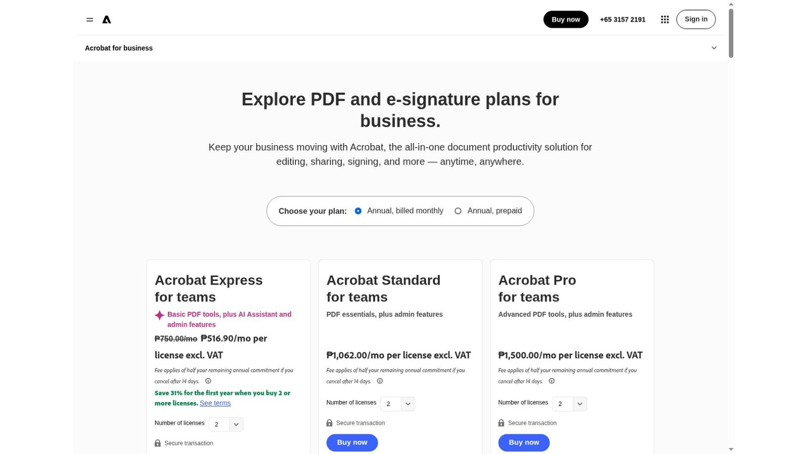
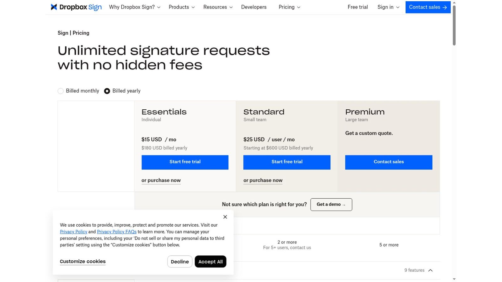
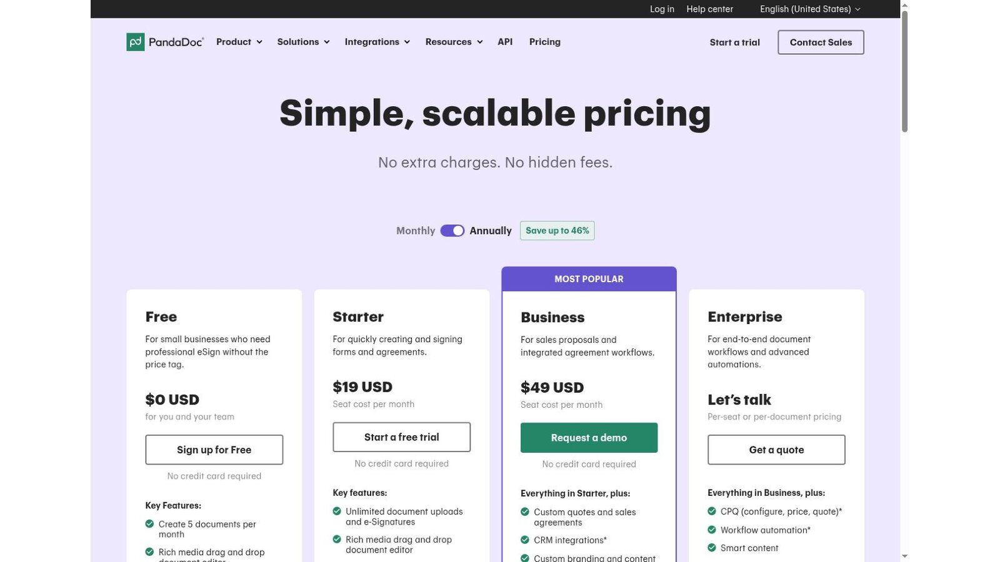
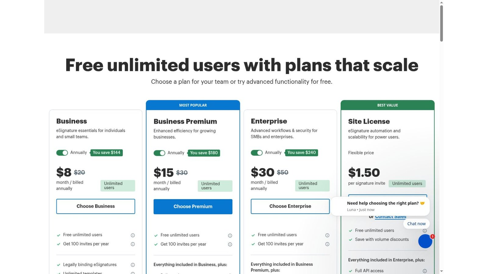
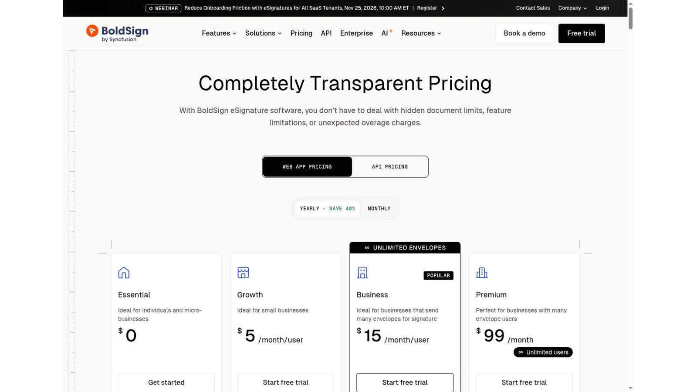
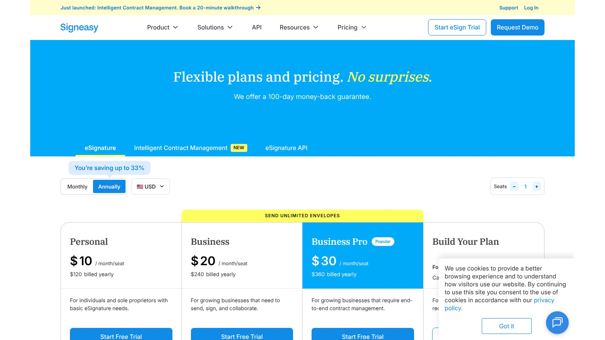
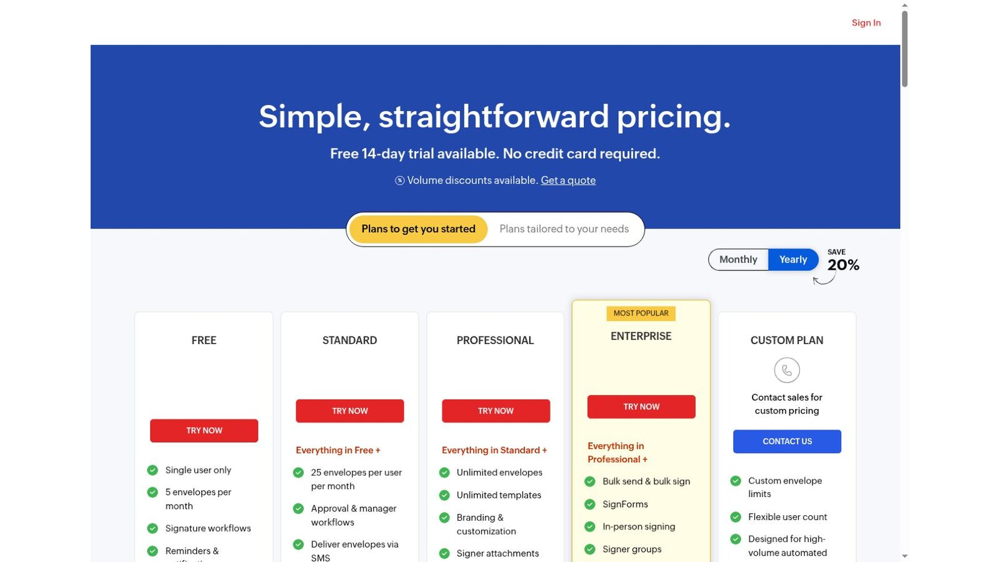
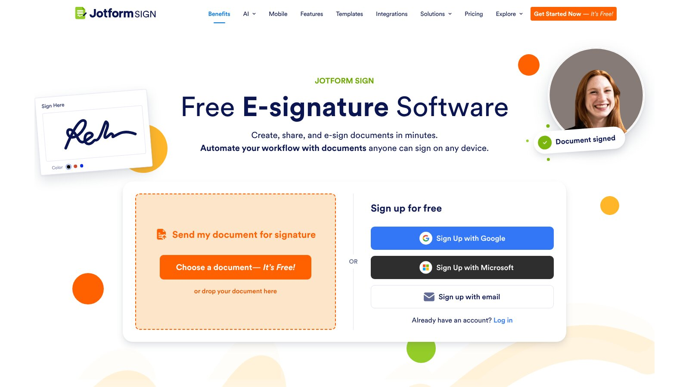
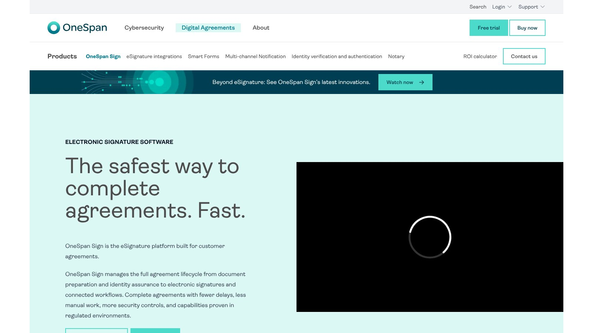

# 9 Best DocuSign Alternatives for Legal and Business Teams

The best DocuSign alternatives depend on what your team signs and how much proof it needs to keep. Adobe Acrobat suits firms that already live in PDFs. Dropbox Sign, Signeasy, and signNow publish simple per-seat plans. BoldSign and PandaDoc fit teams that sign from a developer workflow or a sales proposal. Zoho Sign, Jotform Sign, and OneSpan Sign each solve a narrower problem well.

Every price below comes from the vendor's own pricing page, checked on November 20, 2026. Plans change often, so treat the figures as a dated snapshot and confirm them before you buy.

## Key Takeaways

* **Start with volume, not price:** DocuSign's Standard plan allows 100 envelopes per user per year, while several DocuSign alternatives advertise unlimited sending on their mid-tier plans.
* **Compare the same unit:** Vendors price per seat, per signed document, or per envelope, so a low headline rate can cost more at your real volume.
* **Check the audit trail:** Dropbox Sign, PandaDoc, BoldSign, and OneSpan all name an audit trail on their pricing or product pages.
* **Signer verification is often extra:** BoldSign charges $2 per ID verification, and PandaDoc includes it only on Business and Enterprise.
* **Regulated work needs the enterprise tier:** Adobe says its Acrobat Standard and Pro e-signatures do not offer the same level of compliance as Acrobat Sign Solutions.

## Quick Comparison

The table lists the lowest published paid rate on annual billing unless noted. "Quote" means the vendor asks you to contact sales.

| Tool | Best fit | Lowest published paid plan | Sending limit on that plan |
| --- | --- | --- | --- |
| Adobe Acrobat | PDF-heavy firms | $16.99 per license per month (Standard for teams) | Not stated on the page |
| Dropbox Sign | Small teams | $15 per month for one user (Essentials) | Unlimited signature requests |
| PandaDoc | Proposals and quotes | $25 per seat per month (Starter) | Unlimited documents created in the app |
| signNow | Budget team plans | $8 per month (Business) | 100 invites per year |
| BoldSign | Developers and APIs | $15 per user per month (Business) | Unlimited envelopes |
| Signeasy | Mobile signing | $10 per seat per month (Personal) | 5 envelopes per month |
| Zoho Sign | Zoho customers | Price not captured; per user, billed annually | 25 envelopes per user per month (Standard) |
| Jotform Sign | Forms that end in a signature | $39 per month or $408 per year (Bronze) | 100 signed documents per month |
| OneSpan Sign | High-control enterprise signing | $22 per user per month (Professional) | Not stated on the page |

For reference, the [DocuSign eSignature page](https://www.docusign.com/products/electronic-signature) lists Personal at $10 per month with 5 envelopes a month, Standard at $25 per user per month, and Business Pro at $40 per user per month. Standard and Business Pro each include 100 envelopes per user per year.

## How We Chose These DocuSign Alternatives

We started with nine tools named in our November 2026 topic plan, then opened each vendor's official pricing or product page on November 20, 2026. We kept only the prices, limits, and features shown on those pages or in an official screenshot captured the same day. Where a page did not show a figure, the table says so instead of guessing.

Every one of these DocuSign alternatives was judged on the same published facts. This is desk research, not a hands-on test. We did not open paid accounts, and the order reflects best-fit use cases, not a measured score. Our [legal technology statistics](/legal-tech/legal-technology-statistics/) page covers how widely law firms adopt tools like these.

## 1. Adobe Acrobat: Best for PDF-Heavy Firms

Adobe sells e-signatures inside its Acrobat team plans. Acrobat Standard for teams costs US$16.99 per license per month on an annual plan billed monthly, or US$203.88 per year prepaid. Acrobat Pro for teams costs US$23.99 per month, or US$287.88 per year. Both plans say they keep records and audit trails.

Pro adds bulk e-signature requests, password and security certification, and integrations with Microsoft and Box. Adobe also states that the Standard and Pro e-signatures do not offer the same level of compliance as Acrobat Sign Solutions, its enterprise product sold through sales.

**Best fit:** PDF-heavy firms. Our [DocuSign vs Adobe Sign](/legal-tech/docusign-vs-adobe-sign/) comparison goes deeper.

**Questions to ask:** Which signer authentication options are in your plan? Does the work need Acrobat Sign Solutions instead? What happens if you cancel mid-term? Adobe's monthly-billed plans charge half of the remaining annual commitment after 14 days.

## 2. Dropbox Sign: Best for Small Teams

The [Dropbox Sign pricing page](https://sign.dropbox.com/products/dropbox-sign/pricing) lists Essentials for one user at $15 per month, or $180 billed yearly. Standard, for two or more users, costs $25 per user per month on monthly billing or $17.50 per user per month billed yearly. Premium, for five or more users, is quoted.

Dropbox Sign advertises unlimited signature requests. It also lists templates, non-editable audit trails that time-stamp each action, SMS identity verification, bulk send, single sign-on, and an admin console.

**Best fit:** Small teams that want predictable per-seat pricing without per-envelope counting.

**Questions to ask:** Which features sit on Standard rather than Premium? Is SMS verification enough for your matters?

## 3. PandaDoc: Best for Proposals and Quotes

PandaDoc builds signing into documents such as proposals and quotes. Its pricing page lists a free plan with 5 documents a month, Starter at $25 per seat per month billed annually ($45 monthly), and Business at $49 per seat per month billed annually ($65 monthly). Enterprise is quoted per seat or per document.

Starter includes unlimited document uploads and e-signatures. Business adds unlimited templates, approval workflows, and knowledge-based authentication with ID verification. Every plan lists an audit trail. API use runs on prepaid usage credits.

**Best fit:** Firms and businesses that send engagement proposals or quotes and want the price table and signature in one document.

**Questions to ask:** Does your workflow need Business-tier identity checks? How many API credits would your volume use?

## 4. signNow: Best Low-Cost Team Plans

The official signNow pricing page, captured November 20, 2026, shows Business at $8 per month billed annually, Business Premium at $15, and Enterprise at $30. A Site License costs $1.50 per signature invite. Every plan advertises free unlimited users, and the three standard plans show 100 invites per year.

The page shows struck-through higher prices next to the annual rates, so confirm which price applies after any first term.

**Best fit:** Teams that need many users but send a modest number of invites each year.

**Questions to ask:** What does an invite count as? What is the renewal price after the first year?

## 5. BoldSign: Best for Developers and APIs

The [BoldSign pricing page](https://boldsign.com/pricing/) says Business costs $15 per user per month and Premium costs $99 per month, both billed yearly. Business includes unlimited envelopes. Premium includes unlimited users and 250 envelopes a month, then $0.50 per extra envelope.

For developers, the Enterprise API plan costs $0.75 per envelope and starts at $30 a month with 40 envelopes included. A free sandbox lets teams test the API, with watermarked documents deleted after 14 days. ID verification is a $2 add-on per verification, and every plan lists an audit trail with complete document history.

**Best fit:** Teams that want to embed signing in their own client portal or intake system.

**Questions to ask:** What are the API rate limits? Where is data stored?

## 6. Signeasy: Best for Mobile Signing

Signeasy lists Personal at $10 per seat per month ($120 billed yearly), Business at $20 per seat per month ($240 yearly), and Business Pro at $30 per seat per month ($360 yearly). Personal allows 5 envelopes a month. Business and Business Pro allow unlimited envelopes, subject to fair usage.

The page highlights iPhone, iPad, and Android apps, two-factor login, and integrations with Google Workspace, Microsoft, HubSpot, SharePoint, and OneDrive. HIPAA compliance appears as an option for healthcare teams.

**Best fit:** Lawyers and staff who approve documents from a phone or tablet.

**Questions to ask:** What counts as fair usage? Is HIPAA support an add-on cost?

## 7. Zoho Sign: Best for Zoho Customers

Zoho Sign offers Free, Standard, Professional, and Enterprise plans, priced per user per month and billed annually with 20% off yearly. We could not capture the dollar amounts, so check them on the page. Free allows one user and 5 envelopes a month. Standard allows 25 envelopes per user per month. Professional and Enterprise are unlimited.

Zoho Sign lists signer identity checks by email or SMS code, government ID, and knowledge-based questions. Even the Free plan includes an audit trail and certificate of completion. Enterprise adds controls for 21 CFR Part 11 and EU GMP Annex 11. Some features use separate credits.

**Best fit:** Organizations already using Zoho's business apps.

**Questions to ask:** Which identity checks use credits? What do credits cost at your volume?

## 8. Jotform Sign: Best for Forms That End in a Signature

Jotform prices by signed documents per month on single-user plans. Starter is free with 10. Bronze costs $39 a month or $408 a year for 100, Silver $49 or $468 for 250, and Gold $129 or $1,188 for 1,000. Enterprise is custom and multi-user.

Jotform lists more than 1,000 templates, a mobile app, and approvals. Its pricing page shows HIPAA features on Gold and Enterprise.

**Best fit:** Intake teams that collect information in a form and need a signature at the end.

**Questions to ask:** Does HIPAA coverage extend to the signing product? How would multiple users work below Enterprise?

## 9. OneSpan Sign: Best for High-Control Enterprise Signing

OneSpan Sign lists a Professional plan at $22 per user per month billed yearly, with volume-based Enterprise pricing on request. It offers a 30-day trial, reusable templates, and bulk sending.

OneSpan describes a tamper-sealed audit trail that records identity verification, authentication, signing, and document validation in one place. Its FAQ says the platform meets standards including HIPAA, SOC 2 Type 2, and FedRAMP. Some advanced identity features were marked "coming soon" on the page, so confirm what is live.

**Best fit:** Regulated organizations that need strong agreement evidence and are ready for an enterprise contract.

**Questions to ask:** Which identity checks are available today? How is Enterprise volume priced?

## What 300 Envelopes a Year Costs on Three Plans

A five-person team that sends about 300 envelopes a year shows why the unit matters.

| Plan | How it is priced | Year-one cost | Covers 300 envelopes? |
| --- | --- | --- | --- |
| DocuSign Standard | $25 per user per month, annual | $1,500 | Yes (500 included across 5 users) |
| Dropbox Sign Standard | $17.50 per user per month, billed yearly | $1,050 | Yes (unlimited requests) |
| BoldSign Business | $15 per user per month, billed yearly | $900 | Yes (unlimited envelopes) |

These are list prices before tax, add-ons, and identity checks. A team that needs ID verification on every envelope would add $600 a year on BoldSign at $2 each.

## Choose by Workflow, Not Feature Count

Most DocuSign alternatives handle a basic signature well. The differences show up in the work around it.

### Signing Only

If your team sends finished PDFs for signature, look at Adobe Acrobat, Dropbox Sign, Signeasy, or signNow. Compare the per-seat price and the sending limit.

### Documents That Need Building

If the document is assembled before it is signed, PandaDoc and Jotform Sign build the content and the signature in one flow. Firms with heavier drafting needs should also review [legal document automation software](/legal-tech/best-legal-document-automation-software/).

### Embedded or Regulated Signing

If signing must sit inside your own portal, BoldSign's API plan is built for that. If regulators will review the record, look at OneSpan Sign, Zoho Sign Enterprise, or Acrobat Sign Solutions.

## A Practical Switching Checklist

Moving to one of these DocuSign alternatives takes more than a new login. Plan the move before the renewal date.

### Before You Sign a Contract

Gather three facts first.

* **Count your real volume:** Pull last year's envelope count, users, and templates.
* **List required checks:** Note which matters need SMS, ID, or knowledge-based verification.
* **Price the same unit:** Convert every quote to cost per envelope at your volume.

Ask each vendor to quote against those three facts in writing.

### Before You Switch Off DocuSign

Then protect your records.

* **Export completed agreements:** Download signed documents and their certificates of completion.
* **Rebuild templates:** Recreate fields, signing order, and reminders in the new tool.
* **Test one live matter:** Run a real signing with a colleague before moving client work.

## Frequently Asked Questions

### What Is the Best DocuSign Alternative?

There is no single best option. Dropbox Sign and signNow suit small teams on a budget, Adobe Acrobat suits PDF-heavy firms, BoldSign suits developers, and OneSpan Sign suits regulated enterprises.

### Is There a Free DocuSign Alternative?

Yes, with limits. PandaDoc's free plan allows 5 documents a month, Zoho Sign's allows 5 envelopes for one user, BoldSign's allows 25 envelopes, and Jotform's allows 10 signed documents.

### Are DocuSign Alternatives Legally Binding?

The vendors describe their signatures as legally binding, and most keep an audit trail of each action. Whether a signature holds up depends on the law and the signing process, so ask a lawyer for regulated or high-stakes documents.

### Which DocuSign Alternatives Have Unlimited Sending?

Dropbox Sign advertises unlimited signature requests, BoldSign Business offers unlimited envelopes, and Signeasy Business allows unlimited envelopes under fair usage. Zoho Sign Professional and Enterprise are also unlimited.

### Is This a Hands-On Test?

No. This guide compares the published prices and features of nine DocuSign alternatives from official pages checked on November 20, 2026. We did not test the products with paid accounts.

## Resources

* [DocuSign eSignature plans](https://www.docusign.com/products/electronic-signature)
* [Adobe Acrobat business pricing](https://www.adobe.com/acrobat/business/pricing-plans.html)
* [Dropbox Sign pricing](https://sign.dropbox.com/products/dropbox-sign/pricing)
* [PandaDoc pricing](https://www.pandadoc.com/pricing/)
* [signNow pricing](https://www.signnow.com/pricing)
* [BoldSign pricing](https://boldsign.com/pricing/)
* [Signeasy pricing](https://signeasy.com/pricing)
* [Zoho Sign pricing](https://www.zoho.com/sign/pricing.html)
* [Jotform Sign](https://www.jotform.com/products/sign/) and [Jotform pricing](https://www.jotform.com/pricing/)
* [OneSpan Sign](https://www.onespan.com/products/esignature)

All prices and features were checked against official vendor pages on November 20, 2026. Prices exclude tax and can change.
