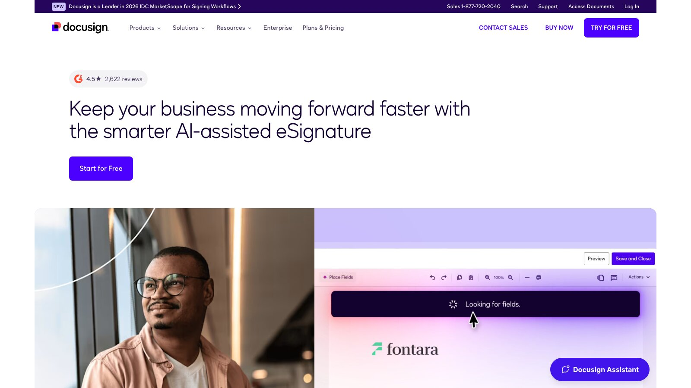
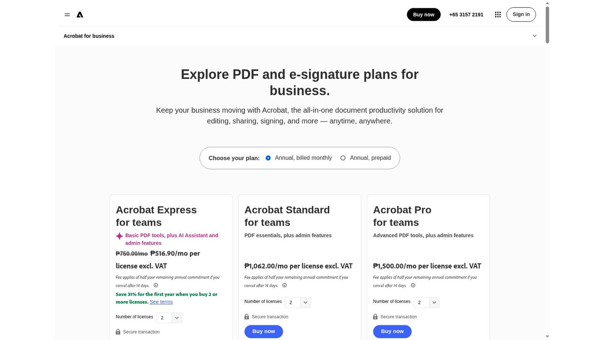

# DocuSign vs Adobe Sign for Legal and Business Teams

DocuSign vs Adobe Sign comes down to where your work starts. If your team mainly routes agreements for signature, DocuSign's plans are built around envelopes, templates, and signing workflows. If your team edits, redacts, and assembles PDFs before anyone signs, Adobe Acrobat puts signing inside the tool you already use. For regulated or high-volume work, both push you toward an enterprise plan sold through sales.

Prices below come from each company's own pages, checked on November 20, 2026. They change often, so confirm them before you buy.

## Key Takeaways

* **Entry prices are close:** DocuSign Standard costs $25 per user per month on annual billing, while Adobe Acrobat Pro for teams costs US$23.99 per license per month on an annual plan billed monthly.
* **DocuSign caps sending:** Standard and Business Pro include 100 envelopes per user per year, and extra envelopes are billed per envelope.
* **Adobe bundles PDF tools:** Acrobat team plans include PDF editing and e-signatures, with bulk requests on Pro.
* **Advanced features sit higher up:** DocuSign puts bulk send, payments, signer attachments, and PowerForms on Business Pro.
* **Compliance needs the enterprise tier:** Adobe says Acrobat Standard and Pro do not offer the same compliance level as Acrobat Sign Solutions, and DocuSign lists HIPAA, FedRAMP, and 21 CFR Part 11 support as contact-sales items.

## DocuSign vs Adobe Sign at a Glance

The table compares the plans most small and mid-sized legal teams look at first.

| Question | DocuSign eSignature | Adobe Acrobat for teams |
| --- | --- | --- |
| Entry team plan | Standard, $25 per user per month billed annually | Acrobat Standard, US$16.99 per license per month |
| Plan with advanced sending | Business Pro, $40 per user per month billed annually | Acrobat Pro, US$23.99 per license per month |
| Sending limit | 100 envelopes per user per year | Not stated on the pricing page |
| PDF editing included | No | Yes |
| Bulk sending | Business Pro | Acrobat Pro |
| Enterprise option | Enhanced plans and Enterprise Pro, through sales | Acrobat Sign Solutions, through sales |

Adobe prices are for an annual commitment billed monthly. Adobe also sells prepaid annual plans at US$203.88 per year for Standard and US$287.88 for Pro.

## How We Compared DocuSign and Adobe Sign

We read each vendor's public plan and pricing pages on November 20, 2026, and kept only what those pages stated. Adobe's separate Acrobat Sign Solutions page did not load during our check, so we describe that product only through what Adobe's pricing page says about it.

This is desk research, not a hands-on test. We did not buy either product, run a timed trial, or review private contracts. For a wider shortlist that includes Dropbox Sign, BoldSign, and PandaDoc, compare these [DocuSign alternatives](/legal-tech/docusign-alternatives/).

## DocuSign eSignature: Plans and Features

DocuSign sells eSignature as a standalone product with three self-serve tiers and enterprise plans above them. The [DocuSign eSignature plans page](https://ecom.docusign.com/plans-and-pricing/esignature) lists Personal, Standard, and Business Pro, plus Enhanced plans through sales.

### Prices and Envelope Limits

DocuSign's product page lists Personal at $10 per month, Standard at $25 per user per month, and Business Pro at $40 per user per month on annual billing. Its plans page shows $11, $30, and $45 for the same tiers when an annual plan is billed monthly.

Personal allows 5 envelopes a month. Standard and Business Pro allow up to 100 envelopes per user per year, or 10 per user per month on monthly plans. DocuSign bills extra envelopes on a pay-as-you-go basis.

### What Each Tier Adds

Every tier includes reusable templates, reminders, a real-time audit trail, and mobile signing. Standard adds shared templates, real-time commenting, custom branding, delegated signing, scheduled sending, in-person signing, and team reports. It also includes a one-time bonus of 5 SMS deliveries and 5 identity verifications.

Business Pro adds bulk send, payment collection during signing, signer attachments, PowerForms, and drop-down and radio fields. DocuSign says its payments feature is only available on Business Pro and Enhanced plans. Its developer account and APIs are listed from Business Pro upward.

### What Needs a Sales Call

The plans table lists conditional routing, data residency, a HIPAA business associate agreement, FedRAMP, 21 CFR Part 11, and access management with single sign-on as contact-sales items. Legal teams with regulated clients should expect a quote, not a self-serve plan.

## Adobe Acrobat: Plans and Features

Adobe sells e-signatures inside its Acrobat team subscriptions. The [Adobe Acrobat business pricing page](https://www.adobe.com/acrobat/business/pricing-plans.html) lists Acrobat Standard for teams and Acrobat Pro for teams, with Acrobat Sign Solutions available through sales.

### Prices and Terms

Acrobat Standard for teams costs US$16.99 per license per month on an annual plan billed monthly, or US$203.88 per year prepaid. Acrobat Pro for teams costs US$23.99 per month, or US$287.88 per year. The pricing page does not state a cap on signature requests.

Adobe's terms matter for budgeting. On plans billed monthly, cancelling after 14 days triggers a fee of half the remaining annual commitment. Prepaid plans are not refunded after 14 days.

### What Each Plan Adds

Acrobat Standard lets teams collect e-signatures and track responses. Acrobat Pro adds bulk e-signature requests, password and security certification, and e-signature integrations with Microsoft and Box. Both plans keep records and audit trails.

### Where Acrobat Sign Solutions Fits

Adobe states that the e-signatures in Acrobat Standard and Pro do not offer the same level of compliance as Acrobat Sign Solutions. Its FAQ describes Sign Solutions as adding advanced signer authentication, industry-specific compliance certification, and workflow standardization and automation. Pricing is by quote.

## Price Comparison for a Five-Lawyer Team

The difference between DocuSign vs Adobe Sign widens with volume. Here is a five-person team on each vendor's mid-tier plan at list price.

| Plan | Annual list cost for 5 users | Envelope allowance |
| --- | --- | --- |
| DocuSign Standard, billed annually | $1,500 | 500 envelopes a year in total |
| DocuSign Business Pro, billed annually | $2,400 | 500 envelopes a year in total |
| Adobe Acrobat Standard for teams, prepaid | $1,019.40 | Not stated |
| Adobe Acrobat Pro for teams, prepaid | $1,439.40 | Not stated |

If the team sends more than 500 envelopes a year, DocuSign's pay-as-you-go charges are added on top. Adobe's page names no sending cap, so ask Adobe in writing whether one applies to your plan.

## Which One Fits Your Workflow?

Price matters less than how your team handles a document before it is signed.

### Choose DocuSign If

DocuSign suits teams whose main job is routing finished agreements. Its tiers add collaboration, branding, delegated signing, and bulk sending in clear steps. Firms that collect retainers at signing may value Business Pro's payment collection, though they should confirm how payments interact with trust account rules.

### Choose Adobe Acrobat If

Adobe suits teams that already draft, combine, redact, and review PDFs. Signing sits next to those tools, so staff do not switch products. Acrobat Pro's bulk requests and Microsoft and Box integrations cover many small-firm needs at a lower list price.

### Consider the Enterprise Options If

Both vendors reserve their strongest compliance and identity features for enterprise plans. If clients require a HIPAA business associate agreement, FedRAMP, or 21 CFR Part 11 controls, request written quotes from both and compare the same requirements line by line.

## Are Electronic Signatures Legally Binding?

For most U.S. transactions, yes. The federal [ESIGN Act, 15 U.S.C. 7001](https://www.law.cornell.edu/uscode/text/15/7001), says a signature or contract relating to a transaction in interstate commerce may not be denied legal effect, validity, or enforceability solely because it is electronic.

The same section adds a consumer consent rule. Where a law requires a consumer to receive information in writing, an electronic record satisfies that rule only if the consumer has affirmatively consented, after the required disclosures. Firms sending consumer documents should build that consent step into the workflow, whichever product they choose. State law and some document types can add rules, so confirm the requirements for your matters.

## DocuSign vs Adobe Sign for Common Legal Tasks

The same firm can lean toward different tools for different documents. The table maps common legal tasks to the published features that matter most for each.

| Task | What matters most | Leaning |
| --- | --- | --- |
| Engagement letters | Templates, reminders, and a clean completion record | Either; both include templates and audit trails |
| Retainer collection at signing | Payment collection inside the signing step | DocuSign Business Pro or Enhanced |
| Redacted or assembled PDFs | Editing and redaction before sending | Adobe Acrobat |
| Bulk client notices | Sending one document to many recipients | DocuSign Business Pro or Acrobat Pro |
| Consumer disclosures | ESIGN consent step and a stored record | Either, with a consent step built in |
| Regulated client work | HIPAA, FedRAMP, or 21 CFR Part 11 terms | Enterprise plans from either vendor |

The sections below explain how DocuSign vs Adobe Sign plays out for three of these jobs.

### Engagement Letters and Fee Agreements

Most firms send the same few engagement letters again and again. In DocuSign vs Adobe Sign terms, both handle this well: each offers reusable templates and keeps an audit trail. DocuSign Standard adds shared templates and custom branding, which helps when several lawyers send the same letter under the firm's name.

### Documents That Need Work Before Signing

Settlement agreements, closing packages, and court-ready exhibits often need redaction, page assembly, or conversion first. Adobe Acrobat handles that work and the signature in one product. A DocuSign user would prepare the PDF in another tool, then upload it.

### High-Volume or Regulated Sending

Firms that send hundreds of envelopes a year should model DocuSign's 100-envelope-per-user allowance against real volume before choosing it. Firms with regulated clients should skip the self-serve comparison and request enterprise quotes from both vendors, because the compliance features they need sit on those plans.

## Questions to Ask Before You Sign

Ask both vendors the same questions in writing so the answers line up.

### About Price and Volume

These questions keep the quote honest.

* **Sending limits:** How many envelopes or signature requests does the plan include, and what does each extra one cost?
* **Billing terms:** What are the cancellation and renewal terms for monthly-billed annual plans?
* **Seat rules:** Who needs a paid seat, and do signers ever need one?

Put the answers side by side before you look at features.

### About Records and Security

These questions protect the client file.

* **Audit trail:** What does the completion certificate record, and how is it exported?
* **Identity checks:** Which signer verification methods are included, and which cost extra?
* **Data control:** Where are documents stored, and how long are they kept after cancellation?

A short pilot settles the rest. Send the same engagement letter and consent form through both products and compare setup time, the signer's experience, and the exported record. Our [legal technology statistics](/legal-tech/legal-technology-statistics/) show how widely firms already rely on cloud tools like these.

## Frequently Asked Questions

### Is Adobe Sign Cheaper Than DocuSign?

At list price for a team, usually. Adobe Acrobat Standard for teams costs US$16.99 per license per month, while DocuSign Standard costs $25 per user per month on annual billing. Compare the plans your team would need, including any sending limits.

### Does Adobe Acrobat Include Adobe Sign?

Acrobat Standard and Pro for teams include e-signature collection. Adobe sells Acrobat Sign Solutions separately for advanced authentication, compliance certification, and workflow automation.

### How Many Envelopes Does DocuSign Include?

Personal includes 5 envelopes a month. Standard and Business Pro include up to 100 envelopes per user per year on annual plans, with extra envelopes billed per envelope.

### Which Is Better for Law Firms, DocuSign or Adobe Sign?

There is no single answer to DocuSign vs Adobe Sign. Firms that live in PDFs often prefer Adobe Acrobat. Firms that route many agreements with branding, delegation, and bulk sending often prefer DocuSign. Regulated practices should compare both vendors' enterprise plans.

### Is This a Hands-On Test?

No. This comparison uses each vendor's published pages, checked on November 20, 2026. We did not test the products with paid accounts.

## Resources

* [DocuSign eSignature plans and pricing](https://ecom.docusign.com/plans-and-pricing/esignature)
* [DocuSign eSignature product page](https://www.docusign.com/products/electronic-signature)
* [Adobe Acrobat business pricing](https://www.adobe.com/acrobat/business/pricing-plans.html)
* [15 U.S.C. 7001, Legal Information Institute](https://www.law.cornell.edu/uscode/text/15/7001)

All prices and features were checked against official pages on November 20, 2026. Prices exclude tax and can change.
