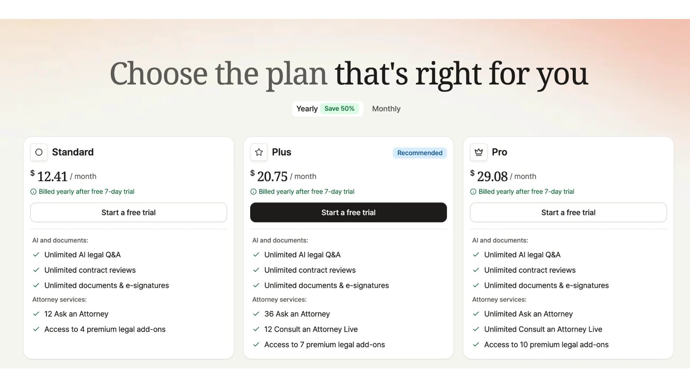
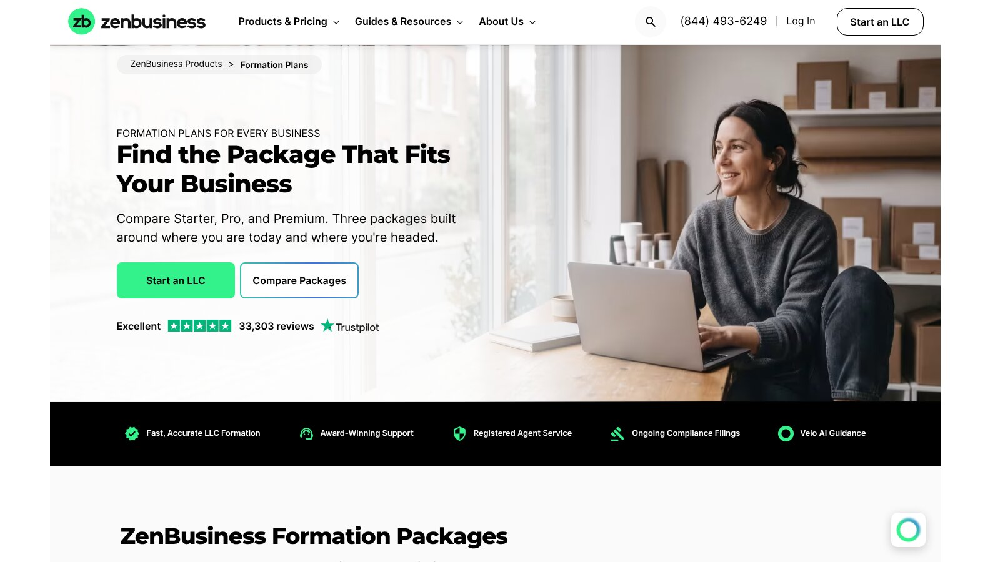
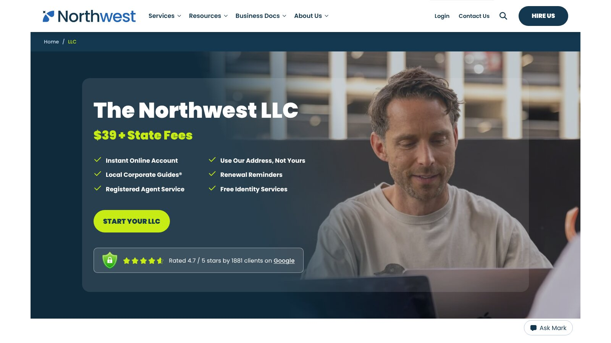
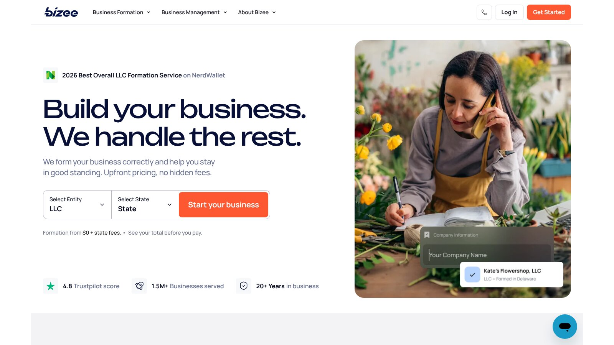
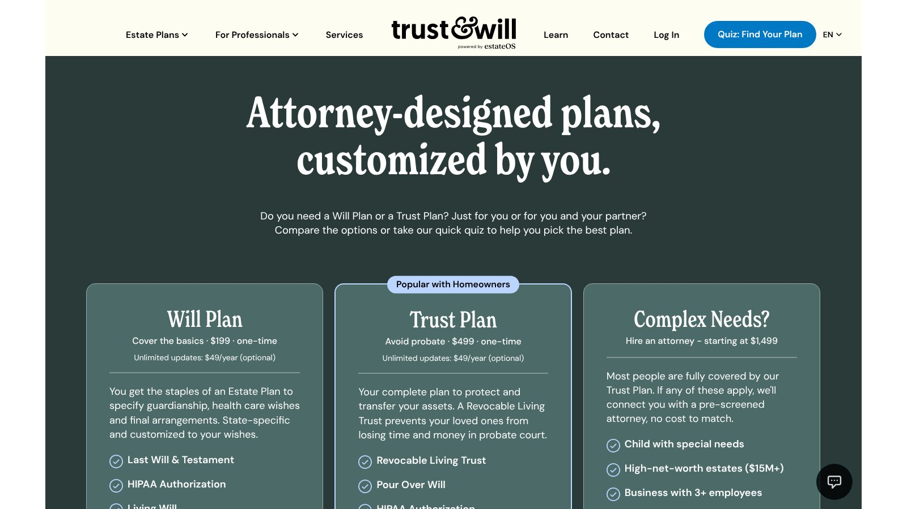
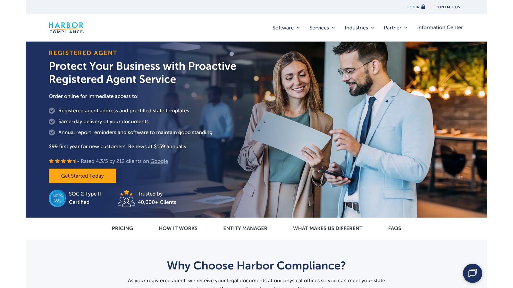
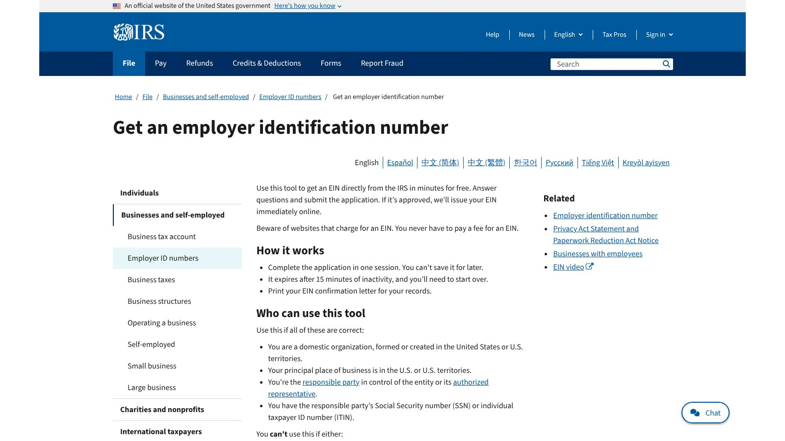
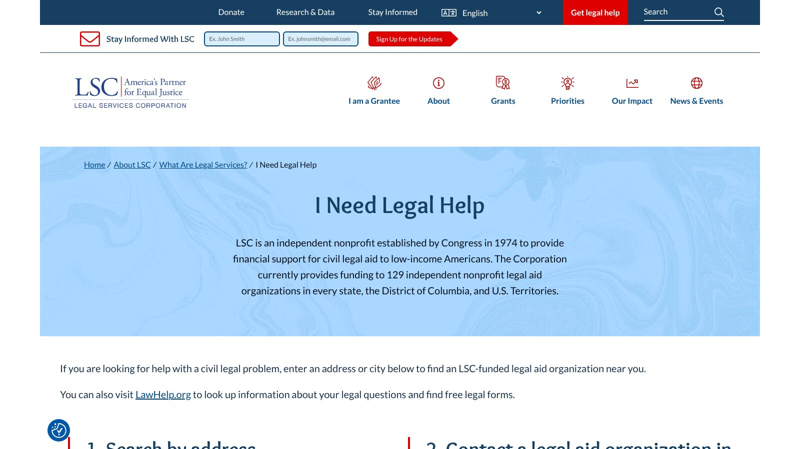

# 8 Best LegalZoom Alternatives by Legal Task and Service Type

The best LegalZoom alternatives depend on the job in front of you. Rocket Lawyer suits people with repeat document and attorney questions. ZenBusiness, Bizee, and Northwest focus on forming a business. Harbor Compliance handles multistate filings. Trust & Will covers wills and trusts. The IRS and Legal Services Corporation offer free official routes that no paid service can beat on price.

Every price below comes from the vendor's own page, checked on November 20, 2026. Treat the figures as a dated snapshot and confirm them before you pay.

## Key Takeaways

* **Pick by task, not brand:** LegalZoom sells formation, documents, estate plans, and attorney plans, while most LegalZoom alternatives specialize in one or two of those jobs.
* **The EIN is always free:** The IRS says you never have to pay a fee for an EIN, so any package price for one buys convenience only.
* **State fees sit on top:** LegalZoom, ZenBusiness, Bizee, and Northwest all list their formation price plus state fees.
* **Renewals change the math:** ZenBusiness charges $199 a year for registered agent service, and Harbor Compliance renews at $159 after a $99 first year.
* **Attorney access varies widely:** Rocket Lawyer's Standard plan includes 12 Ask an Attorney questions, while Pro includes unlimited questions and live consultations.

## Quick Comparison

The table shows the lowest published price for each option's main service. "Free" means the official route charges no service fee.

| Option | Best for | Lowest published price | What sits on top |
| --- | --- | --- | --- |
| Rocket Lawyer | Repeat documents and attorney questions | $149 per year (Standard) | Advice sessions from $149 |
| ZenBusiness | Guided LLC formation | $0 (Starter) | State fees; $199 per year registered agent |
| Northwest Registered Agent | Privacy-first formation | $39 | State fees |
| Bizee | Budget formation with a free first-year agent | $0 (Basic) | State fees; agent renewal |
| Trust & Will | Wills and trusts | $199 (Will Plan) | $299 attorney support add-on |
| Harbor Compliance | Multistate compliance | $99 first-year registered agent | Renews at $159 per year |
| IRS online EIN | Getting a tax ID | Free | Nothing |
| LSC-funded legal aid | Low-income civil legal help | Free | Eligibility rules |

For context, LegalZoom's own LLC page lists Basic at $0, Pro at $249, and Premium at $299, each plus state filing fees.

## How We Chose These LegalZoom Alternatives

We started from the tasks people most often bring to LegalZoom: forming a company, keeping a registered agent, writing a will, asking a lawyer, and staying compliant. We then opened each official page on November 20, 2026, and kept only what those pages state.

This is desk research, not a hands-on test. We did not buy any plan. The order follows use cases, not a measured score. Nolo was on our first list, but its site blocked our access, so we left it out rather than describe it from memory. If you want the full LegalZoom picture first, read our [LegalZoom review](/legal-business/legalzoom-review/).

## 1. Rocket Lawyer: Best for Repeat Legal Questions

Rocket Lawyer works as a membership rather than a one-time purchase. Its pricing page lists three yearly plans: Standard at $149, Plus at $249, and Pro at $349. Monthly billing costs $34.99, $49.99, and $64.99. Each plan starts with a free seven-day trial.

All three plans include unlimited documents and e-signatures. The attorney limits differ. Standard includes 12 Ask an Attorney questions. Plus raises that to 36 and adds 12 live consultations. Pro makes both unlimited.

The [Rocket Lawyer pricing page](https://www.rocketlawyer.com/pricing) also lists add-ons. Your first business registration is free, then $99 plus state fees. Registered agent service costs $125 a year on Plus and Pro.

**Best fit:** Small business owners and households who expect several legal documents or questions each year. Our [LegalZoom vs Rocket Lawyer](/legal-business/legalzoom-vs-rocket-lawyer/) comparison prices both side by side.

**Questions to ask:** How many attorney questions will you really use? Does your matter need a full legal advice session, which costs $149 for 30 minutes?

## 2. ZenBusiness: Best for Guided Formation

ZenBusiness publishes three formation packages. Starter costs $0, Pro costs $199, and Premium costs $299, all plus state fees. Pro and Premium renew each year at the same price.

The [ZenBusiness formation plans page](https://www.zenbusiness.com/pricing-formation-plans/) shows that Starter uses standard processing of 7 to 10 business days, with a $79 rush upgrade. Starter includes Worry-Free Compliance free for the first year, then $199 a year. Pro adds one-day processing, an operating agreement template, and an EIN filing.

Registered agent service is not inside any package. ZenBusiness lists it separately at $199 a year.

**Best fit:** Founders who want reminders and compliance filings bundled with formation. Our [ZenBusiness vs LegalZoom](/legal-business/zenbusiness-vs-legalzoom/) comparison sets the two side by side.

**Questions to ask:** What will the second year cost once renewals start? Do you need the EIN filing, or can you get it free from the IRS?

## 3. Northwest Registered Agent: Best for Privacy

Northwest keeps its offer simple. Its LLC page lists one package at $39 plus state fees. That package includes registered agent service, renewal reminders, and use of Northwest's address in place of yours.

Privacy is the main pitch. Northwest says it will "never, ever sell your data to third parties" and that this protection is automatic. The page does not show the registered agent renewal price in its visible text, so check it before you buy.

**Best fit:** Owners who do not want a home address on public business filings.

**Questions to ask:** What will the registered agent cost after the first year? Which address services does your state accept?

## 4. Bizee: Best Budget Formation

Bizee lists three packages on its homepage. Basic costs $0, Standard costs $199, and Premium costs $299, each plus a state fee. Every package includes the first year of registered agent service.

Standard adds an EIN, an operating agreement, and S corporation election filing. Premium adds expedited filing, business contracts, and a domain with business email. Bizee says state fees "are separate and vary by state."

**Best fit:** Budget-minded founders who want the first year of agent service included.

**Questions to ask:** What does the registered agent renew at after year one? The FAQ says it renews "at their own price" without naming a figure.

## 5. Trust & Will: Best for Estate Plans

Trust & Will focuses on estate planning instead of business filings. Its Will Plan starts at $199, and its Trust Plan starts at $499. Attorney Support costs $299 more. An optional membership costs $49 a year.

For complex estates, Trust & Will points people to an attorney, starting at $1,499. Examples include children with special needs and estates above $15 million. The site also states that it is not a law firm and does not give legal advice.

**Best fit:** People with straightforward wills or revocable trusts. See our [Trust & Will vs LegalZoom](/legal-business/trust-and-will-vs-legalzoom/) comparison for a closer look.

**Questions to ask:** Does your state have rules on witnesses or notarization that you must follow after you download the documents?

## 6. Harbor Compliance: Best for Multistate Compliance

Harbor Compliance serves businesses that operate in several states. Its services include foreign qualification, annual reports, business licenses, and registered agent coverage. It also sells compliance software.

Its registered agent page lists $99 for the first year for new customers, renewing at $159 a year. The price includes same-day document delivery and its Entity Manager software. Harbor says it does not provide tax, financial, or legal advice.

**Best fit:** Companies registered in more than one state. Our list of the [best registered agent services](/legal-business/best-registered-agent-services/) compares more providers.

**Questions to ask:** Which states do you need covered, and does each one carry a separate fee?

## 7. IRS Online EIN: Best Free Tax ID Route

You do not need a paid service to get an Employer Identification Number. The [IRS EIN page](https://www.irs.gov/businesses/small-businesses-self-employed/get-an-employer-identification-number) says you can apply online "in minutes for free" and warns readers to beware of websites that charge for one.

The IRS sets a few rules. If you are forming an LLC or corporation, form it with your state first. The online session must be finished in one sitting. It expires after 15 minutes of inactivity. You can get only one EIN per responsible party per day.

**Best fit:** Anyone who can handle a short online form and wants to skip a fee.

**Questions to ask:** Has your state approved your entity yet? You need that before you apply.

## 8. LSC-Funded Legal Aid: Best Free Help for Low-Income Households

Some readers compare LegalZoom alternatives because they cannot afford a lawyer at all. The Legal Services Corporation is an independent nonprofit set up by Congress in 1974. It funds 129 independent nonprofit legal aid organizations in every state, the District of Columbia, and U.S. territories.

Its Get Legal Help page lets you search by address for a funded legal aid office near you. It also points to LawHelp.org for free legal information and forms. Each office sets its own eligibility rules.

**Best fit:** Low-income households facing a civil legal problem.

**Questions to ask:** Does the local office handle your type of case, and do you meet its income rules?

## Match the Task to the Right Service

Most people do not need one company for everything. The sections below pair common tasks with the options above. That approach often costs less than a bundle.

### Forming a Business

For a basic LLC, compare ZenBusiness, Bizee, and Northwest against LegalZoom's $0 Basic package. Add up the state fee, the second-year agent fee, and any compliance plan. Then compare totals, not headline prices. Our ranking of the [best LLC formation services](/legal-business/best-llc-formation-services/) shows more options side by side.

### Keeping the Company Compliant

Registered agent fees repeat every year. Harbor Compliance and Northwest are built around ongoing compliance. Rocket Lawyer offers agent service only on its Plus and Pro plans.

### Personal Documents and Advice

Trust & Will fits estate plans. Rocket Lawyer fits people who want ongoing access to attorney questions. Legal aid fits people who qualify for free help.

## Three-Year Cost Check for One LLC

First-year prices can hide the real cost. This example uses each provider's published numbers for one LLC with a registered agent, before state fees.

| Provider | Year 1 | Years 2 and 3 | Three-year total |
| --- | --- | --- | --- |
| ZenBusiness Starter plus agent | $0 + $199 | $398 agent + $398 compliance | $995 |
| Harbor Compliance agent only | $99 | $318 | $417 |
| Rocket Lawyer Plus with agent | $249 + $125 | $498 + $250 | $1,122 |

This is our calculation from published prices, not a quote. The ZenBusiness row assumes you keep Worry-Free Compliance after its free first year. Rocket Lawyer's figure also buys a full legal membership, so it is not a like-for-like fee. Bizee and Northwest do not show visible renewal prices, so they are left out.

## Before You Pick One of These LegalZoom Alternatives

A short checklist keeps you from paying for things you do not need. Work through it before you choose any of these LegalZoom alternatives.

* **Name the task:** Write down the exact job, such as forming an LLC or drafting a will.
* **Look for a free route:** Check whether an official tool covers it, like the IRS EIN application.
* **Price three years:** Add state fees and renewals to every quote before you compare.
* **Read the limits:** Several of these companies state that they are not law firms or do not give legal advice.
* **Check for a lawyer need:** Ask whether the matter needs a licensed attorney in your state.

If the answer to the last question is yes, a document service alone may not be enough.

## Frequently Asked Questions

### What Is the Best LegalZoom Alternative?

It depends on the task. For formation, ZenBusiness, Bizee, and Northwest publish low entry prices. For repeat attorney questions, Rocket Lawyer offers a membership. For wills, Trust & Will is more focused.

### Are LegalZoom Alternatives Cheaper?

Some are. Northwest lists its LLC at $39 plus state fees, and Bizee and ZenBusiness start at $0. Renewal fees can close that gap after the first year.

### Do I Have to Pay for an EIN?

No. The IRS says you never have to pay a fee for an EIN. You can apply online directly with the IRS for free.

### Are These LegalZoom Alternatives Law Firms?

Trust & Will and Harbor Compliance both say they do not give legal advice. Rocket Lawyer sells access to attorney questions and consultations through its plans. Check what each service says before you rely on it.

### Is This a Hands-On Test?

No. We compared official pages checked on November 20, 2026, and did not buy any plan.

## Resources

* [Rocket Lawyer pricing](https://www.rocketlawyer.com/pricing)
* [ZenBusiness formation plans](https://www.zenbusiness.com/pricing-formation-plans/) and [ZenBusiness pricing](https://www.zenbusiness.com/pricing/)
* [Northwest Registered Agent LLC](https://www.northwestregisteredagent.com/llc)
* [Bizee](https://bizee.com/)
* [Trust & Will pricing](https://trustandwill.com/pricing)
* [Harbor Compliance registered agent service](https://www.harborcompliance.com/registered-agent-service)
* [IRS: Get an employer identification number](https://www.irs.gov/businesses/small-businesses-self-employed/get-an-employer-identification-number)
* [Legal Services Corporation: I Need Legal Help](https://www.lsc.gov/about-lsc/what-legal-aid/get-legal-help)
* [LegalZoom LLC pricing](https://www.legalzoom.com/business/business-formation/llc-pricing.html)

All prices and features were checked against official pages on November 20, 2026. Prices exclude state fees and tax and can change.
