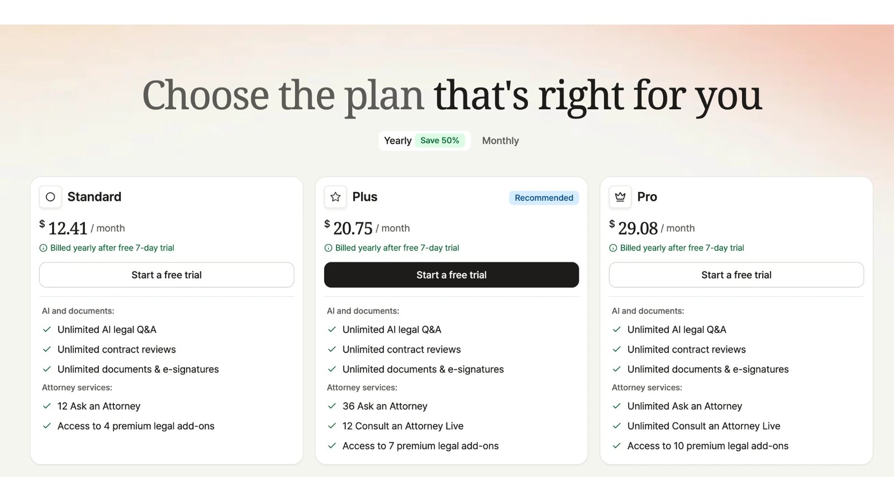
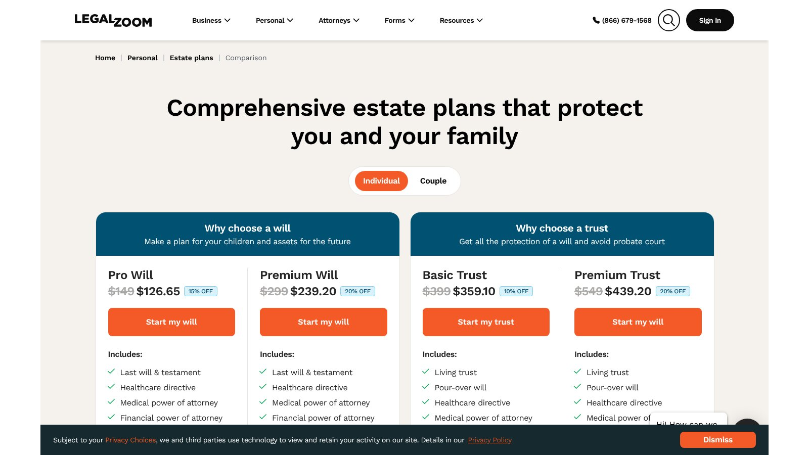

# LegalZoom vs Rocket Lawyer: Which Service Fits Your Legal Needs?

In the LegalZoom vs Rocket Lawyer choice, the deciding factor is how often you need legal help. LegalZoom mostly sells one-time packages, like an LLC filing or a will, with attorney plans you can add. Rocket Lawyer sells a yearly or monthly membership that bundles documents, e-signatures, and a set number of attorney questions.

If you have one job to finish, LegalZoom's package model is easier to price. If you expect a steady stream of contracts and questions, Rocket Lawyer's membership can cost less over a year. Every figure below comes from the two companies' own pages, checked on November 20, 2026.

## Key Takeaways

* **Different pricing models:** LegalZoom charges per package, while Rocket Lawyer charges $149, $249, or $349 a year for membership.
* **LLC formation:** LegalZoom's Basic LLC costs $0 plus state fees, and Rocket Lawyer's first business registration is free for members, then $99 plus state fees.
* **Registered agent:** LegalZoom lists $249 a year, while Rocket Lawyer lists $125 a year on its Plus and Pro plans.
* **Attorney access:** LegalZoom's business attorney plan costs $469 a year, while Rocket Lawyer includes 12 to unlimited attorney questions depending on the tier.
* **Watch auto-renewals:** LegalZoom's LLC Pro package includes 30 days of attorney access that renews at $49 a month unless you cancel.

## Side-by-Side Comparison

The table lists list prices before state fees, tax, and temporary sales. LegalZoom's estate page showed a holiday discount on the day we checked.

| Service | LegalZoom | Rocket Lawyer |
| --- | --- | --- |
| Pricing model | One-time packages plus optional plans | Membership, yearly or monthly |
| Entry membership | Not applicable | Standard, $149 per year or $34.99 per month |
| LLC formation | Basic $0, Pro $249, Premium $299 | First registration free for members, then $99 |
| Registered agent | $249 per year | $125 per year (Plus and Pro) |
| Individual will | Pro Will $149, Premium Will $299 | Included in membership documents |
| Attorney access | Business plan $469 per year | 12 questions (Standard) to unlimited (Pro) |
| Free trial | Not shown on pages checked | 7 days on every plan |

## How We Compared LegalZoom vs Rocket Lawyer

We opened the main pricing pages for both companies on November 20, 2026. For LegalZoom, that meant the LLC pricing page, the estate plan comparison, the registered agent page, and the business attorney plan page. For Rocket Lawyer, it meant the pricing page and the legal advice page.

We kept only what those pages state. This is desk research, not a hands-on test, and we did not buy either service. Our full [LegalZoom review](/legal-business/legalzoom-review/) covers renewal costs in more detail.

## Pricing Models Explained

The two companies start from different ideas. That difference shapes every cost comparison below.

### LegalZoom Sells Packages

LegalZoom prices each task separately. You pick an LLC package, an estate plan, or a registered agent service and pay for that item. Many packages include a short attorney plan that keeps billing after a trial period. LegalZoom's LLC Pro package, for example, includes 30 days of attorney consultations that then renew at $49 a month.

### Rocket Lawyer Sells Memberships

Rocket Lawyer charges a recurring fee for a bundle. The [Rocket Lawyer pricing page](https://www.rocketlawyer.com/pricing) lists Standard at $149 a year, Plus at $249, and Pro at $349. Monthly billing costs $34.99, $49.99, and $64.99. All plans include unlimited documents and e-signatures, and each starts with a free seven-day trial.

## LLC Formation and Registered Agent

For starting a company, both services handle the filing. The cost structure differs.

The [LegalZoom LLC pricing page](https://www.legalzoom.com/business/business-formation/llc-pricing.html) lists three packages. Basic costs $0, Pro costs $249, and Premium costs $299, each plus state filing fees. Pro adds an operating agreement, an EIN, and access to 150-plus legal documents for one year.

Rocket Lawyer lists the first new business registration as free for members, then $99 plus state fees. An EIN filing costs $70 on Plus and Pro.

Registered agent fees repeat every year, so they matter more over time. LegalZoom lists $249 a year and says the service auto-renews at the purchase rate. Rocket Lawyer lists $125 a year, but only on Plus and Pro. To compare more providers, see our ranking of the [best registered agent services](/legal-business/best-registered-agent-services/).

## Wills and Estate Plans

LegalZoom publishes four individual estate packages. Pro Will costs $149, Premium Will $299, Basic Trust $399, and Premium Trust $549. Couple versions cost more. Each will package includes a healthcare directive and medical and financial powers of attorney.

LegalZoom's Pro Will includes 30 days of attorney consultations that renew at $25 a month. Premium Will includes a year that renews at $199 a year.

Rocket Lawyer does not sell separate estate packages on its pricing page. Its members create documents under the unlimited documents benefit. If you only need one will, a one-time LegalZoom package may cost less than a full year of membership. If you also need business documents, the membership can cover both.

## Attorney Access

Both companies connect you with independent attorneys. Neither says it replaces full legal representation.

### LegalZoom Business Attorney Plan

LegalZoom's attorney page lists a 12-month plan billed at $469 a year, about $39.09 a month. A six-month plan bills $259. The plan includes unlimited 30-minute consultations on new legal matters, attorney review of contracts up to 10 pages, and 10% off other LegalZoom filings.

### Rocket Lawyer Attorney Benefits

Rocket Lawyer ties attorney access to the membership tier. Standard includes 12 Ask an Attorney questions. Plus includes 36 questions and 12 live consultations. Pro includes unlimited questions and live consultations. Rocket Lawyer's legal advice page says Ask an Attorney answers arrive in writing within one business day. Longer Legal Advice Sessions start at $149.

## Business Documents and Contracts

Contracts are where the two models split most clearly. A business that signs a new vendor agreement, lease, or nondisclosure agreement every few weeks needs repeat access, not a one-off file.

Rocket Lawyer includes unlimited documents and unlimited e-signatures on every membership tier. It also lists unlimited contract reviews and AI legal questions on all three plans. For a business that drafts often, that bundle is the core of its value.

LegalZoom's LLC Pro package includes access to more than 150 customizable legal documents and unlimited e-signatures for one year. Its business attorney plan adds attorney review of contracts and key documents up to 10 pages, plus a template library. After the first year, you would need to keep a plan to keep that access.

In the LegalZoom vs Rocket Lawyer comparison for contracts, ask one question first. How many documents will you create in the next 12 months? A handful points toward a package. A steady flow points toward a membership.

## Trademarks, Annual Reports, and Other Filings

Both companies sell more than formation. The way they price extra filings differs.

Rocket Lawyer lists several add-ons on its pricing page for Plus and Pro members. Trademark services start at $400. Annual report filing costs $100, a DBA costs $100, and articles of dissolution cost $125. Standard members do not get these member prices.

LegalZoom sells trademark registration, annual reports, DBAs, and business licenses as separate services from its main menu. Its business attorney plan gives 10% off filings, trademarks, and other LegalZoom services. It also includes one copyright registration per month.

Before you buy, list every filing you expect this year. Then price that list on both sites. The totals often decide the LegalZoom vs Rocket Lawyer question more clearly than the headline prices.

## Cancellation and Renewal Terms

Recurring charges are the most common surprise with both services. Read these terms before you enter a card.

LegalZoom's registered agent page says the service auto-renews at the purchase rate each year until you cancel, and that the renewal rate is subject to change. If you cancel, LegalZoom says it may require proof that a new registered agent has been designated with your state. Several estate and LLC packages also include short attorney plans that renew monthly.

Rocket Lawyer's membership renews on the cycle you choose. The pricing page shows a yearly toggle labeled "Save 50%," which reflects the gap between monthly and yearly billing. The seven-day free trial converts to a paid plan if you do not cancel in time.

## Pros and Cons at a Glance

The lists below sum up the published strengths and limits of each service. They are based on official pages, not on our own use.

### LegalZoom

LegalZoom's strengths center on clear package pricing for single tasks.

* **Pro:** One-time packages make a single task easy to price.
* **Pro:** A $0 Basic LLC package covers the filing itself.
* **Con:** Its $249 registered agent fee is higher than Rocket Lawyer's $125.
* **Con:** Short attorney trials inside packages renew unless you cancel.

Those renewals are the main thing to watch on the LegalZoom side of a LegalZoom vs Rocket Lawyer decision.

### Rocket Lawyer

Rocket Lawyer's strengths come from bundling repeat services into one fee.

* **Pro:** Unlimited documents and e-signatures on every tier.
* **Pro:** Attorney questions are built into the membership.
* **Con:** You pay every year, even in a quiet year.
* **Con:** Registered agent service and several filings need Plus or Pro.

## Year-One Cost Scenarios

These examples use each company's published prices. They exclude state fees and tax. They are our calculations, not quotes.

| Scenario | LegalZoom | Rocket Lawyer |
| --- | --- | --- |
| One LLC, no extras | $0 (Basic) | $149 (Standard, first registration free) |
| One LLC plus registered agent | $0 + $249 = $249 | $249 (Plus) + $125 = $374 |
| LLC plus a year of attorney access | $249 (Pro) + $469 plan = $718 | $349 (Pro, unlimited questions) |
| One individual will | $149 (Pro Will) | $149 (Standard) |

The LLC Pro row assumes you cancel the $49 monthly renewal and buy the yearly attorney plan instead. If you keep paying monthly, the cost changes. LegalZoom's plan also includes contract review and copyright filings, which Rocket Lawyer prices differently, so the totals are not perfect matches.

## Which Service Fits Your Needs?

The right pick in the LegalZoom vs Rocket Lawyer decision depends on your pattern of use. Here is a short way to decide.

### Choose LegalZoom If

LegalZoom fits a single, well-defined task. That could be one LLC filing, one estate plan, or one trademark. It also suits people who want a fixed package price and do not plan to use a lawyer every month.

### Choose Rocket Lawyer If

Rocket Lawyer fits steady needs. A small business that drafts contracts, leases, and notices through the year may get more value from a membership. The included attorney questions also help owners who want quick written answers.

### Consider Neither If

Some tasks need neither service. The IRS issues EINs for free, and some states let you file formation documents directly. Our list of [LegalZoom alternatives](/legal-business/legalzoom-alternatives/) covers free official routes and specialist services. For a wider view of formation providers, see the [best LLC formation services](/legal-business/best-llc-formation-services/).

## Frequently Asked Questions

### Is LegalZoom or Rocket Lawyer Cheaper?

It depends on use. For one LLC with no extras, LegalZoom's $0 Basic package is cheaper. For a year of attorney questions, Rocket Lawyer's $349 Pro plan costs less than LegalZoom Pro plus its $469 attorney plan.

### Does Rocket Lawyer Have a Free Trial?

Yes. Rocket Lawyer's pricing page lists a free seven-day trial on Standard, Plus, and Pro.

### Do LegalZoom Packages Auto-Renew?

Some parts do. LegalZoom's registered agent service and several attorney plans renew automatically until you cancel. Check each package's footnotes before you buy.

### Are Rocket Lawyer Attorneys Its Employees?

Rocket Lawyer describes them as independent, licensed attorneys in its network. It also says it does not provide legal representation outside its Legal Advice Sessions.

### Is This a Hands-On Test of LegalZoom vs Rocket Lawyer?

No. We compared official pages checked on November 20, 2026, and did not buy either service.

## Resources

* [Rocket Lawyer pricing](https://www.rocketlawyer.com/pricing)
* [Rocket Lawyer legal advice](https://www.rocketlawyer.com/legal-advice)
* [LegalZoom LLC pricing](https://www.legalzoom.com/business/business-formation/llc-pricing.html)
* [LegalZoom estate plan comparison](https://www.legalzoom.com/personal/estate-planning/compare.html)
* [LegalZoom registered agent service](https://www.legalzoom.com/business/business-operations/registered-agent-overview.html)
* [LegalZoom business attorney plan](https://www.legalzoom.com/attorneys/)
* [IRS: Get an employer identification number](https://www.irs.gov/businesses/small-businesses-self-employed/get-an-employer-identification-number)

All prices and features were checked against official pages on November 20, 2026. Prices exclude state fees and tax and can change.
