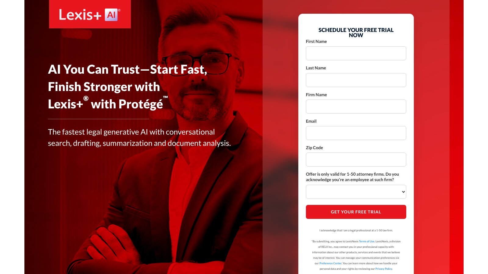
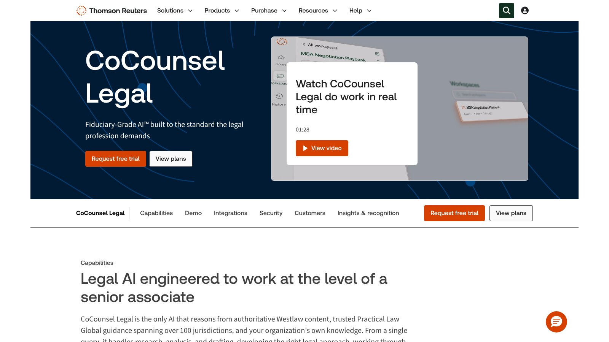
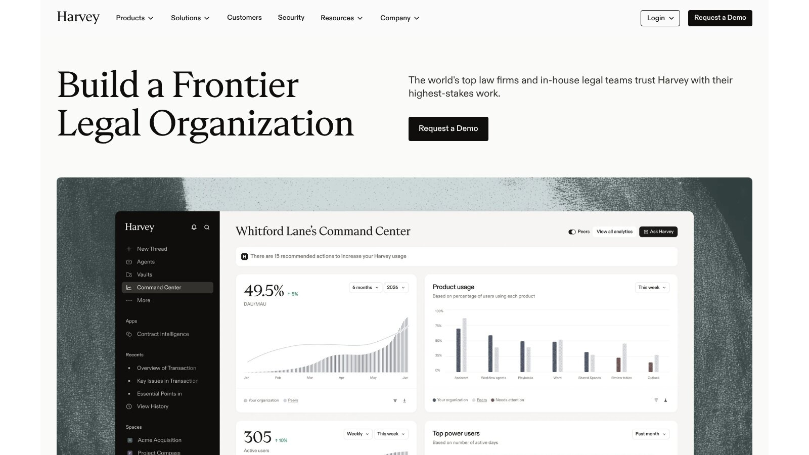
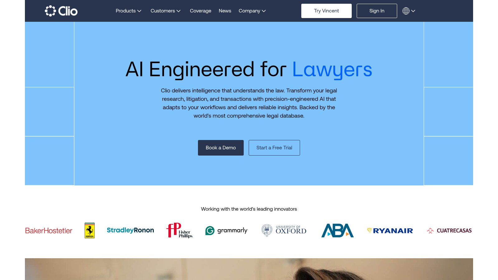
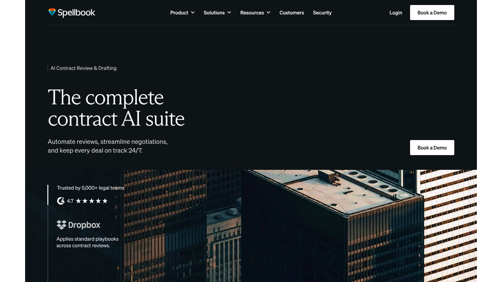
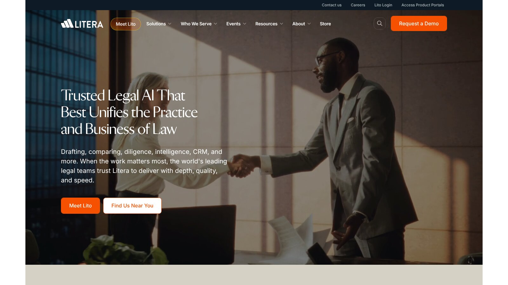
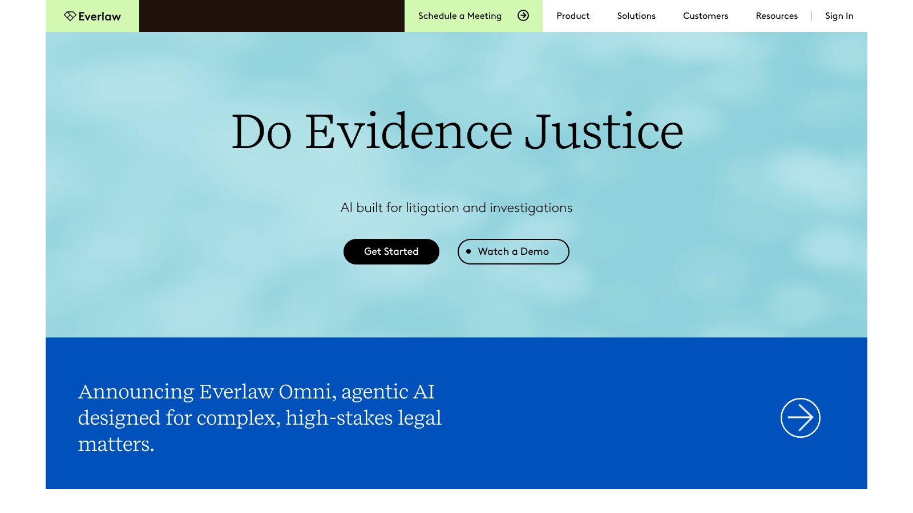
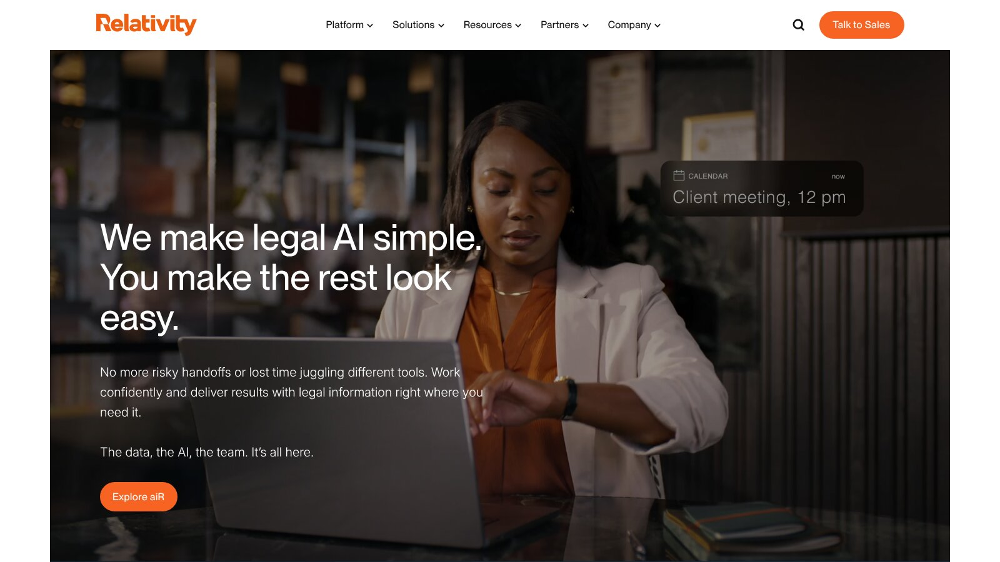
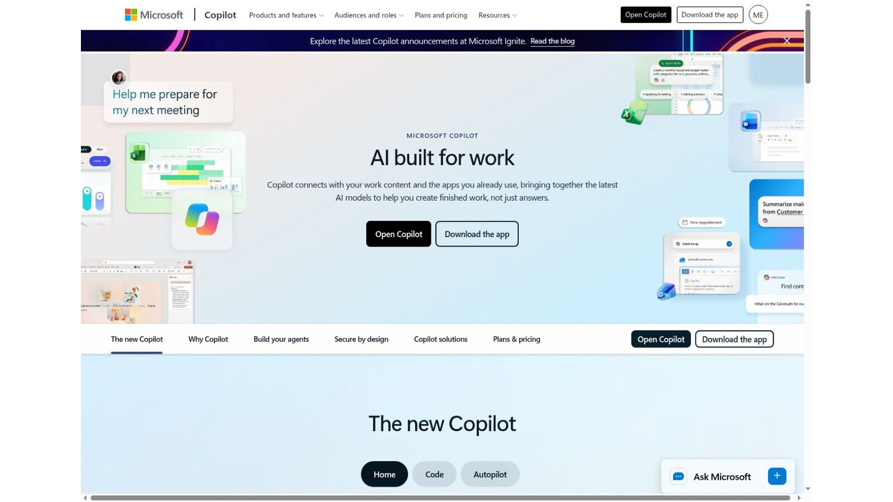
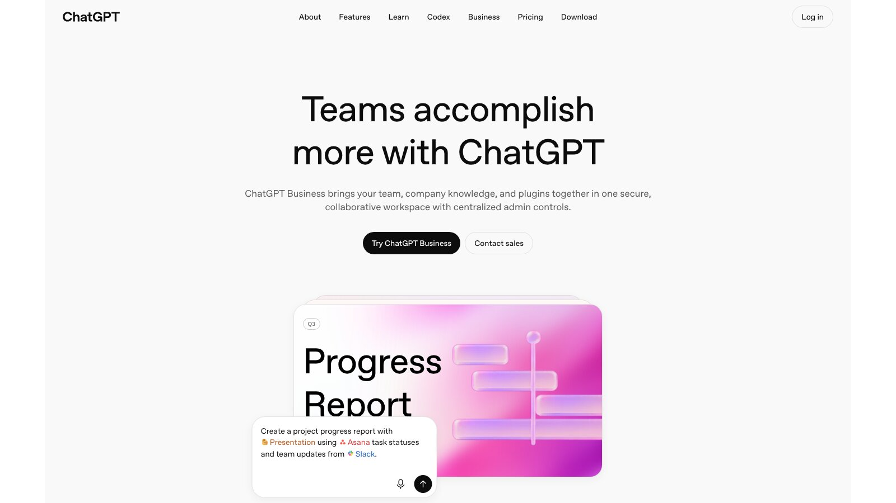

# 10 Best AI Tools for Lawyers by Task, Risk, and Firm Size

The best AI tools for lawyers depend on the task and how much risk it carries. Research tools like Lexis+ with Protégé, CoCounsel Legal, and Vincent by Clio tie answers to legal sources. Spellbook and Litera work inside contract drafting. Everlaw and Relativity aiR handle discovery review. Harvey targets large firms building firm-wide AI programs. Microsoft 365 Copilot and ChatGPT Business help with everyday writing, but they are not legal research tools.

We checked each vendor's official page on November 20, 2026. Most legal AI vendors do not publish prices, so this guide compares tasks, security claims, and fit rather than cost.

## Key Takeaways

* **Match the tool to the task:** Research, drafting, discovery, and general writing carry different risks, so no single product covers them all.
* **Grounded research beats general chat:** CoCounsel Legal says it reasons from Westlaw content and Practical Law guidance, while general assistants do not claim a legal citator.
* **Prices are mostly hidden:** Only ChatGPT Business published seat prices on the pages we checked, at $20 per seat per month billed annually for its Standard seat.
* **Check the data promise in writing:** CoCounsel Legal, Spellbook, and ChatGPT Business each state that customer data is not used to train models, in different wording.
* **Certifications vary:** Harvey lists SOC 2 Type II and ISO 27001, Relativity lists ISO/IEC 27001:2022 and SOC 2 Type II, and Vincent by Clio lists SOC 2 and ISO 27001.

## Quick Comparison

The table summarizes what each vendor's own page says. "Not published" means the page showed no price.

| Tool | Best for | Published price | Security or data claim on page |
| --- | --- | --- | --- |
| Lexis+ with Protégé | Research and drafting for small firms | Not published | Not stated on trial page |
| CoCounsel Legal | Research grounded in Westlaw | Not published | SOC 2 and ISO 42001 |
| Harvey | Large-firm AI programs | Not published | SOC 2 Type II, ISO 27001 |
| Vincent by Clio | Multi-jurisdiction research | Not published | SOC 2 and ISO 27001 |
| Spellbook | Contract review and drafting | Not published | SOC 2 Type II, zero data retention |
| Litera | Drafting and document workflow | Not published | Trust center linked |
| Everlaw | Litigation and eDiscovery | Not published | FedRAMP for public records product |
| Relativity aiR | Large-scale document review | Not published | ISO 27001, SOC 2 Type II |
| Microsoft 365 Copilot | Microsoft-based firms | Not captured | Not captured |
| ChatGPT Business | General drafting and ideas | $20 per seat per month, billed annually | Not used for training by default |

## How We Chose These AI Tools for Lawyers

We started with ten tools named in our November 2026 topic plan. On November 20, 2026, we opened each vendor's official page and kept only claims stated there. When a page blocked access, we used an owner-supplied screenshot or another official page, and we say so in that section.

This is desk research, not a hands-on test. We did not use paid accounts. The order groups tools by task, not by a score. For adoption data across the profession, see our [legal technology statistics](/legal-tech/legal-technology-statistics/).

## 1. Lexis+ with Protégé: Best for Small-Firm Research and Drafting

LexisNexis calls Lexis+ with Protégé "the fastest legal generative AI" with conversational search, drafting, summarization, and document analysis. Its free trial page says users can go from a blank page to arguments, contract clauses, and client messages grounded in authoritative content.

The trial page also lets firms upload documents for summaries. The offer is limited to firms with 1 to 50 attorneys. No price or trial length appears on the page.

**Best fit:** Small and midsize firms already using Lexis research.

**Questions to ask:** Which features sit in your package? How are Protégé answers linked to citations you can check?

## 2. CoCounsel Legal: Best for Westlaw-Grounded Research

Thomson Reuters describes [CoCounsel Legal](https://legal.thomsonreuters.com/en/products/cocounsel-legal) as legal AI built to work at the level of a senior associate. It says the tool handles research, analysis, and drafting from Westlaw content, Practical Law guidance across more than 100 jurisdictions, and a firm's own knowledge.

Named features include Westlaw Brief Builder and Tabular Analysis, which the page says can review up to 10,000 documents against 100 questions. The page states that CoCounsel Legal is SOC 2 and ISO 42001 certified. It also says, "we never use it to train underlying models."

**Best fit:** Litigation and research teams that already rely on Westlaw.

**Questions to ask:** Which plan includes Brief Builder? How does the tool flag authority that has been overruled?

## 3. Harvey: Best for Large-Firm AI Programs

Harvey markets itself as "one platform for all legal AI work." Its homepage lists agents, a document Vault, a Knowledge research area, and shared workspaces called Spaces.

Harvey lists SOC 2 Type II, ISO 27001, ISO 27701, ISO 42001, GDPR, and CCPA among its security standards. It names controls like SAML single sign-on, audit logs, and IP allow-listing. It says more than 85 AmLaw 100 firms use Harvey. Pricing is by demo only.

**Best fit:** Large firms and in-house teams with a formal AI rollout plan. Our [Harvey pilot guide](/legal-tech/harvey-legal-ai-pilot/) covers how to test it.

**Questions to ask:** What does a pilot include? Which apps sit in your contract?

## 4. Vincent by Clio: Best for Multi-Jurisdiction Research

The vlex.com homepage now carries the "Clio (formerly vLex)" brand and calls its assistant Vincent by Clio. It says Vincent handles legal research with citations, 50-state surveys, contract risk analysis, and deposition analysis.

The page describes a library of more than one billion documents from over 100 countries. It states the platform is SOC 2 and ISO 27001 certified. It offers a free trial and a demo, but no published price.

**Best fit:** Firms with research across states or countries.

**Questions to ask:** Which jurisdictions does your plan cover? Does the free trial include Vincent?

## 5. Spellbook: Best for Contract Drafting and Review

Spellbook focuses on contracts. Its site lists modules for review, drafting, comparison, and questions, plus Playbooks that encode a team's legal standards.

On data, Spellbook states, "Zero data retention means our LLM providers never learn from, train on, or store your data." It lists SOC 2 Type II, HIPAA, and GDPR. It offers a seven-day free trial.

**Best fit:** Transactional lawyers and in-house contract teams.

**Questions to ask:** How do Playbooks handle your fallback positions? Which editors does it support for your team?

## 6. Litera: Best for Drafting Workflow Inside Microsoft 365

Litera sells a suite for drafting, comparing, diligence, and firm intelligence. Its homepage promotes an AI assistant called Lito and says its AI is integrated directly into Microsoft 365.

The page says Litera Compare and Firm AI Search are available inside Microsoft Copilot as plugins. It links to a security and trust center but does not list certifications on the homepage. There is no published price.

**Best fit:** Firms that already use Litera tools for document comparison and drafting.

**Questions to ask:** Which Lito features need a Microsoft Copilot license?

## 7. Everlaw: Best for Litigation and eDiscovery

Everlaw describes itself as "AI built for litigation and investigations." Its AI suite includes coding suggestions, a writing assistant, a review assistant, predictive coding, and clustering.

Everlaw also announced Omni, which it calls agentic AI for complex legal matters. Its public records product is described as FedRAMP-certified. The homepage shows no price.

**Best fit:** Litigation teams that review large document sets. Compare more options in our [eDiscovery software](/legal-tech/best-ediscovery-software/) roundup.

**Questions to ask:** How is AI review priced against hosting? Which AI features are in your base plan?

## 8. Relativity aiR: Best for Large-Scale Review

[Relativity aiR](https://www.relativity.com/data-solutions/air/) is a set of AI tools for legal data. aiR for Review supports first-pass review, quality checks, and prioritized queues, and it returns citations and reasons for each call. aiR for Case Strategy summarizes key materials for depositions and trial prep.

The aiR page lists ISO/IEC 27001:2022 and 27018 certification, SOC 2 Type II and SOC 3 audits, and HIPAA compliance. It says 193 of the Am Law 200 rely on Relativity. Relativity also claims aiR for Review can reach "90%+ recall," which is a vendor claim we did not test.

**Best fit:** Large firms, corporations, and service providers with heavy review volume.

**Questions to ask:** How will you validate recall on your own matter before relying on it?

## 9. Microsoft 365 Copilot: Best for Microsoft-Based Firms

Microsoft's Copilot page was unavailable to our checks on November 20, 2026, so this section relies on a screenshot of the official page supplied by the site owner. The page calls Copilot "AI built for work" and says it connects with your work content and the apps you already use.

We could not confirm Copilot's current price or data terms, so we do not state them. Copilot is a general assistant, not a legal citator, so treat legal answers as drafts to check.

**Best fit:** Firms that live in Word, Outlook, and Teams and want help with internal drafting and summaries.

**Questions to ask:** Which license tier does your firm need? What data can Copilot reach inside your tenant?

## 10. ChatGPT Business: Best for General Drafting

The [ChatGPT Business page](https://chatgpt.com/business/) lists a Standard seat at $20 per seat per month and a Premium seat at $100, both billed annually. The pricing page says Business plans start at two users.

OpenAI states that "your business data isn't used to train OpenAI models by default." It also lists SSO and MFA. Like Copilot, it is not built on a legal research database, so every citation needs checking.

**Best fit:** Lawyers who want a general assistant for first drafts, emails, and brainstorming. For no-cost options, see our [free legal AI](/legal-tech/free-legal-ai/) guide.

**Questions to ask:** Which seat type does each lawyer need? Who reviews outputs before they reach a client?

## Choose by Task and Risk

AI tools for lawyers carry different levels of risk depending on what the output feeds. The groups below rank common uses from highest to lowest risk.

### High Risk: Research and Court Filings

Anything that ends up in a brief needs a tool tied to real authority and a lawyer who checks every citation. Lexis+ with Protégé, CoCounsel Legal, and Vincent by Clio all position themselves around legal sources. Our [legal research software](/legal-tech/legal-research-software/) comparison covers the research platforms behind them.

### Medium Risk: Contracts and Discovery

Contract and review AI tools for lawyers speed up work that a lawyer still signs off on. Spellbook, Litera, Everlaw, and Relativity aiR fit here. Test them on closed matters before live ones.

### Lower Risk: Internal Writing

Emails, meeting notes, and internal memos carry less risk. General assistants like Microsoft 365 Copilot and ChatGPT Business fit this tier, as long as client data rules allow it.

## How to Run a Safe Pilot

A short pilot shows whether AI tools for lawyers save time on your actual work. Use these steps before you sign a long contract.

* **Pick one task:** Choose a single workflow, such as first-pass review or clause drafting, and measure it.
* **Use closed matters first:** Test on finished work where you already know the right answer.
* **Get the data terms in writing:** Confirm what the vendor stores, for how long, and whether it trains on your data.
* **Check every citation:** Treat any case or statute from an AI tool as unverified until a lawyer opens it.
* **Record the results:** Note time saved and errors found, so the decision rests on your numbers, not a vendor claim.

A pilot built this way also gives you a record to show clients if they ask how you use AI.

## Frequently Asked Questions

### What Are the Best AI Tools for Lawyers?

It depends on the task. For research, consider Lexis+ with Protégé, CoCounsel Legal, or Vincent by Clio. For contracts, consider Spellbook or Litera. For discovery, consider Everlaw or Relativity aiR.

### How Much Do AI Tools for Lawyers Cost?

Most legal AI vendors do not publish prices. ChatGPT Business was the only tool on our list with a published seat price, at $20 per seat per month billed annually for its Standard seat.

### Do These Tools Train on Client Data?

Some vendors say no in writing. CoCounsel Legal, Spellbook, and ChatGPT Business each make that statement on their pages. Ask every vendor for the contract terms, not just the marketing page.

### Can I Use ChatGPT for Legal Research?

You can use it for drafts and ideas, but it is not a legal research database. Check every case and statute it mentions against an official source.

### Is This a Hands-On Test?

No. We compared official vendor pages checked on November 20, 2026, and did not use paid accounts.

## Resources

* [Lexis+ with Protégé free trial](https://law.lexisnexis.com/digital/bing-launch-PMAX/free-trial)
* [Thomson Reuters CoCounsel Legal](https://legal.thomsonreuters.com/en/products/cocounsel-legal)
* [Harvey](https://www.harvey.ai/)
* [Vincent by Clio (vLex)](https://vlex.com/)
* [Spellbook](https://spellbook.com/)
* [Litera](https://www.litera.com/)
* [Everlaw](https://www.everlaw.com/)
* [Relativity aiR](https://www.relativity.com/data-solutions/air/)
* [Microsoft Copilot](https://www.microsoft.com/en-us/microsoft-365/copilot)
* [ChatGPT Business](https://chatgpt.com/business/) and [ChatGPT pricing](https://chatgpt.com/pricing)

All claims were checked against official vendor pages on November 20, 2026. Features and prices can change.
