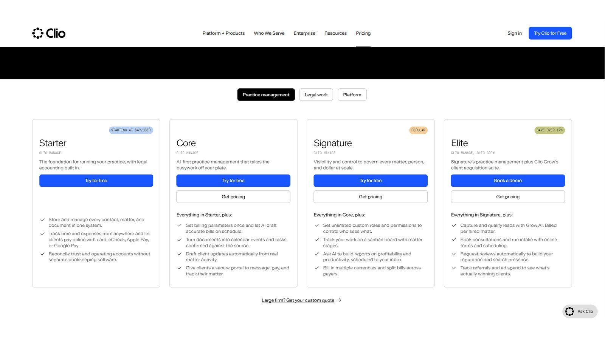
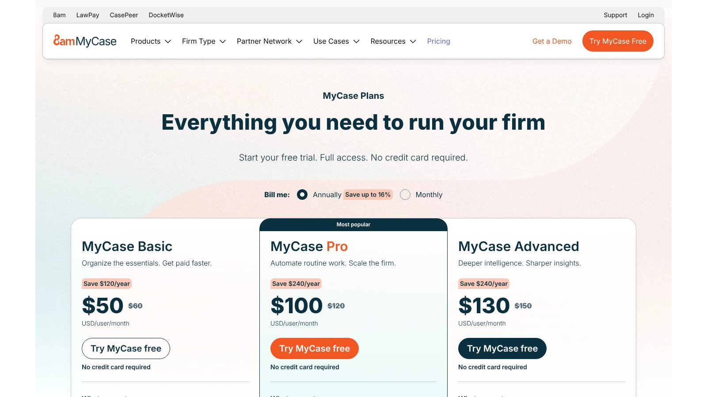

# Clio vs MyCase: Which Practice Management Platform Fits Your Firm?

In the Clio vs MyCase decision, the biggest practical difference is price transparency. MyCase publishes all three of its plans, from $50 to $130 per user per month on annual billing. Clio publishes only its Starter plan, from $49 per user per month, and asks firms to request pricing for Core, Signature, and Elite.

Both platforms cover the basics of running a firm: matters, contacts, time tracking, billing, trust accounting, and online payments. The choice usually turns on which features you need at which tier, and how much budgeting certainty you want before a sales call.

## Key Takeaways

* **MyCase prices are public:** Basic costs $50, Pro $100, and Advanced $130 per user per month billed annually, or $60, $120, and $150 billed monthly.
* **Clio shows one price:** Its pricing page lists Starter from $49 per user, with Core, Signature, and Elite behind a "Get pricing" button.
* **Client portal timing differs:** MyCase Basic includes a limited client portal, while Clio lists a secure client portal starting at Core.
* **Document automation sits mid-tier:** MyCase adds document generation at Pro, and Clio's Core plan turns documents into calendar events and tasks.
* **AI features are tiered:** MyCase's 8am IQ Case Assistant is Advanced only, while Clio's Core plan says AI drafts bills.

## Side-by-Side Comparison

The table uses MyCase's annual prices and Clio's published pricing page. "Quote" means the vendor asks you to contact sales.

| Feature | Clio | MyCase |
| --- | --- | --- |
| Entry plan price | Starter from $49 per user per month | Basic $50 per user per month (annual) |
| Mid plan price | Core, quote | Pro $100 per user per month (annual) |
| Top plan price | Signature and Elite, quote | Advanced $130 per user per month (annual) |
| Free trial | "Try for free" on Starter, Core, Signature | 10-day trial, no credit card |
| Trust accounting | Starter | Basic |
| Client portal | Core and above | Limited on Basic, full on Pro |
| Document automation | Core turns documents into events and tasks | Pro and Advanced |
| E-signatures | Not shown on the tier cards we saw | Pro and Advanced, unlimited |
| AI features | AI bill drafting on Core, AI reports on Signature | Writing and Document Assistant on Pro, Case Assistant on Advanced |

## How We Compared Clio vs MyCase

We opened the [MyCase pricing page](https://www.mycase.com/pricing/) and the MyCase homepage on November 20, 2026. Clio's website blocked our automated checks that day, so the Clio details come from a screenshot of the official [Clio pricing page](https://www.clio.com/pricing/) captured by the site owner on November 3, 2026. We note where that limits what we can say.

This is desk research, not a hands-on test. We did not open paid accounts. For a wider look at the category, compare more [legal practice management software](/legal-tech/legal-practice-management-software/) options.

## Pricing and Plans

Price is where the two platforms differ most. One publishes every tier, and the other publishes only the first.

### Clio Pricing

Clio's practice management pricing tab shows four plans. Starter, labeled Clio Manage, starts at $49 per user. It covers contacts, matters, documents, time and expense tracking, online payments by card, eCheck, Apple Pay, or Google Pay, and trust and operating account reconciliation.

Core, Signature, and Elite each show a "Get pricing" button instead of a price. Elite bundles Clio Manage with Clio Grow, its client intake product, and the card carries a "Save over 17%" label. Clio also links to a custom quote for larger firms. Our breakdown of [Clio total cost](/legal-tech/clio-legal-software-total-cost/) shows how to budget around those quotes.

### MyCase Pricing

MyCase lists three plans with prices per user per month. Annual billing saves up to 16%.

MyCase Basic costs $50 annually or $60 monthly. Pro costs $100 or $120 and is marked "Most popular." Advanced costs $130 or $150. MyCase Accounting is an add-on at $39 per user per month on Pro and Advanced. The FAQ says there is no long-term contract or setup fee.

## Billing, Payments, and Trust Accounting

Both platforms put billing at the center, since that is where firms feel the return first.

Clio's Starter plan includes time and expense tracking, online payments, and trust reconciliation without separate bookkeeping software. Its Core plan adds billing parameters where "AI draft accurate bills on schedule." Signature adds billing in multiple currencies and split bills across payers.

MyCase Basic includes time entry, invoicing, and trust accounting, plus LawPay online payments with next-day deposits. Pro adds premium billing and reporting. Advanced adds split billing, rate plans, and a work-in-progress report. LawPay shows a $0 monthly fee on the MyCase page, with processing rates charged per transaction.

## Client Portal and Communication

Client communication is a clear tier difference in the Clio vs MyCase comparison.

MyCase includes a limited client portal on Basic and a full portal on Pro and Advanced. Pro also adds two-way texting, a call log, and client intake forms.

Clio lists a secure portal "to message, pay, and track their matter" starting at Core. Its Core plan also drafts client updates automatically from matter activity. Online intake forms and scheduling appear on Elite through Clio Grow.

## Document Automation and E-Signatures

Document tools matter most to firms that produce many similar filings or letters.

MyCase Basic includes unlimited document storage but no document generation. Pro adds Word-based templates and unlimited e-signatures. Advanced adds advanced document automation for more complex documents and a desktop drive for PC and Mac.

Clio's Core plan says it can "turn documents into calendar events and tasks, confirmed against the source." The tier cards we saw did not list e-signature limits, so confirm that during a demo.

## AI Features

AI is now part of every practice management pitch. The two companies place it at different tiers.

### MyCase 8am IQ

MyCase calls its AI 8am IQ. The pricing page lists the Writing Assistant and Document Assistant on Pro and Advanced. The Case Assistant and the Discovery Assistant, which handles OCR, are Advanced only. The Discovery Assistant includes 5,000 pages per user each month, shared across the team, with another 5,000 pages for $30. MyCase also lists an MCP connector for Claude on all three plans.

### Clio AI

Clio's tier cards describe AI at several levels. Core lets AI draft bills and draft client updates. Signature adds "Ask AI" for scheduled profitability and productivity reports. Elite adds lead qualification through Grow AI, billed per hired matter.

## Intake, CRM, and Firm Growth

Firms that want more clients, not just smoother billing, should look at intake tools. The two vendors package them differently.

MyCase puts its Legal CRM and client intake forms on Pro and Advanced. Pro also lists more than 70 integrations. Advanced adds an open API for firms that want to connect their own systems.

Clio places client acquisition in a separate product called Clio Grow. Its Elite plan bundles Grow with Clio Manage. The Elite card lists lead capture and qualification with Grow AI, consultation booking with online forms and scheduling, automatic review requests, and referral and ad spend tracking.

For a growth-focused firm, the Clio vs MyCase question becomes whether you want intake inside one plan or as a bundled second product.

## Permissions, Reporting, and Control

Larger firms need to control who sees what. These features tend to sit at the higher tiers on both platforms.

Clio's Signature plan lists unlimited custom roles and permissions, a kanban board for matter stages, and AI-built reports on profitability and productivity sent to your inbox. Because Signature requires a quote, confirm its cost before you plan around these features.

MyCase lists premium reporting on Pro and a work-in-progress report on Advanced. Advanced also adds rate plans and split billing, which help firms with several fee arrangements.

## Five-Seat Cost on MyCase Plans

Because MyCase publishes all three prices, you can model a full year before a demo. The table shows five users for twelve months, before add-ons, payment fees, and tax.

| MyCase plan | Annual billing | Monthly billing | Difference |
| --- | --- | --- | --- |
| Basic | $3,000 | $3,600 | $600 |
| Pro | $6,000 | $7,200 | $1,200 |
| Advanced | $7,800 | $9,000 | $1,200 |

These are our calculations from published prices, not quotes. A matching Clio table is not possible from public data, because only Starter shows a price. Five Clio Starter seats would cost at least $2,940 a year at $49 per user per month.

## Contract and Cancellation Terms

Terms matter as much as price once data is inside a system. MyCase's FAQ says no long-term contract or setup fee is required, and you can cancel from the Settings section at any time. It also says previously paid fees are non-refundable.

Clio's pricing tab did not show contract terms on the cards we saw. Ask for them in writing with your quote.

## Which Platform Fits Your Firm?

The right answer in the Clio vs MyCase choice depends on firm size, budget habits, and growth plans.

### Choose MyCase If

MyCase suits firms that want to price a full plan before they talk to sales. A five-person firm on Pro, billed annually, pays $100 × 5 × 12 = $6,000 a year, before add-ons and payment fees. That is our calculation from published prices.

### Choose Clio If

Clio suits firms that want a modular path, from Starter up to a bundle with client intake in Elite. It also suits firms that plan to grow into permissions, kanban matter boards, and multi-currency billing on Signature. A solo lawyer or small team that only needs matters, time tracking, payments, and trust reconciliation can start on Starter and add tiers later. Just remember that every step above Starter needs a quote, so budget time for at least one sales conversation before you commit to a larger rollout.

### Run the Same Test on Both

Ask each vendor for a written quote for your exact user count and plan. Then compare first-year cost, renewal terms, and payment processing rates side by side. Our [MyCase review](/legal-tech/mycase-legal-software/) covers its plans in more depth.

## Questions to Ask Before You Sign

A short list of questions keeps the Clio vs MyCase decision grounded in your own numbers rather than in feature lists.

* **Total seats:** How many users need logins, including paralegals and billing staff?
* **Plan floor:** Which features do you need on day one, and which tier first includes them?
* **AI limits:** Are AI features capped by pages, users, or matters?
* **Payment fees:** What are the card and eCheck rates, and who pays them?
* **Exit terms:** How do you export matters, documents, and trust records if you leave?

Getting these answers in writing makes the two quotes comparable. Legal technology budgets keep rising, as our [legal technology statistics](/legal-tech/legal-technology-statistics/) show, so the first-year number is only part of the picture.

## Frequently Asked Questions

### Is Clio or MyCase Cheaper?

At the entry level, Clio Starter lists from $49 per user per month and MyCase Basic lists $50 on annual billing. Above that, MyCase publishes Pro at $100 and Advanced at $130, while Clio requires a quote.

### Does MyCase Have a Free Trial?

Yes. MyCase offers a 10-day free trial with full access and no credit card required.

### Which Has Better AI Features?

They place AI at different tiers. MyCase puts writing and document assistants on Pro and its Case Assistant on Advanced. Clio adds AI bill drafting on Core and AI reports on Signature.

### Can I Switch From Clio to MyCase or Back?

Both are cloud platforms, but migration terms vary. Ask each vendor how it exports matters, documents, and trust records before you sign.

### Is This a Hands-On Test of Clio vs MyCase?

No. We compared official pages and an owner-supplied Clio screenshot, and did not use paid accounts.

## Resources

* [MyCase pricing](https://www.mycase.com/pricing/)
* [MyCase homepage](https://www.mycase.com/)
* [Clio pricing](https://www.clio.com/pricing/)

MyCase details were checked on November 20, 2026. Clio details come from an owner-supplied screenshot of Clio's official pricing page captured on November 3, 2026. Prices exclude tax and payment processing fees and can change.
