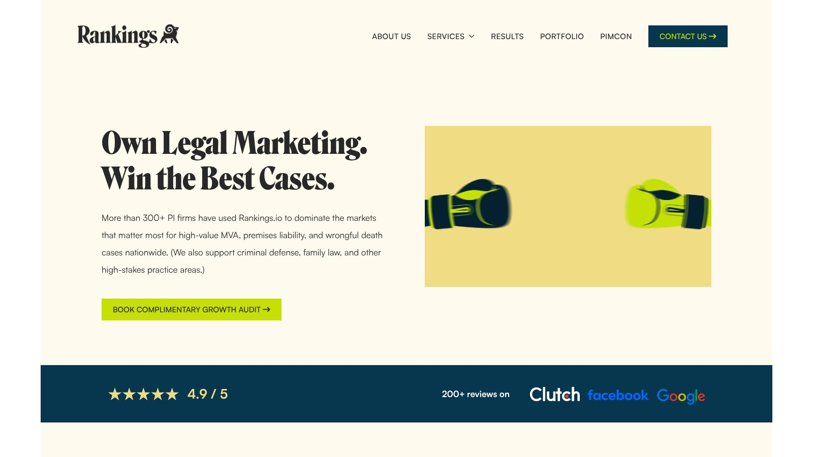
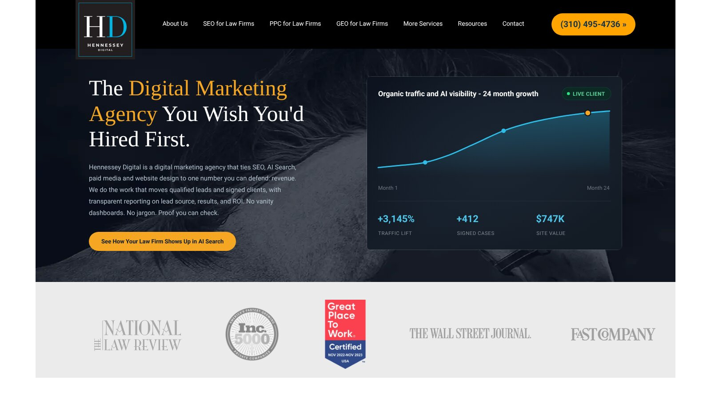
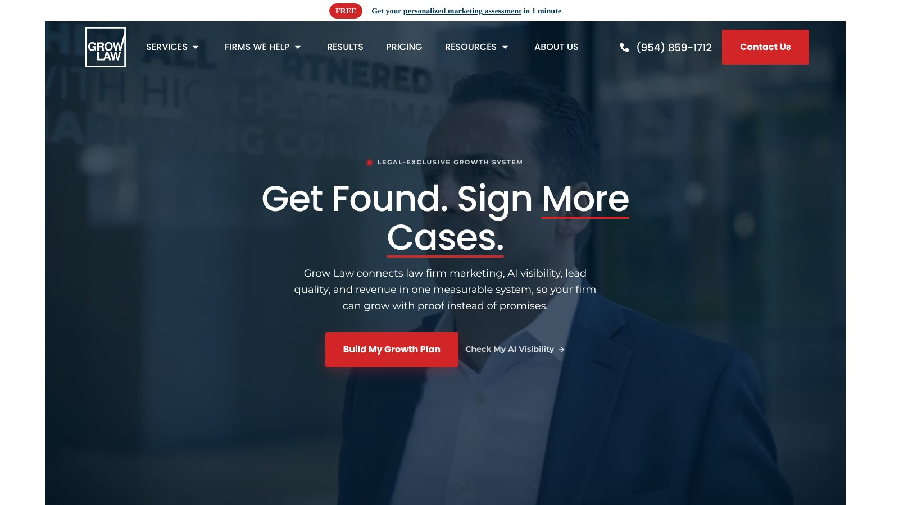
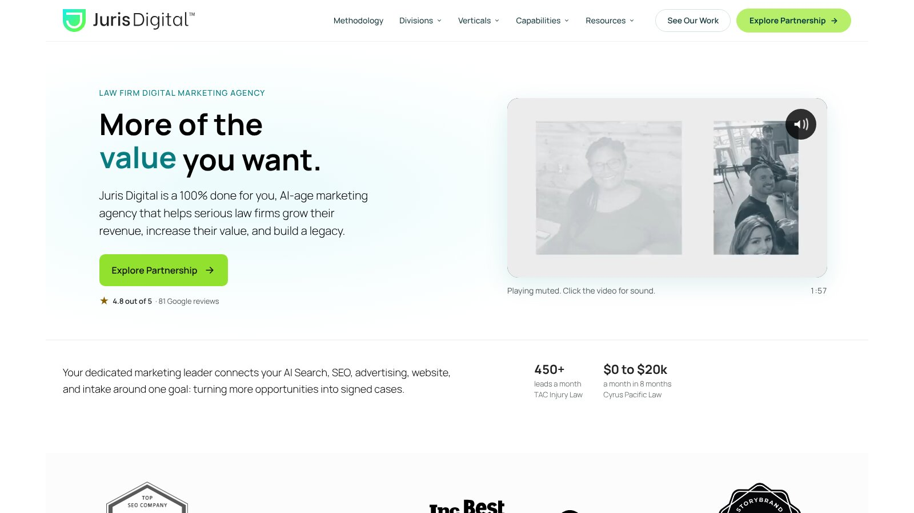
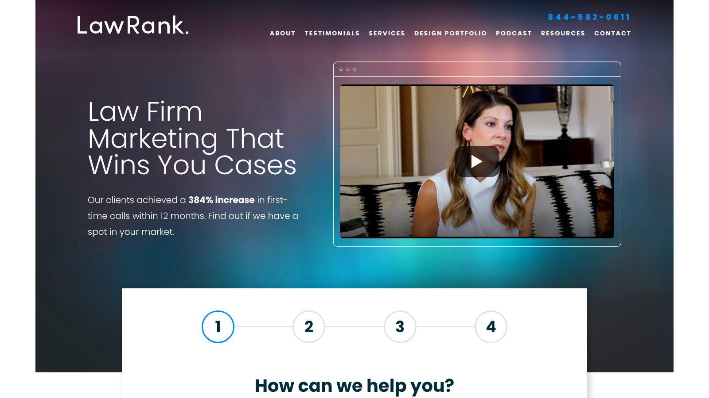
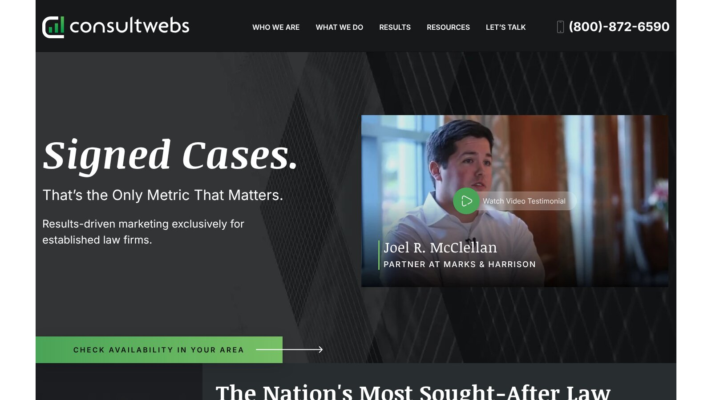
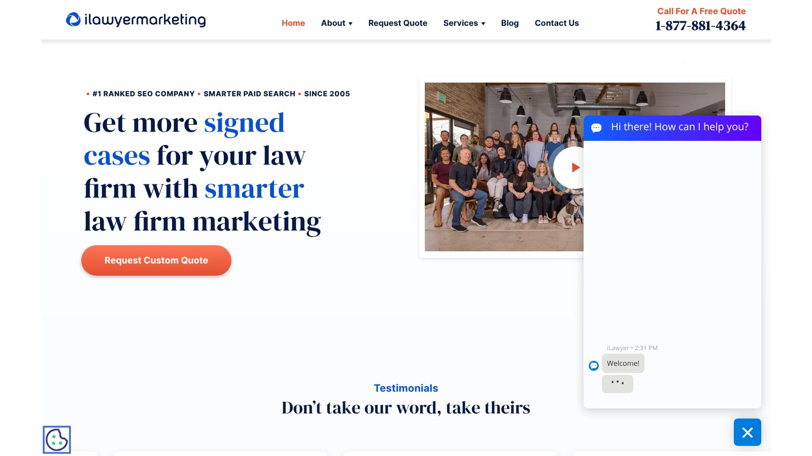
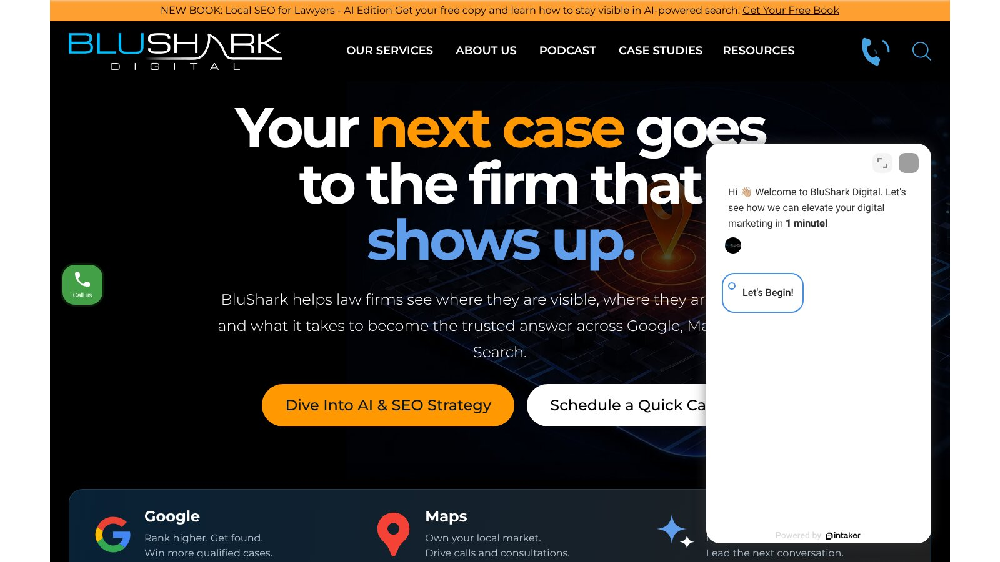
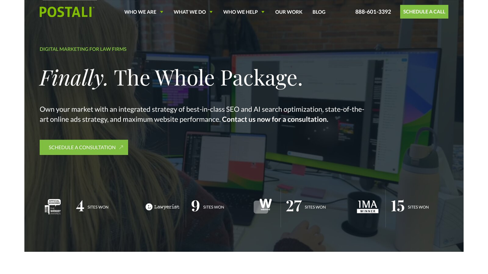
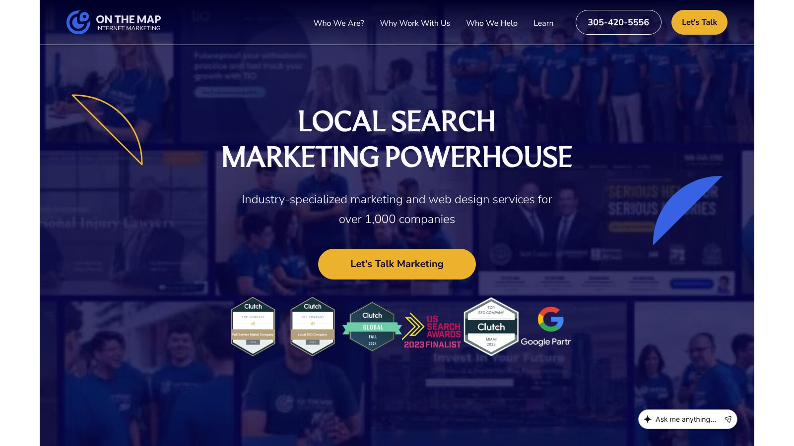

# 10 Best Law Firm SEO Companies: An Evidence-Based Buyer Guide

The best law firm SEO companies differ most on three things: practice focus, contract terms, and how open they are about price. Rankings.io centers on personal injury. Hennessey Digital and Grow Law publish a starting price range. Juris Digital asks for a 12-month commitment, while Rankings.io, Hennessey, and Grow Law say they work month to month.

We checked each agency's own website on November 20, 2026. Every result, rating, and award below is the agency's own claim, not something we measured. Use this guide to build a shortlist and a set of questions, then judge each firm on proof it can show you directly.

## Key Takeaways

* **Most agencies hide prices:** Only Hennessey Digital and Grow Law gave a starting price on the pages we checked.
* **Grow Law publishes a floor:** Its FAQ says SEO and AI visibility plans start at $3,600 a month with a website included.
* **Hennessey sets a higher entry point:** It says entry-level programs often begin in the low-to-mid five figures a month.
* **Contract terms vary widely:** Juris Digital asks for a 12-month campaign, while Hennessey states "month-to-month, no lock-ins."
* **Results claims are self-reported:** Case growth percentages on agency sites are marketing claims, so ask for verifiable data from your own market.

## Quick Comparison

The table summarizes what each agency's own homepage or FAQ said on November 20, 2026.

| Agency | Practice focus | Published price | Contract terms stated |
| --- | --- | --- | --- |
| Rankings.io | Personal injury specialty | Not published | Month-to-month |
| Hennessey Digital | Multiple, legal is its "deepest bench" | Low-to-mid five figures a month to start | Month-to-month, no lock-ins |
| Grow Law | Law firms only, 19 practice areas | From $3,600 a month | $0 setup, cancel anytime |
| Juris Digital | Multiple practice areas | Not published | 12-month campaign |
| LawRank | PI, criminal, family, and more | Not published | Not stated |
| Consultwebs | Established firms; PI, criminal, family | Not published | Not stated |
| iLawyerMarketing | Mostly PI, criminal, and family | Custom quote | Not stated |
| BluShark Digital | Law firm SEO | Not published | Not stated |
| Postali | Multiple practice areas | Quote | Not stated |
| On The Map Marketing | Law firms among other industries | Cost guide only | Not stated |

## How We Chose These Law Firm SEO Companies

We started with the ten law firm SEO companies named in our November 2026 topic plan. On November 20, 2026, we opened each agency's homepage and, where linked, its pricing or FAQ page. We recorded services, practice focus, published prices, and contract terms.

This is desk research. We did not hire these agencies or audit their client results. The order groups agencies by how much they disclose, not by a performance score. For context on what search work can deliver, see our [law firm SEO statistics](/legal-marketing/law-firm-seo-statistics/).

## 1. Rankings.io: Best for Personal Injury Focus

Rankings.io names personal injury as its specialty. It also lists criminal defense, family, immigration, and other practice areas. Its services include SEO, AI search optimization, Local Services Ads, Google Ads, ChatGPT ads, social, video, and WordPress web design.

The site promises "month-to-month flexibility" instead of a long-term contract. It claims more than 300 personal injury firms have used the agency and a 4.9 rating across 200 Clutch reviews. No price is published.

**Best fit:** Personal injury firms that want a specialist.

**Questions to ask:** Do you limit clients per market? Which reports show signed cases, not just traffic?

## 2. Hennessey Digital: Best for Larger Budgets

Hennessey Digital offers SEO, generative engine optimization, PPC, web design, digital PR, content, and conversion work. Its FAQ calls legal its "deepest bench."

[Hennessey Digital](https://hennessey.com/) gives a rare price signal. Its FAQ says entry-level programs often begin in the low-to-mid five figures a month. It also states "month-to-month, no lock-ins." The agency says it has done SEO since 2001 and served more than 100 law firms.

**Best fit:** Established firms with a large monthly budget.

**Questions to ask:** What does the entry program include? Who works on your account day to day?

## 3. Grow Law: Best for Published Pricing

Grow Law, formerly at growlawfirm.com and now at growlaw.co, says it works with law firms only. It lists SEO, local SEO, AI search optimization, web design, PPC, and lead generation.

The [Grow Law homepage](https://growlaw.co/) FAQ says SEO and AI visibility plans start at $3,600 a month with a website included. PPC management starts at $1,150 a month plus ad spend. It advertises $0 setup and "cancel anytime," and says clients own their website, content, and ad accounts.

**Best fit:** Small and midsize firms that want a known starting price.

**Questions to ask:** What is included at $3,600? How is the "3.8x typical year-one return" claim calculated? Its own footnote says individual results vary.

## 4. Juris Digital: Best for Content-Led Programs

Juris Digital calls itself a done-for-you marketing agency. It lists law firm SEO, generative engine optimization, legal content writing, web design, PPC, paid social, and intake and revenue operations.

The [Juris Digital FAQ](https://jurisdigital.com/) says it asks firms to sign a basic agreement committing to a 12-month campaign. It also states a "positive return on investment, guaranteed." It reports a 4.8 rating from 81 Google reviews.

**Best fit:** Firms ready for a year-long content and SEO plan.

**Questions to ask:** How exactly is the ROI guarantee measured, and what happens if it is missed?

## 5. LawRank: Best for SEO With Web Design

LawRank lists AI search optimization, SEO, PPC, attorney web design, social, and demand generation. Its intake form names personal injury, criminal defense, family, workers' compensation, and employment.

LawRank says it has spent more than a decade building rankings exclusively for law firms and that its team includes JD holders. It shows a 4.8 Google rating from 103 reviews. No price or contract term appears on the homepage.

**Best fit:** Firms that want SEO and a site rebuild from one team.

**Questions to ask:** What contract length do you require?

## 6. Consultwebs: Best for Established Firms

Consultwebs describes its work as "results-driven marketing exclusively for established law firms." Services include AI SEO, SEO, digital ads, web design and hosting, video, social, and email.

It claims more than 25 years of work with law firms. Its homepage tabs focus on personal injury, criminal defense, and family law. No pricing or contract terms are published.

**Best fit:** Larger firms in competitive markets.

**Questions to ask:** What qualifies a firm as "established"? Is there a minimum budget?

## 7. iLawyerMarketing: Best for Market Exclusivity

iLawyerMarketing offers law firm SEO, answer engine optimization, web design, Google Ads, Facebook marketing, video, and streaming ads. It says most clients are personal injury, criminal, and family law firms.

The agency says it has been in business since 2005. It also states that it limits the number of law firms it works with per geographic area. Pricing is by custom quote.

**Best fit:** Firms that want a market exclusivity promise in writing.

**Questions to ask:** How is your geographic area defined?

## 8. BluShark Digital: Best for SEO-Only Focus

BluShark Digital keeps its menu narrow. It lists technical SEO, content, link building, local SEO, and paid ads, with a strong focus on visibility in Google and AI search.

It claims more than 160 five-star Google reviews and a 4.9 rating on Clutch. No pricing, practice focus, or contract terms are published.

**Best fit:** Firms that already have a website and want focused SEO work.

**Questions to ask:** Which link building methods do you use, and can you share examples?

## 9. Postali: Best for Branding Plus SEO

Postali combines SEO and AI search optimization with PPC, website design, branding, content, direct mail, and PR. It lists personal injury first among many practice areas.

Its FAQ says most clients see PPC traction within weeks and SEO momentum in three to six months. Pricing is by quote.

**Best fit:** Firms planning a rebrand alongside SEO.

**Questions to ask:** What milestones should you expect in months three and six?

## 10. On The Map Marketing: Best for Local Search

On The Map Marketing calls itself a local search marketing company. Law firms are one of several industries it serves, alongside home services and healthcare.

It claims 10 years in business and more than 300 clients. Its pricing page is a general cost guide, not a package list. That guide says agencies charge $3,000 to $5,000 or more a month and warns readers to avoid agencies that guarantee results.

**Best fit:** Firms where local map visibility matters most.

**Questions to ask:** How many law firms do you serve, and in which markets?

## How to Compare Law Firm SEO Companies

Agency websites are sales pages. A fair comparison relies on what each firm will put in writing for your market.

### Ask for Your Own Numbers

Request an audit of your site and two local competitors. Ask which metrics the agency will report each month. These [law firm SEO metrics](/legal-marketing/law-firm-seo-metrics/) show which numbers connect to signed cases.

### Read the Contract First

Contract length is the clearest difference between these law firm SEO companies. A 12-month term protects the agency's ramp-up time. Month-to-month terms protect you. Either can work if the exit terms and asset ownership are clear.

### Check Who Owns the Work

Ask who owns the website, content, Google Business Profile, and ad accounts. Grow Law states that clients own their website, content, and ad accounts. Get that promise in your contract with any agency.

## Red Flags When Hiring an Agency

Some warning signs show up again and again. Watch for these before you sign.

* **Guaranteed rankings:** No agency controls Google's results, and On The Map's own guide warns against guarantees.
* **Vague reporting:** Traffic charts without calls, forms, or signed cases tell you little.
* **No exit plan:** If you cannot take your content and accounts with you, you are locked in.
* **Unverified case studies:** Ask to speak with a current client in a similar market.

If an agency cannot answer these points clearly, keep looking. Firms weighing directories or website platforms can compare [law firm marketing companies](/legal-marketing/law-firm-marketing-companies/) by service model. A firm that prefers to run the plan in house can start with our [90-day law firm SEO plan](/legal-marketing/law-firm-seo/).

## Frequently Asked Questions

### How Much Do Law Firm SEO Companies Charge?

Few publish prices. Grow Law starts at $3,600 a month with a website included. Hennessey Digital says its entry programs often begin in the low-to-mid five figures a month.

### Do Law Firm SEO Companies Require Long Contracts?

Some do. Juris Digital asks for a 12-month campaign. Rankings.io, Hennessey Digital, and Grow Law say they work month to month.

### Can an SEO Agency Guarantee Results?

No agency controls search rankings. Treat any guarantee as a contract term to read closely, not a promise of rankings.

### How Long Does Law Firm SEO Take?

Postali says most clients see SEO momentum in three to six months. Your timeline depends on competition and your site's starting point. Our [law firm marketing statistics](/legal-marketing/law-firm-marketing-statistics/) show how many firms invest in search at all.

### Is This an Independent Test of These Law Firm SEO Companies?

No. We compared each agency's own website on November 20, 2026. Results and ratings are the agencies' claims.

## Resources

* [Rankings.io](https://rankings.io/)
* [Hennessey Digital](https://hennessey.com/)
* [Grow Law](https://growlaw.co/)
* [Juris Digital](https://jurisdigital.com/)
* [LawRank](https://lawrank.com/)
* [Consultwebs](https://www.consultwebs.com/)
* [iLawyerMarketing](https://www.ilawyermarketing.com/)
* [BluShark Digital](https://blusharkdigital.com/)
* [Postali](https://www.postali.com/)
* [On The Map Marketing pricing guide](https://www.onthemap.com/pricing/)

All details were checked on each agency's own website on November 20, 2026. Services, prices, and terms can change.
