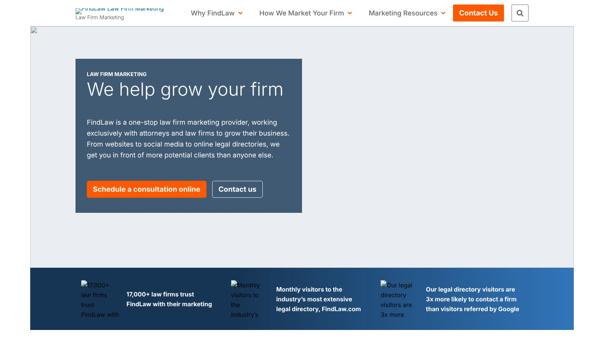
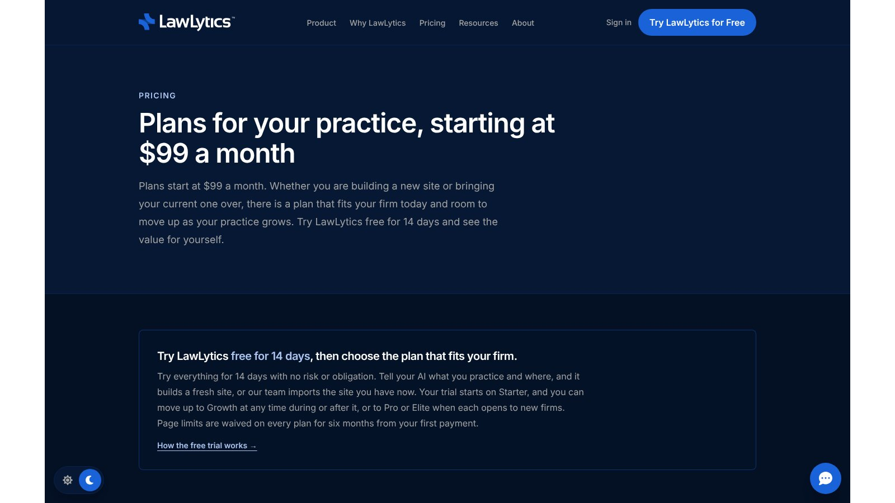
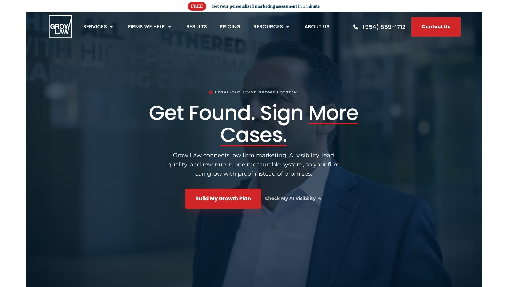
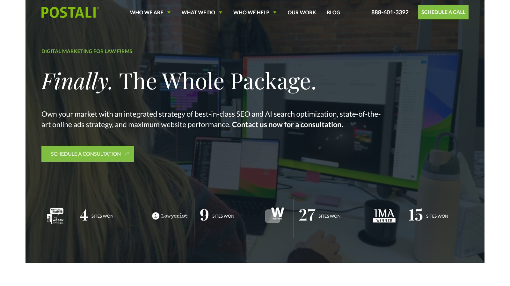
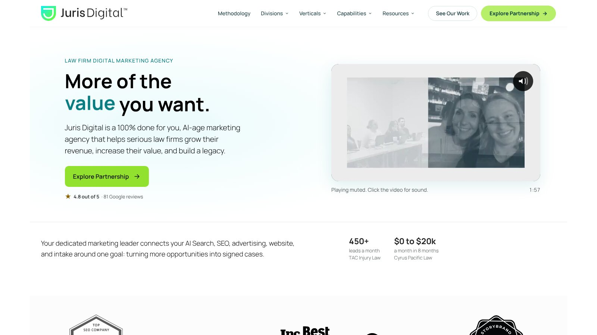
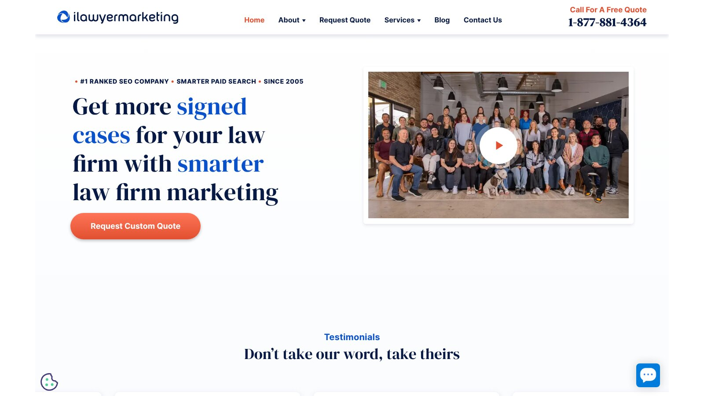
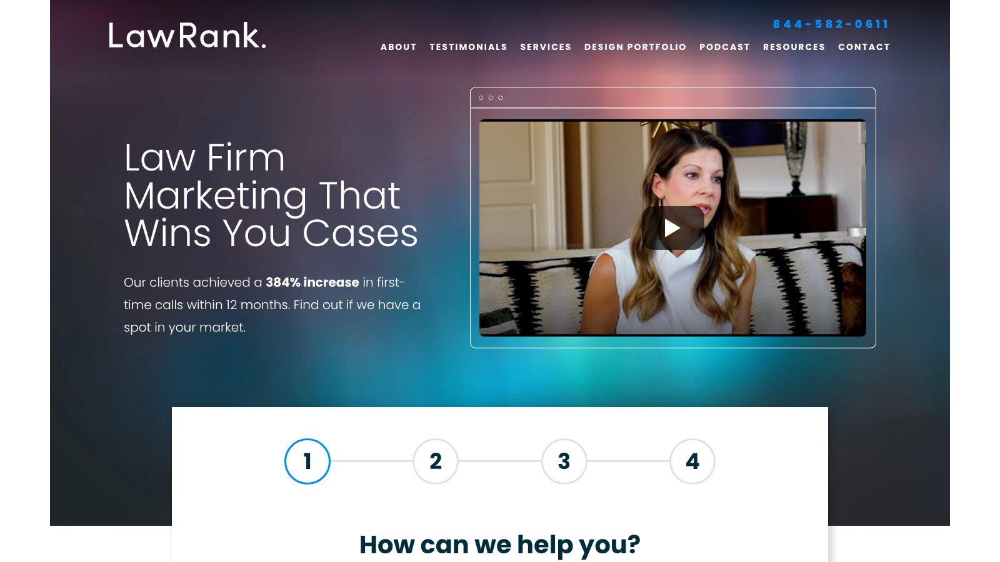
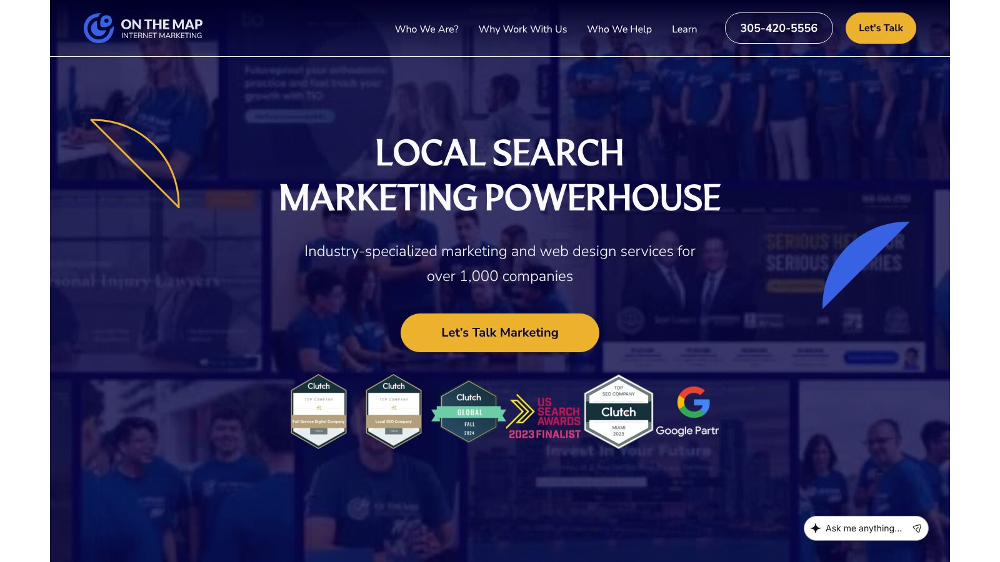
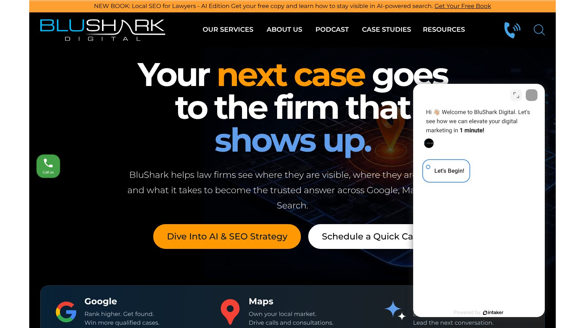

# 10 Best Law Firm Marketing Companies by Service Model

The best law firm marketing companies fall into a few service models, and choosing the model first saves time. FindLaw pairs a legal directory with websites and ads. LawLytics sells a do-it-yourself website platform from $99 a month. Grow Law, Consultwebs, and Postali run full-service programs. Others, like BluShark Digital and On The Map Marketing, focus on search.

We checked each company's own website on November 20, 2026. Every rating, result, and client count below is the company's own claim. Most firms do not publish prices, so we say so where that is the case.

## Key Takeaways

* **Pick the model before the vendor:** A directory, a website platform, and a full-service agency solve different problems at very different costs.
* **One platform publishes clear prices:** LawLytics lists Starter at $99 a month and Growth at $249 a month billed annually.
* **Full-service programs cost more:** Grow Law says its SEO and AI visibility plans start at $3,600 a month with a website included.
* **Directories bring reach:** FindLaw says more than 17,000 law firms trust it with their marketing.
* **Self-reported results need checking:** Case growth figures on agency sites are marketing claims, not audited outcomes.

## Service Models at a Glance

The table groups the ten law firm marketing companies by how they deliver work. "Not published" means the site showed no price.

| Company | Service model | Published price | Notable term or claim |
| --- | --- | --- | --- |
| FindLaw | Directory plus marketing suite | Not published | 17,000+ firms, its claim |
| LawLytics | DIY website platform | $99 to $249 a month now available | 14-day free trial |
| Grow Law | Full-service, law firms only | From $3,600 a month | $0 setup, cancel anytime |
| Consultwebs | Full-service for established firms | Not published | 25+ years, its claim |
| Postali | Brand, web, and search | Quote | Awards listed on site |
| Juris Digital | Search plus intake operations | Not published | 12-month campaign |
| iLawyerMarketing | Search, video, and streaming ads | Custom quote | Limits firms per area |
| LawRank | Web design plus SEO | Not published | Team includes JD holders |
| On The Map Marketing | Local search across industries | Cost guide only | 300+ clients, its claim |
| BluShark Digital | SEO and link building | Not published | 4.9 Clutch rating, its claim |

## How We Chose These Law Firm Marketing Companies

We began with the companies named in our November 2026 topic plan. On November 20, 2026, we opened each company's homepage and any linked pricing or FAQ page. Scorpion was on the original list, but its site showed a bot check to our browser and blocked our automated checks, so we left it out instead of describing it from memory. We added Grow Law, which publishes prices.

This is desk research. We did not hire these companies or audit their client results. For the wider market picture, see our [law firm marketing statistics](/legal-marketing/law-firm-marketing-statistics/).

## Directory and Platform Models

These options cost less than a full agency and give the firm more control. They suit solo lawyers and small firms.

### 1. FindLaw: Best Directory Plus Marketing Suite

FindLaw, a Thomson Reuters business, describes itself as a "one-stop law firm marketing provider" that works only with attorneys and law firms. Its lawyer marketing page lists websites, local SEO, directory advertising, pay-per-click, social media, content, Spanish-language marketing, and intake help through call answering and web chat.

FindLaw says more than 17,000 law firms trust it with their marketing. It does not publish prices and asks firms to schedule a consultation.

**Best fit:** Firms that want directory visibility and a website from one vendor.

**Questions to ask:** Which directory placements are included? Who owns the website if you leave?

### 2. LawLytics: Best DIY Website Platform

LawLytics calls itself an AI website platform for small law firms and solos. The [LawLytics pricing page](https://www.lawlytics.com/pricing) lists Starter at $99 a month, month to month, for up to 10 pages. Growth costs $249 a month billed annually for up to 100 pages.

Pro at $499 and Elite at $1,249 a month are marked "coming soon" for new clients. A full site import costs from $449, waived during the 14-day trial and for 90 days after.

**Best fit:** Solo lawyers who want to run their own site at a known price.

**Questions to ask:** How much editing time will you need each month? What happens to your content if you cancel?

## Full-Service Agency Models

Full-service agencies handle strategy, content, ads, and reporting. They cost more but take work off the firm's plate.

### 3. Grow Law: Best Full-Service Option With Published Pricing

Grow Law, formerly growlawfirm.com, says it works with law firms only. Its homepage FAQ says SEO and AI visibility plans start at $3,600 a month with a website included. PPC management starts at $1,150 a month plus ad spend.

It advertises $0 setup and "cancel anytime," and says clients own their website, content, and ad accounts. It claims a "3.8x typical year-one return," with a footnote that individual results vary.

**Best fit:** Small and midsize firms that want a full program with a known floor price.

**Questions to ask:** What exactly is included at $3,600 a month, and how is the return figure calculated?

### 4. Consultwebs: Best for Established Firms

Consultwebs markets itself "exclusively for established law firms." Services include AI SEO, digital ads, web design and hosting, video, social, and email marketing.

It claims more than 25 years of work with law firms and focuses its homepage on personal injury, criminal defense, and family law. No price is published.

**Best fit:** Larger firms with a marketing budget and competitive markets.

**Questions to ask:** Is there a minimum budget, and which services are bundled?

### 5. Postali: Best for Branding and Websites

Postali pairs search and paid ads with website design, branding, content, direct mail, and PR. Its homepage lists award counts for its websites, including four Webby wins and nine Lawyerist wins.

Its FAQ says most clients see PPC traction within weeks and SEO momentum in three to six months. Pricing is by quote.

**Best fit:** Firms planning a rebrand or a new site.

**Questions to ask:** Who owns the design files and site code after launch?

### 6. Juris Digital: Best for Intake and Revenue Operations

Juris Digital lists SEO, content, web design, PPC, paid social, and a revenue operations and intake service. That intake focus sets it apart from search-only agencies.

The [Juris Digital FAQ](https://jurisdigital.com/) asks firms to commit to a 12-month campaign and states a guaranteed positive return on investment.

**Best fit:** Firms that lose leads after the first call. Pair it with a review of your [law firm intake process](/law-firms/law-firm-intake-process/).

### 7. iLawyerMarketing: Best for Video and Streaming Ads

iLawyerMarketing offers SEO, answer engine optimization, web design, Google Ads, Facebook marketing, video production, and streaming TV ads. It says most clients are personal injury, criminal, and family firms.

It says it has worked since 2005 and limits how many firms it serves in each geographic area. Pricing is by custom quote.

**Best fit:** Firms adding video or streaming ads to a search program.

## Search-Focused Models

These companies lead with search visibility. They suit firms that already have a site and strong intake.

### 8. LawRank: Best for Web Design Plus SEO

LawRank lists SEO, AI search optimization, PPC, attorney web design, and social. It says it has spent more than a decade working exclusively for law firms and that its team includes JD holders.

No price or contract term appears on its homepage.

**Best fit:** Firms that want a redesign and SEO in one project.

**Questions to ask:** What contract length do you require, and who hosts the finished site?

### 9. On The Map Marketing: Best for Local Search

On The Map Marketing calls itself a local search marketing company. Law firms are one of several industries it serves. It claims 10 years in business and more than 300 clients.

Its pricing page is a general cost guide. It says agencies charge $3,000 to $5,000 or more a month and warns against agencies that guarantee results.

**Best fit:** Single-office firms that depend on map results.

### 10. BluShark Digital: Best SEO Specialist

BluShark Digital lists technical SEO, content, link building, local SEO, and paid ads. It claims more than 160 five-star Google reviews and a 4.9 Clutch rating.

No pricing or contract terms are published.

**Best fit:** Firms that want SEO only. Our list of [law firm SEO companies](/legal-marketing/law-firm-seo-companies/) compares more search specialists.

## Budget Ranges by Model

Published prices are rare, but the few that exist show how far apart the models sit. These figures come from the companies' own pages.

| Model | Example | Published monthly cost |
| --- | --- | --- |
| DIY website platform | LawLytics Starter | $99 |
| DIY website platform, annual | LawLytics Growth | $249 |
| Full-service SEO with website | Grow Law | From $3,600 |
| PPC management only | Grow Law | From $1,150 plus ad spend |

A year of LawLytics Growth costs $2,988. A year of Grow Law's entry SEO plan costs at least $43,200. That is our calculation from published prices, before ad spend and tax. The gap shows why the model matters more than the vendor name.

## How to Choose Among Law Firm Marketing Companies

The right partner depends on what your firm lacks today. Work through these points before you request proposals.

* **Site or no site:** If your website is weak, start with a platform or a web-focused agency.
* **Leads or intake:** If calls come in but few sign, fix intake before buying more traffic.
* **Time available:** A DIY platform needs your hours; an agency needs your budget.
* **Contract and ownership:** Get the term, exit terms, and asset ownership in writing.

Comparing proposals on these points makes the choice clearer. Our [law firm website statistics](/legal-marketing/law-firm-website-statistics/) also show how visits turn into inquiries.

## Frequently Asked Questions

### What Do Law Firm Marketing Companies Charge?

Few publish prices. LawLytics starts at $99 a month for a website platform. Grow Law starts at $3,600 a month for SEO with a website included.

### Is a Directory Better Than an Agency?

They do different jobs. A directory like FindLaw puts you in front of people searching its site. An agency builds your own visibility and site.

### Do Law Firm Marketing Companies Require Contracts?

Some do. Juris Digital asks for a 12-month campaign. Grow Law says you can cancel anytime. LawLytics Starter is month to month.

### Why Is Scorpion Not on This List?

Scorpion's site blocked our checks on November 20, 2026, so we could not verify its current offer. We did not describe it from memory.

### Is This an Independent Test of These Law Firm Marketing Companies?

No. We compared each company's own website on November 20, 2026. Results and ratings are the companies' claims.

## Resources

* [FindLaw lawyer marketing](https://www.findlaw.com/lawyer-marketing/)
* [LawLytics pricing](https://www.lawlytics.com/pricing)
* [Grow Law](https://growlaw.co/)
* [Consultwebs](https://www.consultwebs.com/)
* [Postali](https://www.postali.com/)
* [Juris Digital](https://jurisdigital.com/)
* [iLawyerMarketing](https://www.ilawyermarketing.com/)
* [LawRank](https://lawrank.com/)
* [On The Map Marketing pricing guide](https://www.onthemap.com/pricing/)
* [BluShark Digital](https://blusharkdigital.com/)

All details were checked on each company's own website on November 20, 2026. Services, prices, and terms can change.
