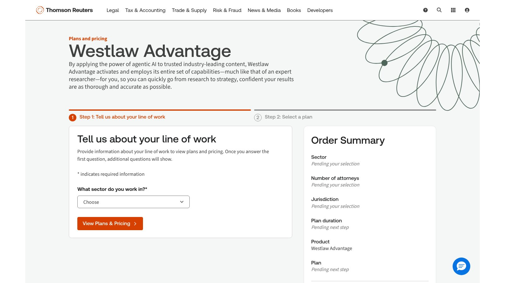
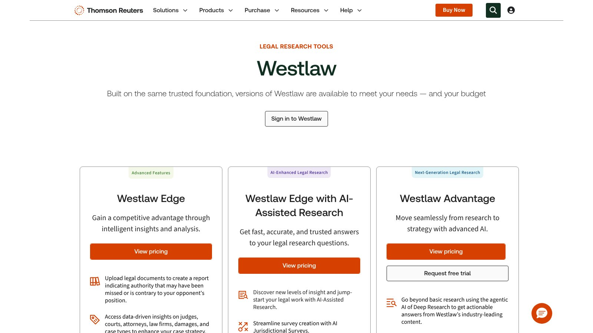
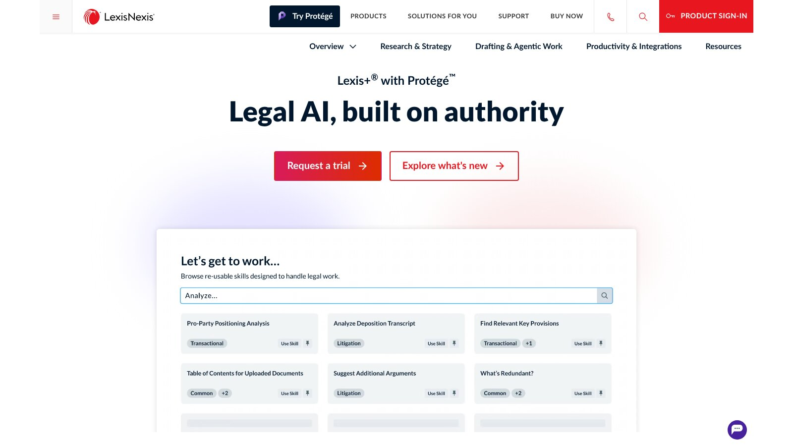

# Lexis vs Westlaw: Legal Research Platforms Compared

In the Lexis vs Westlaw choice, both platforms now pair a large legal library with generative AI and a citator. Westlaw Advantage publishes a starting price for small firms: $256.75 a month for single-circuit coverage. Lexis+ with Protégé does not publish a price on the pages we could read, but it offers a free trial to firms with 1 to 50 attorneys.

The better pick depends on budget certainty, the content you need beyond case law, and which AI workflow your team prefers. We checked official pages from both vendors on November 20 and 21, 2026.

## Key Takeaways

* **Westlaw publishes a floor price:** Westlaw Advantage starts at $256.75 a month for single-circuit coverage and $399.75 a month for all states and federal coverage.
* **Longer terms cost less:** Thomson Reuters says firms save 12% with a two-year subscription and 18% with a three-year subscription.
* **Lexis leads with a trial:** LexisNexis offers a free Lexis+ with Protégé trial limited to firms with 1 to 50 attorneys.
* **Both have AI research agents:** Westlaw lists Deep Research, and LexisNexis added Deep Legal Research to Protégé in October 2026.
* **Both check citations:** Westlaw uses KeyCite, and Lexis offers Shepard's Verify for uploaded documents.

## Side-by-Side Comparison

The table uses each vendor's own pages. "Not published" means we found no price on the pages we could open.

| Feature | Westlaw Advantage | Lexis+ with Protégé |
| --- | --- | --- |
| Starting price | $256.75 a month, single circuit | Not published |
| Broad coverage price | $399.75 a month, all states and federal | Not published |
| Online pricing | Firms with up to 10 attorneys | Not shown |
| Free trial | Free trial offered on product page | Free trial for 1 to 50 attorney firms |
| Citator | KeyCite | Shepard's |
| AI research agent | Deep Research | Deep Legal Research |
| Document analysis | Litigation Document Analyzer | Document upload and analysis |
| Classification system | West Key Number System | Not stated on pages read |
| Extra content named | Headnotes by attorney-editors | Lex Machina, Law360, CourtLink, Intelligize |

## How We Compared Lexis vs Westlaw

We opened the Westlaw Advantage pricing page, product page, and features page. For LexisNexis, its main product pages refused our automated checks, so we used its official free trial page and its October 29, 2026 product announcement on the LexisNexis blog.

This is desk research, not a hands-on test, and we did not hold paid accounts. Our wider [legal research software](/legal-tech/legal-research-software/) comparison covers Bloomberg Law, vLex, and other options.

## Pricing and Contract Terms

Price transparency is the clearest gap between the two vendors. One posts numbers for small firms, and the other routes buyers to sales or a trial.

### Westlaw Advantage Pricing

The [Westlaw Advantage pricing page](https://sales.legalsolutions.thomsonreuters.com/en-us/products/westlaw-advantage/plans-pricing) says pricing starts at $256.75 a month for single-circuit coverage and $399.75 a month for all states and federal coverage. Online pricing is for firms with up to 10 attorneys and for new customers. Larger firms contact sales.

Thomson Reuters says firms save 12% with a two-year subscription and 18% with a three-year subscription. It also says new features are added during the initial contract term without a plan upgrade. Most customers get online access within one business day.

### Lexis+ Pricing

We did not find a published Lexis+ price on the pages we could read. The LexisNexis store returned no content to our checks, and its product pages refused access. The official trial page offers a free trial but limits it to firms with 1 to 50 attorneys. It does not state the trial length or a price.

That means a small firm comparing Lexis vs Westlaw on cost will need a written Lexis quote. Ask for the same jurisdictions and term length as your Westlaw option so the two numbers line up.

## AI Research Tools

Both vendors now sell AI agents that plan and run multi-step research. Single-question answers are only part of the offer. The names differ, but the goals are close.

### Westlaw Deep Research and Analyzers

Thomson Reuters describes Westlaw Advantage as "applying the power of agentic AI to trusted industry-leading content." Its Deep Research tool "works like an expert legal researcher, planning and performing thorough investigations."

The features page also lists the Litigation Document Analyzer, which the vendor says "goes beyond citation checks to identify mischaracterizations of the law." Other named tools include Claims Explorer, AI Jurisdictional Surveys with KeyCite status indicators, and AI summaries for dockets.

### Lexis+ with Protégé

LexisNexis calls Protégé "the fastest legal generative AI with conversational search, drafting, summarization and document analysis." Its trial page says Protégé can summarize cases, complaints, and statutes, or load outside documents for analysis.

The [October 29, 2026 LexisNexis announcement](https://www.lexisnexis.com/blog/en-us/legal/product-announcement/integrated-legal-ai-platform) added Deep Legal Research, which it says examines relevant and adverse authority, exceptions, and jurisdictional differences. The same post says the Skills Library now has 92 legal skills from LexisNexis and Claude.

## Citators: KeyCite vs Shepard's

Citation checking is where many lawyers form their loyalty. Both platforms build AI tools around their citator.

Westlaw's features page lists KeyCite tools such as KeyCite Cited With, KeyCite Overruled in Part, and KeyCite Overruling Risk. Its AI Jurisdictional Surveys also show KeyCite status indicators.

LexisNexis announced Shepard's Verify, which lets users upload a document and check its citations against Shepard's content. The post said checks for quoted language and holding attribution were coming later in the fall, so confirm whether they are live in your account.

Whichever you use, read every authority yourself before you file. A method for [checking LexisNexis AI sources](/legal-tech/lexisnexis-legal-ai-source-checking/) applies to either platform.

## Content Beyond Case Law

The libraries differ most in what sits next to primary law. That extra content can decide the Lexis vs Westlaw question for some practices.

### Westlaw Editorial Tools

Thomson Reuters highlights the West Key Number System, which it calls "the definitive classification system of U.S. case law for over 100 years." It also lists Headnotes, described as "concise summaries crafted by attorney-editors."

### Lexis Connected Sources

The October 2026 LexisNexis post says Protégé can now draw on Lex Machina litigation analytics, Intelligize corporate disclosures, CourtLink dockets, Law360 news, and firm content in NetDocuments. Access depends on your subscription. The post also says Vault capacity rose from 500 to 10,000 documents.

## Firm Fit

Each platform suits a different kind of buyer. Use these profiles as a starting point, then test both.

### Westlaw May Fit If

Westlaw fits small firms that want a published price before talking to sales. It also fits litigators who rely on the Key Number System, Headnotes, and KeyCite-linked AI tools.

### Lexis May Fit If

Lexis fits firms that want litigation analytics, legal news, and docket data inside the same AI workspace. Firms with 1 to 50 attorneys can also test it through the free trial before asking for a quote.

### Test Both on the Same Question

Run the same research question on both trials. Compare the answer, the sources cited, and how quickly you can verify each authority. Pick a question from a matter you have already closed, so you know what a complete answer looks like. Note any authority one platform found and the other missed. Time how long it takes a lawyer to confirm each citation with the citator. Then repeat the test with a second question from a different practice area, because coverage strengths can vary by subject. Those notes give you a fair basis for the final decision.

## Workspaces, Skills, and Firm Content

Research rarely ends with a search result. Both vendors now pitch shared spaces where drafts, documents, and checks live together.

LexisNexis says Protégé Workrooms are secure matter spaces that hold Vaults, drafts, discussions, skills, and citation checks, with access levels and an activity log. A Skill Creator lets users test and refine a skill before publishing it. Skills Administration gives firms one place to add, turn off, and assign access to skills. Vault Administration adds central control over sensitive content.

Westlaw Advantage centers its pitch on research and litigation analysis rather than custom skills. Its named tools include Deep Research, the Litigation Document Analyzer, the Complaint Analyzer, Claims Explorer, and AI Jurisdictional Surveys. Thomson Reuters sells a separate assistant, CoCounsel Legal, for broader drafting and document work.

For firms that want to build repeatable AI workflows, this is a real point of difference in the Lexis vs Westlaw decision. Firms that mainly want fast, checked research may care less.

## Access and Onboarding

Getting started is simpler on the side that publishes prices. Thomson Reuters says most new Westlaw Advantage customers get online access within one business day. Online pricing is limited to new customers, and existing customers are told to call sales.

LexisNexis routes small firms to its free trial form. The form asks you to confirm you work at a firm with 1 to 50 attorneys. After the trial, you will need a quote to compare against Westlaw's listed price.

Adoption of research tools is already high across the profession, as our [legal technology statistics](/legal-tech/legal-technology-statistics/) show. The harder question is which platform your team will use well every day.

## Questions to Ask Before You Sign

A short list of questions keeps the Lexis vs Westlaw comparison grounded in your own practice.

* **Jurisdictions:** Which states and federal circuits do you need, and what does each add to the price?
* **Term length:** Is a two- or three-year discount worth the longer commitment?
* **AI features:** Which AI tools are in your plan, and which cost extra?
* **Citator checks:** Can the AI tools show citator status next to every authority they return?
* **Exit terms:** What happens to saved research, folders, and uploaded documents if you cancel?

Getting these answers in writing from both vendors makes their quotes comparable and gives you a record to check at renewal time.

## Sample Annual Cost on Westlaw

Because Westlaw publishes small-firm prices, you can model a year before you call. The figures below use its listed monthly prices, before tax and before any multi-year discount.

| Westlaw Advantage coverage | Monthly price | Twelve months |
| --- | --- | --- |
| Single circuit | $256.75 | $3,081 |
| All states and federal | $399.75 | $4,797 |

These are our calculations from published prices, not quotes. The vendor's 12% two-year and 18% three-year discounts would lower them, in return for a longer commitment. A matching Lexis table is not possible from public pages.

## Frequently Asked Questions

### Is Lexis or Westlaw Cheaper?

We cannot say from public data. Westlaw Advantage starts at $256.75 a month for single-circuit coverage. LexisNexis did not publish a Lexis+ price on the pages we could read, so you need a quote.

### Does Lexis Have a Free Trial?

Yes. LexisNexis offers a free Lexis+ with Protégé trial, limited to firms with 1 to 50 attorneys.

### What Is the Difference Between KeyCite and Shepard's?

KeyCite is Westlaw's citator, and Shepard's is the LexisNexis citator. Both flag how later cases treat an authority. Both vendors now tie AI tools to their citator.

### Which Platform Has Better AI?

Both now sell AI research agents. Westlaw lists Deep Research and a Litigation Document Analyzer. Lexis added Deep Legal Research and a skills library to Protégé. Test both on your own matters. Our list of [AI tools for lawyers](/legal-tech/ai-tools-for-lawyers/) covers other options.

### Is This a Hands-On Test of Lexis vs Westlaw?

No. We compared official vendor pages checked on November 20 and 21, 2026, and did not hold paid accounts.

## Resources

* [Westlaw Advantage plans and pricing](https://sales.legalsolutions.thomsonreuters.com/en-us/products/westlaw-advantage/plans-pricing)
* [Westlaw Advantage product page](https://legal.thomsonreuters.com/en/products/westlaw-advantage)
* [Westlaw Advantage features](https://legal.thomsonreuters.com/en/products/westlaw-advantage/features)
* [Thomson Reuters Westlaw](https://legal.thomsonreuters.com/en/products/westlaw)
* [Lexis+ with Protégé free trial](https://law.lexisnexis.com/digital/bing-launch-PMAX/free-trial)
* [What's New in Lexis+ with Protégé (October 29, 2026)](https://www.lexisnexis.com/blog/en-us/legal/product-announcement/integrated-legal-ai-platform)

All details were checked on official vendor pages on November 20 and 21, 2026. Prices exclude tax and can change.
