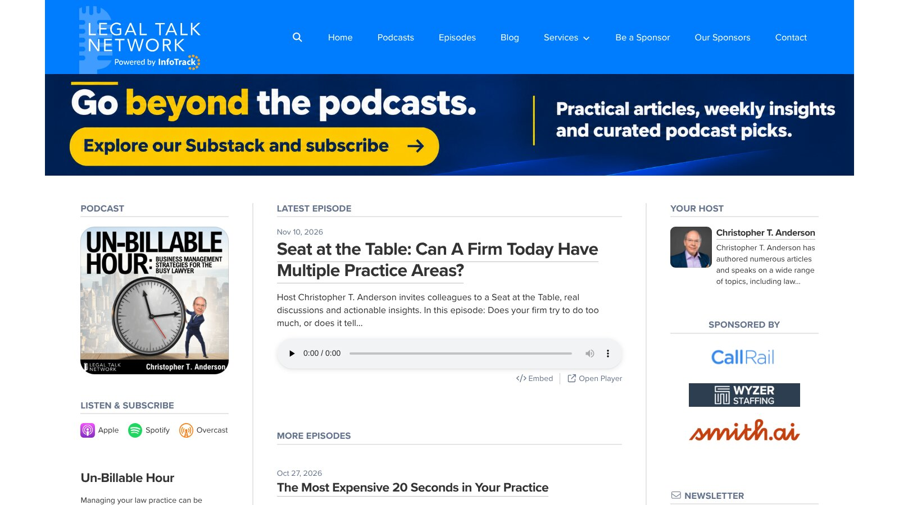
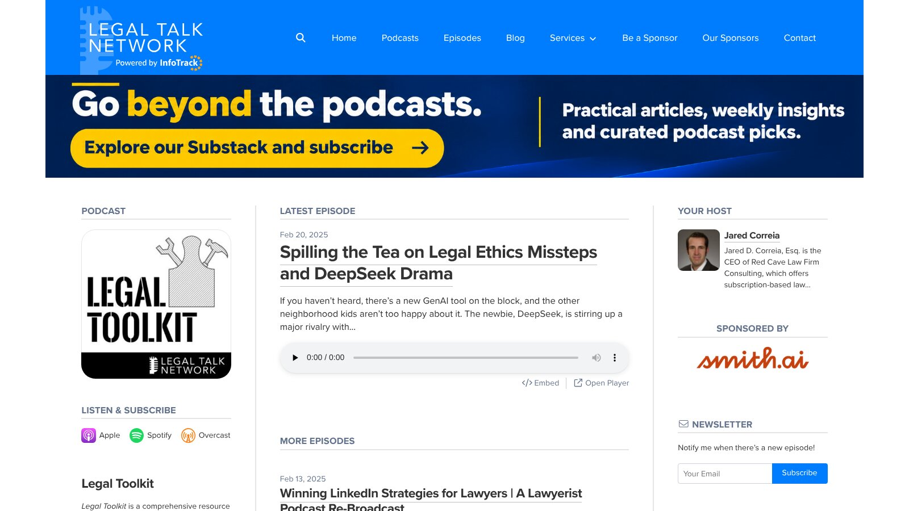
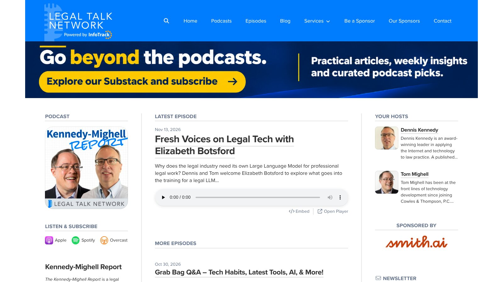
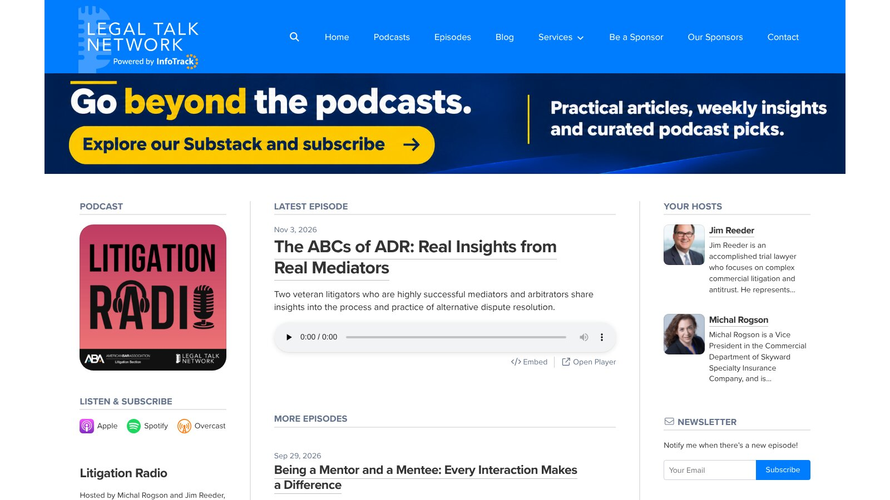
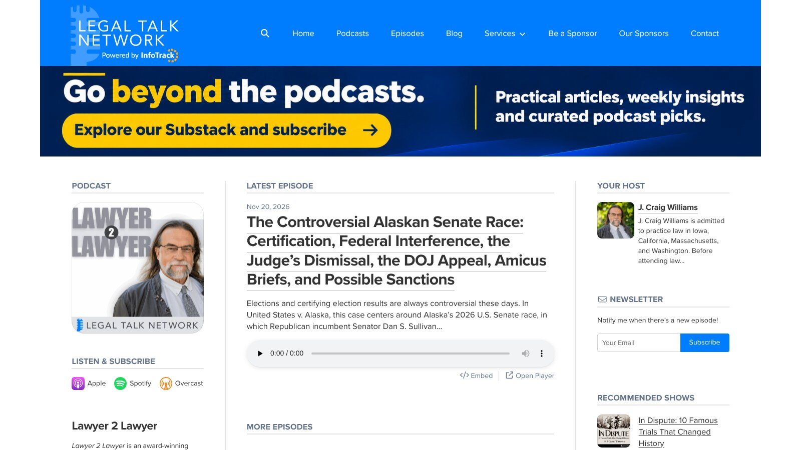
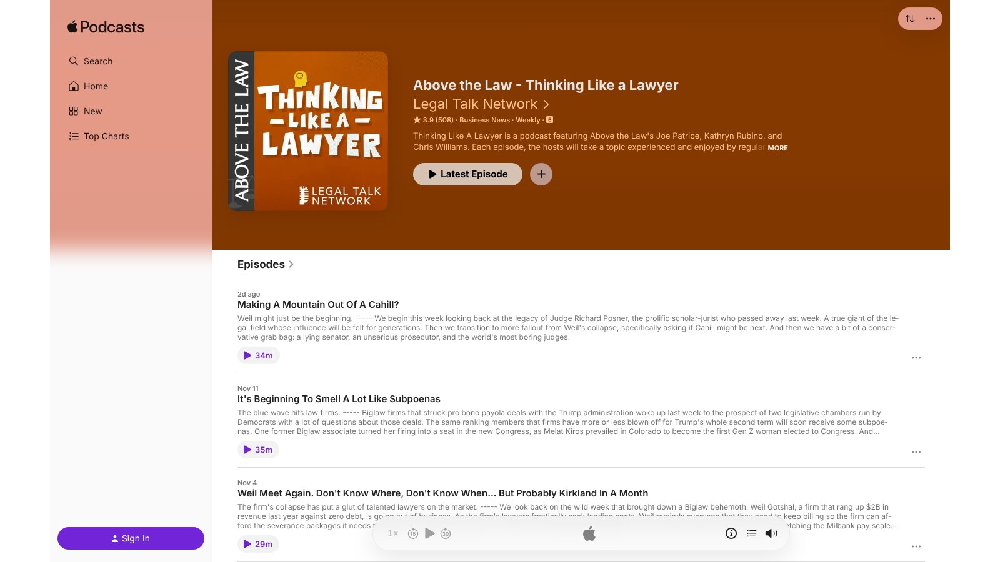
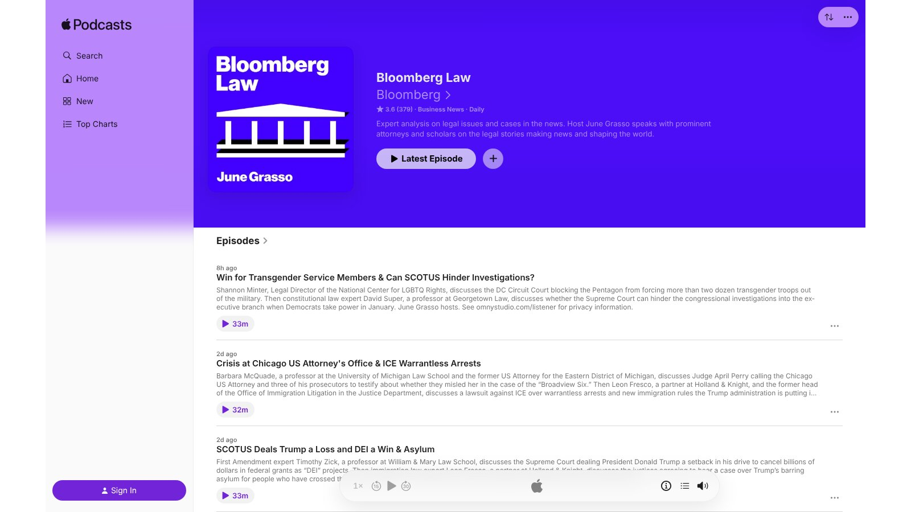
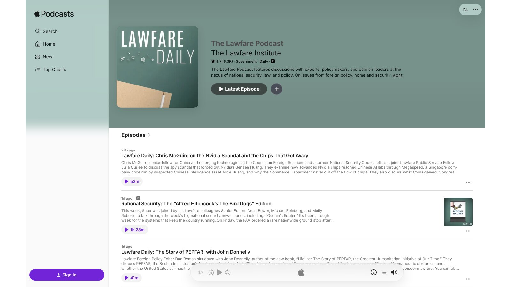
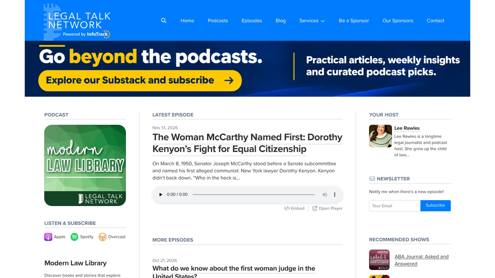
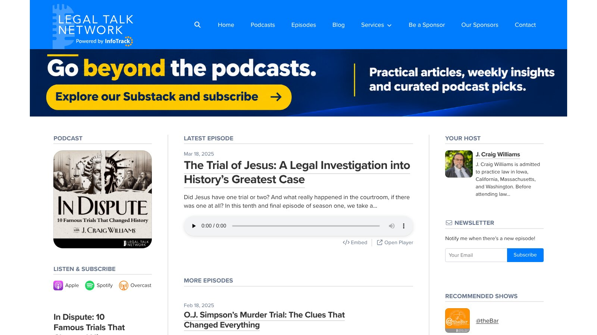

# 15 Best Legal Podcasts for Lawyers and Law Firm Leaders

The best legal podcasts for lawyers fall into a few clear groups. Lawyerist, Un-Billable Hour, and Legal Toolkit cover running a firm. The Kennedy-Mighell Report and The Legal Geeks cover legal technology. Lunch Hour Legal Marketing covers getting clients. Litigation Radio serves trial lawyers. Amicus, Strict Scrutiny, Bloomberg Law, Lawfare, Lawyer 2 Lawyer, and Thinking Like a Lawyer cover legal news. Modern Law Library and In Dispute bring legal history to life.

We checked each show's official page or Apple Podcasts listing on November 21, 2026, and noted the most recent episode we saw. Two picks are archive shows with no new episodes, and we label them so you know what to expect.

## Key Takeaways

* **Pick by job, not popularity:** Practice management, marketing, technology, and litigation shows each solve a different problem for a firm.
* **Most picks are active:** Eleven of the fifteen shows posted an episode in November 2026 on the pages we checked, and Lawyerist posted in late October.
* **Legal Talk Network hosts many of them:** Nine shows on this list have pages on Legal Talk Network, and it also produces Thinking Like a Lawyer.
* **Two shows are archives:** Legal Toolkit's latest episode is from February 2025, and In Dispute finished its ten-episode first season in March 2025.
* **News shows move fastest:** Bloomberg Law and The Lawfare Podcast are listed as daily shows on Apple Podcasts.

## Quick Guide to the 15 Legal Podcasts

The table lists each show's focus and the latest episode date we saw. "Recent" means the listing showed a relative time, such as "2d ago," instead of a calendar date.

| Podcast | Best for | Host or publisher | Latest episode seen |
| --- | --- | --- | --- |
| Lawyerist Podcast | Running a small firm | Stephanie Everett, Zack Glaser | Oct 29, 2026 |
| Un-Billable Hour | Firm management | Christopher T. Anderson | Nov 10, 2026 |
| Legal Toolkit | Practice management archive | Jared Correia | Feb 20, 2025 |
| Kennedy-Mighell Report | Legal technology | Dennis Kennedy, Tom Mighell | Nov 13, 2026 |
| The Legal Geeks | Tech and geek culture | Jessica Mederson, Joshua Gilliland | Episode list on site |
| Lunch Hour Legal Marketing | Law firm marketing | Gyi Tsakalakis, Conrad Saam | Nov 18, 2026 |
| Litigation Radio | Trial lawyers | Michal Rogson, Jim Reeder | Nov 3, 2026 |
| Lawyer 2 Lawyer | Legal news analysis | J. Craig Williams | Nov 20, 2026 |
| Thinking Like a Lawyer | Big Law and culture | Above the Law, Legal Talk Network | Recent |
| Amicus | Supreme Court | Dahlia Lithwick, Slate | Nov 21, 2026 |
| Strict Scrutiny | Supreme Court | Leah Litman, Kate Shaw, Melissa Murray | Nov 16, 2026 |
| Bloomberg Law | Daily legal news | June Grasso, Bloomberg | Recent |
| The Lawfare Podcast | National security law | The Lawfare Institute | Recent |
| Modern Law Library | Legal books and history | Lee Rawles | Nov 13, 2026 |
| In Dispute | Famous trials archive | J. Craig Williams | Mar 18, 2025 |

## How We Chose These Legal Podcasts

We started from the shows named in our November 2026 topic plan. On November 21, 2026, we opened each show's page and recorded its description, hosts, and latest episode. Two original picks did not make the list. The Daily Beans describes itself as a progressive news podcast, which is broader than legal practice. Above the Law's site did not list its show, so we verified it through Apple Podcasts instead.

This is an editorial shortlist, not a ranking by downloads. We did not receive anything from these shows. For the business context many of these shows discuss, see our [law firm profitability statistics](/law-firms/law-firm-profitability-statistics/).

## Practice Management Podcasts

These shows focus on running the business side of a law firm. They suit owners, managing partners, and firm administrators.

### 1. Lawyerist Podcast

The [Lawyerist Podcast page](https://legaltalknetwork.com/podcasts/lawyerist-podcast/) describes it as "a show about lawyering and law practice hosted by Stephanie Everett and Zack Glaser of Lawyerist." Recent topics include firm growth, leadership, and AI for lawyers. The latest episode we saw, from October 29, 2026, was about building a team that can grow with a firm.

**Best for:** Small firm owners who want practical systems advice.

### 2. Un-Billable Hour

Un-Billable Hour calls itself "a law practice advisory podcast." Host Christopher T. Anderson covers marketing, hiring, cash flow, and firm growth. A November 10, 2026 episode asked whether a firm today can have multiple practice areas.

**Best for:** Firm owners thinking about pricing, cash flow, and staffing. Pair it with our [law firm billing statistics](/law-firms/law-firm-billing-statistics/).

### 3. Legal Toolkit (Archive)

Legal Toolkit describes itself as "a comprehensive resource for professionals in law practice management." Host Jared Correia covers services, ideas, and programs for firms. The latest episode we saw is from February 20, 2025, so treat it as an archive.

**Best for:** Browsing past practice management episodes.

## Legal Technology Podcasts

Technology shows help firms judge new tools before buying. These two take different angles.

### 4. Kennedy-Mighell Report

The Kennedy-Mighell Report is "a legal technology podcast with an Internet focus." Hosts Dennis Kennedy and Tom Mighell often discuss AI tools in practice. A November 13, 2026 episode featured fresh voices on legal tech.

**Best for:** Lawyers tracking legal tech and AI. Our list of [AI tools for lawyers](/legal-tech/ai-tools-for-lawyers/) pairs well with it.

### 5. The Legal Geeks

The Legal Geeks are attorneys Jessica Mederson and Joshua Gilliland. Their site says the show covers "everything from eDiscovery to Sci Fi" from a lawyer's point of view. Episodes play from the podcast page on their site.

**Best for:** Lawyers who enjoy legal analysis of pop culture.

## Marketing and Litigation Podcasts

These shows serve two specific audiences: firms chasing new clients and lawyers who try cases.

### 6. Lunch Hour Legal Marketing

The show opens with a question: "Are you hungry for more clients?" Hosts Gyi Tsakalakis and Conrad Saam cover client acquisition and website teardowns. A November 18, 2026 episode covered analog marketing in a digital world.

**Best for:** Firms reviewing their marketing. Compare [law firm marketing companies](/legal-marketing/law-firm-marketing-companies/) if you plan to hire help.

### 7. Litigation Radio

Litigation Radio features "conversations with top litigators, judges, and experts." It is brought to listeners by the ABA Litigation Section, with hosts Michal Rogson and Jim Reeder. A November 3, 2026 episode covered alternative dispute resolution.

**Best for:** Litigators building their skills and careers.

## Legal News and Analysis Podcasts

News shows keep lawyers current on rulings and policy. They vary from daily briefings to weekly deep dives.

### 8. Lawyer 2 Lawyer

Lawyer 2 Lawyer is "an award-winning podcast covering relevant, contemporary news from a legal perspective." Host J. Craig Williams brings in guests on recent rulings. The latest episode we saw, from November 20, 2026, covered a disputed Alaska Senate race.

**Best for:** Weekly legal news with practitioner guests.

### 9. Above the Law: Thinking Like a Lawyer

Apple Podcasts lists this weekly show from Legal Talk Network. It features Above the Law's Joe Patrice, Kathryn Rubino, and Chris Williams, who take everyday topics and look at them through a legal lens. Apple lists it as explicit.

**Best for:** Big Law news with humor.

### 10. Amicus

Slate describes [Amicus](https://slate.com/podcasts/amicus) as "a legal podcast with Slate's Dahlia Lithwick" about the Supreme Court and its justices. Its newest episode, dated November 21, 2026, was titled "Move Fast and Fix Things."

**Best for:** Supreme Court coverage for a general audience.

### 11. Strict Scrutiny

Crooked Media calls [Strict Scrutiny](https://crooked.com/podcast-series/strict-scrutiny/) "a podcast about the United States Supreme Court and the legal culture that surrounds it." Hosts Leah Litman, Kate Shaw, and Melissa Murray are law professors. A November 16, 2026 episode asked whether the Court will make it harder to sue federal officers.

**Best for:** In-depth Supreme Court analysis.

### 12. Bloomberg Law

Apple Podcasts lists Bloomberg Law as a daily show hosted by June Grasso, with "expert analysis on legal issues and cases in the news." Episodes are short news segments.

**Best for:** Daily legal headlines.

### 13. The Lawfare Podcast

The Lawfare Institute's show "features discussions with experts, policymakers, and opinion leaders at the nexus of national security, law, and policy." Apple lists it as daily.

**Best for:** National security and government lawyers.

## Legal History Podcasts

History shows offer a break from daily practice while still teaching something useful.

### 14. Modern Law Library

Host Lee Rawles talks with authors of books that "explore the law in new and surprising ways." A November 13, 2026 episode covered Dorothy Kenyon's fight for equal citizenship.

**Best for:** Readers who like legal history and nonfiction.

### 15. In Dispute (Archive)

In Dispute brings "ten famous court cases" to life through reenactments drawn from trial transcripts. Host J. Craig Williams closed the first season with its tenth episode on March 18, 2025.

**Best for:** A finished ten-part series to listen through.

## How to Fit Legal Podcasts Into a Busy Week

A plan helps you get value from legal podcasts without adding hours. Try these habits.

* **Match shows to goals:** Pick one show for the business side and one for your practice area.
* **Use commute time:** Short news shows like Bloomberg Law fit a drive.
* **Share episodes:** Send one useful episode to your team each month.
* **Check for CLE:** Ask your state bar whether any podcast listening counts toward credit.

A small routine like this keeps listening useful rather than background noise.

## Frequently Asked Questions

### What Are the Best Legal Podcasts for Lawyers?

For running a firm, try Lawyerist or Un-Billable Hour. For technology, try the Kennedy-Mighell Report. For news, try Lawyer 2 Lawyer, Amicus, or Strict Scrutiny.

### Are These Legal Podcasts Still Active?

Eleven of the fifteen posted an episode in November 2026 on the pages we checked, and Lawyerist posted on October 29. Legal Toolkit and In Dispute are archives, and The Legal Geeks site shows episodes without dates.

### Where Can I Listen to These Shows?

Most are on Legal Talk Network, Apple Podcasts, and Spotify. Amicus is on Slate, and Strict Scrutiny is on Crooked Media.

### Do Legal Podcasts Count for CLE?

It depends on your state. Check with your state bar before you count any podcast toward credit.

### How Did You Choose These Legal Podcasts?

We started from our November 2026 topic plan and checked each show's page on November 21, 2026. This is an editorial list, not a ranking by downloads.

## Resources

* [Legal Talk Network: Lawyerist Podcast](https://legaltalknetwork.com/podcasts/lawyerist-podcast/)
* [Legal Talk Network: Un-Billable Hour](https://legaltalknetwork.com/podcasts/un-billable-hour/)
* [Legal Talk Network: Legal Toolkit](https://legaltalknetwork.com/podcasts/legal-toolkit/)
* [Legal Talk Network: Kennedy-Mighell Report](https://legaltalknetwork.com/podcasts/kennedy-mighell-report/)
* [The Legal Geek Podcasts](https://thelegalgeeks.com/the-legal-geek-podcasts/)
* [Legal Talk Network: Lunch Hour Legal Marketing](https://legaltalknetwork.com/podcasts/lunch-hour-legal-marketing/)
* [Legal Talk Network: Litigation Radio](https://legaltalknetwork.com/podcasts/litigation-radio/)
* [Legal Talk Network: Lawyer 2 Lawyer](https://legaltalknetwork.com/podcasts/lawyer-2-lawyer/)
* [Apple Podcasts: Above the Law Thinking Like a Lawyer](https://podcasts.apple.com/us/podcast/above-the-law-thinking-like-a-lawyer/id976331027)
* [Slate: Amicus](https://slate.com/podcasts/amicus)
* [Crooked Media: Strict Scrutiny](https://crooked.com/podcast-series/strict-scrutiny/)
* [Apple Podcasts: Bloomberg Law](https://podcasts.apple.com/us/podcast/bloomberg-law/id277975394)
* [Apple Podcasts: The Lawfare Podcast](https://podcasts.apple.com/us/podcast/the-lawfare-podcast/id498897343)
* [Legal Talk Network: Modern Law Library](https://legaltalknetwork.com/podcasts/modern-law-library/)
* [Legal Talk Network: In Dispute](https://legaltalknetwork.com/podcasts/in-dispute/)

All show details were checked on official show pages or Apple Podcasts on November 21, 2026. Episode schedules can change.
