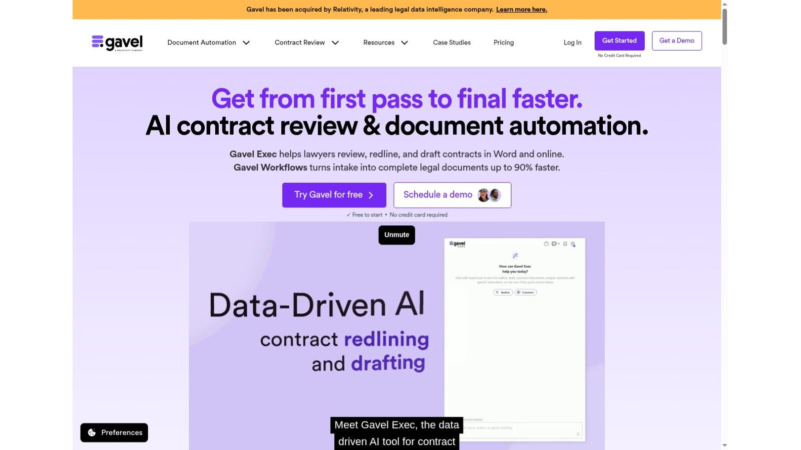
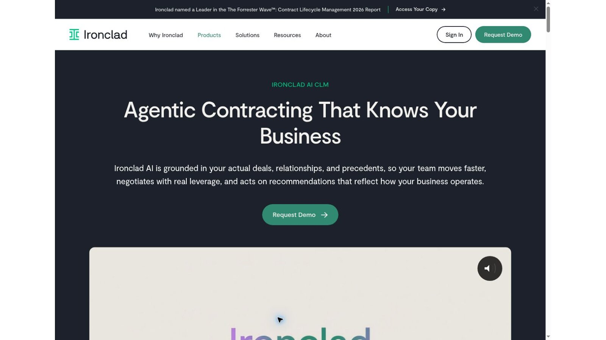
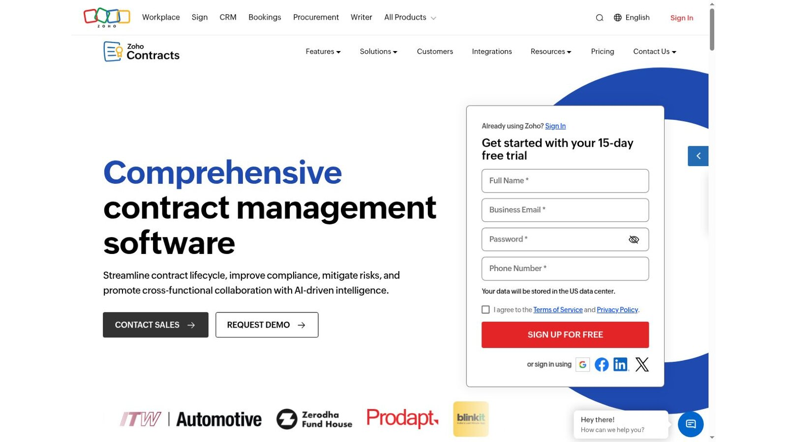
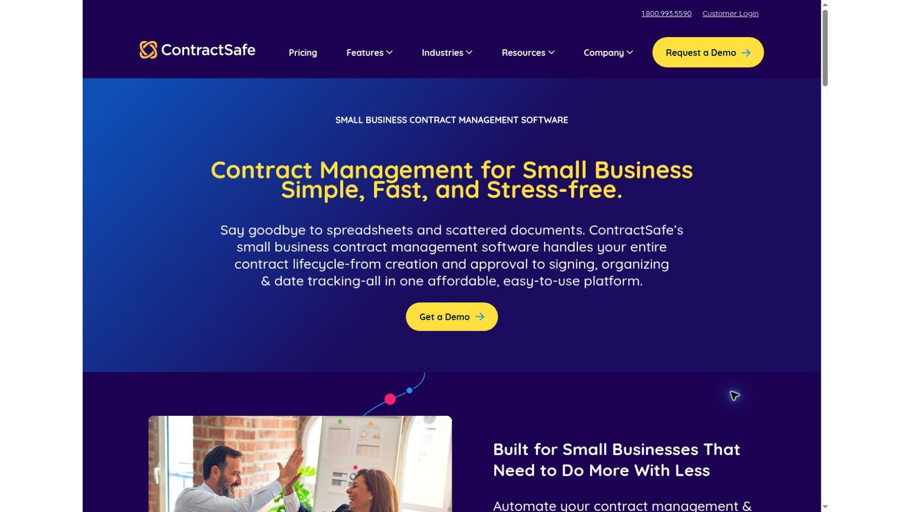

# AI Contract Management Software: Contract Review vs Full CLM

AI contract management software now covers two very different jobs. Some tools help a lawyer review and redline one agreement faster inside Microsoft Word. Others run the whole contract lifecycle, from request and approval to signature, storage, and renewal. Buying the wrong kind is the most common mistake in this category.

This guide sorts four products by the job they do. Every price and feature below comes from the vendor's own pages, checked on November 26, 2026. Where a vendor hides its price, we say so.

## Key Takeaways

* **Review tools and CLM platforms solve different problems:** Gavel Exec redlines in Word, while Ironclad and Zoho Contracts manage approvals, signature, and renewals.
* **Published prices span a wide range:** Gavel Exec lists $160 per user per month for 1,000 completions, and ContractSafe starts at $450 a month billed annually.
* **Ironclad does not publish prices:** Its pricing page asks buyers to get a custom quote.
* **Renewal tracking is the quiet payoff:** Ironclad, Zoho Contracts, and ContractSafe all name automated renewal or deadline alerts.
* **AI extraction still needs a human check:** Confirm that dates and terms pulled by AI match the signed document before you rely on them.

## Quick Comparison

The table sorts each product by its main job, using published facts.

| Product | Main job | Published price | AI features named |
| --- | --- | --- | --- |
| Gavel Exec | Contract review and redlining in Word | $160 per user per month for 1,000 completions | Redlines, playbooks, market benchmarking |
| Ironclad | Full contract lifecycle management | Custom quote | Drafting, redlining, clause and metadata extraction, Renewal Agent |
| Zoho Contracts | Lifecycle management for small and midsize teams | Free plan for 3 users and 10 contracts; paid prices not captured | ChatGPT integration, obligation tracking |
| ContractSafe | Contract repository and deadline tracking | From $450 a month billed annually | AI data extraction, contract chat, AI review on top tier |

## Contract Review or Full CLM: Which Do You Need?

Start with the problem you are trying to fix.

If lawyers spend hours marking up third-party paper, you need a review tool. It works on one document at a time. It suggests edits against your playbook and flags unusual terms. It does not track who approved the deal or when it renews.

If deals stall in email, or nobody knows when contracts expire, you need contract lifecycle management. A CLM platform routes requests, collects approvals, sends documents for signature, and stores the signed copy with its key dates. The guide to [contract lifecycle management](/legal-business/contract-lifecycle-management/) explains each stage in more detail.

Many teams need both. A legal team can use a review tool for negotiation and a CLM platform for everything after signature. Decide which problem costs you more today and buy for that first.

## How We Compared These Tools

We opened each vendor's product and pricing pages on November 26, 2026 and recorded only what they stated. The site owner captured the screenshots below from the same official pages on November 25, 2026. We did not run trials or test the AI on real contracts. This is a research comparison, not a hands-on review.

## 1. Gavel Exec: Best for Redlining in Word

Gavel Exec is a review tool for lawyers who negotiate in Microsoft Word. The [Gavel home page](https://www.gavel.io/) says it can "Create suggested redlines and negotiation-ready comments directly in Word." It also lets teams "Apply built-in or custom playbooks across matters to keep positions consistent."

A benchmarking feature can "Compare clause language to market data to flag off-market positions." For price, Gavel states: "Get 1,000 completions for $160/month per user." New users can "Start with 25 free queries per user."

Gavel's home page also notes that "Gavel has been acquired by Relativity." Ask how the acquisition affects your contract and data terms before you sign a long plan.

Gavel Exec does not describe itself as a repository or renewal tracker. Pair it with a CLM or storage tool if you need those.

**Choose it if:** your lawyers negotiate in Word and want consistent, playbook-based markups.

## 2. Ironclad: Best for Enterprise Contract Lifecycles

Ironclad is a full lifecycle platform with AI built in. Its [Ironclad AI page](https://ironcladapp.com/product/ironclad-ai) lists "AI-assisted drafting, editing, summarization, and redlining" and "Clause and metadata extraction."

Ironclad also offers portfolio insights that cover "terms, obligations, renewals, and workflow status." A Renewal Agent "automatically generates a brief with key terms, auto-renewal windows, and savings opportunities."

The Ironclad pricing page shows no dollar amounts. It invites buyers to "Get a Custom Quote" and lets them pick contract lifecycle management, an AI assistant, or eSignature. It also says some integrations are included and some are add-ons. Get the integration list in writing.

**Choose it if:** you run a high volume of commercial contracts across sales, procurement, and legal, and can budget for a quoted platform.

## 3. Zoho Contracts: Best Value for Small and Midsize Teams

Zoho Contracts covers the full lifecycle at a smaller scale. The Zoho Contracts page promises: "Never miss renewals with our automated alerts." It describes a "contextual obligation module" and a ChatGPT integration.

E-signature is included. The FAQ says "Zoho Contracts comes bundled with Zoho Sign at no additional cost." A free plan "supports up to three users and 10 contracts." Paid plans are Standard, Professional, and Premium, with a 15-day free trial and a 20% saving on yearly billing.

The paid plan prices did not appear in the page text we captured, so check the Zoho Contracts pricing page directly. The pricing table lists negotiation and redlining, eSignature, obligations management, Microsoft Word integration, and ChatGPT integration as features, but we could not confirm which plan includes each one.

**Choose it if:** you want lifecycle features and built-in signing without an enterprise budget, especially if you already use Zoho.

## 4. ContractSafe: Best for Finding Contracts and Tracking Dates

ContractSafe focuses on storage, search, and reminders. Its [pricing page](https://www.contractsafe.com/pricing) says pricing "starts at $450/month billed annually ($540 month-to-month)." The plans are Organize, Finalize, and Maximize, and all include unlimited users.

The AI features grow by tier. Organize includes "AI data extraction" and "AI-powered contract chat." Finalize adds redlining, e-signature, and Word integration. Maximize adds "AI Contract Review," a Salesforce integration, and intake forms.

Reminders cover "Payment dates, milestones, renewals, expirations, deadline-to-nonrenew." Price also depends on how many contracts you store. The FAQ says "Any contracts that are in your repository count toward the total."

**Choose it if:** your main pain is lost contracts and missed renewal deadlines, not drafting.

## A Worked Example: One NDA, Two Approaches

Picture a sales team that sends 20 non-disclosure agreements a month. Legal approves each one, a manager signs, and some renew automatically.

With a review tool alone, legal opens each NDA in Word and applies the playbook. Edits are faster and more consistent. But approval still happens by email, and the signed copy lands in someone's inbox. Nobody is reminded when an NDA renews.

With a CLM platform, sales submits a request through a form. The system routes the draft to legal, collects the manager's approval, and sends it for signature. The signed NDA is stored with its renewal date, and the system sends an alert before the deadline to cancel.

For this team, the CLM approach fixes the bigger risk. The review tool saves legal time, but the lifecycle tool keeps the company from missing renewals. A team that negotiates complex supplier deals might rank them the other way.

## How to Test AI Contract Management Software

Run the same test on every shortlisted tool before you buy.

### Use Your Own Paper

Upload five signed contracts that you know well. Check whether the AI extracts the correct parties, dates, renewal terms, and notice periods. Count every error. AI extraction is a time saver only when a person verifies it.

### Change an Input

Ask the tool to apply your fallback position to a clause. Then change the clause and run it again. Many tools look good on the first pass and slip on revisions.

### Check Approval and Audit Records

For CLM platforms, confirm who approved each step and when. Make sure the record cannot be edited after the fact.

### Confirm the Data Terms

Ask where your contracts are stored, who can see them, and whether the vendor uses your documents to train its AI. Get the answers in the order form, not just a sales email.

### Price the Full Year

Add seats, contract volume, integrations, onboarding, and any usage caps. Gavel Exec caps completions, and ContractSafe prices by contract volume. Those limits can change your real cost.

## Common Buying Mistakes

Most failed rollouts trace back to a few avoidable choices.

### Buying a Demo, Not a Workflow

Vendor demos use clean sample contracts. Your contracts include scans, old templates, and amendments. Ask to run the demo on your own files. Any AI contract management software should handle a messy scanned agreement before you trust it with hundreds.

### Skipping the Data Cleanup

A repository is only as good as what goes into it. Before migration, decide which contracts to load, who owns each one, and which fields matter. ContractSafe sells Jump Start services starting at $2.50 per contract. Budget for setup work like this as a real cost.

### Ignoring Who Will Use It

Sales and procurement teams will not log into a tool built only for lawyers. If non-lawyers will request contracts, check that the intake form is simple. If only lawyers will use it, a Word add-in may be all you need.

### Treating AI Output as Final

AI contract management software can misread a notice period or miss an amendment. Build a review step into the process, and record who confirmed each key date.

## Where AI Fits in Legal Contract Work

AI is spreading fastest in drafting and review. Our [legal technology statistics](/legal-tech/legal-technology-statistics/) track how many firms and legal departments now use generative AI. For a wider view of the tools, see our list of [AI tools for lawyers](/legal-tech/ai-tools-for-lawyers/).

If you are a law firm comparing contract tools for client work, the guide to the [best legal contract management software](/legal-tech/best-legal-contract-management-software/) covers more options. If you run a small business without a legal team, start with [contract management software for small business](/legal-business/contract-management-software-for-small-business/), which focuses on renewals and storage.

## Frequently Asked Questions

### What Is AI Contract Management Software?

It is software that uses AI to help draft, review, store, or track contracts. Some products focus on reviewing one document. Others manage the full lifecycle from request to renewal.

### Is AI Contract Review Accurate Enough to Trust?

Treat AI output as a first draft. Clause suggestions and extracted dates can be wrong. A lawyer or trained reviewer should confirm key terms against the signed document.

### How Much Does AI Contract Management Software Cost?

Published prices on November 26, 2026 ranged from Gavel Exec at $160 per user per month to ContractSafe from $450 a month billed annually. Ironclad quotes each customer, and Zoho Contracts offers a free plan for three users and 10 contracts.

### Do I Need a Full CLM Platform?

Only if your problems sit outside the document itself, such as slow approvals, lost signed copies, or missed renewals. If drafting speed is the only issue, a review tool may be enough.

### Can Small Businesses Use These Tools?

Yes. Zoho Contracts has a free plan, and ContractSafe includes unlimited users on every plan. Ironclad is aimed at larger teams with higher contract volume.

### Is This a Hands-On Test?

No. We compared each AI contract management software product using its official pages and the site owner's screenshots. We did not run the AI on real contracts.

## Resources

* [Gavel](https://www.gavel.io/)
* [Ironclad AI](https://ironcladapp.com/product/ironclad-ai)
* [Ironclad pricing](https://ironcladapp.com/pricing/)
* [Zoho Contracts](https://www.zoho.com/contracts/)
* [Zoho Contracts pricing](https://www.zoho.com/contracts/pricing.html)
* [ContractSafe pricing](https://www.contractsafe.com/pricing)
* [ContractSafe small business contract management](https://www.contractsafe.com/small-business-contract-management-software)
