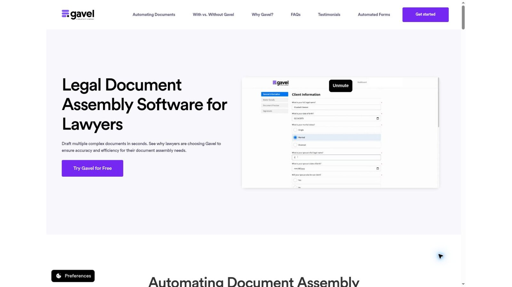
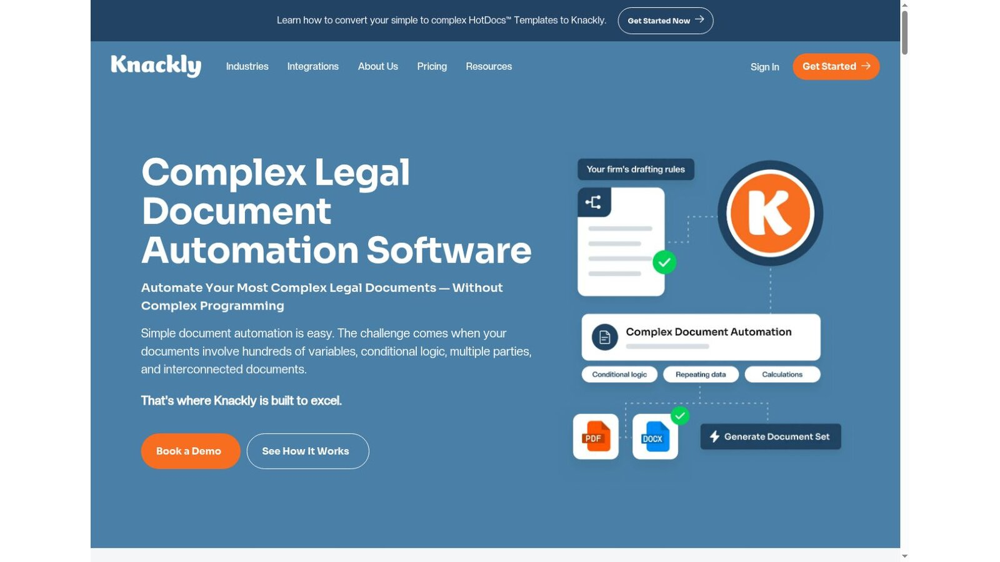
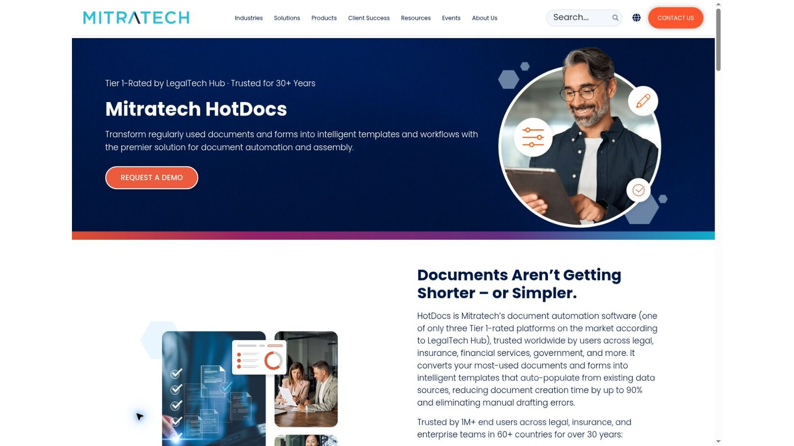

# Document Assembly Software for Lawyers: From Questionnaire to Final Draft

Document assembly software turns a set of answers into a finished legal document. A lawyer or client completes a questionnaire. The software fills a template, includes or removes clauses based on the answers, and produces a Word or PDF draft. The time savings are real, but only when the templates and questions are built well.

This guide compares three tools that take different approaches: Gavel, Knackly, and HotDocs. Every price and feature below comes from the vendor's own pages, checked on November 26, 2026.

## Key Takeaways

* **The questionnaire is the product:** Knackly says "Questions appear only when they're relevant," and Gavel lets clients answer intake questionnaires through a portal.
* **Gavel is the lowest published entry price:** Its document assembly page says "Subscriptions start at $83/mo with a free trial."
* **Knackly publishes all three plans:** Starter costs $250 a month or $209 a month paid yearly and includes 4 users.
* **HotDocs is an enterprise tool:** Mitratech lists batch processing for more than 500,000 documents but publishes no prices.
* **Check plan limits:** Gavel's Lite plan lists 10 document templates and 100 sessions a month.

## Quick Comparison

Here is how the three tools compare on price and template approach.

| Tool | Published price | Template source | Client-facing questionnaires | Best fit |
| --- | --- | --- | --- | --- |
| Gavel | From $83 a month | Word (.docx) and PDF forms | Yes, through a client portal | Solo and small firms selling document-based services |
| Knackly | Starter $250 a month, or $209 paid yearly | Existing Microsoft Word templates | Yes, on Starter | Firms with complex, interconnected documents |
| HotDocs (Mitratech) | Not published | Existing word processing environment | Not described on the product page | Large firms and enterprise legal teams |

## How Document Assembly Works

Every tool in this category follows the same basic steps.

1. **Mark up a template.** You take an existing Word document and replace names, dates, and amounts with fields.
2. **Add logic.** You set rules, such as "include the guardianship clause only if the client has minor children."
3. **Build the questionnaire.** The software turns the fields into questions for staff or clients to answer.
4. **Generate the document.** Answers flow into the template, and the software produces a draft.
5. **Review and finalize.** A lawyer checks the draft before it goes out.

The difference between tools lies in how hard steps 1 to 3 are and how far the logic can go. Simple tools handle names and dates. Advanced tools handle repeating sections, calculations, and sets of related documents.

## How We Compared These Tools

We opened each vendor's product and pricing pages on November 26, 2026 and recorded only what they stated. The site owner captured the screenshots below from the same official pages on November 25, 2026. We did not build templates or run trials. This is a research comparison, not a hands-on review.

## 1. Gavel: Best for Client-Facing Intake

Gavel, formerly Documate, focuses on turning intake into documents. Its pricing page notes, "Documate is now Gavel!" The Gavel document assembly page says you can "automate both your Microsoft Word (or .docx) documents or PDF forms."

Clients can take part directly. The page says, "Have your clients log in, answer intake questionnaires, and load files directly from the Gavel client portal." Logic and calculations let "special language" appear in the document based on rules the attorney sets. Integrations include Clio, Zapier, Microsoft Word, and a public API.

The [Gavel pricing page](https://www.gavel.io/pricing) lists four plans:

* **Lite:** $83 a month, with 10 document templates, a Clio Manage integration, and 100 sessions a month.
* **Standard:** The plan card showed $210 a month, while the comparison table showed $165. Confirm the current price before you buy.
* **Pro:** $290 a month, with 100 document templates and a DocuSign integration.
* **Scale:** From $417 a month, billed annually, with API access and per-seat pricing.

Annual plans, billed upfront, get two months free.

**Choose it if:** you want clients to complete their own intake and you sell flat-fee document work.

## 2. Knackly: Best for Complex Documents

Knackly targets documents with many variables and parties. Its home page promises to "Automate your existing Microsoft Word templates while retaining the formatting and structure required." It says it can "Turn complex questionnaires into guided workflows" in which "Questions appear only when they're relevant."

Its conditional drafting lets you "Include, exclude, or modify provisions based on interview answers, using your firm's own drafting rules."

The [Knackly pricing page](https://knackly.io/pricing) lists three plans:

* **Starter:** $250 a month, or $209 a month paid yearly. Includes 4 users, 400 new records or clients a month, Clio, Zapier, and OneDrive integrations, client-facing questionnaires, and PDF automation.
* **Done For You:** $500 a month, or $417 paid yearly, with Knackly building automation for you for 3 hours a month.
* **Professional:** $1,000 a month, or $834 paid yearly, with 12 users and API access.

Knackly says "All plans are month to month with no contracts, no setup fees, and no hidden gimmicks."

**Choose it if:** your documents involve multiple parties, repeating sections, or related document sets, such as estate plans.

## 3. HotDocs: Best for Enterprise Volume

HotDocs is one of the oldest names in document assembly, now sold by Mitratech. The [Mitratech HotDocs page](https://mitratech.com/products/hotdocs/) says it can reduce "document creation time by up to 90%." That figure is the vendor's own claim.

HotDocs is built for scale. The page lists "Batch processing that generates 500,000+ documents without manual intervention." Business rules, conditional logic, clause libraries, and approval workflows are set up through an interface. It runs on desktop and cloud and connects to other systems through an open API.

Mitratech does not publish HotDocs prices. Expect a sales process and a quote.

**Choose it if:** you run high-volume document production across a large firm, insurer, or legal department.

## Which Documents to Automate First

Not every document is worth automating. Start with documents that meet three tests:

* **You draft them often.** A template used twice a year rarely repays the setup time.
* **They follow a pattern.** Engagement letters, simple wills, and standard pleadings vary in predictable ways.
* **Errors are costly.** A wrong name or missing clause in a court filing creates real risk.

A good first project is the engagement letter. Every new client needs one, and the variables are clear: client name, matter type, fee arrangement, and scope. Once that works, move to your most common substantive document.

## A Worked Example: Simple Will Package

Picture a solo estate planning lawyer who prepares 10 simple will packages a month. Each package includes a will, a power of attorney, and a health care directive.

Without document assembly, staff copy a past client's documents and replace names by hand. A missed name in one of three documents is easy to overlook.

With document assembly software, the client completes one questionnaire. It asks about spouse, children, guardians, and agents. Questions about guardians appear only if the client has minor children. The software then produces all three documents with the same names and choices.

The lawyer's role changes from typing to reviewing. That is where the time savings come from. The questionnaire must be tested, though. One wrong rule can repeat the same error across every package.

## Building Templates That Last

Most automation projects fail because of the template, not the software. Follow these rules.

### Clean the Source Document

Fix numbering, styles, and cross-references before you add fields. Automation copies existing formatting problems into every draft.

### Name Fields Clearly

Use names such as client_full_name rather than field1. Anyone who maintains the template later will thank you.

### Test Every Branch

Run the questionnaire with every combination that matters: married and single, children and none, one executor and two. Check each output.

### Assign an Owner

Laws and firm preferences change. Name one person who updates each template and records the date.

## Questions to Ask Before You Buy

Ask every vendor the same questions and record the answers with the date.

### How Are Templates Built?

Some tools let you mark up a Word file directly. Others use their own editor. Ask who will build the first templates and how long a typical engagement letter takes to set up. Knackly's Done For You plan exists because many firms lack the time to build templates themselves.

### What Are the Usage Limits?

Plans often cap templates, users, or sessions. Gavel Lite lists 10 document templates and 100 sessions a month. Knackly Starter includes 4 users and 400 new records or clients a month. Estimate your monthly volume before you pick a tier.

### Does It Connect to Your Practice Management System?

If client data already lives in a practice management tool, the questionnaire should pull it in instead of asking again. Gavel and Knackly both list a Clio integration. Confirm which fields sync and in which direction.

### Who Owns the Templates?

Ask whether you can export your templates and logic if you leave. Automation work can take many hours, so losing it on exit is a real cost.

### How Is Client Data Protected?

Client-facing questionnaires collect sensitive facts. Ask where answers are stored, who can see them, and how long they are kept.

## Common Mistakes to Avoid

Three mistakes slow down most first projects.

The first is automating too much at once. Start with one document, prove it works, and then expand. A single tested engagement letter is worth more than ten half-built templates.

The second is writing questions in legal language. Clients do not know what "per stirpes" means. Write questions in plain English and explain the effect of each choice.

The third is skipping the review step. Document assembly software produces a draft, not a final document. Keep a lawyer review in every workflow, and record any template errors so they get fixed at the source.

## What Setup Really Costs

Subscription price is only part of the cost. The bigger cost is the time to build and test templates. A lawyer who spends 10 hours building a will package at a $300 billing rate has invested $3,000 of time before the first client benefits. That figure is an illustration, not a vendor estimate.

The payoff comes from volume. If the package saves an hour on each of 10 packages a month, the setup time is repaid in the first month. If you prepare only two a year, it may never pay back. Run this math for your own documents before you choose a plan.

## Where Document Assembly Fits

Document assembly works best when it connects to the rest of your workflow. Intake answers can feed templates, so pair it with [legal intake software](/legal-tech/legal-intake-software/). Finished documents often need signatures, so compare [DocuSign alternatives](/legal-tech/docusign-alternatives/) too.

For a broader list that includes practice management suites with built-in automation, see the guide to the [best legal document automation software](/legal-tech/best-legal-document-automation-software/). Our [legal technology statistics](/legal-tech/legal-technology-statistics/) show how widely firms have adopted document tools.

## Frequently Asked Questions

### What Is Document Assembly Software?

It is software that builds legal documents from templates and questionnaire answers. It fills in fields, applies rules to include or exclude clauses, and produces a draft for review.

### Is Document Assembly the Same as Document Automation?

The terms overlap. Document assembly usually means building documents from templates and answers. Document automation can also include workflows, storage, and signing.

### How Much Does Document Assembly Software Cost?

Published prices on November 26, 2026 started at $83 a month for Gavel Lite and $209 a month paid yearly for Knackly Starter. HotDocs prices are by quote.

### Can Clients Fill Out the Questionnaire Themselves?

Yes, with some tools. Gavel offers a client portal for intake questionnaires, and Knackly lists client-facing questionnaires on its Starter plan.

### Is This a Hands-On Review?

No. We compared each document assembly software product using its official pages and the site owner's screenshots. We did not build templates in each tool.

## Resources

* [Gavel legal document assembly software](https://www.gavel.io/legal-document-assembly-software)
* [Gavel pricing](https://www.gavel.io/pricing)
* [Knackly](https://knackly.io/)
* [Knackly pricing](https://knackly.io/pricing)
* [Mitratech HotDocs](https://mitratech.com/products/hotdocs/)
