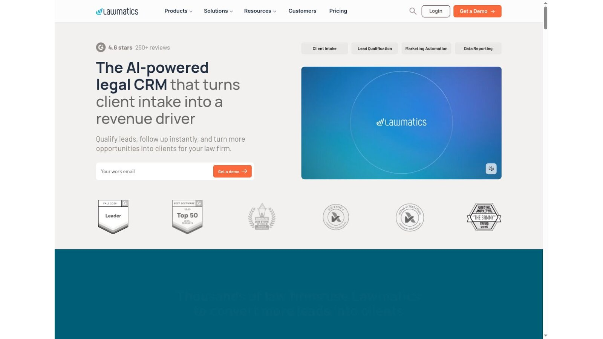
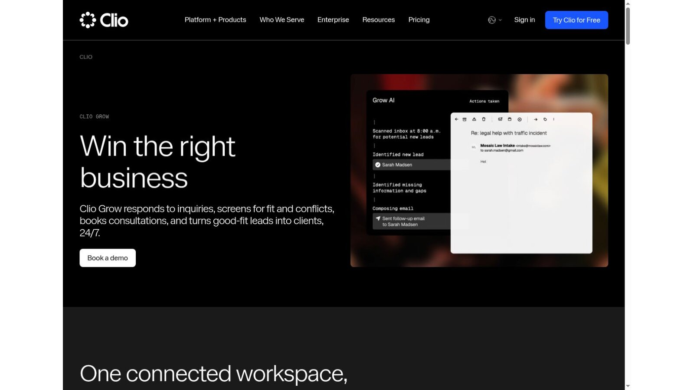
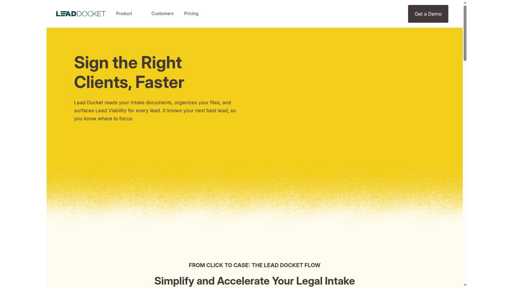
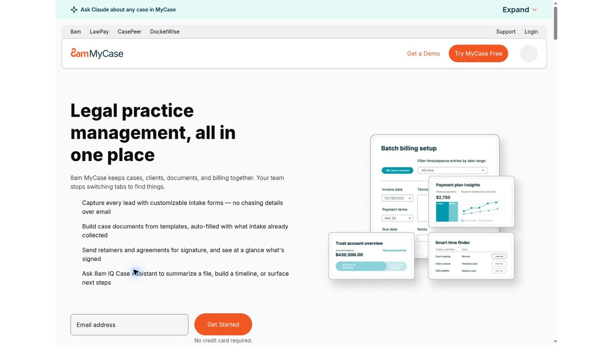

# Legal Intake Software: Compare Lead Capture, Follow-Up, and Handoff

Legal intake software captures a prospective client's details, screens the matter, checks for conflicts, and moves a signed client into your case system. The best tool for your firm depends on where leads get lost today. Some firms lose them in slow follow-up. Others lose them at the fee agreement, or in retyping data into a second system.

This guide compares four tools by the part of intake they handle best. Every price and feature below comes from the vendor's own pages, checked on November 26, 2026.

## Key Takeaways

* **Intake has three stages:** capture the lead, follow up until a decision, then hand off a signed client to case management.
* **Only MyCase publishes prices:** Pro, which adds intake forms and a legal CRM, costs $100 per user per month billed annually.
* **AI screening is spreading:** Lead Docket says its AI "assesses every lead the moment it opens," and Clio Grow says its AI sends intake forms and follows up on unsigned agreements.
* **Conflict checks vary by plan:** Lawmatics lists advanced conflict checking on Premium, while MyCase lists conflict check tracking on all plans.
* **Handoff matters:** Lead Docket says its data "natively transfers to Filevine," and Clio Grow searches across all of Clio for conflicts.

## Quick Comparison

The table shows each tool's published price and its intake strength.

| Tool | Published price | Intake strength | Handoff |
| --- | --- | --- | --- |
| Lawmatics | Quote (Essential, Premium, Enterprise) | Intake forms, automated scheduling, marketing automation | Integrations |
| Clio Grow | Not shown on the product page | Screens for fit and conflicts, books consultations | Clio Manage |
| Lead Docket | Not shown on the home page | AI lead viability scoring, automated follow-up | Filevine |
| MyCase | Pro $100 per user per month billed annually | Intake forms and legal CRM inside practice management | Built in |

## The Three Stages of Legal Intake

Before you compare features, map how a lead moves through your firm today.

**Capture.** A lead calls, fills in a web form, or sends a chat message. The goal is to record every lead, with its source, within minutes.

**Follow-up.** Someone screens the matter, checks conflicts, books a consultation, and sends a fee agreement. This is where most leads stall.

**Handoff.** Once the client signs, the details should flow into your case management system without retyping.

Each tool below is strongest at one or two of these stages. Pick the one that fixes your weakest stage.

## How We Compared These Tools

We opened each vendor's product and pricing pages on November 26, 2026 and recorded only what they stated. The site owner captured the screenshots below from the same official pages on November 25, 2026. We did not run trials or process real leads. This is a research comparison, not a hands-on review.

## 1. Lawmatics: Best for Marketing-Led Intake

Lawmatics positions itself as "The AI-powered legal CRM that turns client intake into a revenue driver." Its home page describes customizable intake form templates and the ability to "Auto schedule initial consultations and appointment reminders." Engagement agreements can go out for e-signature, and the system tracks how each prospect found you.

The Lawmatics pricing page shows three plans: Essential, Premium, and Enterprise. It lists no dollar prices and asks buyers to contact sales. Essential includes client intake, lead management, custom forms, e-signature, task management, and 500 contacts. Premium raises the limit to 10,000 contacts and adds workflow and marketing automation, advanced conflict checking, and SMS and MMS as a paid add-on. The page notes that additional contacts are sold separately.

**Choose it if:** you invest in marketing and want intake, follow-up campaigns, and lead source tracking in one place.

## 2. Clio Grow: Best for Firms Already on Clio

Clio Grow is Clio's intake product. Its [product page](https://www.clio.com/grow/) says it "responds to inquiries, screens for fit and conflicts, books consultations." It can "Search across all of Clio for potential conflicts of interest" and lets you "Track every lead through your pipeline."

Clio Grow also handles the paperwork. The page says you can "Send fee agreements for e-signature and collect payment online." Its AI feature "sends intake forms and follows up on unsigned agreements." Clients can book consultations online with automated reminders.

The product page lists no prices. Clio's pricing page blocked our automated reader, so ask Clio which plan includes Grow. Our [Clio vs MyCase](/legal-tech/clio-vs-mycase/) comparison found that Clio's Elite plan bundles Clio Manage with Clio Grow.

**Choose it if:** you already run your practice on Clio Manage and want conflict checks across your existing records.

## 3. Lead Docket: Best for High-Volume Personal Injury Intake

Lead Docket focuses on screening many leads quickly. Its [home page](https://www.leaddocket.com/) says it "reads your intake documents, organizes your files, and surfaces Lead Viability for every lead." It adds that "AI assesses every lead the moment it opens, so your team knows which cases are worth taking."

Follow-up is automated. Personalized emails and tasks trigger as soon as a web form arrives. Firms can collect retainers and payments directly in Lead Docket. For handoff, the page says "Data natively transfers to Filevine, creating a unified client record and eliminating double entry."

The home page lists no prices. Request a quote based on your lead volume.

**Choose it if:** you handle a high volume of contingency-fee leads and use Filevine for case management.

## 4. MyCase: Best Intake Built Into Practice Management

MyCase puts intake inside its practice management suite. Its [pricing page](https://www.mycase.com/pricing/) lists Basic at $50, Pro at $100, and Advanced at $130 per user per month billed annually, or $60, $120, and $150 billed monthly.

Intake starts at Pro. The pricing table shows client intake forms and a legal CRM on Pro and Advanced, but not on Basic. Pro and Advanced also include unlimited e-signatures and automated workflows. Conflict check tracking is included on all three plans. A 10-day free trial is available.

The MyCase home page says firms can "Easily automate the creation and signing of retainer agreements" and get "a 360-degree view" of the prospective client pipeline.

**Choose it if:** you want intake and case management in one subscription with a published price.

## Another Option to Consider: Law Ruler

Law Ruler is another intake and CRM tool aimed at law firms. Its client intake software page describes a form builder for custom forms by practice area. A Smart Forms feature uses decision trees to hide or show fields based on earlier answers. Firms can request e-signatures by email or text message, and leads can be added to drip email campaigns. The FAQ says users can assign tasks, schedule consultations, perform conflict checks, and run document automation. The page lists no prices. We did not include a screenshot, so treat this as a pointer for further research rather than a full review.

## Questions to Ask Every Vendor

Write down each answer with the date and the name of the person who gave it.

* **Which plan includes intake?** MyCase puts intake forms on Pro, not Basic. Lawmatics caps contacts by plan.
* **Are texting and AI extra?** Lawmatics lists SMS and MMS as an add-on, and its AI products carry their own pricing.
* **What syncs to case management?** Ask for the exact field list, not a logo on an integrations page.
* **Who owns the lead data?** Confirm you can export leads, notes, and source data if you switch.
* **How fast can we launch?** Ask whether the vendor builds your first forms and automations, and whether that costs extra.

## A Worked Example: A Missed Weekend Lead

Picture a family law firm that receives a web inquiry at 9 p.m. on a Friday.

Without intake software, the form lands in a shared inbox. A paralegal sees it on Monday morning. By then the prospect has called two other firms.

With legal intake software, the form creates a lead record at once. An automated email thanks the prospect and offers a link to book a consultation. The system runs a conflict search against existing contacts. If the prospect books, a reminder goes out before the meeting. After the consultation, the fee agreement goes out for e-signature, and a reminder follows if it is not signed.

When the client signs, their details move into the case system. Nobody retypes the address or the opposing party's name.

The firm also learns which channel produced the lead, because the source was recorded at capture.

The software did not replace the lawyer's judgment. It made sure the lead got a fast response and did not slip through the cracks over the weekend.

## What to Test in a Trial

Run the same test in each tool before you buy.

### Submit a Test Lead

Fill in your own web form as a fake prospect. Time how long it takes for the lead to appear and for the first automated reply to arrive.

### Run a Conflict Check

Enter a name that matches an existing client. Confirm that the tool flags it and shows where the match came from.

### Send and Sign a Fee Agreement

Send a test agreement for e-signature. Check that the signed copy is stored on the right record.

### Convert to a Client

Turn the lead into a client and open the matter in your case system. List every field that did not transfer.

### Pull a Source Report

Ask the tool which marketing channels produced signed clients last month. If it cannot answer, you cannot measure your marketing spend.

## Phone Calls Still Matter

Many legal leads still arrive by phone. Intake software only helps if calls are captured too. Firms that cannot answer every call often pair intake software with a [virtual receptionist for law firms](/legal-tech/virtual-receptionist-for-law-firms/), which can complete a short intake and push it to the CRM.

Once a client signs, the intake answers can feed your templates. See the comparison of [document assembly software](/legal-tech/document-assembly-software/) for tools that turn questionnaire answers into drafts.

## How Intake Fits Your Tech Stack

Intake tools overlap with legal CRMs. For a wider list that includes marketing automation and client relationship tools, see the guide to the [best legal CRM software](/legal-tech/best-legal-crm-software/). For context on how fast firms are adopting cloud and AI tools, see our [legal technology statistics](/legal-tech/legal-technology-statistics/).

## Frequently Asked Questions

### What Is Legal Intake Software?

It is software that captures prospective client details, screens and follows up on leads, checks conflicts, collects signed fee agreements, and passes new clients into case management.

### Is Legal Intake Software the Same as a Legal CRM?

They overlap. Intake software focuses on turning a lead into a signed client. A legal CRM often adds longer-term marketing and relationship tracking.

### How Much Does Legal Intake Software Cost?

Of the four tools here, only MyCase published prices on November 26, 2026. Its Pro plan, which includes intake forms, costs $100 per user per month billed annually. Lawmatics, Clio Grow, and Lead Docket quote prices.

### Can Legal Intake Software Run Conflict Checks?

Many can. Clio Grow searches across Clio for conflicts, Lawmatics lists advanced conflict checking on Premium, and MyCase includes conflict check tracking on all plans.

### Does Legal Intake Software Use AI?

Some products do. Lead Docket uses AI to assess lead viability, and Clio Grow uses AI to send intake forms and follow up on unsigned agreements. A person should still review each decision to accept or decline a matter.

### Is This a Hands-On Review?

No. We compared each legal intake software product using its official pages and the site owner's screenshots. We did not process real leads.

## Resources

* [Lawmatics](https://www.lawmatics.com/)
* [Lawmatics pricing](https://www.lawmatics.com/pricing)
* [Clio Grow](https://www.clio.com/grow/)
* [Lead Docket](https://www.leaddocket.com/)
* [MyCase](https://www.mycase.com/)
* [MyCase pricing](https://www.mycase.com/pricing/)
* [Law Ruler client intake software](https://www.lawruler.com/client-intake-software/)
