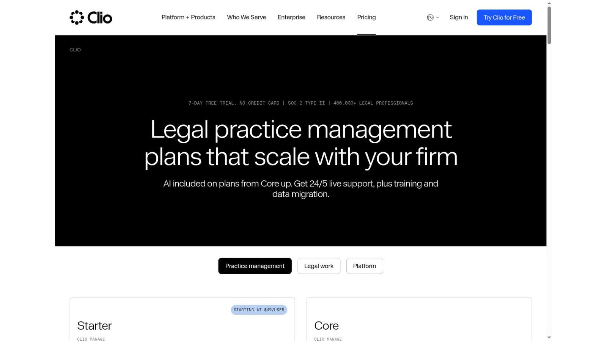
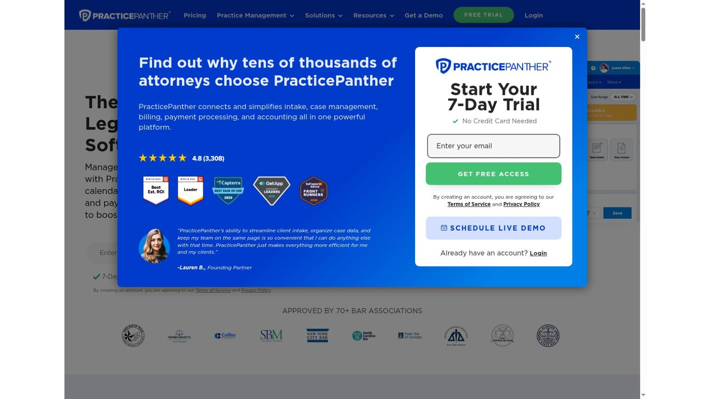
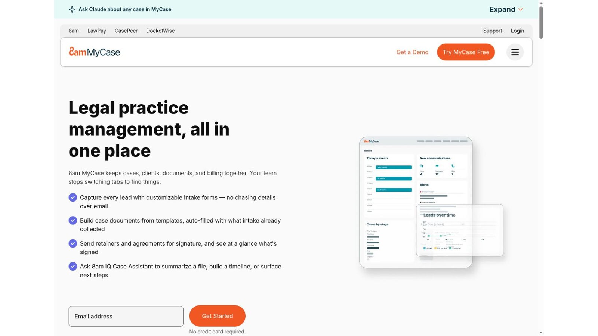
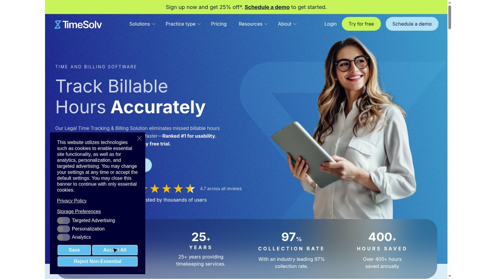

# Billing Software for Small Law Firms: Compare the Work, Not Just the Seat Price

Billing software for small law firms should do four jobs well: capture time, produce accurate invoices, collect payment, and keep trust money separate. The cheapest seat price rarely tells you which plan does all four. Trust accounting and LEDES billing often sit one or two tiers above the entry plan.

This guide compares four tools a solo or small firm can buy without a long sales process. Every price below comes from the vendor's own pages, checked on November 26, 2026, except Clio's, which comes from a screenshot of its pricing page captured by the site owner.

## Key Takeaways

* **Entry prices are close:** Clio Starter starts at $49 per user, PracticePanther Solo is $49 per user per month billed annually, and MyCase Basic is $50.
* **Trust accounting tiers differ:** MyCase Basic includes a trust ledger and reconciliation, while PracticePanther lists trust accounting on Business Pro at $114 per user per month billed annually.
* **LEDES billing is mid-tier:** PracticePanther lists LEDES on Business, and MyCase lists LEDES billing on Pro and Advanced.
* **TimeSolv hides its base price:** Its pricing page says you pay per active user but lists no per-user rate.
* **Monthly billing costs more:** PracticePanther and MyCase charge $10 more per user per month when billed monthly.

## Quick Comparison

The table compares entry prices and where key billing features sit.

| Tool | Entry price | Trust accounting | LEDES billing | Online payments |
| --- | --- | --- | --- | --- |
| Clio | Starter from $49 per user | See plan details | See plan details | See plan details |
| PracticePanther | Solo $49 annual, $59 monthly | Business Pro | Business | PantherPayments |
| MyCase | Basic $50 annual, $60 monthly | Basic (ledger and reconciliation) | Pro and Advanced | LawPay, $0 monthly fee |
| TimeSolv | Per active user; rate not published | All plans | Listed | Built-in processing |

Prices are per user per month. Clio's plan-level features could not be read because its site blocks automated readers, so check them on Clio's pricing page.

## What a Small Firm Needs From Billing Software

A two-lawyer firm does not need enterprise reporting. It does need these basics to work every time:

* **Time capture:** Timers and quick entry from phone or desktop, so billable minutes are not lost.
* **Invoices:** Clean invoices built from time and expense entries, with flat-fee and hourly options.
* **Payments:** Card and eCheck payments that post to the right invoice.
* **Trust accounting:** Separate trust ledgers per client and reconciliation that matches the bank.
* **LEDES:** Only if you bill insurers or corporate clients who require it.

Write down which of these you need now and which you will need within two years. Good billing software for small law firms should cover both lists without a forced migration. Then compare plans that cover both lists.

## How We Compared These Tools

We opened each vendor's pricing and product pages on November 26, 2026 and recorded only what they stated. Clio's pages blocked our automated reader, so Clio's details come from the site owner's screenshot of its pricing page, captured November 25, 2026. We did not run trials or send real invoices. This is a research comparison, not a hands-on review.

## 1. Clio: Best for Firms That Want a Large Ecosystem

Clio's pricing page, as captured on November 25, 2026, shows Starter under Clio Manage at "STARTING AT $49/USER." The header says "AI included on plans from Core up" and offers "24/5 live support, plus training and data migration." It also lists a 7-day free trial with no credit card.

Our [Clio vs MyCase](/legal-tech/clio-vs-mycase/) comparison, based on an earlier owner screenshot, found that Core, Signature, and Elite show a "Get pricing" button rather than a price. Ask Clio for a written quote for the plan that includes every billing feature you need.

**Choose it if:** you want a widely used platform with training and data migration support, and you are willing to request a quote for higher tiers.

## 2. PracticePanther: Best for Clear Tier-by-Tier Pricing

PracticePanther publishes every plan. Its [pricing page](https://www.practicepanther.com/pricing/) lists Solo at $49, Essential at $69, Business at $89, and Business Pro at $114 per user per month billed annually. Monthly billing costs $59, $79, $99, and $124. The annual option saves $120 per user per year.

Time and expense tracking is always included. Business adds UTBMS coding and LEDES billing, intake forms, and native e-signature with unlimited sends. Business Pro adds PantherAccounting Plus with trust and operating accounting and a guided three-way trust reconciliation wizard. Automated payment reminders can go out before or after an invoice is due.

The PracticePanther home page says clients can pay by "credit card, ACH, or eCheck with PantherPayments."

**Choose it if:** you want to see every tier's price up front and plan your upgrade path.

## 3. MyCase: Best for Trust Accounting on the Entry Plan

MyCase includes core billing and trust features on its cheapest plan. Its [pricing page](https://www.mycase.com/pricing/) lists Basic at $50, Pro at $100, and Advanced at $130 per user per month billed annually, or $60, $120, and $150 billed monthly.

Basic includes time entry and expense tracking, invoices that can be shared by email, text, or client portal, LawPay online payments, and a trust ledger and reconciliation. LawPay shows a $0 monthly fee, with processing rates charged per transaction. Pro adds LEDES billing, subscription billing, and account statements. MyCase Accounting is a $39 per user per month add-on on Pro and Advanced.

**Choose it if:** you hold client funds in trust and want trust tools without paying for a higher tier.

## 4. TimeSolv: Best for Billing-First Firms

TimeSolv focuses on time and billing rather than full practice management. Its home page says "Every plan includes core features like time tracking, invoicing, payments, trust accounting, and reporting."

The [TimeSolv pricing page](https://www.timesolv.com/pricing/) shows Pro and Legal plans but no base per-user price. Its FAQ says, "You pay per active user, monthly or annually." A promotion offers 25% off the first year on annual plans or the first four months on monthly plans. The feature list includes LEDES billing, trust accounting, and built-in payment processing with next-day funding. Volume pricing is available through sales.

**Choose it if:** you already have case management you like and only need stronger time and billing.

## What Year One Costs for a Two-Lawyer Firm

Here is a year-one comparison for two users on annual billing, using published prices only.

| Plan | Calculation | Year-one cost | Trust accounting included? |
| --- | --- | --- | --- |
| PracticePanther Solo | 2 x $49 x 12 | $1,176 | Not listed on Solo |
| PracticePanther Business Pro | 2 x $114 x 12 | $2,736 | Yes |
| MyCase Basic | 2 x $50 x 12 | $1,200 | Ledger and reconciliation |
| MyCase Pro | 2 x $100 x 12 | $2,400 | Ledger and reconciliation, plus LEDES |
| Clio Starter | 2 x $49 x 12 | From $1,176 | Check plan details |

These totals are our arithmetic from published prices. They leave out payment processing fees, taxes, and add-ons. The table shows why the entry price misleads. A firm that needs full trust accounting in PracticePanther pays more than double the Solo price.

## Trust Accounting Is Not Optional

If your firm holds client money, trust accounting is the feature that protects your license. Your state bar sets the rules for client trust accounts and records, so read them before you choose a plan. Reconciliation, where the bank balance, the trust ledger, and each client ledger all match, is how firms prove it.

Before you choose billing software for small law firms, confirm three things:

* **Correct posting:** Payments to trust post to the trust account, not operating.
* **Separate ledgers:** Each client has a separate ledger.
* **Clear reports:** The software produces a reconciliation report you can hand to an auditor.

Dedicated [trust accounting software for lawyers](/legal-tech/trust-accounting-software-for-lawyers/) can also sit alongside your billing software.

## Payment Processing Fees Add Up

Online payments speed up collection, but they carry fees. MyCase lists LawPay with no monthly fee and per-transaction processing rates. PracticePanther does not list its fee percentages on its pricing page. Its comparison page with Clio states PantherPayments rates, but that page is a competitor comparison, so confirm rates in your own agreement.

Ask each vendor for its card, eCheck, and American Express rates in writing. Also ask whether you can pass card fees to clients where your state's rules allow it.

## How to Run a Billing Trial

Use one test matter in every tool.

### Record Time Three Ways

Use a timer, a manual entry, and a mobile entry. Check that all three land on the right matter.

### Build a Mixed Invoice

Combine hourly time, a flat fee, and an expense. Apply a discount and check the totals.

### Take a Test Payment

Pay the invoice with a test card if the vendor allows it. Confirm the payment posts and the balance updates.

### Move Money From Trust

Deposit a retainer to trust, then apply it to the invoice. Run the reconciliation report and see whether it balances.

### Export Your Data

Export invoices, payments, and trust records. If you cannot get them out cleanly, switching later will be painful.

## Signs Your Current Setup Is Costing You Money

Many small firms bill from spreadsheets, a word processor, or general accounting software. That works for a while. These signs suggest it is time for billing software for small law firms:

* **Time goes unrecorded.** If lawyers reconstruct their hours at the end of the week, minutes get lost. Timers and mobile entry fix that.
* **Invoices go out late.** Every week of delay pushes back payment. Software that builds invoices from time entries cuts the delay.
* **Clients cannot pay online.** Mailing checks slows collection. A payment link on the invoice makes paying easy.
* **Trust records live in a separate spreadsheet.** Two systems drift apart. Built-in trust ledgers keep records in one place.
* **You cannot see who owes what.** An aging report should take seconds, not an afternoon.

If two or more of these apply, the time saved usually outweighs a modest per-user fee. Start a trial with real but low-risk matters, and compare at least two tools before you commit.

## Choosing Between Suites and Billing-Only Tools

Clio, PracticePanther, and MyCase are full practice management suites. They include calendars, documents, and client portals alongside billing. TimeSolv focuses on time and billing.

A suite makes sense when you have no case management system yet. One login and one client record save effort. A billing-only tool makes sense when you already like your case system and only need better invoices. Pick billing software for small law firms that fits the systems you already trust.

## Related Guides

PracticePanther and Clio are the two most compared names in this space. Our [Clio vs PracticePanther](/legal-tech/clio-vs-practicepanther/) comparison looks at the full suites side by side. If time capture is your weakest area, see the [best lawyer time tracking software](/legal-tech/best-lawyer-time-tracking-software/). For a broader list, see the [best legal billing software](/legal-tech/best-legal-billing-software/), and for adoption trends, see our [legal technology statistics](/legal-tech/legal-technology-statistics/).

## Frequently Asked Questions

### What Is the Best Billing Software for Small Law Firms?

It depends on your needs. MyCase includes trust accounting tools on its $50 Basic plan. PracticePanther publishes every tier. TimeSolv suits firms that only need time and billing. Clio offers a large platform with quoted upper tiers.

### How Much Does Legal Billing Software Cost?

On November 26, 2026, entry plans ranged from $49 to $50 per user per month billed annually. Plans with full trust accounting or LEDES cost more, such as PracticePanther Business Pro at $114.

### Do I Need LEDES Billing?

Only if clients require it. Insurance companies and many corporate clients ask for LEDES invoices. Most solo and small firms serving individuals do not need it.

### Can I Accept Credit Cards Through Billing Software?

Yes. PracticePanther, MyCase, and TimeSolv all list built-in or partner payment processing. Fees apply per transaction.

### Is This a Hands-On Review?

No. We compared each billing software for small law firms option using official pages and the site owner's screenshots. We did not run live billing cycles.

## Resources

* [PracticePanther pricing](https://www.practicepanther.com/pricing/)
* [PracticePanther](https://www.practicepanther.com/)
* [MyCase pricing](https://www.mycase.com/pricing/)
* [TimeSolv](https://www.timesolv.com/)
* [TimeSolv pricing](https://www.timesolv.com/pricing/)
