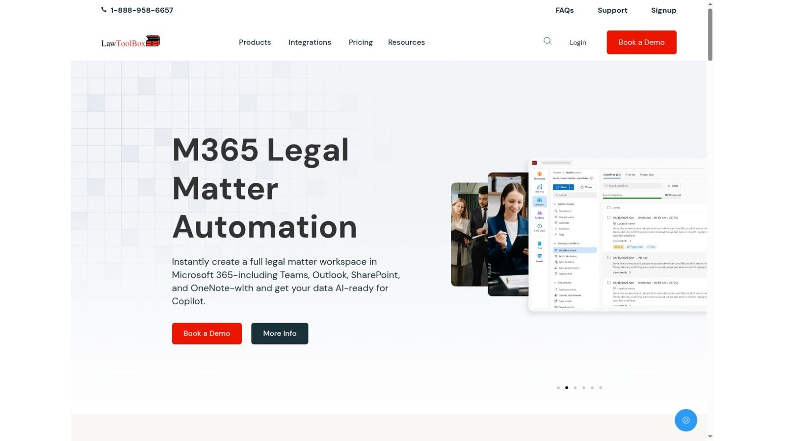
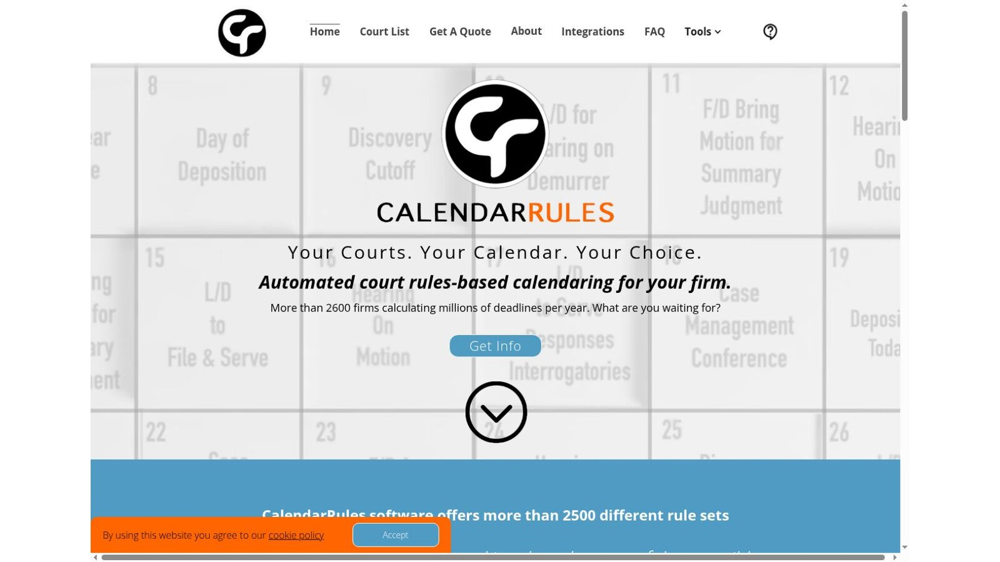

# Legal Docketing Software: How Rules-Based Deadline Tools Work

Legal docketing software calculates court deadlines from the applicable rules and puts them on the right calendars. You enter a triggering event, such as a service date or trial date. The software applies the court's rules and produces every related deadline. When a date changes, the deadlines change with it.

This matters because a missed deadline can end a case. This guide explains how rules-based docketing works and compares two dedicated tools, LawToolBox and CalendarRules, using their own pages checked on November 26, 2026.

## Key Takeaways

* **Rules-based tools start from one trigger:** LawToolBox says it can calculate "80+ court-specific deadlines by entering a single trial date."
* **Coverage is broad:** LawToolBox covers "thousands of jurisdictions in the US, Canada, and around the world," and CalendarRules says it is available in all 50 states.
* **Rule updates are the real product:** LawToolBox says a team of attorneys monitors court rule changes daily.
* **Calendar sync matters:** Both tools sync deadlines to Outlook, and LawToolBox adds Google and Apple calendars.
* **Expect a commitment:** LawToolBox requires a minimum one-year commitment, billed annually or monthly.

## Quick Comparison

Here is how the two tools compare on the points their pages state.

| Feature | LawToolBox | CalendarRules |
| --- | --- | --- |
| Coverage claim | Thousands of jurisdictions in the US, Canada, and elsewhere | Available in all 50 states; more than 2,500 rule sets |
| Calendar sync | Outlook, Google, Apple Calendar, and case management platforms | Outlook |
| Rule updates | Attorneys monitor court rule changes daily | Updates can reach users in as little as 15 seconds, per the vendor |
| Platform | Built around Microsoft 365 | Cloud-based |
| Published pricing | Per-user rates by seat band; one-year minimum | No prices published; free trial offered |

## Who Needs Dedicated Docketing Software

Not every firm needs a standalone rules engine. Use these rough guides.

* **Litigation-heavy firms:** If most of your work involves court filings, a rules-based tool is close to essential. Deadlines multiply with each case.
* **Firms in many courts:** Lawyers who appear in several state and federal courts face different counting rules. A rule library saves research time.
* **Transactional firms:** If you rarely appear in court, the calendar in your practice management system may be enough.
* **Solo litigators:** A solo lawyer with no docketing clerk carries all the risk alone. Automated calculation adds a second check that a solo practice otherwise lacks.

## What Docketing Software Does That a Calendar Cannot

A regular calendar stores dates you type in. Legal docketing software works out the dates for you.

Here is the basic process:

1. **Choose the court and case type.** The software loads the rule set for that court.
2. **Enter the trigger.** This might be the date a complaint was served or the date set for trial.
3. **Review the generated deadlines.** The software lists each deadline, the rule behind it, and how it was counted.
4. **Push to calendars.** Deadlines appear on the calendars of everyone assigned to the matter.
5. **Recalculate on change.** If the trial date moves, dependent deadlines move too.

The value lies in the rule logic. Counting rules differ by court. Weekends, court holidays, and service methods can all shift a deadline. A rules-based tool applies those details the same way every time.

## How We Compared These Tools

We opened each vendor's live pages on November 26, 2026 and recorded only what they stated. The site owner captured the screenshots below from the same official pages on November 25, 2026. We did not run trials or calculate deadlines in either tool. This is a research comparison, not a hands-on review.

We focused on two dedicated rules-based tools because their pages stated enough detail to compare. Practice management suites also include calendars, but their deadline features vary by plan. Ask each vendor directly whether its calendar applies court rules or simply stores dates.

## 1. LawToolBox: Best for Microsoft 365 Firms

LawToolBox builds its docketing into Microsoft 365. Its home page says firms can "Automatically calculate 80+ court-specific deadlines by entering a single trial date." It covers "rules-based deadlines for thousands of jurisdictions in the US, Canada, and around the world."

Deadlines can "Sync to Outlook, Google, Apple Calendar, and leading case management platforms." The home page also describes creating a full matter workspace in Microsoft 365, including Teams, Outlook, SharePoint, and OneNote.

The [LawToolBox pricing page](https://lawtoolbox.com/pricing/) answers the most important question for any docketing tool: who keeps the rules current. Its FAQ says, "We have a dedicated team of attorneys monitoring daily for any changes to court rules."

On cost, the pricing page lists per-user monthly rates that vary by number of seats. The page text we captured did not clearly show which rates apply to annual versus monthly billing. It does state that "LawToolBox is a minimum one-year commitment which can be billed annually or monthly." It adds $4 per user for integrations with NetDocuments, iManage, ECFX, or InfoTrack. Pricing assumes a license for every Microsoft 365 licensed mailbox.

**Choose it if:** your firm runs on Microsoft 365 and wants deadlines inside Outlook and Teams.

## 2. CalendarRules: Best for Broad State Court Coverage

CalendarRules describes itself as "Automated court rules-based calendaring for your firm." Its [home page](https://www.calendarrules.com/) says the software "offers more than 2500 different rule sets" and is "Available in all 50 states."

The tool is cloud-based and says users can "integrate with Outlook." On rule changes, the page claims, "we can take as little as 15 seconds to update everyone."

The page repeats some marketing copy with different numbers. One version says "More than 2600 firms calculating millions of deadlines per year," while another says 1,500 firms and 9 million deadlines. We report the rule set and state figures above as the vendor states them and suggest you confirm current coverage for your courts.

CalendarRules publishes no prices but offers a free trial.

**Choose it if:** you practice in several state courts and want a cloud tool that pushes deadlines to Outlook.

## Why Rule Updates Matter Most

Court rules change. Local rules, standing orders, and holiday schedules shift during the year. A docketing tool is only as good as its rule library on the day you use it.

Ask every vendor these questions:

* **Who updates the rules?** LawToolBox says attorneys monitor changes daily. Ask how quickly a change reaches your calendar.
* **What happens to existing deadlines?** If a rule changes, does the software flag deadlines already calculated under the old rule?
* **Can you see the rule behind each deadline?** A good tool shows the citation, so a lawyer can check the count.
* **How are local rules handled?** Confirm coverage for the specific courts and judges you appear before.

## The Malpractice Risk of Missed Deadlines

CompuLaw, an older docketing product now listed by Aderant, states on its [website](https://www.compulaw.com/) that "Calendar/deadlines-related errors are the leading cause of malpractice actions against lawyers." That page is dated and is the vendor's claim, but it reflects why firms invest in docketing.

Software reduces the risk but does not remove it. Someone must enter the right trigger date, choose the right rule set, and review the result. Treat legal docketing software as a second check, not a replacement for a lawyer's review.

## A Worked Example: A Moving Trial Date

Picture a litigation team with a civil case set for trial. The docketer enters the trial date, and the tool generates every pretrial deadline under the court's rules: discovery cutoffs, expert disclosures, motion deadlines, and the pretrial conference.

Two months later, the court moves the trial by six weeks. Without rules-based software, someone must recount every dependent deadline by hand and update each lawyer's calendar. One missed update can lead to a missed filing.

With legal docketing software, the docketer changes the trial date once. The tool recalculates the dependent deadlines and updates the synced calendars. The team then reviews the new list and confirms it against the court's order.

## Questions to Ask in a Demo

Bring a real, closed case to every demo. Ask the vendor to enter its trigger dates and compare the output with the deadlines your firm calendared.

### Which Courts Do You Cover in Full?

"All 50 states" can mean statewide rules only. Ask whether the tool covers the local rules, standing orders, and individual judge preferences for your courts. Get the list in writing.

### How Are Service Methods Handled?

Some deadlines shift depending on how a document was served. Ask how the tool records the service method and whether it adds the right extra days.

### What Does the Deadline Entry Show?

Each deadline should show the rule it came from and the counting method. Lawyers need that to check the result quickly.

### Who Gets Notified, and When?

Confirm that reminders go to everyone on the matter, not just the person who entered the trigger. Ask how far ahead reminders can be set.

### What Happens When Someone Leaves?

Deadlines tied to one person's calendar can vanish when that person leaves. Ask how matters and deadlines are reassigned.

## Total Cost Beyond the License

The subscription is only part of the cost. Plan for the time to set up matters, train staff, and enter triggers for open cases. LawToolBox's pricing assumes a license for every Microsoft 365 licensed mailbox, so count mailboxes, not just litigators. Add any integration fees, such as LawToolBox's $4 per user for document management or e-filing connections.

Compare that total with the cost of a single missed deadline. For most litigation practices, legal docketing software pays for itself if it prevents one serious error.

## Building a Docketing Process Around the Software

Good docketing is a process, not just a product.

### Use Two-Person Review

One person enters the trigger and rule set. A second person checks the generated deadlines against the order or rule.

### Centralize Entry

Have one team or person enter all deadlines. Scattered entry by individual lawyers leads to gaps.

### Keep an Audit Trail

Record who entered each trigger and when. If a deadline is challenged, you can show how it was calculated.

### Review Weekly

Hold a short weekly review of upcoming deadlines for every active matter. Compare the software's list with court notices received that week, and fix any gaps the same day.

## Try a Quick Calculation First

If you want to see how deadline counting works before buying software, try the free legal deadline calculator in our Tools section. It is not a substitute for a rules-based docketing system, but it shows how weekends and holidays shift a date.

For a wider list of calendaring tools, including practice management suites with built-in calendars, see the guide to the [best legal calendaring software](/legal-tech/best-legal-calendaring-software/). If you are choosing a full practice system, compare [legal practice management software](/legal-tech/legal-practice-management-software/) as well. Our [legal technology statistics](/legal-tech/legal-technology-statistics/) show how firms are adopting these tools.

## Frequently Asked Questions

### What Is Legal Docketing Software?

It is software that calculates court deadlines from the applicable rules after you enter a triggering event, then syncs those deadlines to the calendars of everyone on the matter.

### How Is Docketing Different From Calendaring?

Calendaring stores dates. Docketing calculates them from court rules and keeps them updated when triggers or rules change.

### How Much Does Legal Docketing Software Cost?

LawToolBox lists per-user monthly rates by seat band with a minimum one-year commitment. CalendarRules does not publish prices and offers a free trial. Get a written quote for your number of users and courts.

### Does Docketing Software Replace a Docketing Clerk?

No. It speeds up calculation and reduces counting errors, but a person still has to enter the right trigger, choose the right rule set, and review the result.

### Is This a Hands-On Review?

No. We compared each legal docketing software product using official pages and the site owner's screenshots. We did not calculate deadlines in either tool.

## Resources

* [LawToolBox](https://lawtoolbox.com/)
* [LawToolBox pricing](https://lawtoolbox.com/pricing/)
* [CalendarRules](https://www.calendarrules.com/)
* [CompuLaw](https://www.compulaw.com/)
* [Aderant CompuLaw](https://www.aderant.com/compulaw/)
