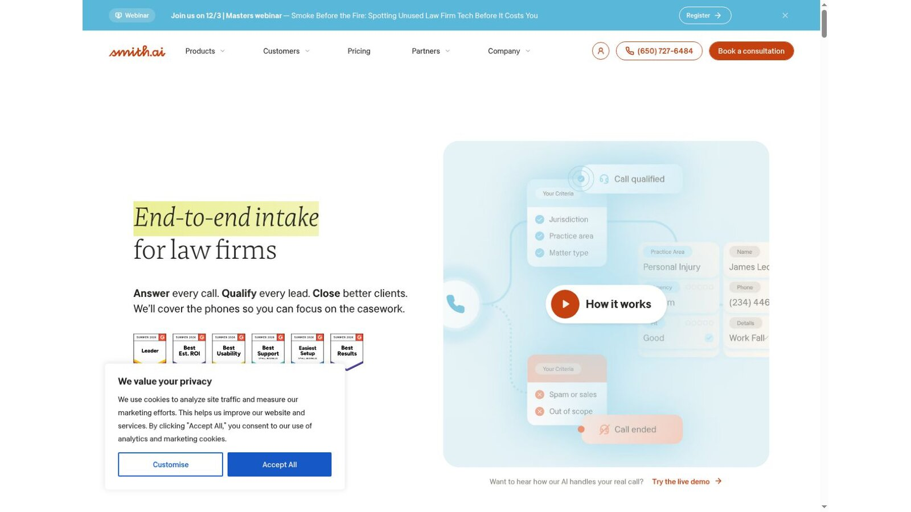
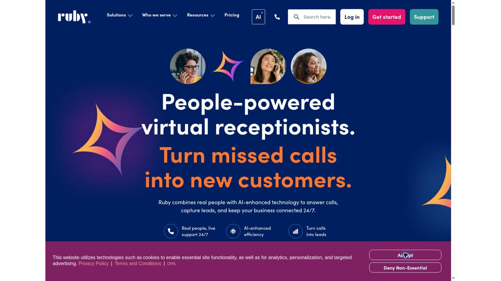
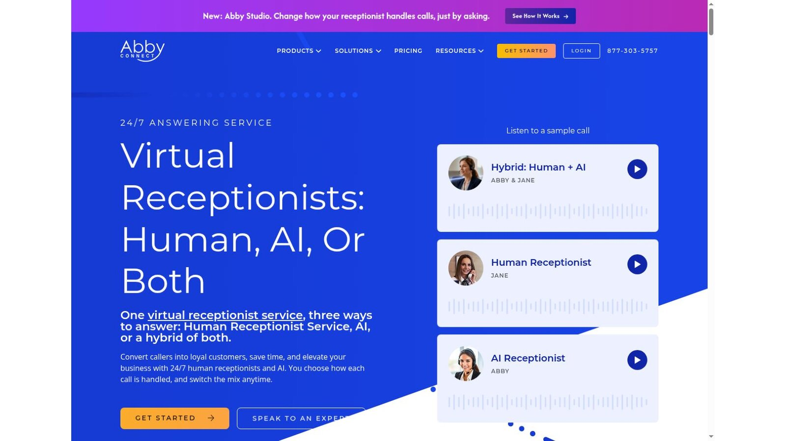
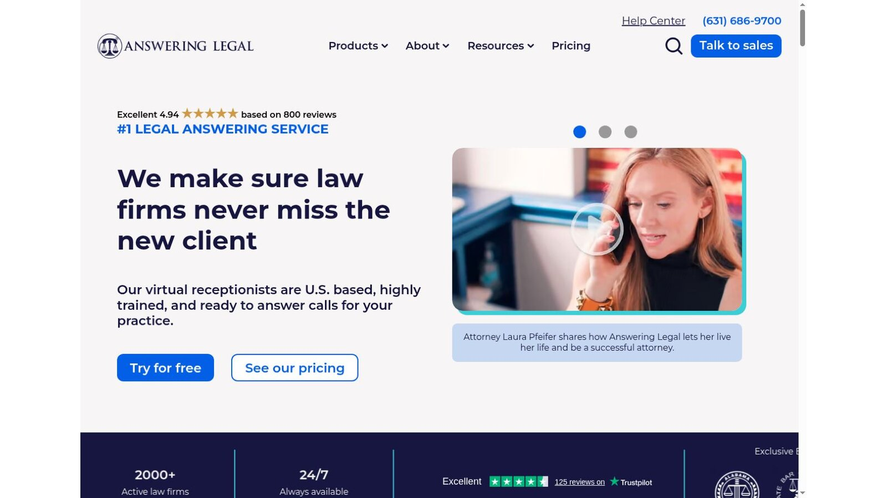
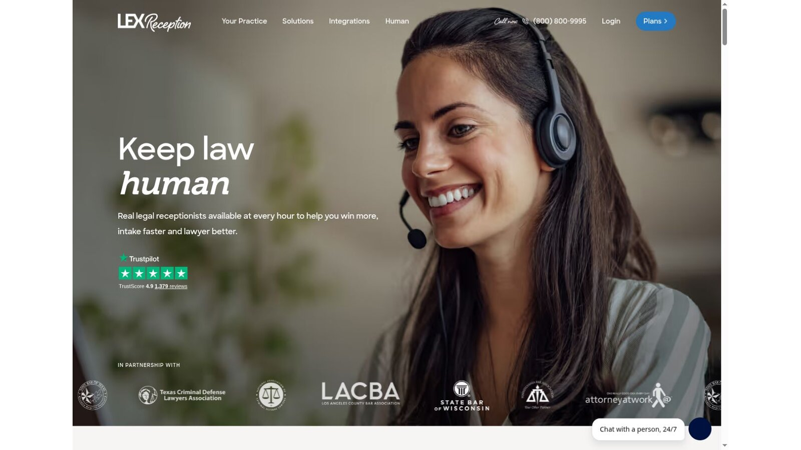

# Virtual Receptionist for Law Firms: Intake Quality Matters More Than a Greeting

A virtual receptionist for law firms answers calls when your staff cannot, takes messages, and in many cases completes a short intake for new callers. The cheapest plan is not always the best value. What matters is whether the receptionist captures the right facts, routes urgent calls, and pushes the lead into your system before the caller hangs up and calls another firm.

This guide compares five services using their own pages, checked on November 26, 2026. It covers how each one charges, what legal intake looks like, and which support Spanish and AI answering.

## Key Takeaways

* **Pricing units differ:** Smith.ai prices by call, while Ruby and Abby Connect price by minutes.
* **Entry prices are close:** Abby Connect Starter is $164 a month for 50 minutes, Ruby starts at $250 for 50 minutes, and Smith.ai Starter is $300 for 30 calls.
* **Two services hide prices:** LEX Reception and Answering Legal do not publish plan prices.
* **AI is a real choice now:** Smith.ai offers AI-first answering from $1.60 per call, while LEX Reception says, "No bots or AI."
* **All five offer English and Spanish:** Each service states Spanish or bilingual support on its pages.

## Quick Comparison

The table compares each service's entry price, pricing unit, and options.

| Service | Entry price | Unit | Legal intake | AI option |
| --- | --- | --- | --- | --- |
| Abby Connect | $164 a month for 50 Abby Minutes | Minutes | Intake use case listed | AI receptionist; AI minutes count as half |
| Ruby | $250 a month for 50 minutes | Minutes | Lead qualification and intake | Optional AI enhancements at no extra cost |
| Smith.ai | $300 a month for 30 calls | Calls | New client intake free; extended $1.50 | AI-first from $1.60 per call |
| Answering Legal | Behind a form | Not stated | Custom legal intake for new callers | AI chatbot for web leads |
| LEX Reception | Not published | Not stated | Intake of new clients day and night | None; "No bots or AI" |

Prices are list prices from each vendor's site on November 26, 2026.

## Calls or Minutes: Why the Unit Matters

A per-call price is easier to predict when calls vary in length. A per-minute price can be cheaper when most calls are short.

Legal intake calls are often long. A new caller describing an accident or a custody dispute can talk for several minutes. If most of your calls are new-client intakes, per-call pricing may protect you from surprise bills. If most calls are quick messages from existing clients, minutes may cost less.

Before you compare any virtual receptionist for law firms, count last month's calls and estimate how many were new-client intakes. That single number makes the comparison much easier.

## How We Compared These Services

We opened each vendor's home and pricing pages on November 26, 2026 and recorded only what they stated. The site owner captured the screenshots below from the same official pages on November 25, 2026. We did not place test calls or open accounts. This is a research comparison, not a hands-on review.

## 1. Smith.ai: Best for Predictable Per-Call Pricing

Smith.ai prices by call. Its [receptionist pricing page](https://smith.ai/pricing/receptionists) lists Starter at $300 a month for 30 calls, Basic at $810 for 90 calls, and Pro at $2,100 for 300 calls. Overage costs $11.50, $10.50, and $8.50 per call. Enterprise is custom.

Legal intake is part of the plan. New client intake of up to five short questions is free, and extended intake costs $1.50. A dedicated Spanish line costs $1.00. The first CRM integration is free, and each extra CRM costs $0.50 per call. A 12-month commitment earns a 10% discount.

The Smith.ai home page also lists AI-first answering from $1.60 per call, hybrid from $2.50, and human-first from $7, plus a free plan with 25 calls a month. It integrates with Clio, Filevine, Lawmatics, MyCase, PracticePanther, Smokeball, Litify, and Rocket Matter.

**Choose it if:** you want predictable costs per call and the option to mix AI and human answering.

## 2. Ruby: Best for Live Human Answering

Ruby uses live receptionists. Its FAQ says, "Ruby uses live, human receptionists." The [Ruby pricing page](https://www.ruby.com/pricing/) lists 50 minutes for $250, 100 minutes for $395, 200 minutes for $720, and 500 minutes for $1,725 a month. The 200-minute plan is marked most popular.

Coverage is "24/7 live answering (including after-hours, on weekends, and holidays)." Spanish and bilingual call handling is available. Plans include lead qualification and intake, and Ruby lists more than 5,000 integrations. Optional AI enhancements are included in all plans at no extra cost. The Ruby home page says there are no long-term contracts.

The pricing page we read did not list an overage rate. Ask what happens when you exceed your minutes.

**Choose it if:** your clients expect a live person on every call.

## 3. Abby Connect: Best Low Entry Price

Abby Connect has the lowest published entry price in this group. Its [pricing page](https://www.abby.com/pricing/) lists Starter at $164 a month for 50 Abby Minutes, Essential at $329 for 100, Professional at $599 for 200, and Growth at $1,380 for 500.

Abby counts time in its own unit. One Abby Minute equals one minute of human answering, or two minutes of AI answering. Overage is billed at your plan's Abby Minute rate. Coverage can be set to 24/7 with no weekend upcharge, in English and Spanish.

The Abby home page says it connects with more than 1,000 tools, including Clio. There is no setup fee, plans are month to month, and every plan has a free trial.

**Choose it if:** you have modest call volume and want a low monthly starting point.

## 4. Answering Legal: Best for Law-Only Focus

Answering Legal serves law firms only. Its home page says, "Every new client caller gets a custom legal intake." Receptionists are U.S. based and available 24/7/365, in English or Spanish.

Integrations include Clio Grow, MyCase, PracticePanther, Smokeball, Lawmatics, and Litify. An AI chatbot captures web leads. A free trial offers 14 days and 400 minutes with no credit card.

Prices sit behind a form. The pricing page says, "We never charge extra to use premium features" and "There are no long term commitments." Request a written quote.

**Choose it if:** you want a service built only for law firms, with intake scripts designed for legal calls.

## 5. LEX Reception: Best for Firms That Want No AI

LEX Reception offers "24/7 legal reception" by people. Its home page answers the AI question directly: "No bots or AI." It says "LEX can intake new, qualified clients day and night" and that information "flows directly into your CRM or case management system."

Service is available in English and Spanish. Integration logos include Clio, MyCase, Filevine, Smokeball, and Lawmatics. The pricing page we reached showed a sign-up form but no prices.

**Choose it if:** your firm wants human-only answering for every call and chat.

## What 60 New-Client Calls Cost

Here is a rough monthly comparison for a firm that gets 60 calls a month, using published prices only.

| Option | Assumption | Monthly cost |
| --- | --- | --- |
| Smith.ai Basic | 60 calls fit within 90 included | $810 |
| Smith.ai Starter | 30 included plus 30 overage at $11.50 | $300 + $345 = $645 |
| Ruby 200 minutes | 60 calls averaging 3 minutes = 180 minutes | $720 |
| Abby Connect Professional | 180 human minutes within 200 included | $599 |

These figures are our arithmetic from the published prices. The 3-minute average is an assumption, not vendor data. Longer intake calls push minute-based plans into higher tiers or overage. Use your own call log to redo the math.

## What Good Legal Intake on a Call Looks Like

The receptionist is the first person a prospective client talks to. Check that the script covers:

* **Contact details:** Name, phone, email, and best time to call back.
* **Matter type:** A short description in the caller's words.
* **Urgency:** Court dates, arrests, or deadlines that need same-day attention.
* **Opposing party:** A name for your conflict check.
* **Source:** How the caller found your firm.

Ask each service to send you a sample intake summary. If it reads like a vague message slip, keep looking.

## Questions to Ask Before You Sign

Ask every virtual receptionist for law firms the same questions, and keep the answers in writing.

### What Counts as a Billable Call or Minute?

Ask whether spam calls, wrong numbers, and hang-ups count. Ask whether time on hold or transferring a call is billed.

### How Are Urgent Calls Handled?

Give the service a list of urgent situations, such as an arrest or a same-day hearing. Ask how it reaches a lawyer after hours and what happens if no one answers.

### Can I Change the Script Myself?

Practice areas and intake questions change. Ask whether you can edit scripts online or must file a support request.

### How Do Leads Reach My Systems?

Ask which fields push into your CRM and how fast. A lead that waits in an email inbox until morning loses much of the value.

### What Reports Will I Get?

Ask for call counts, new-client calls, and missed or abandoned calls each month. You need these numbers to judge whether the service pays for itself.

## Signs You Need a Virtual Receptionist

A virtual receptionist for law firms makes sense when calls go to voicemail during court, meetings, or after hours. It also helps when staff spend much of the day answering routine calls instead of doing billable work. If prospective clients mention that they called other firms first, slow answering may be costing you cases. Track missed calls for two weeks before you decide.

## Ethics and Confidentiality

Receptionists hear confidential information. Ask each vendor where call recordings and notes are stored, who can access them, and how long they are kept. Make sure the receptionist never gives legal advice and tells callers that no attorney-client relationship exists until the firm agrees to take the case. The Florida Bar lists virtual reception vendors as a member benefit, with member discounts from several providers. Florida lawyers should check that page before buying.

## Connect Calls to Your Intake System

A virtual receptionist for law firms works best when calls feed straight into your intake pipeline. Pair it with [legal intake software](/legal-tech/legal-intake-software/) so every call becomes a lead record with automatic follow-up. For tools that manage long-term client relationships, see the guide to the [best legal CRM software](/legal-tech/best-legal-crm-software/). Our [legal technology statistics](/legal-tech/legal-technology-statistics/) show how firms are adding AI and cloud tools.

## Frequently Asked Questions

### How Much Does a Virtual Receptionist for Law Firms Cost?

Published entry prices on November 26, 2026 ranged from $164 a month at Abby Connect to $300 a month at Smith.ai. Answering Legal and LEX Reception require a quote.

### Should I Choose AI or Human Answering?

It depends on your callers. AI answering costs less per call, but some firms and clients prefer a live person for sensitive matters. Smith.ai and Abby offer both, while LEX Reception is human-only.

### Can a Virtual Receptionist Do Legal Intake?

Yes. Smith.ai includes a short new-client intake, Answering Legal gives every new caller a custom legal intake, and LEX Reception takes intake day and night.

### Do Virtual Receptionists Integrate With Clio?

Several do. Smith.ai, Abby Connect, Answering Legal, and LEX Reception all name Clio or Clio Grow among their integrations.

### Is This a Hands-On Review?

No. We compared each virtual receptionist for law firms using official pages and the site owner's screenshots. We did not place test calls.

## Resources

* [Smith.ai receptionist pricing](https://smith.ai/pricing/receptionists)
* [Smith.ai](https://smith.ai/)
* [Ruby pricing](https://www.ruby.com/pricing/)
* [Ruby](https://www.ruby.com/)
* [Abby Connect pricing](https://www.abby.com/pricing/)
* [Abby Connect](https://www.abby.com/)
* [Answering Legal](https://www.answeringlegal.com/)
* [LEX Reception](https://www.lexreception.com/)
* [The Florida Bar: Virtual Receptionists](https://www.floridabar.org/member/benefits/practice-resources/virtual-reception/)
