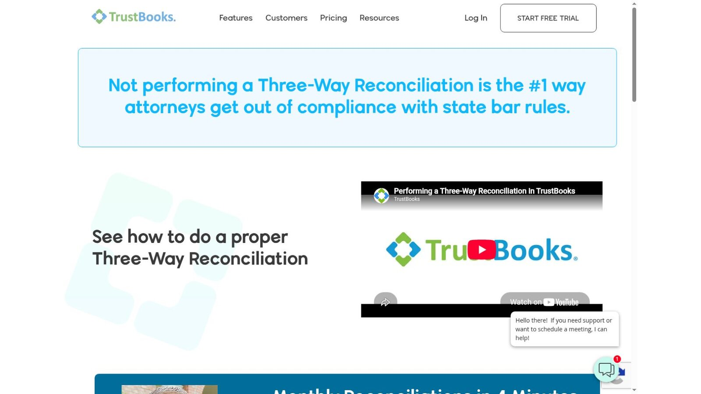
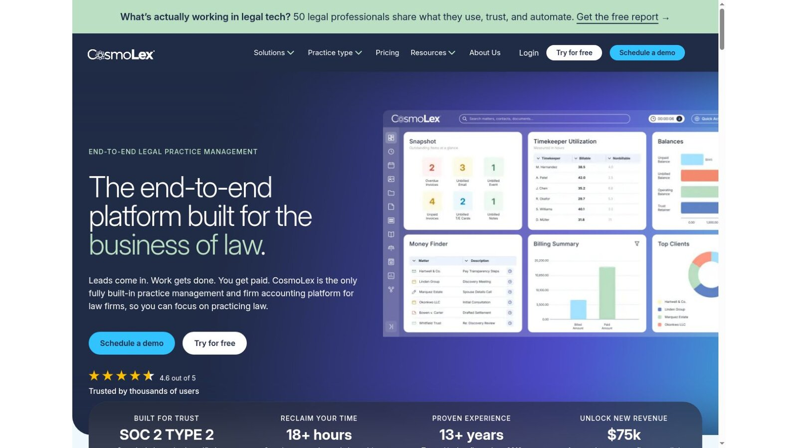
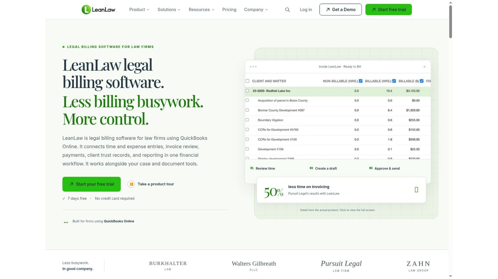
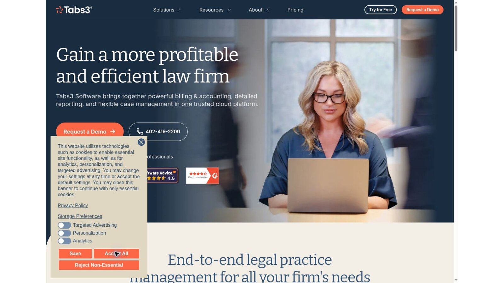

# Trust Accounting Software for Lawyers: Trust Ledgers vs Full Bookkeeping

Trust accounting software for lawyers keeps client money separate from firm money and proves it with records. The core job is three-way reconciliation: the bank statement, the trust account ledger, and the total of every client ledger must all match. Some tools do only that job. Others run the firm's full books as well.

This guide compares four tools that take different approaches. Every price and feature below comes from the vendor's own pages, checked on November 26, 2026.

## Key Takeaways

* **Three-way reconciliation is the test:** TrustBooks generates a report "showing your bank balance matching your trust ledger," and CosmoLex names three-way reconciliation on its home page.
* **Trust-only tools are cheapest:** TrustBooks Trust Only costs $59 a month for one user, plus $10 a month for each additional user.
* **QuickBooks fit varies:** LeanLaw requires QuickBooks Online as the general ledger, while CosmoLex runs full accounting in its own system.
* **All-in-one platforms cost more per user:** CosmoLex ranges from $49 to $129 per user per month, and Tabs3 Cloud starts at $89.
* **IOLTA is named by LeanLaw:** Every LeanLaw plan includes "Trust accounting & IOLTA compliance."

## Quick Comparison

The table compares each tool's price, approach, and QuickBooks fit.

| Tool | Published price | Approach | Three-way reconciliation named | QuickBooks |
| --- | --- | --- | --- | --- |
| TrustBooks | Trust Only $59 a month (1 user) | Trust-focused add-on | Yes | Not listed as an integration |
| CosmoLex | $49 to $129 per user per month | All-in-one practice and accounting | Yes, on home page | QuickBooks Online integration listed |
| LeanLaw | $55 to $75 per user per month | Billing and trust on top of QuickBooks Online | Not named on pages we read | Required |
| Tabs3 | Cloud from $89 per user per month | Billing and financials suite | Not named on pages we read | Not listed on pages we read |

## What Trust Accounting Software Must Do

Client money held in trust belongs to clients, not the firm. Your state bar sets the rules for how it is handled and recorded, so read those rules first. Software helps you follow them in four ways:

* **Separate ledgers:** One ledger for each client, so you always know whose money is whose.
* **No negative balances:** A good tool warns before you pay out more than a client has on deposit.
* **Reconciliation:** Regular matching of the bank, trust ledger, and client ledgers.
* **Audit-ready reports:** Clear reports you can hand to an auditor or bar examiner.

General accounting software can track a bank account, but it does not naturally track many client ledgers inside one trust account. TrustBooks makes this point on its three-way reconciliation page: "QuickBooks doesn't make it easy to track client ledgers."

## Who Needs Dedicated Trust Software

Any firm that takes retainers, settlement funds, or other client money into trust needs reliable records. The need grows with volume. A firm with a handful of trust transactions a month may manage with a careful process and a basic tool. A personal injury or real estate practice moving large sums for many clients needs trust accounting software for lawyers that reconciles quickly and flags problems early.

## How We Compared These Tools

We opened each vendor's product and pricing pages on November 26, 2026 and recorded only what they stated. The site owner captured the screenshots below from the same official pages on November 25, 2026. We did not open accounts or run reconciliations. This is a research comparison, not a hands-on review.

## 1. TrustBooks: Best for Trust-Only Needs

TrustBooks focuses on trust compliance. Its three-way reconciliation page says firms can "Generate a Three-Way Reconciliation Report showing your bank balance matching your trust ledger."

The [TrustBooks pricing page](https://trustbooks.com/pricing/) lists three tiers:

* **Trust Only:** $59 a month for one user, plus $10 a month per additional user. Includes three-way trust reconciliations.
* **Trust + Operating:** $79 a month, adding profit and loss, balance sheet, cash flow, general ledger, and trial balance reports.
* **Trust + Operating + Reconciliation Services:** $249 a month with unlimited users, for up to 100 transactions a month.

Annual billing gives two months free. Integrations include PracticePanther, LawPay, and Clio, plus bank connections.

**Choose it if:** you already have billing software and need a dedicated, low-cost trust ledger with clean reconciliation reports.

## 2. CosmoLex: Best All-in-One Option

CosmoLex combines practice management, billing, and full accounting. Its home page mentions "three-way reconciliation and detailed audit trails."

The [CosmoLex pricing page](https://www.cosmolex.com/pricing/) lists Launch at $49, Core at $99, and Pro at $129 per user per month, with $120 per user saved on yearly billing. Features include "Trust accounting & ledgers" and "General Ledger & Payables," described as "Full accounting across trust, operating, and business in one system." The home page says a QuickBooks Online integration is available on Core and Pro.

**Choose it if:** you want trust, operating, and practice management in one system and do not want to run QuickBooks alongside it.

## 3. LeanLaw: Best for QuickBooks Online Firms

LeanLaw is built around QuickBooks Online. Its home page says LeanLaw requires QuickBooks Online, not as an integration but "as the financial source of truth." It covers "IOLTA trust accounting, LEDES billing, contingency-fee work, split billing."

The [LeanLaw pricing page](https://www.leanlaw.co/pricing/) lists Core at $55 and Pro at $75 per user per month, with custom pricing for Contingency and Elite plans. Every plan includes "Trust accounting & IOLTA compliance" and "Two-way QuickBooks Online sync." A 7-day free trial requires no credit card.

**Choose it if:** your accountant already works in QuickBooks Online and you want trust and billing to sync with it.

## 4. Tabs3: Best for Established Firms Wanting a Full Suite

Tabs3 offers billing, financials, and practice management modules. Its home page says it "includes a dedicated module for trust accounting" and helps firms "maintain trust-account ledgers." General Ledger is listed among its natively integrated modules.

The Tabs3 pricing page lists Cloud from $89 per user per month, including Tabs3 Billing, Tabs3 Financials, Tabs3Pay, and Tabs3 Connect. PracticeMaster, its practice management module, adds $35 per user per month. An OnSite version starts at $69, with PracticeMaster at $32. Firms with 10 or more users are encouraged to request a custom quote.

**Choose it if:** you want a mature billing and accounting suite and may later add practice management.

## What Year One Costs for a Three-Lawyer Firm

Here is a year-one comparison for three users using published monthly prices, before taxes and payment fees.

| Option | Calculation | Year-one cost |
| --- | --- | --- |
| TrustBooks Trust Only | ($59 + 2 x $10) x 12 | $948 |
| TrustBooks Trust + Operating | ($79 + 2 x $10) x 12 | $1,188 |
| LeanLaw Core | 3 x $55 x 12 | $1,980, plus QuickBooks Online |
| CosmoLex Launch | 3 x $49 x 12 | $1,764 |
| Tabs3 Cloud | 3 x $89 x 12 | $3,204 |

These totals are our arithmetic from published prices. We assumed the TrustBooks Trust + Operating tier uses the same $10 per additional user as Trust Only. Confirm that with the vendor. The table compares different scopes: TrustBooks covers trust, while CosmoLex and Tabs3 also include billing and other features. LeanLaw also needs a QuickBooks Online subscription, which is not included.

## Running a Monthly Three-Way Reconciliation

Whatever tool you choose, the monthly process looks like this:

1. **Get the bank statement** for the trust account.
2. **Reconcile the trust ledger** to the bank statement, accounting for outstanding deposits and checks.
3. **Total the client ledgers** and confirm they equal the trust ledger balance.
4. **Investigate any difference** at once. A gap usually means a missed entry, a misposted payment, or a bank error.
5. **Save the signed report** with the bank statement.

Software speeds up steps 2 and 3 and produces the report. A person must still review it and resolve differences. Set a fixed day each month for this work so it never slips.

## Common Trust Accounting Mistakes

### Depositing Fees Into the Wrong Account

Earned fees belong in operating. Unearned retainers belong in trust. Software that routes payments by type reduces mix-ups.

### Paying Out Before Funds Clear

Spending a client's deposit before it clears can leave a negative balance. Choose a tool that warns you.

### Reconciling Only the Bank

A two-way match between bank and trust ledger is not enough. Client ledgers must add up too.

### Letting Small Balances Sit

Old, small client balances complicate reconciliation. Review them regularly and follow your state's rules for returning or handling unclaimed funds.

## Trust-Only Tool or Full Suite?

The first decision is scope. Trust accounting software for lawyers comes in two broad types.

**Trust-only tools** handle client ledgers and reconciliation and leave billing and general accounting to other systems. TrustBooks Trust Only fits here. It is cheaper and quick to adopt, but you must keep data in sync with your billing tool.

**Full suites** handle trust, operating accounting, billing, and often practice management in one place. CosmoLex and Tabs3 fit here. They cost more per user but remove the need to move data between systems.

LeanLaw sits in between. It adds legal billing and trust accounting on top of QuickBooks Online, which stays the general ledger.

Choose a trust-only tool if you are happy with your billing software and only need cleaner trust records. Choose a suite if you are replacing several tools at once.

## Questions to Ask Every Vendor

Before you pick trust accounting software for lawyers, get written answers to these questions:

* **Does it block overdrafts?** Ask whether the system prevents a payment that would make a client ledger negative.
* **What does the reconciliation report show?** Ask for a sample report and compare it with what your state bar or auditor expects.
* **How are bank feeds handled?** Ask whether transactions import automatically and how mismatches are flagged.
* **Which billing tools does it connect to?** TrustBooks lists PracticePanther and Clio. Confirm the exact sync, not just the logo.
* **Can my accountant access it?** Ask about accountant seats and whether they cost extra.
* **How do I get my records out?** Trust records must be kept for years. Confirm you can export them in a standard format.

## How It Fits With Billing

Trust accounting software for lawyers often pairs with a billing tool. If you are still choosing billing software, see the comparison of [billing software for small law firms](/legal-tech/billing-software-for-small-law-firms/), which notes which plans include trust ledgers. For a broader list, see the [best legal accounting software](/legal-tech/best-legal-accounting-software/). Our [legal technology statistics](/legal-tech/legal-technology-statistics/) show how firms are adopting cloud finance tools.

## Frequently Asked Questions

### What Is Trust Accounting Software for Lawyers?

It is software that tracks client money held in trust, keeps a ledger for each client, and reconciles the trust account against the bank and the client ledgers.

### What Is Three-Way Reconciliation?

It is the process of matching three figures: the bank statement balance, the trust account ledger balance, and the total of all client ledgers.

### Can I Use QuickBooks for Trust Accounting?

QuickBooks can track the bank account, but TrustBooks notes that QuickBooks does not make it easy to track client ledgers. LeanLaw adds trust accounting on top of QuickBooks Online.

### How Much Does Trust Accounting Software Cost?

On November 26, 2026, TrustBooks started at $59 a month for one user, CosmoLex at $49 per user per month, LeanLaw at $55, and Tabs3 Cloud at $89.

### Is This a Hands-On Review?

No. We compared each trust accounting software for lawyers option using official pages and the site owner's screenshots. We did not run reconciliations.

## Resources

* [TrustBooks three-way reconciliation](https://trustbooks.com/three-way-reconciliation/)
* [TrustBooks pricing](https://trustbooks.com/pricing/)
* [CosmoLex](https://www.cosmolex.com/)
* [CosmoLex pricing](https://www.cosmolex.com/pricing/)
* [LeanLaw](https://www.leanlaw.co/)
* [LeanLaw pricing](https://www.leanlaw.co/pricing/)
* [Tabs3](https://www.tabs3.com/)
* [Tabs3 pricing](https://www.tabs3.com/pricing)
