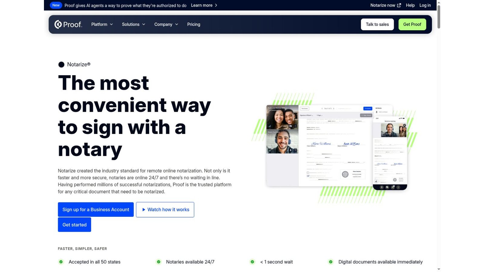
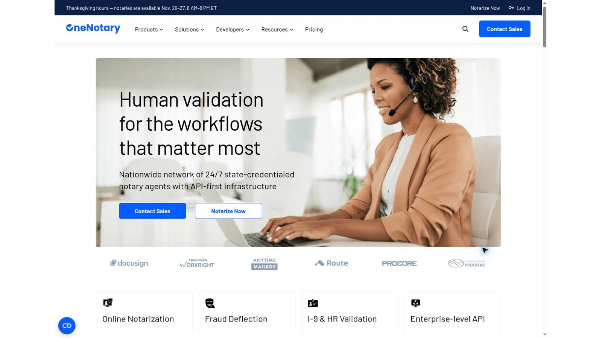
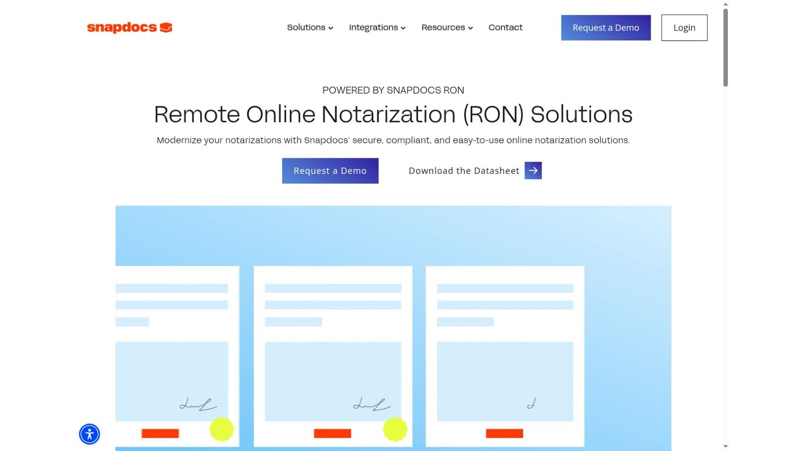
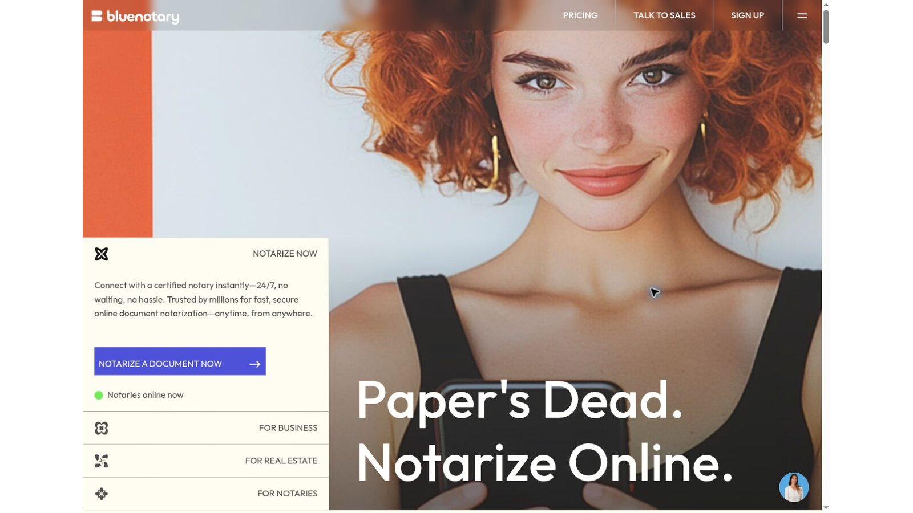

# How to Choose a Remote Online Notarization Platform

A remote online notarization platform lets a signer and a commissioned notary complete a notarization over live video. The right choice depends on who is buying. A business that needs a few documents notarized wants a low price per session. A notary wants a platform that is approved in their state. A title or lending team needs closing support that its underwriters accept.

This guide compares four providers using their own product and pricing pages, checked on November 26, 2026. It also explains the identity checks most state rules expect, so you can spot a platform that cuts corners.

## Key Takeaways

* **Most states now allow it:** The National Association of Secretaries of State says 47 states and the District of Columbia have a law that allows remote e-notarization.
* **Identity checks follow a standard:** NASS notes that the national standards require more than one way to verify a signer, such as knowledge-based authentication and credential analysis.
* **Published prices vary widely:** OneNotary lists $25 per session, Snapdocs lists RON at $15 for non-mortgage transactions plus a plan fee, and Proof asks buyers to talk to sales.
* **Retention terms differ:** OneNotary keeps documents for 7 days after a session on its free tier, with unlimited storage on paid plans.
* **Closings need underwriter approval:** BlueNotary and Snapdocs both state that major title underwriters have approved their eClosing tools.

## Quick Comparison

The table summarizes each platform's published price and identity checks.

| Platform | Published price | Identity checks named | Best fit |
| --- | --- | --- | --- |
| Proof (Notarize) | Talk to sales | Credential analysis, KBA, biometric comparison | High-volume business and real estate teams |
| OneNotary | $25 per session; Business Professional $49 a month | Biometric ID verification, credential analysis, KBA | Occasional signers and small businesses |
| Snapdocs | Notary plan $20 a month; RON $15 non-mortgage, $25 mortgage | Automated IDV, KBA, and biometrics | Lenders and settlement teams |
| BlueNotary | Not shown on the pricing page we read | Biometric authentication and ID checks | Independent notaries and eClosings |

Prices are list prices from each vendor's site on November 26, 2026. Taxes and state notary fee caps are not included.

## How RON Works and What the Law Expects

In a remote online notarization, the signer appears on a live audio-video call. The platform checks the signer's identity, the notary watches the signing, and the notary applies an electronic seal and certificate. The session is usually recorded.

A remote online notarization platform does not make the notarization legal on its own. The notary's commission state sets the rules. According to the [NASS page on remote electronic notarization](https://www.nass.org/initiatives/remote-electronic-notarization), "47 states and the District of Columbia have a law that allows for remote e-notarization." The page shows no date for that count, so confirm your state's current rule with your secretary of state.

NASS also explains that its revised national standards "require multiple means of verifying the signer's identity (e.g. Knowledge Based Authentication and credential analysis)." That is the baseline to test against. If a platform cannot explain how it verifies identity, keep looking.

NASS adds that its adoption of the standards "is not an endorsement of either e-notarization or remote e-notarization." In other words, the standards describe safeguards. They are not a seal of approval for any vendor.

## How We Compared These Platforms

We opened each vendor's live product and pricing pages on November 26, 2026. We recorded only what the pages stated. Where a page did not show a price, we say so rather than estimate one. The site owner captured the screenshots below from the same official pages on November 25, 2026.

We did not open paid accounts or run test notarizations. This is a research comparison, not a hands-on review. Each section names the source page so you can check it yourself.

## 1. Proof (Notarize): Best for High-Volume Business Use

Proof sells the Notarize product to businesses and real estate teams. Its Notarize product page says identity is confirmed with "credential analysis, knowledge-based authentication and biometric comparison." It also states that "Every notary is verified with NIST IAL2 identity verification."

The page says its notarizations are "Accepted in all 50 states." That is a vendor statement about acceptance, not a count of states that authorize their own notaries to perform RON. Proof also notes that "Notaries on the Notarize Network require a background check."

For real estate, Proof says buyers, sellers, and agents can "sign and notarize closing documents remotely." Its pricing page lists no prices. It asks buyers to talk to the team about transaction volume and workflow.

**Choose it if:** you need a managed network of notaries and expect enough volume to negotiate a contract.

## 2. OneNotary: Best for Occasional Signers

OneNotary publishes simple prices. Its [pricing page](https://onenotary.com/pricing/) lists a one-time session at "$25 per session" for one stamp and one signer. A Pay-as-you-go plan has no monthly fee. The Business Professional plan costs $49 a month, billed annually, and Enterprise pricing is by discussion.

For identity, the OneNotary home page names "Biometric ID verification, credential analysis, and KBA." It also describes recorded signer and notary communication with an audit trail.

Retention is the detail to read closely. The home page says OneNotary keeps documents "for 7 days after the notarization session is completed." The pricing table shows the same 7-day storage on Pay-as-you-go and unlimited storage on Business Professional and Enterprise. Download your notarized file right away if you use the free tier.

OneNotary also lists a mobile notary visit at $80 and a "Connect Your Own Notary" session at $10.

**Choose it if:** you notarize a handful of documents a year and want a clear per-session price.

## 3. Snapdocs: Best for Lenders and Settlement Teams

Snapdocs focuses on mortgage and real estate closings. Its RON solution page describes the product as "MISMO compliant, automated IDV/KBA/biometrics, and approval by all major underwriters." It also says users can "Access 140K+ qualified, real estate–trained notaries nationwide."

Snapdocs publishes per-transaction prices on its [RON pricing page](https://www.snapdocs.com/solutions/remote-online-notarization/pricing). The Notary plan costs $20 per user per month and includes one free RON. A RON costs $15 per non-mortgage transaction and $25 per mortgage transaction. In-person electronic notarization and eSign each cost $5 per transaction. A Team plan costs $50 per team per month with three free RONs.

**Choose it if:** your work is closings and you need underwriter acceptance and a notary network trained for real estate.

## 4. BlueNotary: Best for Independent Notaries

BlueNotary courts notaries as well as signers. Its home page invites notaries to "SIGN UP FOR FREE" and offers a Pro Notary upgrade. It lists "Biometric Authentication" and says secure ID checks keep sessions compliant.

For closings, BlueNotary says it is "Approved for eClosing by leading title underwriters" and shows First American, Old Republic, and Fidelity National logos. It also offers an on-demand witness service for $10.

Its pricing page states "45+ States Approved" but did not show plan prices in the version we read. Ask for a written quote before you commit.

**Choose it if:** you are a commissioned notary who wants to build a remote practice and handle title work.

## What a Year of Notarizations Costs

Price per session matters most when volume is low. Here is a simple comparison for a small business that needs 24 non-mortgage notarizations a year, two a month, using only the published list prices above.

| Option | How it is charged | Year-one cost |
| --- | --- | --- |
| OneNotary Pay-as-you-go | 24 sessions at $25 | $600 |
| OneNotary Business Professional | $49 a month for 12 months, billed annually | $588 plus per-session charges set by the plan |
| Snapdocs Notary plan | $20 a month plus $15 per non-mortgage RON | $240 + $360 = $600, less the value of any included free RON |

These totals are our arithmetic from the published prices. The pricing page says the Notary plan includes one free RON but does not say whether it renews each month, so we did not subtract it. The Snapdocs figure also assumes your own commissioned notary performs the work, since the Notary plan is sold per notary user. A business without a notary on staff should price OneNotary's per-session option or ask Snapdocs about a Team or Enterprise plan.

Read the plan terms for each tier before you rely on this table. Session limits, signer counts, and extra stamps can change the total.

## Questions to Ask Before You Sign Up

Use the same checklist for every remote online notarization platform you consider.

### Is the Platform Approved Where the Notary Is Commissioned?

The notary's state controls the act. A vendor's national claim does not replace a state approval list. Ask which states have approved the platform and check your secretary of state's list.

### How Does It Verify Identity?

Look for at least two methods, such as credential analysis and knowledge-based authentication. Ask what happens when a signer fails KBA and how many retries the platform allows.

### How Long Are Recordings and Documents Kept?

Many states require the notary to keep the audio-video recording for years. Ask who holds the recording, for how long, and how you can retrieve it. Compare that with OneNotary's 7-day document storage on its free tier.

### Will the Receiving Party Accept It?

County recorders, lenders, and foreign authorities can have their own requirements. For a deed or loan, confirm that the title underwriter and recorder accept the platform's output.

### Does It Fit Your Signing Workflow?

Many documents need a signature but not a notary. For those, an e-signature tool is cheaper. Compare options in our review of [DocuSign alternatives](/legal-tech/docusign-alternatives/) before paying for notarization you do not need. If notarized agreements pile up, track them in [contract management software for small business](/legal-business/contract-management-software-for-small-business/) so renewal dates do not slip.

## Common Mistakes When Choosing a Platform

Three mistakes come up again and again in buyer questions.

The first is choosing on price alone. A low session fee means little if the recorder or lender rejects the result. Confirm acceptance for your document type before you compare fees.

The second is ignoring who keeps the record. If the platform deletes files after a short window, the notary or business must download and store them. Build that step into your process on day one.

The third is assuming every signer can pass online identity checks. Some signers, such as people living abroad, may not be able to complete the questions or present a supported ID. Ask each remote online notarization platform what fallback it offers, such as a personally known witness or an in-person option.

## Where RON Fits in Legal Technology

Remote notarization is one part of a wider shift to digital legal work. The [legal technology statistics](/legal-tech/legal-technology-statistics/) we track show how far e-signature and cloud tools have spread in law firms. A remote online notarization platform adds the identity and record-keeping layer that a plain e-signature tool does not provide.

## Frequently Asked Questions

### What Is a Remote Online Notarization Platform?

It is software that connects a signer and a commissioned notary on a recorded video call, verifies the signer's identity, and applies an electronic notary seal and certificate.

### Is Remote Online Notarization Legal in Every State?

Not by every state's own law. NASS reports that 47 states and the District of Columbia have a law allowing remote e-notarization. A notary can only perform RON if their commission state allows it.

### How Much Does a Remote Online Notarization Cost?

Published list prices on November 26, 2026 ranged from OneNotary's $25 per session to Snapdocs' $15 per non-mortgage RON on a $20 monthly notary plan. Proof quotes by volume.

### What Identity Checks Should a RON Platform Use?

Look for credential analysis of a government ID and knowledge-based authentication. Some platforms add biometric comparison. NASS notes that the national standards call for multiple means of verifying identity.

### Is This a Hands-On Review?

No. We compared each remote online notarization platform using its official pages and the site owner's screenshots. We did not complete paid notarizations.

## Resources

* [NASS: Remote electronic notarization](https://www.nass.org/initiatives/remote-electronic-notarization)
* [Proof Notarize product page](https://www.proof.com/product/notarize)
* [OneNotary pricing](https://onenotary.com/pricing/)
* [Snapdocs remote online notarization](https://www.snapdocs.com/solutions/remote-online-notarization)
* [Snapdocs RON pricing](https://www.snapdocs.com/solutions/remote-online-notarization/pricing)
* [BlueNotary](https://bluenotary.us/)
* [BlueNotary pricing](https://bluenotary.us/pricing)
* [OneNotary](https://onenotary.com/)
