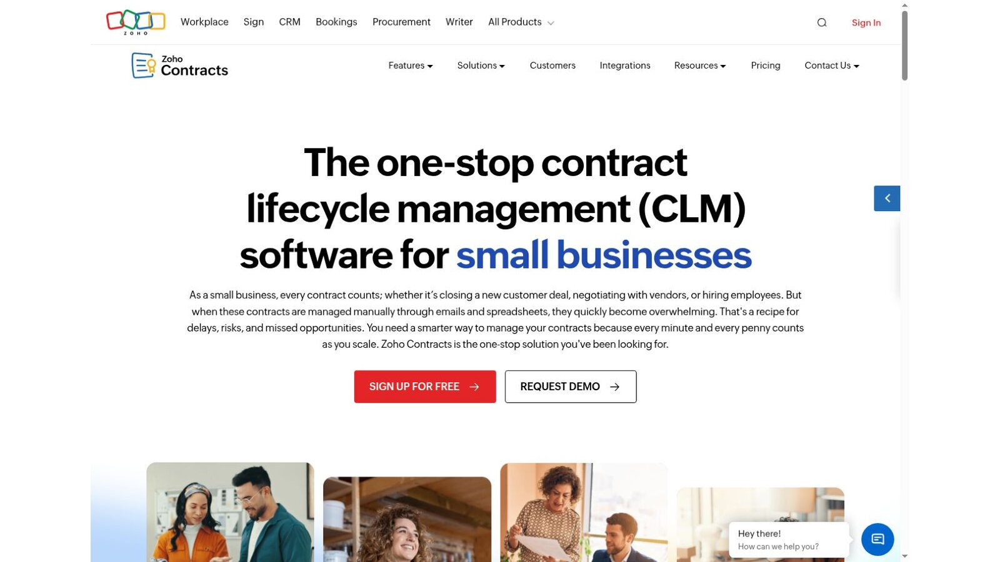
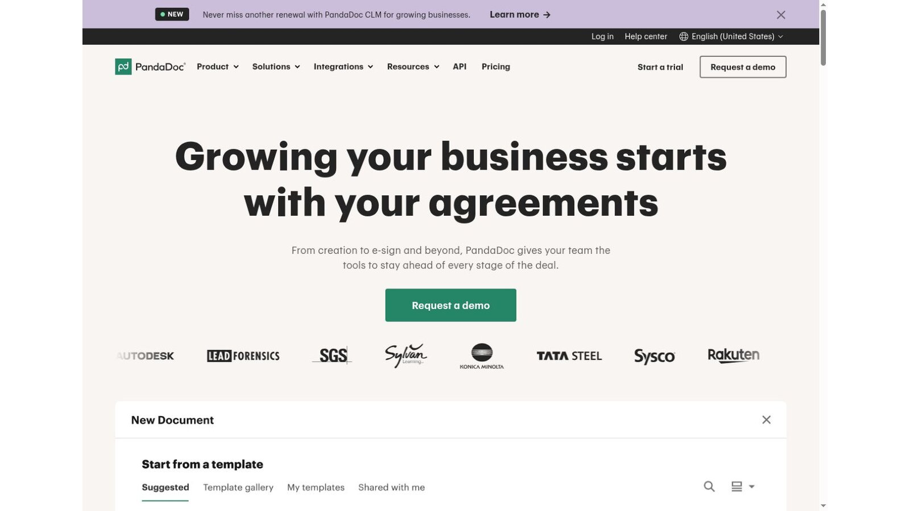
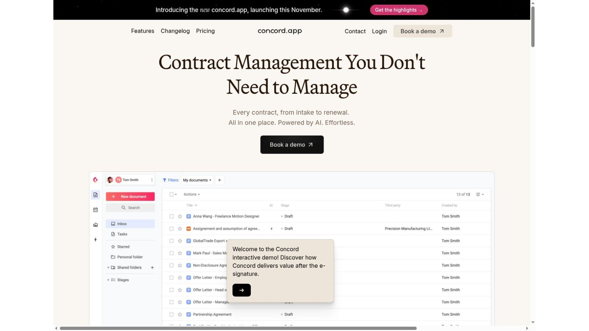
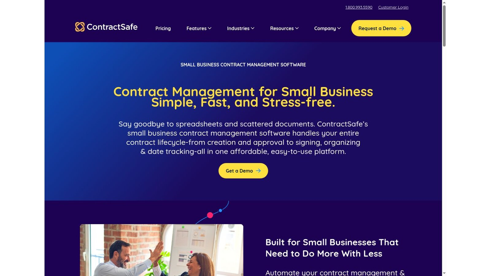

# Contract Management Software for Small Business: Renewals First

Contract management software for small business should solve one problem before any other: knowing what you signed and when it renews. A missed cancellation window on a software subscription, a lease, or a supplier deal can cost more than a year of software. Drafting tools and AI features come second.

This guide compares four products that small teams can buy without an enterprise sales cycle. Every price and feature below comes from the vendor's own pages, checked on November 26, 2026.

## Key Takeaways

* **Start with reminders:** ContractSafe, Concord, Zoho Contracts, and PandaDoc all name renewal or deadline reminders on their pages.
* **Free options exist:** Zoho Contracts is free for 3 users and 10 contracts, and PandaDoc's free plan allows 5 documents a month.
* **Price models differ:** PandaDoc charges per seat, Concord charges per plan with 5 users included, and ContractSafe includes unlimited users but prices by contract volume.
* **E-signature is often included:** Zoho Contracts bundles Zoho Sign at no additional cost, and Concord's Essentials plan lists unlimited e-signatures.
* **Monthly billing costs more:** PandaDoc's Starter plan is $25 per seat billed annually but $45 billed monthly.

## Quick Comparison

The table compares each product's starting price and core features.

| Product | Starting price | Users | Renewal reminders | E-signature |
| --- | --- | --- | --- | --- |
| Zoho Contracts | Free for 3 users and 10 contracts | Per user on paid plans | Automated reminder alerts | Included through Zoho Sign |
| PandaDoc | Free, then $25 per seat per month billed annually | Per seat | Auto reminders on Business; AI renewal alerts optional on Enterprise | Unlimited on Starter and above |
| Concord | $499 a month billed annually | 5 included, then $49 per user per month | Deadline reminders | Unlimited on Essentials |
| ContractSafe | $450 a month billed annually | Unlimited | Unlimited reminders and alerts | On Finalize and above |

## What a Small Business Needs

Large companies buy contract lifecycle management to route hundreds of deals through legal review. A small business usually has a simpler list:

* **Storage:** One place to keep every signed contract.
* **Search:** A way to find any contract by party name or keyword.
* **Reminders:** Alerts before renewals, expirations, and payment dates.
* **Signing:** A way to send a contract for signature.
* **Permissions:** Simple controls so the right people see the right files.

If that list covers your needs, avoid paying for heavy approval workflows. Our overview of [contract lifecycle management](/legal-business/contract-lifecycle-management/) explains the larger process if your volume grows.

## How We Compared These Products

We opened each product and pricing page on November 26, 2026 and recorded only what the pages stated. The site owner captured the screenshots below from the same official pages on November 25, 2026. We did not open paid accounts or load real contracts. This is a research comparison, not a hands-on review.

## 1. Zoho Contracts: Best Free Starting Point

Zoho Contracts is the easiest way to start for free. Its pricing page lists a free plan for 3 users with 10 contracts and 5 counterparties. Paid plans are Standard, Professional, and Premium, with a 15-day free trial and no credit card required.

The Zoho Contracts small business page promises "Automated reminder alerts" and says "Never miss a renewal or an obligation deadline again." It also answers a common cost question. Asked whether digital signatures cost extra, it says: "No. Zoho Contracts includes e-signature capabilities powered by Zoho Sign at no additional cost."

The paid plan prices did not appear in the page text we captured, so check the pricing page for current rates. Zoho lists a 20% saving on yearly billing.

**Choose it if:** you have a small number of contracts and want to start without spending anything.

## 2. PandaDoc: Best When Contracts Start as Proposals

PandaDoc suits businesses whose contracts begin as quotes or proposals. Its [pricing page](https://www.pandadoc.com/pricing/) lists a free plan for 5 documents a month. The FAQ says "Starter is $25 per seat per month billed annually, or $45 billed monthly. Business is $49 per seat per month billed annually, or $65 billed monthly."

Starter and Business include unlimited document uploads and e-signatures. Free and Starter allow up to 5 templates, and Business allows unlimited templates. Automatic reminders are listed on Business and Enterprise. AI renewal alerts appear as an optional Enterprise feature.

PandaDoc also uses usage credits. A credit is used when you create a document through an integration or automated workflow, such as the API or bulk send. If you automate document creation, ask how many credits your plan includes.

**Choose it if:** your contracts start as sales documents and you want signing built into the same tool.

## 3. Concord: Best All-in-One Plan for a Small Team

Concord sells flat plans that include five users. Its [pricing page](https://www.concord.app/pricing) lists Essentials at $499 a month, Business at $899, and Enterprise at $1,299, each paid annually. Extra users cost $49, $69, or $89 a month depending on the plan.

Essentials includes unlimited documents, deadline reminders, unlimited e-signatures, and AI Copilot and extraction. The plan also lists a contract repository with full-text OCR search. Concord's home page adds "built-in redlining, version control, comments, and e-signature."

No monthly billing price appeared on the pricing page. Plan on an annual commitment.

**Choose it if:** a team of about five people negotiates, signs, and tracks contracts and wants one tool for all three.

## 4. ContractSafe: Best for Search and Unlimited Users

ContractSafe is built around storage and reminders. Its [pricing page](https://www.contractsafe.com/pricing) says pricing "starts at $450/month billed annually ($540 month-to-month)." All plans include unlimited users, which helps when many staff need to look up contracts.

The ContractSafe small business page says it uses "Advanced OCR technology" to search scanned contracts. Reminders cover renewals, deliverables, and payment dates. E-signature arrives on the Finalize plan, and AI data extraction appears on the entry Organize plan.

Price depends on how many contracts you store, in bands from 100 or fewer to more than 10,000. Count your contracts before you request a quote.

**Choose it if:** many people need to find contracts, and your main risk is missed dates rather than drafting.

## What Year One Costs for a Five-Person Team

Here is a simple year-one comparison for a five-person team using published annual prices. It leaves out taxes, add-ons, and setup fees.

| Option | Calculation | Year-one cost |
| --- | --- | --- |
| Zoho Contracts Free | 3 users only, 10 contracts | $0, but only 3 of 5 people get access |
| PandaDoc Starter | 5 seats x $25 x 12 months | $1,500 |
| PandaDoc Business | 5 seats x $49 x 12 months | $2,940 |
| Concord Essentials | $499 x 12 months, 5 users included | $5,988 |
| ContractSafe Organize | $450 x 12 months, unlimited users | $5,400 |

These totals are our arithmetic from the published prices. They show that seat-based tools are cheaper for small teams, while flat plans become better value as more people need access. ContractSafe's price also rises with contract volume, so a business with thousands of contracts will pay more.

## How to Set Up Renewal Tracking in a Week

Software only helps if the data inside it is complete. Use this short plan.

### Day 1: Gather Every Contract

Pull signed contracts from email, shared drives, and filing cabinets. Include leases, software subscriptions, supplier agreements, and customer contracts.

### Day 2: Pick Your Key Fields

For each contract, record the parties, start date, end date, renewal type, notice period, and owner. The notice period matters most, because it sets the last day to cancel.

### Days 3 and 4: Load and Check

Upload the files. If the tool extracts dates with AI, check each one against the document. A wrong notice date is worse than no date.

### Day 5: Set Reminders

Set an alert 30 to 90 days before each notice deadline, depending on how long a decision takes. Assign each alert to a named person.

### Ongoing: Store New Contracts at Signature

Make it a rule that no contract is final until it is stored with its dates. Review the full list of upcoming renewals once a month so nothing depends on a single alert.

## Signs You Have Outgrown a Spreadsheet

Many small businesses track contracts in a spreadsheet. That works until it does not. These signs suggest it is time for contract management software for small business:

* **A renewal slipped past you.** If a subscription or lease renewed before anyone noticed, reminders tied to each contract would have caught it.
* **Nobody can find the signed copy.** Contracts saved in personal inboxes leave when employees leave.
* **More than one person needs access.** Sales, finance, and operations all ask about the same contracts.
* **Contracts arrive as scans.** A spreadsheet cannot search inside a PDF. Tools with OCR search, such as ContractSafe and Concord, can.
* **You sign more than a few contracts a month.** Manual tracking grows fragile as volume rises.

## Questions to Ask Vendors

Before you pick contract management software for small business, ask each vendor these questions and save the answers.

### What Counts Toward My Limit?

Vendors cap different things. PandaDoc counts documents on its free plan and usage credits for automated creation. ContractSafe prices by the number of contracts in the repository. Zoho's free plan caps users, contracts, and counterparties.

### Can I Cancel Monthly?

ContractSafe and PandaDoc list month-to-month prices that cost more than annual rates. Concord showed only annual prices. Know your exit terms before you load hundreds of files.

### Can I Export Everything?

Ask whether you can export contracts, extracted data, and reminder history in a standard format. Test the export during the trial.

### Who Sets Up the Reminders?

Some tools extract dates with AI. Others need a person to enter them. Either way, ask how the tool handles a contract that renews automatically unless cancelled.

### What Does Support Include?

Small teams rarely have IT staff. Ask whether onboarding help is included or billed separately.

## Related Tools

If you only need signatures, an e-signature tool may be enough. Compare prices in our review of [DocuSign alternatives](/legal-tech/docusign-alternatives/). Some agreements also need a notary, and a [remote online notarization platform](/legal-business/remote-online-notarization-platform/) can handle that by video. Larger teams that negotiate complex deals should read the comparison of [AI contract management software](/legal-tech/ai-contract-management-software/).

For a wider view of how businesses and law firms adopt these tools, see our [legal technology statistics](/legal-tech/legal-technology-statistics/).

## Frequently Asked Questions

### What Is the Best Contract Management Software for Small Business?

It depends on team size and volume. Zoho Contracts is free for 3 users and 10 contracts. PandaDoc suits proposal-led sales. Concord fits a five-person team that wants an all-in-one plan. ContractSafe fits businesses where many people need access.

### Is There Free Contract Management Software for Small Business?

Yes. Zoho Contracts offers a free plan for 3 users and 10 contracts, and PandaDoc offers a free plan for 5 documents a month.

### Do I Need E-Signature in My Contract Tool?

Not always, but it helps. When signing and storage happen in one place, the signed copy is saved with its dates automatically.

### How Many Contracts Before Software Is Worth It?

There is no fixed number. If anyone on your team has missed a renewal or searched for a lost contract, a tool with reminders and search will likely pay for itself.

### Can Contract Management Software for Small Business Use AI?

Some options do. Concord's Essentials plan lists AI Copilot and extraction, and ContractSafe's Organize plan lists AI data extraction. Check every AI-extracted date against the contract.

### Is This a Hands-On Review?

No. We compared each contract management software for small business option using its official pages and the site owner's screenshots. We did not run trials.

## Resources

* [Zoho Contracts pricing](https://www.zoho.com/contracts/pricing.html)
* [Zoho Contracts for small businesses](https://www.zoho.com/contracts/contract-management-software-for-small-businesses.html)
* [PandaDoc pricing](https://www.pandadoc.com/pricing/)
* [Concord pricing](https://www.concord.app/pricing)
* [ContractSafe pricing](https://www.contractsafe.com/pricing)
* [ContractSafe small business contract management](https://www.contractsafe.com/small-business-contract-management-software)
* [Concord](https://www.concord.app/)
* [PandaDoc](https://www.pandadoc.com/)
