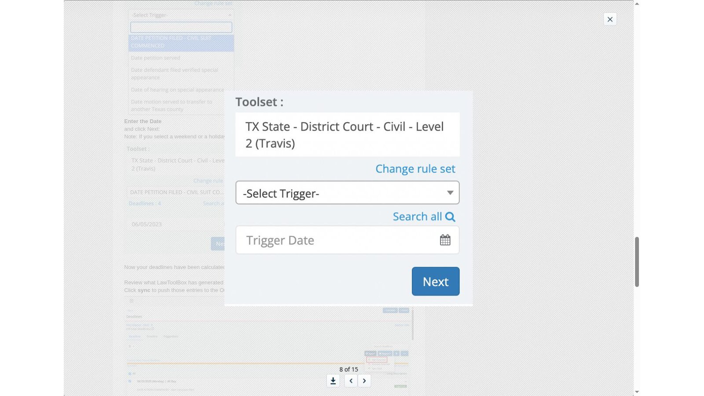
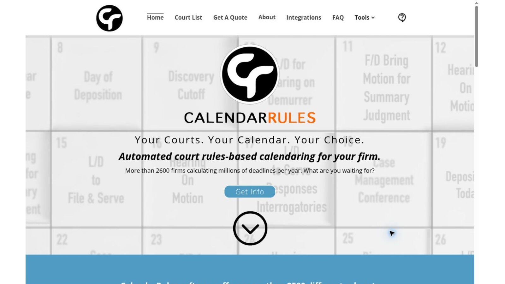
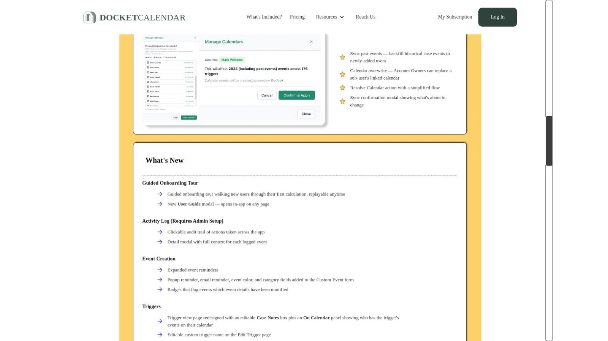
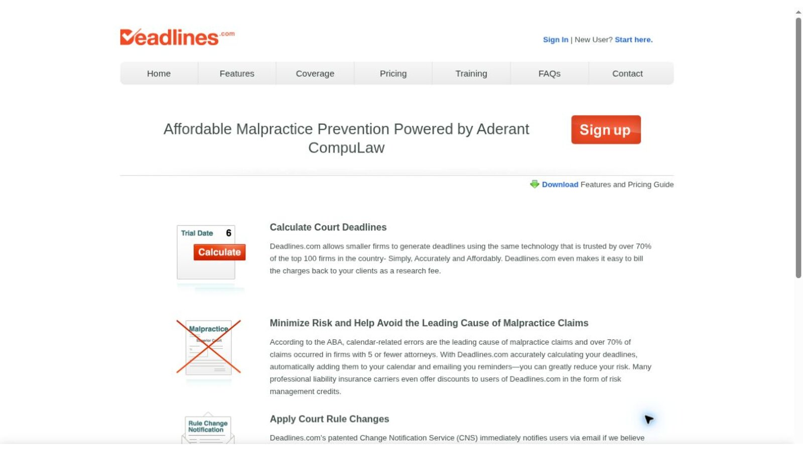
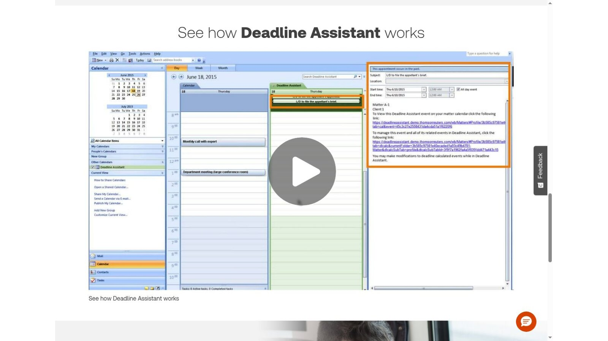
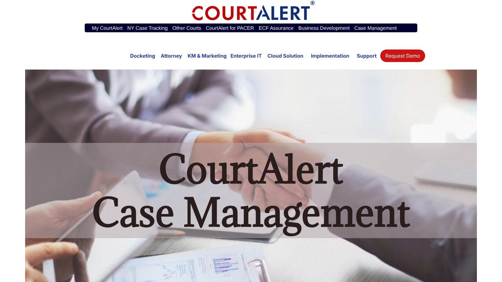
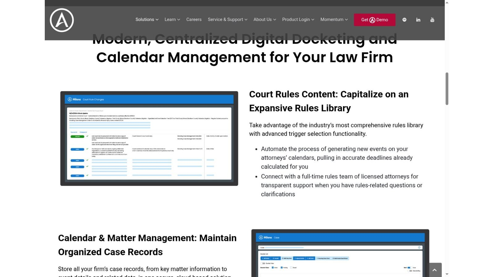

# 7 Best Legal Calendaring Software Options for Law Firms

The best legal calendaring software fits the way your firm already controls deadlines. LawToolBox suits firms that work inside Microsoft 365. CalendarRules supplies a specialist rules engine. DocketCalendar and Deadlines.com publish simpler subscription prices. Deadline Assistant, CourtAlert, and Aderant Milana serve firms that run calendaring from a central team.

Good software also shows who entered a trigger, which rule produced each date, who checked it, and where the deadline went. A big rules library can't fix a weak approval process.

No vendor paid to be included. We checked every product fact and price against official vendor pages on November 5, 2026. We didn't test paid accounts, so vendor claims stay attributed to the vendor. This article is general information, not legal advice.

## Key Takeaways

- **Rules and Docketing Are Different Jobs:** A rules engine calculates dates, while a docketing system manages intake, review, and distribution around them.
- **Outlook Is a Destination, Not a Record:** Calendar sync is useful, but a personal calendar shouldn't be the only place a deadline lives.
- **Check Coverage Court by Court:** Rule-set counts sound impressive, so confirm the exact courts, judges, and events your firm uses before you buy.
- **Prices Follow Different Units:** Vendors charge by user, court, active case, or a negotiated license, so the cheapest headline price may not be the cheapest total.
- **Test the Controls:** Rule changes, duplicate dates, permissions, audit history, and recovery deserve as much demo time as the calculator.

## Quick Comparison

The table below sets the seven platforms side by side on the same five points. Prices are the published US figures we found on November 5, 2026.

| Platform | Best For | Rules Content | Calendar Connection | Public Starting Price |
|---|---|---|---|---|
| LawToolBox | Microsoft 365 firms | Maintained court rules | Outlook and Teams | $39 per user per month, billed yearly, for 2 to 9 users |
| CalendarRules | Adding a rules engine to existing systems | More than 2,500 rule sets | Integrations with legal and calendar products | Quote required |
| DocketCalendar | Firms with a short list of courts | About 2,200 court rule sets, powered by CalendarRules | Outlook and Google | $20 per court plus $20 per user, per month |
| Deadlines.com | Small firms with predictable active cases | Aderant CompuLaw rules | Outlook and iCalendar | $35 per case per month for one case |
| Deadline Assistant | Central Outlook-based administration | Federal, state, and local court rules | Outlook | Quote required |
| CourtAlert Case Management | Heavy docket intake and reconciliation | CalendarRules integration | Outlook | Quote required |
| Aderant Milana | Enterprise cloud docketing | More than 3,000 rule sets | Outlook | Quote required |

## How We Selected the Platforms

Many legal calendaring software lists mix practice-management calendars, rules engines, and enterprise docketing systems without explaining the difference. We focused on products that publicly document rules-based calculation or docketing controls, and we gave more weight to clear, checkable scope than to marketing claims.

## Calendar, Rules Engine, or Docketing System?

Legal calendaring software usually combines three functions. Knowing which one you're short of narrows the field quickly.

### Shared Calendar

A shared calendar distributes approved dates and reminders. It helps a team see commitments, but it may not calculate a deadline or keep the legal basis for it.

### Rules Engine

A rules engine links a trigger to maintained procedural rules. It generates related dates and may adjust for holidays or service. Coverage still has to match the exact court and event.

### Docketing System

A docketing system manages intake, documents, assignments, approvals, calendars, reminders, changes, and audits. It may include its own rules engine or connect to a specialist provider.

Most firms need all three, from one platform or from two connected systems with a clear system of record.

## 1. LawToolBox: Best for Microsoft 365 Firms

LawToolBox puts matter calendars and rules-based deadlines inside Microsoft 365, with tools in Outlook and Microsoft Teams. It also syncs with other calendars and with leading case management platforms.

The [LawToolBox pricing page](https://www.lawtoolbox.com/pricing/) lists $39 per user per month for 2 to 9 users on yearly billing. The per-user rate falls to $36 for 10 to 19 users, $25 for 20 to 79 users, and $21 for 80 or more. LawToolBox requires a one-year minimum commitment. It adds $4 per user to activate NetDocuments, iManage, ECFX, or InfoTrack integrations, and it quotes training separately.

LawToolBox also offers a free public calculator for simple day counts. The paid product adds maintained court rules and matter workflows.

**Best fit:** Firms already standardized on Microsoft 365 that want legal dates close to daily email and collaboration tools.

**Questions for the demo:** Which events are supported in your busiest courts? How does the system handle duplicate matters, reviewer sign-off, departed users, and rule-change notices?

## 2. CalendarRules: Best Specialist Rules Engine

CalendarRules concentrates on automated court-rule calculation. Its homepage says the software offers more than 2,500 different rule sets and that more than 2,600 firms use it to calculate deadlines.

The engine connects to docketing, case-management, and calendar products through integrations.

CalendarRules prices by quote. The company says it encourages rules trials and conversations with existing customers before you commit.

**Best fit:** Firms that like their docketing or matter system but need a dedicated calculation engine.

**Questions for the demo:** Request a written list of every court, judge, agency, and event you need. Ask how a correction reaches existing matters and calendars.

## 3. DocketCalendar: Best Transparent Modular Subscription

DocketCalendar separates court access from users. Its [What's Included page](https://www.docketcalendar.com/whats-included) lists $20 per court and $20 per user each month. A court subscription includes unlimited calculations and firm-wide use within that jurisdiction.

The rules come from CalendarRules, and DocketCalendar says it offers about 2,200 court rule sets nationwide. Deadlines go to Outlook or Google calendars, and the system stores case, trigger, and event details for reports and recalculation.

The published model lets a firm estimate cost without a sales call, though the total grows with each court and user.

**Best fit:** Smaller or focused practices that want maintained rules and can name a limited set of courts.

**Questions for the demo:** Calculate the full monthly cost for every court and user. Test a changed trial date, a bulk recalculation, reports, and staff access.

## 4. Deadlines.com: Best for Small Firms With Case-Based Pricing

Deadlines.com is powered by Aderant CompuLaw rules and charges by active case. The [Deadlines.com pricing page](https://deadlines.com/pricing/) lists $35 per case per month for one case, $30 per case for 2 to 5, $25 per case for 6 to 29, and $20 per case for 30 or more.

Every tier includes unlimited users and nationwide coverage. The features page describes rule-change notifications, Outlook sync, iCalendar import, on-screen calendars, and email reminders.

A firm with many long-running cases should compare the annual total with user-based pricing.

**Best fit:** Solo and small firms that value unlimited users and can forecast how many matters are active.

**Questions for the demo:** What makes a case active and billable? How are closed matters kept, searched, reopened, and exported?

## 5. Thomson Reuters Deadline Assistant: Best Central Outlook Administration

Deadline Assistant calculates deadlines from federal, state, and local court rules. It adds them to a Deadline Assistant calendar and to the Microsoft Outlook calendar view for the firm, department, or matter team.

Users can edit dates, rename events, add notes, remove events, and build custom templates for case types, transactional deadlines, or scheduling orders. Thomson Reuters says users get email alerts when applicable court rules change, with detailed reports from attorney-editors.

Pricing isn't public, so ask for a quote that itemizes implementation, training, and migration.

**Best fit:** Firms that want a centrally managed Outlook workflow with editorial support for rules content.

**Questions for the demo:** How are custom templates approved? What happens when a rule changes after dates have reached lawyers' calendars?

## 6. CourtAlert Case Management: Best for Filing Reconciliation

CourtAlert says its case management product is designed for large and mid-sized firms. It reads ECF notices for federal PACER courts and supports some state courts, including New York, New Jersey, and Texas.

Users can enter dates manually, use a date calculator, apply automatic rules through a real-time CalendarRules integration, or move dates with an adjournment tool. CourtAlert can download linked documents and upload them to iManage or NetDocuments, and it adds deadlines to Outlook.

CourtAlert doesn't publish a price. A real evaluation should include monitoring services, the rules subscription, document integrations, and implementation work.

**Best fit:** Central docketing teams that need court-notice intake, document reconciliation, deadline calculation, and firm-wide distribution.

**Questions for the demo:** Which courts and filing systems support automated intake? How are failed notices, duplicate documents, and reviewer queues handled?

## 7. Aderant Milana: Best Enterprise Cloud Docketing

Aderant Milana combines cloud docketing, matter calendars, rules content, reminders, and reporting. Aderant reports more than 3,000 rule sets within its covered jurisdictions and daily monitoring of rule changes, backed by a rules team of licensed attorneys.

The platform syncs matter events to Outlook calendars, supports custom reminders, and uses AutoDocket Pro to process ECF receipts. Pricing is available through a demo and quote.

**Best fit:** Larger firms planning a cloud replacement or consolidation of docketing and calendaring.

**Questions for the demo:** Ask about migration checks, role design, data location, business continuity, ECF exceptions, audit exports, and contract exit terms.

## What Three Published Price Models Cost for One Firm

Three vendors publish enough pricing to run a quick comparison. Take an invented firm with 5 users, 3 courts, and 12 active cases. These are illustrative calculations, not quotes.

| Platform | Pricing Unit | Calculation | Monthly Total |
|---|---|---|---|
| LawToolBox | Per user, yearly plan | 5 users × $39 | $195 |
| DocketCalendar | Per court plus per user | 3 courts × $20 + 5 users × $20 | $160 |
| Deadlines.com | Per active case | 12 cases × $25 | $300 |

Change one assumption and the order shifts. At 30 active cases, Deadlines.com reaches $600 at the $20 rate, while DocketCalendar stays at $160. Run your own numbers before you rank legal calendaring software on price.

## Choose by Workflow, Not Feature Count

Start with the operating problem your firm needs to solve, then match it to the product built for that problem.

1. **Lawyers live in Microsoft 365.** Compare LawToolBox with Deadline Assistant.
2. **The firm already has a strong legal system.** Test CalendarRules as the rules layer.
3. **The practice uses a short list of courts.** Model DocketCalendar's court and user fees.
4. **A small firm wants unlimited users.** Compare Deadlines.com's case pricing with your active docket.
5. **A central team reconciles court notices.** Evaluate CourtAlert's intake and review workflow.
6. **The firm needs enterprise cloud docketing.** Evaluate Aderant Milana and plan migration early.

Deadline data also feeds billing. The trigger dates and events in a calendar often become the time entries reviewed in [lawyer time tracking software](/legal-tech/best-lawyer-time-tracking-software/), so check how the two systems share matter records.

## A Practical Buying and Implementation Checklist

A demo shows the product at its best. These checks show how legal calendaring software behaves with your own work.

### Map Requirements Before the Demo

Write down what the system must handle first.

1. List every court, agency, judge, and standing order used in the past year.
2. Count active cases, users, shared calendars, and docketing staff.
3. Document every trigger source, including email, ECF, portals, orders, and manual intake.
4. Name the final system of record and the calendar lawyers use each day.

### Test Controls, Not Only Calculations

Ask the vendor to run these tests live.

1. Enter a trigger twice and watch how duplicates are handled.
2. Change a trigger after approval and track every downstream update.
3. Test holidays, service methods, local closures, and custom orders.
4. Remove a user and confirm reassignment and calendar continuity.
5. Export an audit history that shows entry, review, change, and notification.

Price the full operating model too. Include licenses, rule content, courts, calendars, active cases, integrations, migration, training, storage, and support. Ask quote-based vendors for a line-item proposal and renewal terms. The wider [legal technology statistics](/legal-tech/legal-technology-statistics/) can help frame adoption and budget conversations.

## Why a Second Review Still Belongs in the Process

Rules-based legal calendaring software can standardize calculations and spread changes quickly. It can't decide every legal question. A filing date, service method, judge's order, emergency closure, or unusual statute can change the result.

Build a documented review step around high-risk dates. The reviewer should see the trigger document, the selected rule, the calculation history, and every calendar the date reached.

## Frequently Asked Questions

### What Is Legal Calendaring Software?

Legal calendaring software records, calculates, reviews, and distributes legal dates. More advanced products add maintained court rules, docket intake, audit history, and integrations.

### What Is Rules-Based Legal Calendaring?

A user picks a jurisdiction, an event, and a trigger date. The system applies maintained procedural rules to generate related dates, within the product's coverage and subject to the firm's review.

### Is Outlook Enough for a Law Firm's Deadline Calendar?

Outlook can distribute dates and reminders. A firm still needs controlled intake, rule support, ownership, review, change management, and an authoritative record outside any single mailbox.

### Which Product Has the Clearest Public Pricing?

DocketCalendar publishes court and user prices. Deadlines.com publishes case tiers, and LawToolBox publishes user tiers. CalendarRules, Deadline Assistant, CourtAlert, and Milana need quotes.

### How Should a Firm Compare Coverage Claims?

Send each vendor the same list of courts, judges, agencies, events, and service methods. Ask for written confirmation, then test sample calculations against current official rules.

## Resources

- [LawToolBox](https://www.lawtoolbox.com/) and [LawToolBox support: calculate deadlines](https://support.lawtoolbox.com/support/solutions/articles/16000135755-faq-calendar-calculate-deadlines)
- [CalendarRules](https://www.calendarrules.com/)
- [DocketCalendar](https://www.docketcalendar.com/) and [DocketCalendar updates](https://www.docketcalendar.com/updates)
- [Deadlines.com](https://deadlines.com/) and [Deadlines.com features](https://deadlines.com/features/)
- [Thomson Reuters Deadline Assistant](https://legal.thomsonreuters.com/en/products/deadline-assistant)
- [CourtAlert Case Management](https://www.courtalert.com/content/CaseManagement)
- [Aderant Milana](https://www.aderant.com/solutions-milana/)

All product facts and public prices were checked against official vendor pages on November 5, 2026. Pages, prices, and coverage can change.
