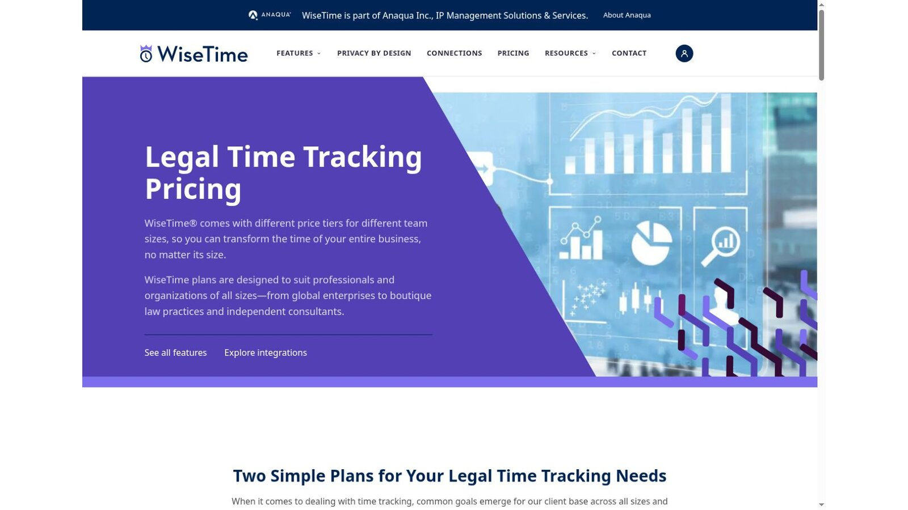
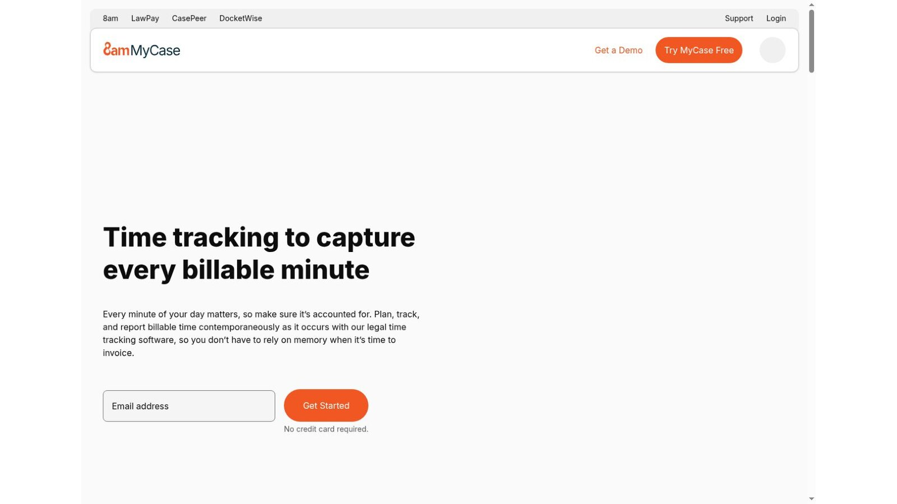
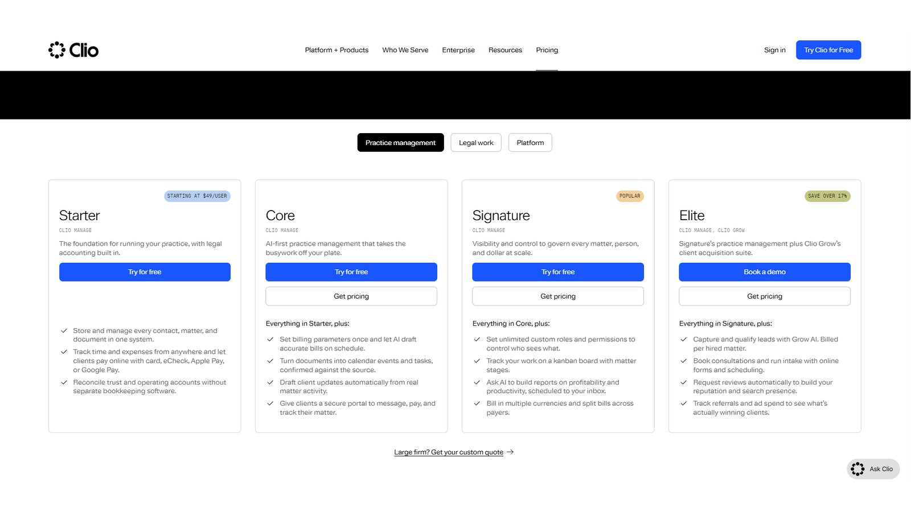
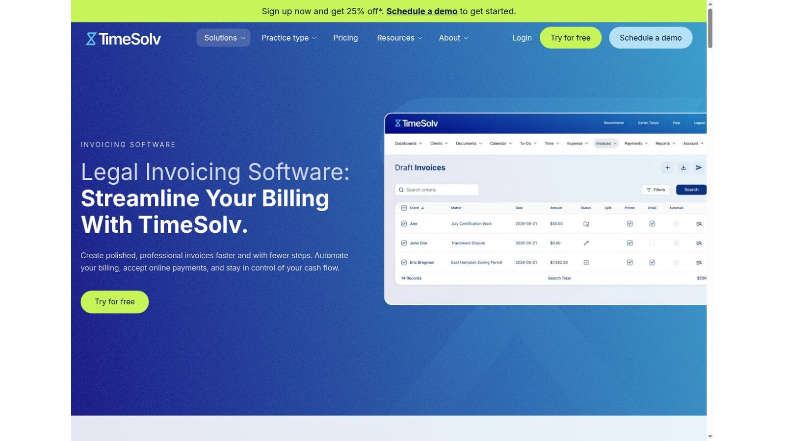
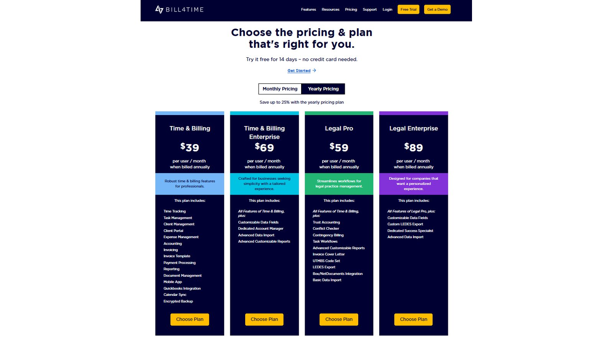
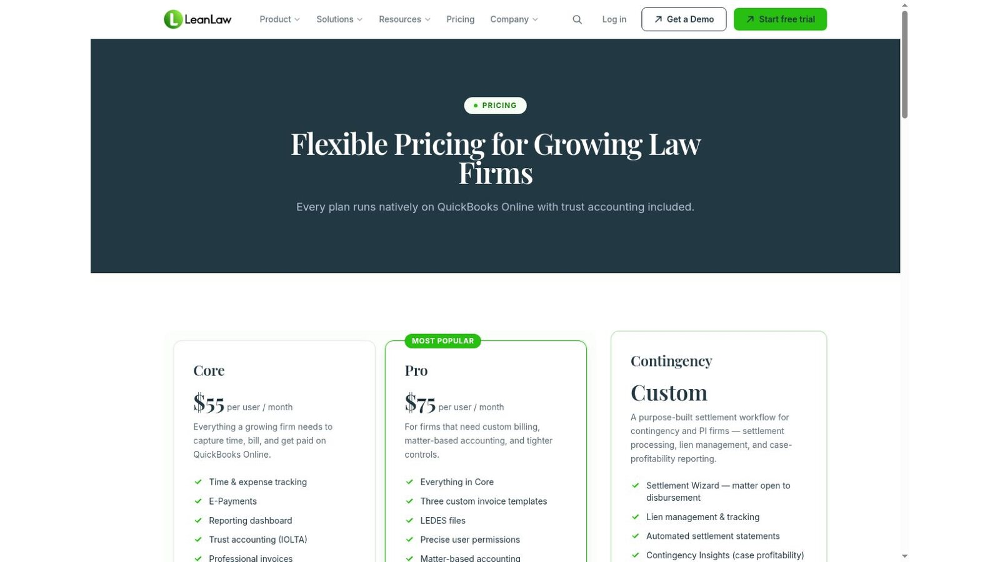
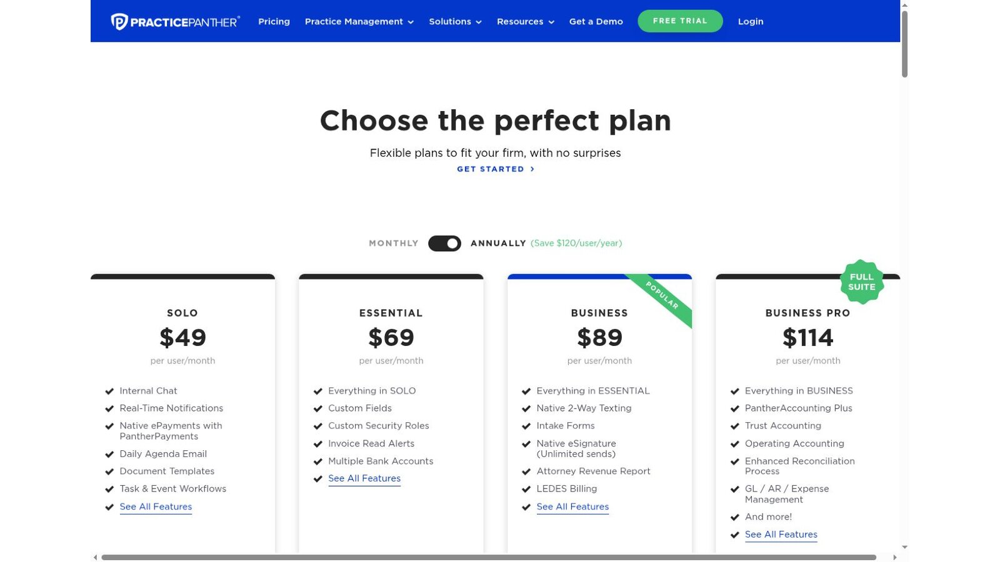
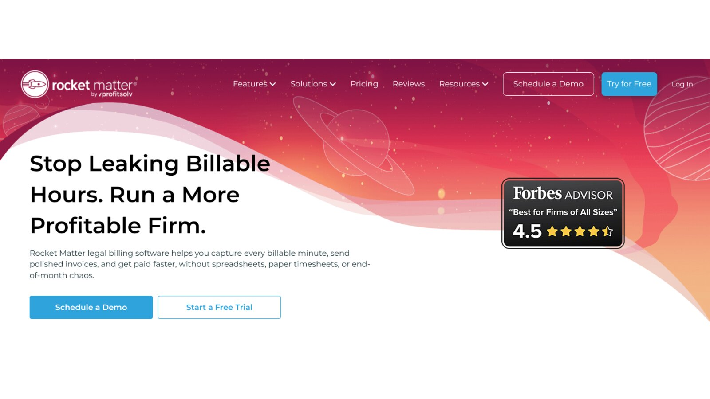

# 9 Best Lawyer Time Tracking Software Tools for Billable Work

The best lawyer time tracking software depends on where your firm loses time. WiseTime and Smokeball AutoTime rebuild the day from activity. MyCase mixes timers with a missed-time finder. Clio, TimeSolv, Bill4Time, LeanLaw, PracticePanther, and Rocket Matter tie each entry straight to matters and invoices.

Whatever you pick, captured activity shouldn't flow onto a bill unchecked. A lawyer still needs to confirm the matter, the duration, the narrative, and the client's billing rules before any charge goes out.

No vendor paid to be included. We checked product facts and prices against official vendor pages on November 5, 2026. Where a page blocks automated readers, we checked a screenshot of the live page supplied by the site owner. We didn't test paid accounts or measure recovered revenue. This article is general information, not legal or billing advice.

## Key Takeaways

- **Capture Methods Solve Different Problems:** Passive capture finds forgotten desktop work, while timers and prompts depend on habit.
- **Private Until Posted:** Raw activity should stay with the lawyer until they review it and choose what to post.
- **Recovered Isn't Billable:** A minute the software finds still needs a matter, a narrative, and a billing decision.
- **Flat-Fee Firms Benefit Too:** Time data shows what a fixed-fee matter really costs to deliver.
- **Test the Edge Cases:** Corrections, duplicates, mobile entries, rate changes, and exports matter more than a clean demo.

## Quick Comparison

The table compares the nine tools on capture method, billing link, and the published US price we found on November 5, 2026. Promotions, add-ons, and monthly terms can change the real total.

| Platform | Best For | Capture Model | Billing Connection | Published Starting Price |
|---|---|---|---|---|
| WiseTime | Passive desktop capture | Private automatic timeline | Connectors for legal systems | Not shown in page text; five-user minimum |
| Smokeball AutoTime | Firms working inside Smokeball | Entries built from Smokeball activity | Native Smokeball billing | Quote required |
| MyCase | Timers plus missed-time review | Up to three timers and Smart Time Finder | Native MyCase billing | $50 per user per month, billed yearly |
| Clio | Broad matter and billing workflow | Timers and activity entries | Native Clio billing | From $49 per user per month |
| TimeSolv | Detailed time and e-billing | Timers, entries, mobile app | Native billing with LEDES | Plan prices not shown in page text |
| Bill4Time | Clear specialist tiers | Timers, mobile, expenses | Native billing with LEDES on legal tiers | $39 per user per month, billed yearly |
| LeanLaw | QuickBooks Online firms | Matter time entries | LeanLaw billing with QuickBooks Online | $55 per user per month |
| PracticePanther | Small-firm practice management | Timers and matter entries | Native billing and payments | $49 per user per month, billed yearly |
| Rocket Matter | Flexible rates and batch billing | Timers, mobile, matter entries | Native billing | $59 per user per month, billed yearly |

## How We Evaluated the Tools

Search results often call every billing platform a time tracker. This list of lawyer time tracking software focuses on the capture step: how a lawyer spots work, assigns it to a matter, writes a usable narrative, and approves the entry.

We checked official pages for passive capture, timers, prompts, mobile entry, privacy, review steps, billing links, LEDES or UTBMS support, and price. We left out general employee-monitoring tools, because legal timekeeping needs matter context and careful handling of client information.

## Passive Capture, Timers, and Prompts

Lawyer time tracking software records time in one of three ways. Knowing which gap you have tells you which group to shortlist.

### Timers

A timer works when the lawyer remembers to start and stop it. It gives exact control, but it fails on busy days with constant interruptions.

### Prompts and Finders

A prompt or finder flags activity inside the software, such as a saved note or a sent email, that may need an entry. It catches some misses without watching the whole desktop.

### Passive Capture

Passive tools record application activity in the background and show a timeline for review. They catch the most, so firms need firm rules on who sees the data and how long it stays.

## 1. WiseTime: Best for Private Passive Desktop Capture

WiseTime records activity on Windows, Mac, and Linux and places it in a private timeline. Its pricing page says users can review, add, delete, or write narratives before sharing time, and can set rules to keep private tasks out.

The entry plan needs at least five users and keeps data for up to 12 months. A larger tier keeps data for up to two years and starts at 50 users. The page also lists an Outlook add-in and an iPhone and iPad app. We couldn't find a price in the page text, so ask WiseTime for a written quote.

**Best fit:** Firms that lose time across email, research, drafting, and other desktop work.

**Test:** Record a day with client work, admin, personal tasks, and two similar matters. Then confirm what was excluded and who could see the unposted timeline.

## 2. Smokeball AutoTime: Best for Automatic Capture Inside Smokeball

AutoTime builds entries from work done in Smokeball, such as documents, email, and matter tasks. Smokeball's [AutoTime support article](https://support.smokeball.com/hc/en-us/articles/5860708227863-AutoTime-Basics) says entries are not billed automatically. Users can edit the date, description, duration, rate, and amount before an invoice goes out.

Smokeball's pricing page says AutoTime is included in the Prosper+ plan, and Grow users can buy it as an add-on. Prices are by quote.

**Best fit:** Firms that already do most of their work inside Smokeball.

**Test:** Check how the system treats short actions, duplicate activity, internal work, fixed-fee matters, and deleted drafts.

## 3. MyCase: Best Mix of Timers and Missed-Time Review

MyCase Basic costs $50 per user per month on yearly billing, or $60 month to month. The [MyCase time tracking page](https://www.mycase.com/features/law-firm-time-tracking-software/) says users can run up to three timers at once as they move between cases.

The same page describes Smart Time Finder, which tracks activity inside MyCase to flag billable time you forgot to enter. The page says higher tiers provide the more advanced features, including Smart Time Finder, so confirm the plan you need before you budget.

**Best fit:** MyCase firms that want manual control plus a daily missed-time check.

**Test:** Switch among three matters, log a call and an email, then compare the timer log with Smart Time Finder.

## 4. Clio: Best Broad Practice Management Workflow

Clio's pricing page shows its Starter plan from $49 per user per month. Its higher Core, Signature, and Elite plans list prices on request. Time entries, billing, payments, and matter records sit in one system.

Clio is a broad platform, not a specialist passive recorder. If your firm wants background capture too, price a second lawyer time tracking software product alongside it.

**Best fit:** Firms that want time, matters, invoices, and payments in one place.

**Test:** Enter time on desktop and mobile, change the billing status, revise a narrative, and trace the entry into a draft bill.

## 5. TimeSolv: Best for Detailed Time and E-Billing

TimeSolv's plans cover time and expense tracking, LEDES billing, batch invoicing, a mobile app, and trust accounting. Its [invoicing page](https://www.timesolv.com/billing-invoicing-features/invoicing/) says it supports LEDES 1998B, 1998BI, and UTBMS task codes.

The pricing page advertises 25% off the first year on annual plans, but its plan prices didn't appear in the page text we checked. Ask for a written quote that shows the price after the first year.

**Best fit:** Firms with strict outside counsel guidelines and e-billing review.

**Test:** Create entries with required task codes, trigger a validation error, and fix it without changing approved time.

## 6. Bill4Time: Best Transparent Specialist Pricing

Bill4Time's pricing page lists Time and Billing at $39 per user per month on yearly billing. Legal Pro costs $59, and Legal Enterprise costs $89. The legal tiers are where firms should look for trust accounting and legal billing formats.

Published tiers make it easy to see when a legal feature needs an upgrade. Confirm which tier holds the features your clients require.

**Best fit:** Firms that want specialist time and billing with clear plan limits.

**Test:** Rebuild one client's codes, rates, narrative rules, and invoice format in the tier you plan to buy.

## 7. LeanLaw: Best for QuickBooks Online Firms

LeanLaw Core costs $55 per user per month, and Pro costs $75. The pricing page says every plan runs on QuickBooks Online with trust accounting included. Users enter time by matter, apply rates, and send approved financial data into QuickBooks.

QuickBooks Online is a separate subscription. Decide early which system owns time, invoices, payments, and corrections.

**Best fit:** Firms committed to QuickBooks Online that need matter context.

**Test:** Correct a posted entry after it syncs and confirm both systems still match.

## 8. PracticePanther: Best Straightforward Small-Firm Suite

PracticePanther's Solo plan costs $49 per user per month on yearly billing. Essential costs $69, Business $89, and Business Pro $114. The pricing page lists LEDES billing on the Business plan.

It's a practical choice for firms that want a general legal platform with timers. If passive capture is your priority, compare it with WiseTime or AutoTime.

**Best fit:** Small firms that want time and billing next to everyday matter work.

**Test:** Run a lawyer, a paralegal, and a nonbillable user through the same matter, then review permissions and rates.

## 9. Rocket Matter: Best for Flexible Rates and Batch Billing

Rocket Matter's pricing page lists its Essentials plan at $59 per user per month, paid yearly. Higher plans cost $95, $115, and $145 per user. Its legal billing page focuses on capturing billable minutes and sending invoices faster.

The $39 figure in some older summaries is a CRM add-on, not the starting plan.

**Best fit:** Firms that need rate flexibility and batch billing inside practice management.

**Test:** Set rates by client, matter, role, and task. Change one rate going forward and confirm older entries stay the same.

## What Five Users Cost Per Month at Published Rates

Here is the plain arithmetic for a five-user firm, using only prices printed on each page. It covers the base plan only, with no add-ons, taxes, or promotions.

| Platform | Published Rate | Calculation | Monthly Total |
|---|---|---|---|
| Bill4Time Time and Billing | $39 per user, yearly | 5 × $39 | $195 |
| Clio Starter | $49 per user | 5 × $49 | $245 |
| PracticePanther Solo | $49 per user, yearly | 5 × $49 | $245 |
| MyCase Basic | $50 per user, yearly | 5 × $50 | $250 |
| LeanLaw Core | $55 per user | 5 × $55 | $275 |
| Rocket Matter Essentials | $59 per user, yearly | 5 × $59 | $295 |

This is our calculation, not a vendor quote. LeanLaw also needs a QuickBooks Online subscription, and Clio's Starter plan may lack features a growing firm wants. WiseTime, Smokeball, and TimeSolv need quotes, so they aren't in the table.

## Choose by Timekeeping Failure

Match lawyer time tracking software to the way your time slips away.

- **Forgotten Desktop Work:** Choose WiseTime when email, research, and drafting go unrecorded.
- **Work Done in One Platform:** Choose Smokeball when most tasks already happen inside Smokeball.
- **Occasional Misses:** Choose MyCase when timers plus a daily finder fit better than full capture.
- **Billing Controls:** Choose TimeSolv or Bill4Time for specialist e-billing and clear tiers.
- **Accounting Fit:** Choose LeanLaw when QuickBooks Online stays your books.

Clio, PracticePanther, and Rocket Matter suit firms that want broad practice management with timekeeping built in. After capture comes invoicing, which our [comparison of legal billing software](/legal-tech/best-legal-billing-software/) covers in detail. For wider adoption trends, see the [legal technology statistics](/legal-tech/legal-technology-statistics/) we track across firms.

## Questions to Ask Before Buying

Bring these questions to every demo of lawyer time tracking software and ask for written answers.

1. What activity is captured, and what is deliberately left out?
2. Who can see raw activity before the lawyer posts it?
3. Can users edit duration, matter, narrative, and billing status?
4. How does the system stop duplicate entries across integrations?
5. Which mobile, email, document, and research activity shows up?
6. What happens to entries when a matter, user, or rate changes?
7. Can the firm export raw, approved, billed, and written-down time?
8. Which licenses, add-ons, and setup fees change the total cost?

## Frequently Asked Questions

### What Is Lawyer Time Tracking Software?

Lawyer time tracking software records time spent on client and internal work, links each entry to a matter, and prepares approved entries for billing and reports.

### Is Passive Time Tracking the Same as Employee Monitoring?

Not always. A privacy-focused legal tool can keep activity private until the user reviews and posts it. Check the settings, access rights, and retention period before rollout.

### Can Flat-Fee Firms Benefit From Time Tracking?

Yes. Time data shows the labor cost and margin of a flat-fee matter, even when the client never sees an hourly bill.

### Should Captured Time Go Straight to an Invoice?

No. A lawyer or authorized reviewer should confirm the matter, duration, narrative, billing status, and client rules first. Smokeball, for example, says AutoTime entries are not billed automatically.

### Which Product Is Best for Automatic Capture?

WiseTime captures broad desktop activity in a private timeline. Smokeball AutoTime builds entries from work done inside Smokeball. The better fit depends on where your lawyers do most of their work.

## Resources

- [WiseTime pricing](https://wisetime.com/pricing/)
- [Smokeball pricing](https://www.smokeball.com/pricing)
- [Smokeball AutoTime](https://www.smokeball.com/features/do/autotime)
- [MyCase pricing](https://www.mycase.com/pricing/)
- [Clio pricing](https://www.clio.com/pricing/)
- [TimeSolv pricing](https://www.timesolv.com/pricing/)
- [Bill4Time pricing](https://www.bill4time.com/pricing/)
- [LeanLaw pricing](https://www.leanlaw.co/pricing/)
- [PracticePanther pricing](https://www.practicepanther.com/pricing/)
- [Rocket Matter pricing](https://www.rocketmatter.com/pricing/)
- [Rocket Matter legal billing](https://www.rocketmatter.com/features/legal-billing/)
