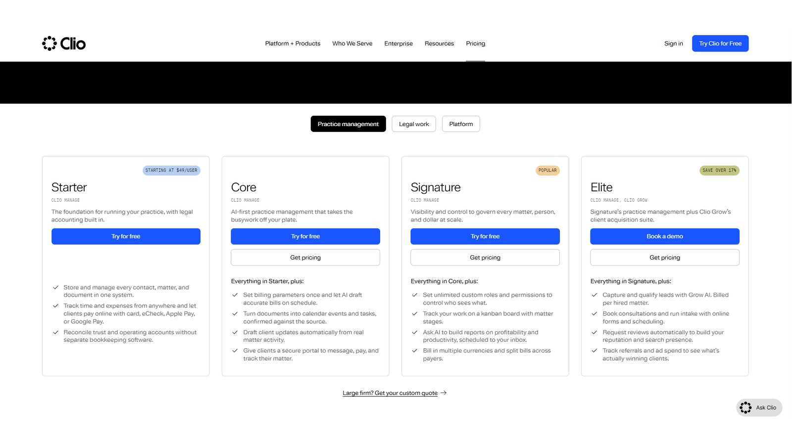
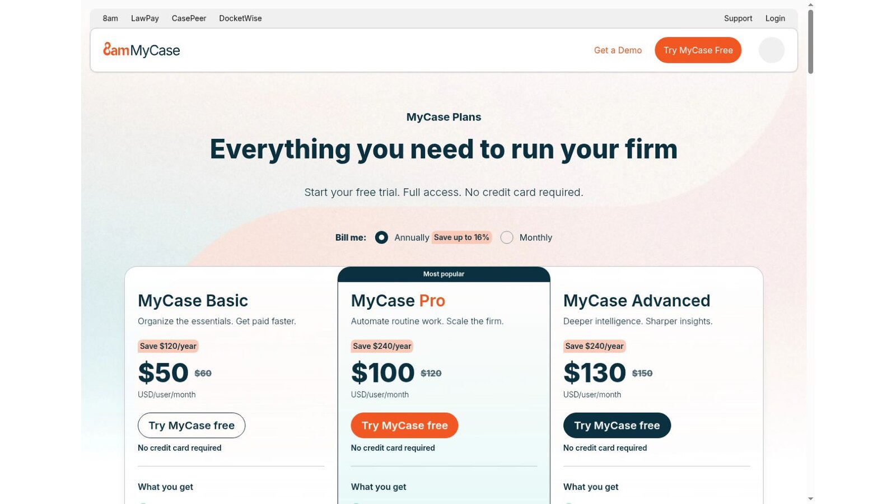
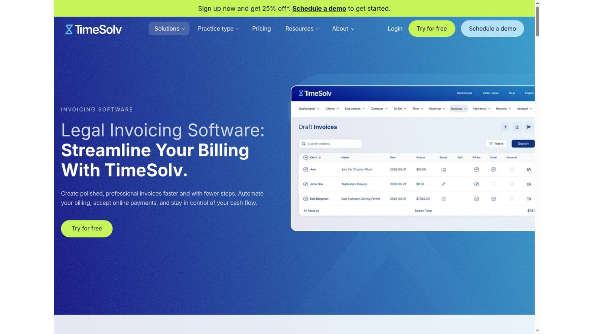
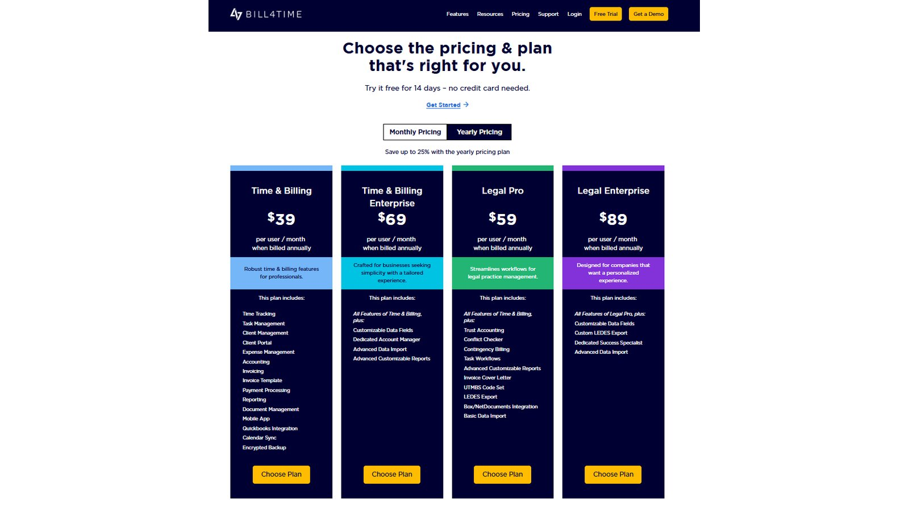
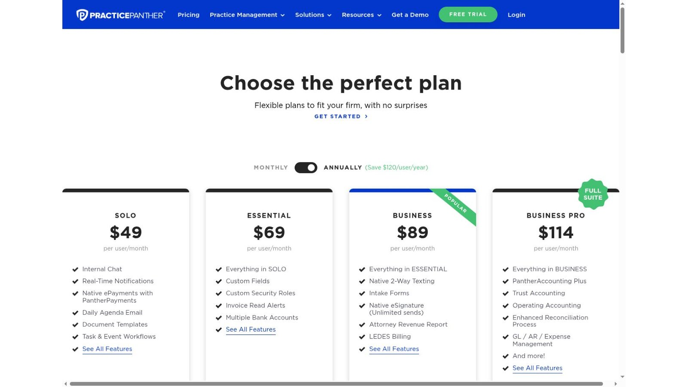
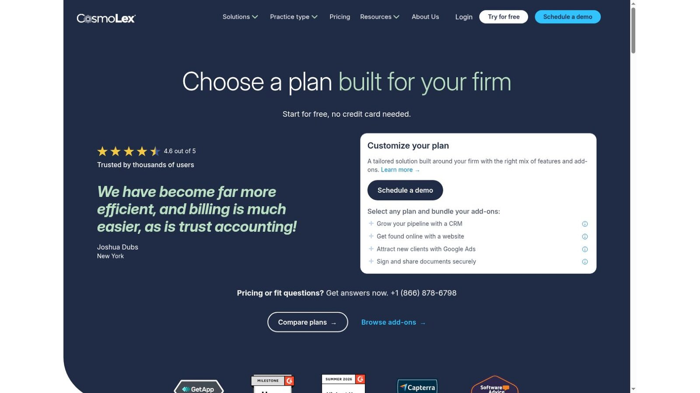
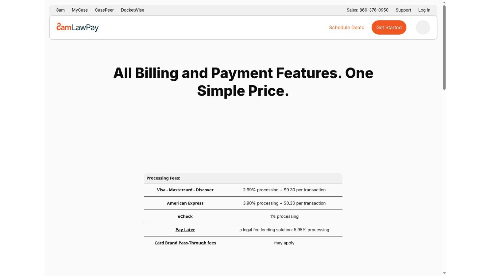
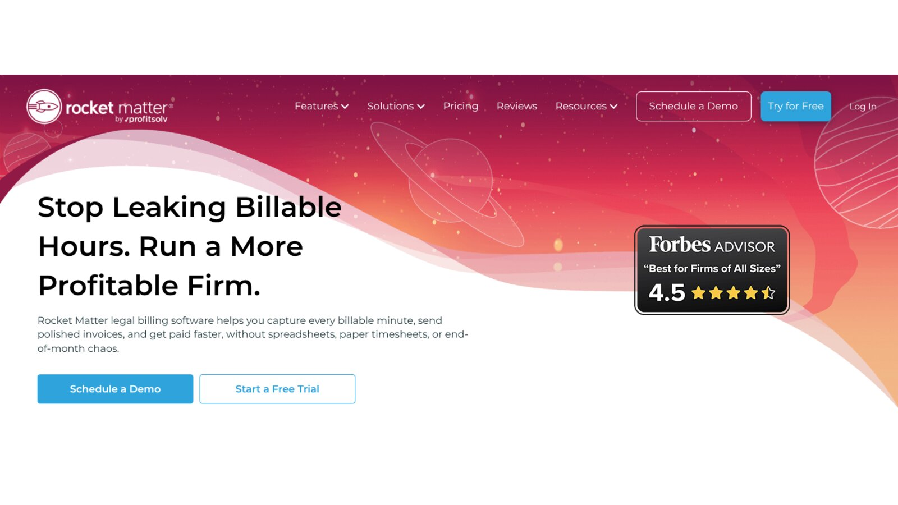

# 9 Best Legal Billing Software Options for Different Firm Workflows

The best legal billing software matches your fee arrangements and your approval process. Clio and MyCase put billing inside practice management. Smokeball leans on activity capture. TimeSolv and Bill4Time suit specialist time and billing. PracticePanther and Rocket Matter pair billing with matter tools. CosmoLex ties billing to accounting, and LawPay focuses on payments and simple invoices.

Start your search with a sample bill, not a feature list. A good platform reproduces your rates, narratives, discounts, trust applications, LEDES files, and payment terms without manual repair.

No vendor paid to be included. We checked product facts and prices against official vendor pages on November 5, 2026. Where a page blocks automated readers, we checked a screenshot of the live page supplied by the site owner. We didn't test paid accounts. This article is general information, not legal or financial advice.

## Key Takeaways

- **Three Separate Jobs:** Time capture, invoice production, and payment collection each need their own controls.
- **LEDES Must Match the Client:** Support only helps when it matches the exact format and validation rules a client uses.
- **Fees Add Up:** At higher payment volumes, processing fees can outweigh differences in subscription price.
- **Test Hard Matters:** Split billing, evergreen retainers, and trust applications deserve testing with real examples.
- **Ownership Speeds Billing:** Faster bills depend on approvals and clear owners as much as on software.

## Quick Comparison

The table lists each platform's best fit and the published US starting price we found on November 5, 2026. Monthly terms, payment fees, add-ons, and higher tiers raise the real cost.

| Platform | Best For | Standout Workflow | Published Starting Price |
|---|---|---|---|
| Clio | Broad practice management | Time, invoices, and payments in one system | From $49 per user per month |
| MyCase | Client-facing billing | Billing, portal, trust, and payments | $50 per user per month, billed yearly |
| Smokeball | Activity-based time capture | AutoTime on Prosper+ or as a Grow add-on | Quote required |
| TimeSolv | Detailed time and LEDES billing | Batch invoices and several e-billing formats | Plan prices not shown in page text |
| Bill4Time | Specialist time and billing | Separate general and legal tiers | $39 per user per month, billed yearly |
| PracticePanther | Small-firm practice management | LEDES billing from the Business plan | $49 per user per month, billed yearly |
| CosmoLex | Billing tied to accounting | Billing, trust, and built-in accounting | $49 per user per month |
| LawPay | Payment-led workflow | Legal payments with invoicing and time tracking | $19 per month per firm |
| Rocket Matter | Flexible billing in practice management | Rates, batch billing, and payments | $59 per user per month, billed yearly |

## How We Evaluated the Products

Search results often treat every legal platform as the same. We grouped buyers into four needs instead: practice management with billing, specialist time and billing, accounting-led billing, and payment-led billing.

We checked official pages for time capture, fee arrangements, invoice controls, LEDES or UTBMS support, trust workflows, payments, accounting links, and price. We left out generic invoice apps that don't document legal workflows.

## 1. Clio: Best Broad Practice Management Billing

Clio's pricing page shows its Starter plan from $49 per user per month. The Core, Signature, and Elite plans list prices on request. Time entries, invoices, payments, and matter records live in one platform.

Clio blocks automated readers, so we checked its pricing from a screenshot of the live page. Confirm payment processing rates in your own agreement, since we couldn't read them from Clio's pages.

**Best fit:** Firms that want billing, matters, documents, and client messages in one system.

**Test:** Build a split or contingency bill, apply trust funds, reverse the payment, and inspect every ledger entry.

## 2. MyCase: Best Client-Facing Billing Workflow

The [MyCase pricing page](https://www.mycase.com/pricing/) lists Basic at $50 per user per month on yearly billing, Pro at $100, and Advanced at $130. Monthly prices are higher. Split billing appears in the Advanced plan.

MyCase places billing next to its client portal and case tools. That can cut the handoffs between an invoice, a client message, and a payment.

**Best fit:** Small and midsize firms that want clients to get bills, send messages, and pay in one place.

**Test:** Send a sample bill through the portal and count every step your client and billing team take.

## 3. Smokeball: Best for Activity-Based Time Capture

Smokeball prices by quote. Its pricing page says AutoTime is included with Prosper+ and that Grow users can buy it as an add-on. AutoTime builds entries from work done in Smokeball, which helps firms recover time lawyers forget to enter.

Smokeball's support article says AutoTime entries are not billed automatically and can be edited before an invoice goes out. You still need narrative and approval rules.

**Best fit:** Firms whose staff work inside Smokeball and lose time through late entry.

**Test:** Compare captured activity with a lawyer's draft entries, then review how private, admin, and duplicate work is treated.

## 4. TimeSolv: Best Specialist for LEDES Billing

TimeSolv's [invoicing page](https://www.timesolv.com/billing-invoicing-features/invoicing/) says it supports LEDES 1998B, 1998BI, Chubb, Litigation Advisor, and UTBMS task codes. It also generates LEDES-compliant invoices in batches.

That depth matters when billing rules come from outside counsel guidelines. The pricing page advertises 25% off the first year on annual plans, but plan prices didn't appear in the page text we checked, so get a written quote. The $147 figure some summaries quote is a marketing add-on, not a billing plan.

**Best fit:** Firms with detailed timekeeping, e-billing, and invoice review needs.

**Test:** Import a client's codes, build the required file, trigger common validation errors, and fix them without rework.

## 5. Bill4Time: Best Configurable Time and Billing

Bill4Time's pricing page lists Time and Billing at $39, Time and Billing Enterprise at $69, Legal Pro at $59, and Legal Enterprise at $89 per user per month on yearly billing. Bill4Time blocks automated readers, so we checked these prices from a screenshot of the live page.

The tiers separate general time billing from legal controls. Check which reports, integrations, and support come with the tier you pick.

**Best fit:** Firms that want a specialist billing system with a clear path to legal features.

**Test:** Recreate your most complex invoice and export both the client copy and the accounting records.

## 6. PracticePanther: Best for Simple Small-Firm Workflows

PracticePanther's yearly prices are $49 per user per month for Solo, $69 for Essential, $89 for Business, and $114 for Business Pro. Its pricing page lists LEDES billing and UTBMS coding among the higher-tier features.

That packaging lets a firm start with practice management and add deeper billing later. It also means the low starting price may not be the plan you need.

**Best fit:** Smaller firms that want matters, billing, and client work with published plan levels.

**Test:** Match your required features to one plan, then work out the full annual cost with payments and migration.

## 7. CosmoLex: Best When Billing Must Post to Accounting

CosmoLex lists its plans at $49, $99, and $129 per user per month. Its pricing table spreads billing, trust, accounting, and the LEDES and split billing features across the Launch, Core, and Pro plans.

The main benefit is a direct link between legal billing and built-in accounting records. That removes a sync layer, but it also makes migration and chart of accounts design part of the project.

**Best fit:** Firms that are replacing both billing and accounting systems.

**Test:** Follow one invoice from time entry through payment, trust application, bank reconciliation, and reports.

## 8. LawPay: Best Focused Legal Payments Option

The [LawPay pricing page](https://www.lawpay.com/pricing/) lists $19 per month and includes billing and invoicing with time tracking, plus unlimited users. Processing costs 2.99% plus $0.30 for Visa, Mastercard, and Discover, 3.90% plus $0.30 for American Express, 1% for eCheck, and 5.95% for its Pay Later lending option. Card brand pass-through fees may apply.

LawPay is narrower than a full practice management platform. That helps when the main gap is payment routing, simple bills, and collection.

**Best fit:** Firms that keep their current matter system but want better invoices and collection.

**Test:** Confirm how card fees, chargebacks, trust deposits, refunds, and payment plans show up in your records.

## 9. Rocket Matter: Best Flexible Billing in Practice Management

Rocket Matter's pricing page lists Essentials at $59 per user per month, paid yearly, with higher plans at $95, $115, and $145. Its legal billing page focuses on capturing billable minutes and sending invoices faster.

Older summaries quote a $39 start, but on the current page that figure belongs to a CRM add-on. Rocket Matter fits firms that want billing in a broader legal system with a workflow distinct from Clio or MyCase.

**Best fit:** Firms that need flexible rates and batch billing inside practice management.

**Test:** Build rate tables by client, matter, role, and task, then change one rate going forward without altering past bills.

## What Payment Fees Add to a Month of Billing

Subscription price is only part of the bill. Here is our calculation for a firm that collects $20,000 a month through LawPay, using its published rates.

| Payment Mix | Amount | Published Rate | Monthly Fee |
|---|---|---|---|
| Visa, Mastercard, Discover | $12,000 across 40 payments | 2.99% plus $0.30 each | $370.80 |
| eCheck | $8,000 | 1% | $80.00 |
| LawPay subscription | One firm | $19 per month | $19.00 |
| Total | $20,000 collected | Blended | $469.80 |

Card fees here cost almost 20 times the subscription. This is our arithmetic, not a vendor quote, and it leaves out pass-through fees and American Express. Pushing clients toward eCheck changes the total far more than switching plans.

## Choose by Workflow

Match the legal billing software to the job that needs fixing.

- **Practice Management:** Compare Clio, MyCase, PracticePanther, and Rocket Matter.
- **Activity Capture:** Look closely at Smokeball.
- **Detailed E-Billing:** Compare TimeSolv and Bill4Time.
- **Built-In Accounting:** Evaluate CosmoLex.
- **Payment Upgrade:** Consider LawPay.

Don't choose from a feature table alone. Run one test matter through every finalist with your hardest fee arrangement, a write-down, a trust application, a rejected entry, a corrected bill, and a refund.

If your firm also needs a general ledger, read our review of the [best legal accounting software](/legal-tech/best-legal-accounting-software/) before you sign. For adoption context, our [legal technology statistics](/legal-tech/legal-technology-statistics/) show how firms are buying tools.

## Questions to Ask Before Signing

Put these questions to every legal billing software vendor and ask for answers in writing.

1. Can the product reproduce every fee arrangement and client billing rule?
2. Which LEDES formats and UTBMS code sets does it support?
3. How do draft review, write-downs, appeals, and final approval work?
4. Can trust and operating payments be routed and reported separately?
5. Which payment fees, chargeback terms, and pass-through costs apply?
6. Can users edit posted time, invoices, or payments without an audit record?
7. How do rate changes apply to open matters and past entries?
8. What data and documents can the firm export when the contract ends?

## Frequently Asked Questions

### What Is Legal Billing Software?

Legal billing software records time and expenses, applies rates or fees, creates invoices, and tracks payment. Legal products may also handle trust funds, LEDES files, UTBMS codes, client portals, and payment plans.

### What Is LEDES Billing?

LEDES is a family of standard electronic billing formats used by many corporate legal departments and insurers. A firm may also need UTBMS task codes and client-specific validation rules.

### Does Legal Billing Software Include Accounting?

Sometimes. CosmoLex includes built-in accounting, and some practice platforms offer it on higher tiers. Other products connect to QuickBooks. Decide which system owns the general ledger.

### Which Option Has the Lowest Starting Price?

LawPay lists $19 per month per firm, but it's a narrower payment and invoicing product. That price leaves out processing fees and any separate practice or accounting system.

### How Can a Firm Bill Faster?

Require prompt time entry, assign draft reviewers, set approval deadlines, standardize narratives, and track exceptions. Legal billing software can automate reminders and batches, but clear owners still set the pace.

## Resources

- [Clio pricing](https://www.clio.com/pricing/)
- [Smokeball pricing](https://www.smokeball.com/pricing)
- [Smokeball AutoTime support](https://support.smokeball.com/hc/en-us/articles/5860708227863-AutoTime-Basics)
- [TimeSolv pricing](https://www.timesolv.com/pricing/)
- [Bill4Time pricing](https://www.bill4time.com/pricing/)
- [PracticePanther pricing](https://www.practicepanther.com/pricing/)
- [CosmoLex pricing](https://www.cosmolex.com/pricing/)
- [Rocket Matter pricing](https://www.rocketmatter.com/pricing/)
- [Rocket Matter legal billing](https://www.rocketmatter.com/features/legal-billing/)
