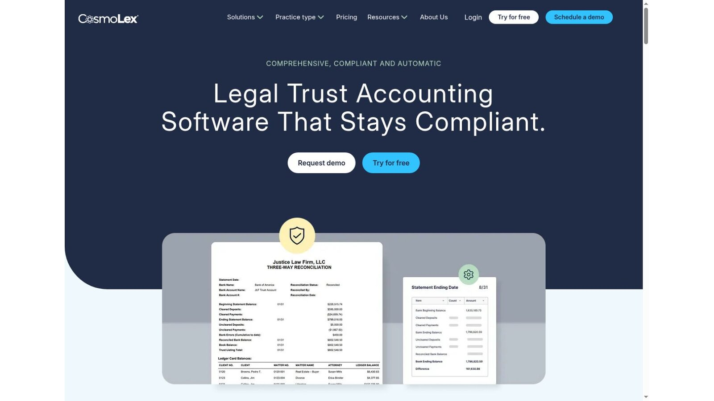
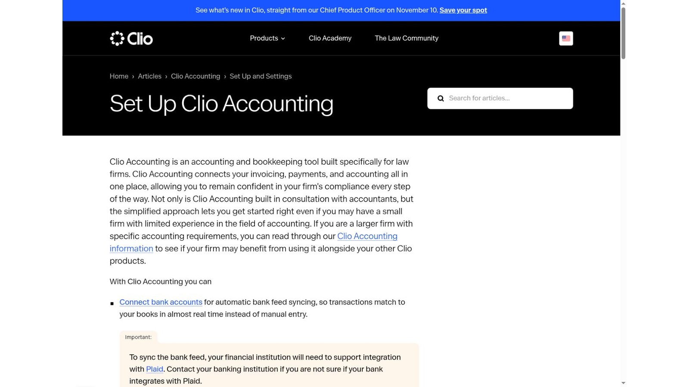
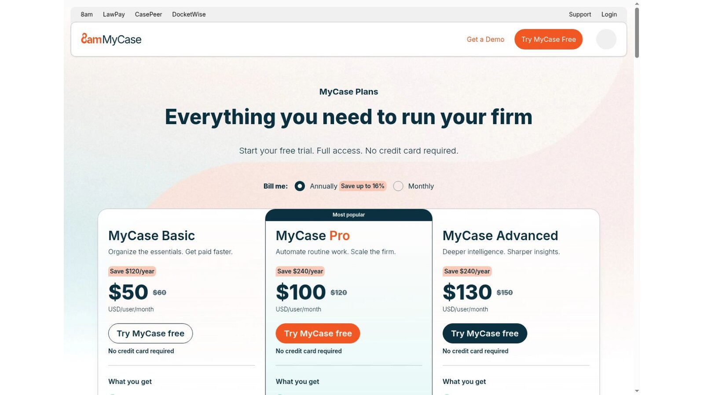
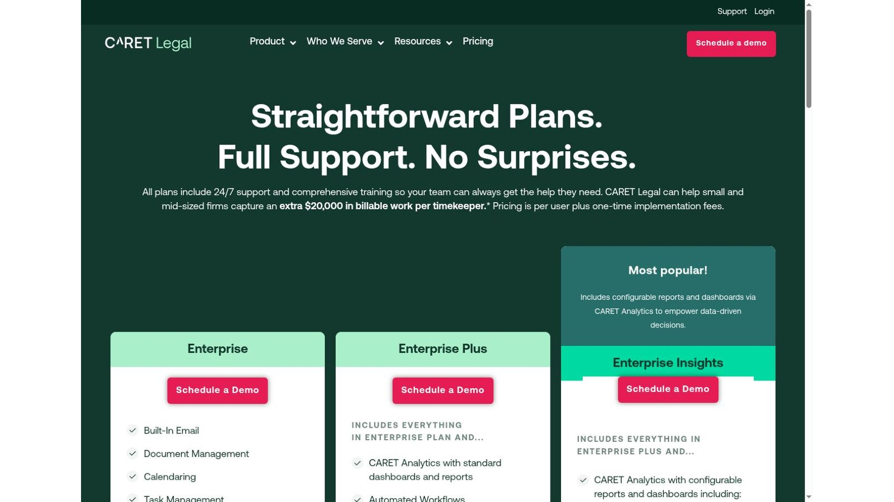
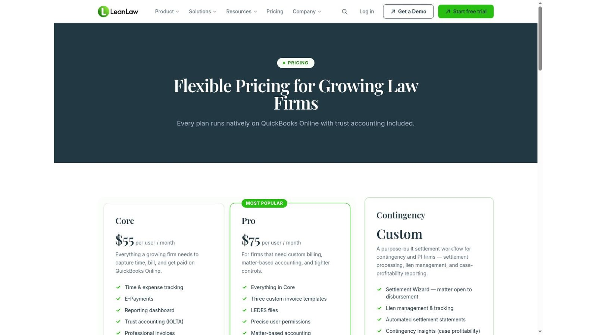
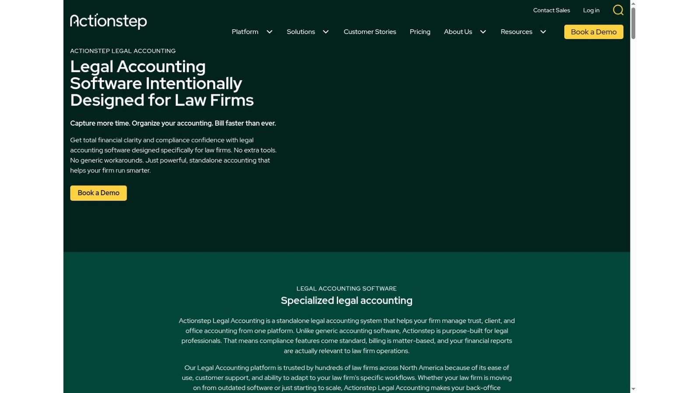
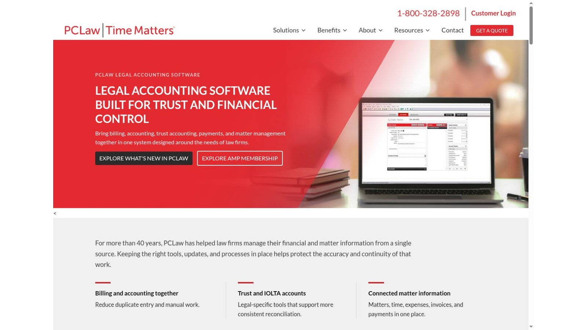
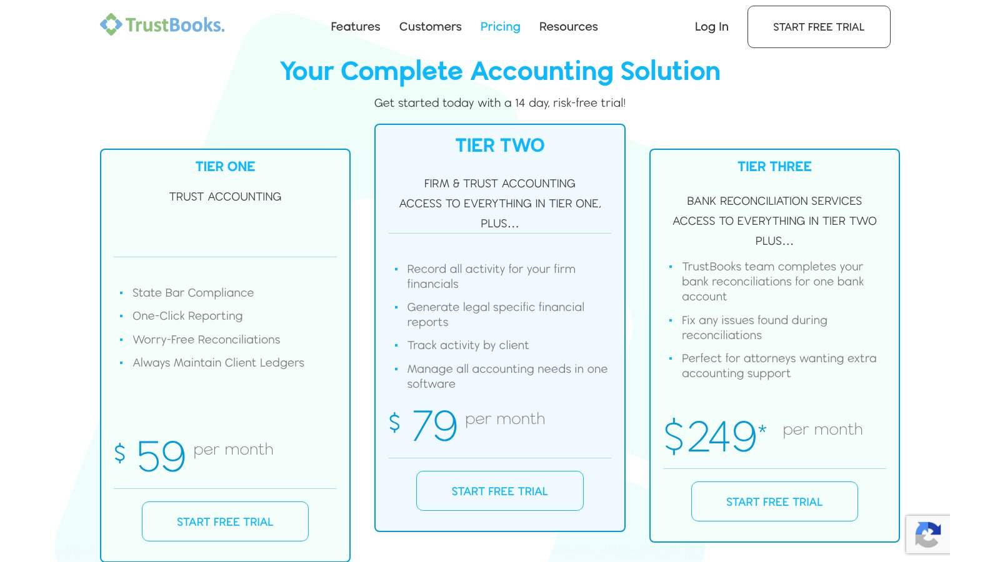

# 8 Best Legal Accounting Software Platforms for Law Firms

The best legal accounting software depends on where your firm wants its financial records to live. CosmoLex, Clio Accounting, MyCase Accounting, CARET Legal, Actionstep, and PCLaw combine legal work and accounting to different degrees. LeanLaw links legal billing and trust work to QuickBooks Online. TrustBooks focuses on trust and small-firm accounting.

No product makes a firm compliant on its own. State trust rules set the details, so firms still need written procedures, trained staff, regular review, and advice for their own jurisdiction.

No vendor paid to be included. We checked product facts and prices against official vendor pages on November 5, 2026. Where a page blocks automated readers, we checked a screenshot of the live page supplied by the site owner. We didn't test paid accounts. This article is general information, not legal or accounting advice.

## Key Takeaways

- **Pick the Model First:** Decide whether you need a full general ledger or a trust-specific control layer.
- **Test Real Reconciliations:** Run three-way reconciliation with your actual account structure, not demo data.
- **Price the Whole Project:** Add setup, migration, payments, integrations, and training to license fees.
- **Probe the Hard Cases:** Ask how the system handles negative client balances, uncleared funds, and corrections.
- **Name One Reviewer:** Give one person ownership of review, even when reports run automatically.

## Quick Comparison

The table groups the eight platforms by accounting model and the published US price we found on November 5, 2026. Taxes, payment fees, setup, and connected products can add to the total.

| Platform | Best Fit | Accounting Model | Trust Controls | Published Starting Price |
|---|---|---|---|---|
| CosmoLex | One legal and accounting system | Built-in ledger | Trust ledgers and three-way reconciliation | $49 per user per month |
| Clio Accounting | Firms already in Clio | Built into Clio | Bank feeds through Plaid | Clio plans from $49 per user per month |
| MyCase Accounting | MyCase firms adding accounting | Add-on | Trust accounting within MyCase | $39 per user per month add-on, Pro and Advanced only |
| CARET Legal | Finance, billing, and operations together | Built-in | Three-way reconciliation reports | Per user plus one-time setup fees; quote required |
| LeanLaw | QuickBooks Online firms | Two-way QuickBooks Online sync | Trust accounting included | $55 per user per month |
| Actionstep Legal Accounting | Configurable legal workflows | Built-in general ledger | Three-way trust reconciliation | Quote required |
| PCLaw | Legal bookkeeping at the center | Built-in | Trust and IOLTA accounts | Quote required |
| TrustBooks | Solo and small firms focused on trust | Trust-only or firm plus trust tiers | One-click reports | $59 per month |

## How We Evaluated the Platforms

Search results often mix three kinds of product: full accounting systems, practice platforms with accounting, and trust-only tools. That makes long feature lists hard to compare.

We sorted products by model first. Then we checked official pages for ledger scope, trust ledgers, bank reconciliation, billing links, permissions, reports, integrations, and price. We didn't assign scores, because a QuickBooks-linked setup and an all-in-one ledger solve different problems.

## What Legal Accounting Software Should Control

A useful demo follows money from receipt to disbursement. Ask the vendor to show the bank record, trust account, client ledger, invoice, and operating entry. Then introduce a correction and watch what happens.

### Three-Way Reconciliation

Three-way reconciliation compares the trust bank balance, the trust account ledger, and the total of every client ledger. A clean report only helps when the entries, outstanding items, and review trail behind it are accurate.

### Segregation of Duties

The person who receives money shouldn't be the only person who approves transfers and closes the month. Check that roles and permissions can enforce that split.

## 1. CosmoLex: Best All-in-One Option for Small and Midsize Firms

CosmoLex combines practice management, billing, business accounting, and trust accounting. Its pricing page lists plans at $49, $99, and $129 per user per month, and its table places fuller accounting and trust features in the higher plans.

The [CosmoLex trust accounting page](https://www.cosmolex.com/features/trust-accounting-software/) says the software blocks ledger overdrafts and commingling and runs three-way reconciliations in a few clicks. Having accounting built in removes the need to sync a separate bookkeeping product.

**Best fit:** Firms that want legal work and accounting in one system.

**Test:** Enter a trust receipt, apply part to an invoice, return the rest, reconcile the account, and export the audit detail.

## 2. Clio Accounting: Best for Firms Already Using Clio

Clio now offers accounting inside its platform. Its help article on setting up Clio Accounting says automatic bank feed syncing needs a bank that supports Plaid. Clio's pricing page starts at $49 per user per month.

Clio blocks automated readers, so we checked both pages from screenshots of the live pages. Confirm every operating and trust bank before you plan an automatic feed, and confirm which accounting features your plan includes.

**Best fit:** Clio firms that want billing, matters, and financial records in one workspace.

**Test:** Reconcile an account with an uncleared item, correct a posted transaction, and inspect the audit history.

## 3. MyCase Accounting: Best Add-On for MyCase Firms

The [MyCase pricing page](https://www.mycase.com/pricing/) lists MyCase Accounting at $39 per user per month, available on Pro and Advanced. Those plans cost $100 and $130 per user per month on yearly billing, so a Pro user with Accounting costs $139 a month.

Keeping accounting next to cases, billing, and payments can cut duplicate entry. The full cost, though, always includes both the plan and the add-on.

**Best fit:** Established MyCase users that want accounting without changing practice platforms.

**Test:** Ask how past trust transactions are migrated, checked, locked, and reported after cutover.

## 4. CARET Legal: Best Integrated Financial Operations Suite

CARET Legal combines matter management, billing, payments, and accounting across its Enterprise, Enterprise Plus, and Enterprise Insights plans. Its pricing page says pricing is per user plus one-time implementation fees, and lists LEDES invoicing and three-way reconciliation reporting.

We couldn't find plan prices in the page text, so ask for a written quote. CARET suits firms evaluating a full business platform more than a narrow trust ledger.

**Best fit:** Firms ready to combine finance, billing, reporting, and operations.

**Test:** Request a line-item setup scope that covers migration, chart of accounts, training, opening balances, and acceptance testing.

## 5. LeanLaw: Best QuickBooks Online Connection

LeanLaw Core costs $55 per user per month, and Pro costs $75. The pricing page lists a two-way QuickBooks Online sync and says every plan includes trust accounting. Pro adds LEDES files, precise user permissions, and matter-based accounting.

This model keeps the general ledger in QuickBooks while adding legal context. It suits firms whose bookkeeper already works in QuickBooks Online, but the sync is one more thing to monitor.

**Best fit:** Firms committed to QuickBooks Online that need legal billing and trust controls around it.

**Test:** Break a sync on purpose, then ask how staff find, fix, and document the mismatch.

## 6. Actionstep Legal Accounting: Best for Configurable Workflows

Actionstep says its Legal Accounting product was formerly known as Soluno. The product page lists a general ledger, client ledger, three-way trust reconciliation, and audit trails. Pricing is by quote.

Actionstep also sells workflow and practice tools, which can tie financial steps to matter stages. Ask for a precise proposal that shows products, setup, configuration, and support.

**Best fit:** Firms that want accounting tied to configurable legal workflows.

**Test:** Map a trust-to-operating transfer with approval, split duties, exception handling, and audit export.

## 7. PCLaw: Best for Established Legal Bookkeeping

PCLaw's product page says it connects legal billing, accounting, trust accounting, and matter management in one system, with built-in reconciliation tools. The page highlights trust and IOLTA accounts. Pricing is by quote.

PCLaw has a long history in legal finance. Spend less demo time on brand familiarity and more on deployment, integrations, reports, support, and migration.

**Best fit:** Firms that want legal bookkeeping and billing at the center of their system.

**Test:** Import a sample historical matter and reproduce your month-end reports before you accept migration.

## 8. TrustBooks: Best Focused Trust Accounting Option

TrustBooks publishes three tiers. Tier One costs $59 per month for trust accounting. Tier Two costs $79 for firm and trust accounting. Tier Three costs $249, and the TrustBooks team completes bank reconciliations for one account. The page offers a 14-day trial.

The product highlights client ledgers, one-click reports, and state bar compliance. Its narrow scope suits a solo or small firm that doesn't need a new practice platform.

**Best fit:** Small firms that want a dedicated trust control system with simple published pricing.

**Test:** Run your current month-end process, including stale checks, uncleared deposits, and a client balance correction.

## What Three Users Pay Each Month at Published Rates

Here is our arithmetic for a three-user firm, using only prices printed on each page. It covers base subscriptions, with no setup, taxes, or payment fees.

| Setup | Calculation | Monthly Total |
|---|---|---|
| TrustBooks Tier Two, firm price | One firm at $79 | $79 |
| CosmoLex lowest plan | 3 × $49 | $147 |
| LeanLaw Core plus QuickBooks Online | 3 × $55, plus a separate QuickBooks bill | $165 plus QuickBooks |
| MyCase Pro with Accounting | 3 × ($100 + $39) | $417 |

This is our calculation, not a vendor quote. The cheapest line is a trust-focused tool, so it may still need a separate practice platform. Compare the total cost of the model you need, not the lowest headline price.

## How to Choose the Right Model

Match the legal accounting software model to your main gap.

- **All-in-One Ledger:** Compare CosmoLex, Clio Accounting, MyCase Accounting, CARET, Actionstep, and PCLaw when you want one vendor for billing and books.
- **Connected Ledger:** Choose LeanLaw when QuickBooks Online stays, and document which system owns each record.
- **Focused Trust Tool:** Choose TrustBooks when trust controls are the main gap, while keeping a home for business accounting.

Accounting and billing overlap, so read our [legal billing software comparison](/legal-tech/best-legal-billing-software/) before you settle on a model. For wider adoption data, see our [legal technology statistics](/legal-tech/legal-technology-statistics/) hub.

## Questions to Ask Every Vendor

Put these questions to every legal accounting software vendor and ask for written answers.

1. Does the product hold the general ledger, or connect to another system?
2. Can it complete and keep a three-way reconciliation for each trust account?
3. What stops a payment from exceeding a client's cleared balance?
4. How are corrections, voids, reversals, and deleted entries recorded?
5. Which roles can receive, approve, transfer, reconcile, and close funds?
6. How will historical client and trust balances be checked during migration?
7. What are the total first-year and renewal costs?
8. How can the firm export ledgers, documents, and audit records at contract end?

## Frequently Asked Questions

### What Is Legal Accounting Software?

Legal accounting software records a law firm's business and client-fund transactions. Depending on the product, it may include a general ledger, trust ledgers, billing, bank reconciliation, payables, and financial reports.

### Is It the Same as Legal Billing Software?

No. Billing software creates time entries, invoices, and payment workflows. Legal accounting software records the financial effect, reconciles accounts, and produces ledgers and statements. Some platforms do both.

### What Is Three-Way Trust Reconciliation?

It compares the trust bank balance, the trust account ledger, and the total of all client ledgers. Any difference needs investigation and a documented correction.

### Can QuickBooks Handle Law Firm Accounting?

QuickBooks can hold a firm's general ledger. Many firms add legal billing and trust controls through a linked product such as LeanLaw. Confirm that the full workflow meets your state's rules.

### How Often Should a Firm Reconcile Trust Accounts?

It depends on your jurisdiction. Many firms reconcile monthly, but follow your state rules and bar guidance.

## Resources

- [CosmoLex pricing](https://www.cosmolex.com/pricing/)
- [Clio pricing](https://www.clio.com/pricing/)
- [Clio Accounting setup](https://help.clio.com/hc/en-us/articles/47397952204315-Set-Up-Clio-Accounting)
- [CARET Legal pricing](https://caretlegal.com/pricing/)
- [LeanLaw pricing](https://www.leanlaw.co/pricing/)
- [Actionstep Legal Accounting](https://www.actionstep.com/legal-accounting/)
- [PCLaw](https://pclawtimematters.com/product-pclaw/)
- [TrustBooks pricing](https://trustbooks.com/pricing/)
