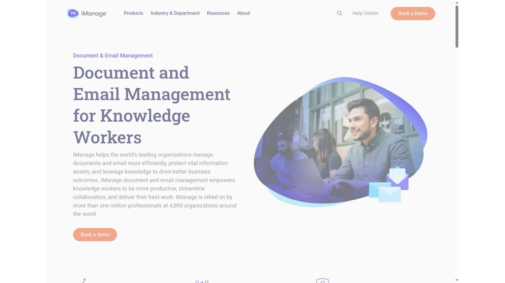
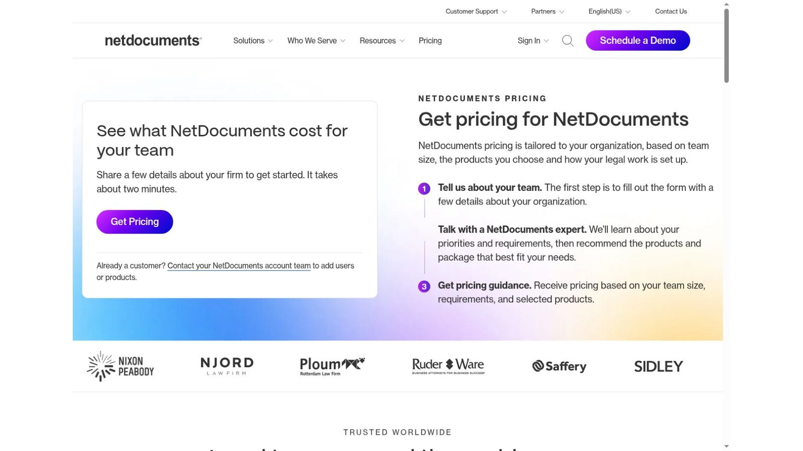
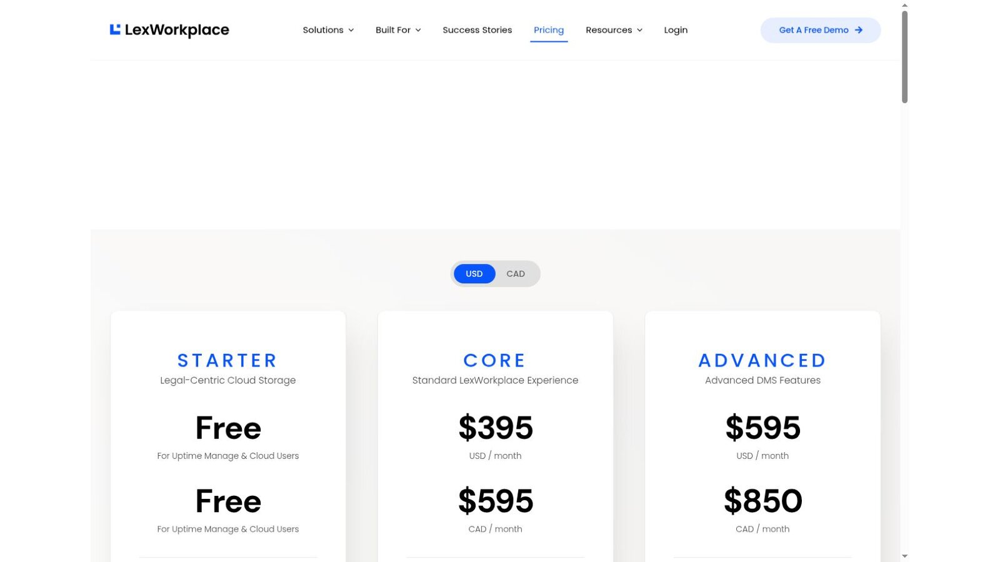
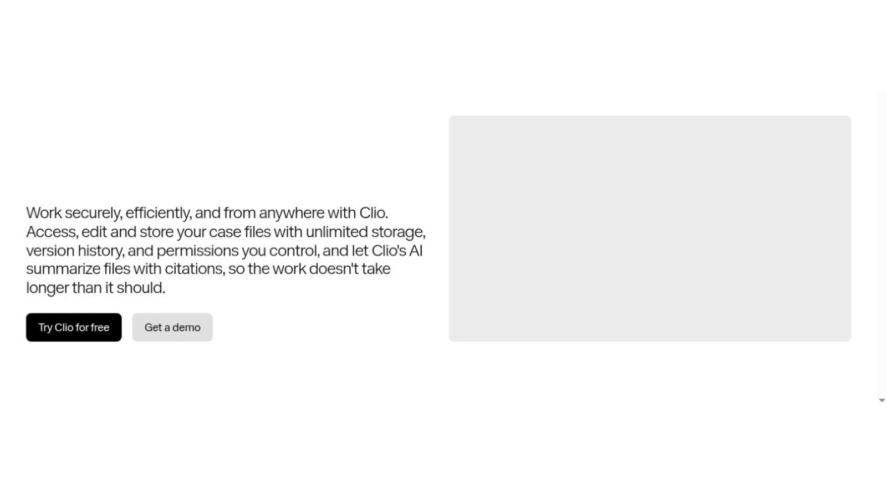
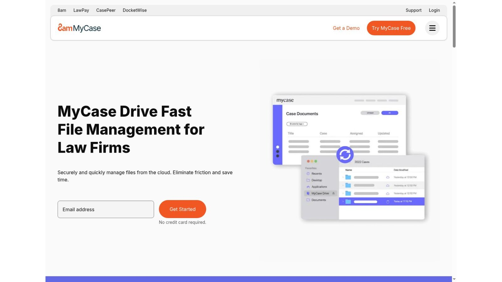
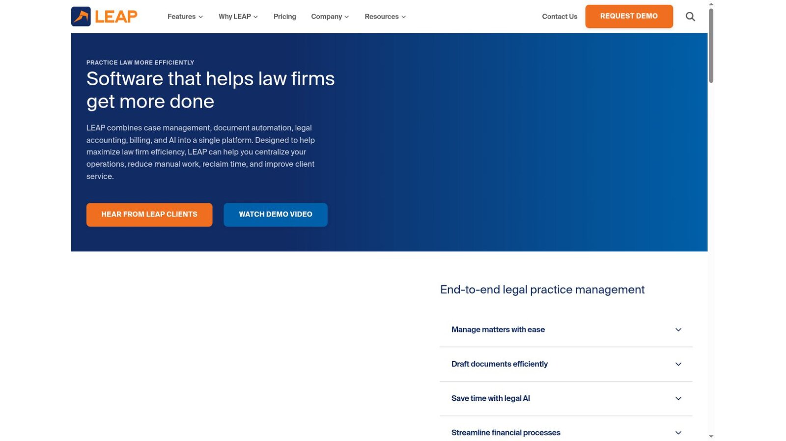
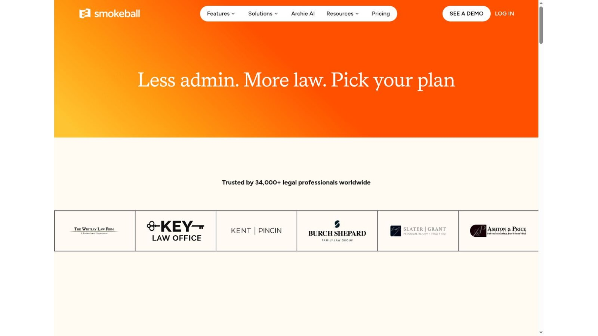
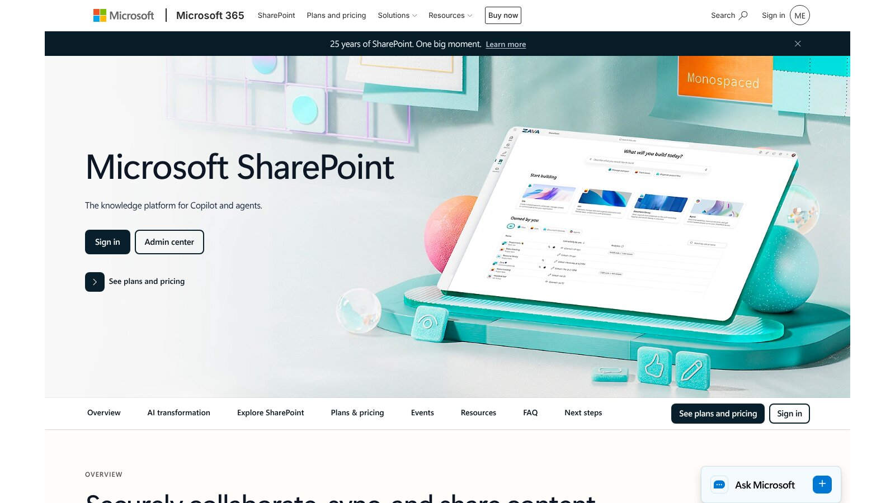

# 8 Best Law Firm Document Management Software Platforms

The best law firm document management software depends on whether you need a dedicated system or document tools inside practice management. iManage and NetDocuments serve firms that need a dedicated DMS. LexWorkplace offers a legal cloud DMS with published prices. Clio, MyCase, LEAP, and Smokeball keep documents next to matters. Microsoft SharePoint can work as a custom system when a firm has the skills to configure it.

A file store alone isn't enough. Firms need consistent filing, full-text search, version control, email capture, access rules, audit records, retention, and a tested way out.

No vendor paid to be included. We checked product facts and prices against official vendor pages on November 5, 2026. Where a page blocks automated readers, we checked a screenshot of the live page supplied by the site owner. We didn't test paid accounts or security controls. This article is general information, not legal or cybersecurity advice.

## Key Takeaways

- **Dedicated Means Deeper:** A dedicated DMS gives more governance than matter attachments in a practice platform.
- **Email Filing Is Central:** Key client instructions often live in Outlook, so filing email well matters most.
- **Search Depends on Discipline:** Results rely on metadata, OCR, permissions, and consistent filing habits.
- **Security Needs Proof:** Treat security claims as a starting point for contract, technical, and process review.
- **Plan the Migration:** Validate file counts, duplicates, permissions, and retention before you switch.

## Quick Comparison

The table sorts the eight platforms by product type and the published US price we found on November 5, 2026. Migration, storage, setup, and training can add to the total.

| Platform | Product Type | Best Fit | Published Starting Price |
|---|---|---|---|
| iManage | Dedicated DMS | Larger firms with governance needs | Quote required |
| NetDocuments | Dedicated cloud DMS | Firms that want cloud governance and integrations | Quote required |
| LexWorkplace | Cloud legal DMS | Small and midsize firms that want a focused DMS | $395 per month with 3 users on Core |
| Clio | Practice management with documents | Clio firms that want matter-based files | From $49 per user per month |
| MyCase | Practice management with a desktop drive | MyCase firms that want desktop access | Desktop Drive comes with Advanced at $130 per user per month, billed yearly |
| LEAP | Practice management with document tools | Small firms on Microsoft 365 | Quote required |
| Smokeball | Practice management with automation | Firms working in Word and Outlook | Quote required |
| Microsoft SharePoint | Configurable content platform | Microsoft 365 firms with technical staff | Included in Microsoft 365 Business Basic at $7 per user per month, billed yearly |

## How We Evaluated the Platforms

Searches for law firm document management software often mix enterprise DMS products, practice platform attachments, cloud drives, and knowledge tools. We split dedicated DMS platforms from matter platforms and general tools you configure yourself.

We checked official pages for matter filing, email management, search, versioning, permissions, ethical walls, Microsoft 365 links, desktop and mobile access, audit records, storage, and price. We gave more weight to a clear operating model than to a long feature list.

## 1. iManage: Best for Large-Firm Governance

iManage sells a dedicated document and email management system. Its product page describes managing documents and email, protecting information, and working from anywhere, and it lists iManage Share for secure collaboration. Pricing is by quote.

Ask which governance features sit in the core proposal and which need an extra product, because enterprise packages vary widely.

**Best fit:** Midsize and large firms with formal governance, mobility, and integration needs.

**Test:** Change one user's matter access, then check search results, recent lists, email filing, shared links, and audit records.

## 2. NetDocuments: Best Dedicated Cloud DMS

The [NetDocuments pricing page](https://www.netdocuments.com/pricing/) says it organizes documents and email by client and matter, with version control and search. It lists ethical walls and data loss prevention, and it says users work from Outlook, Word, and Teams while documents stay filed.

Pricing is tailored to team size, products, and setup, and the page notes that ethical walls, data loss prevention, and data residency can affect the package. A cloud model cuts local servers, but you still need to design workspaces, metadata, and access groups.

**Best fit:** Firms that want a dedicated cloud DMS with legal integrations and governance tools.

**Test:** File the same email from Outlook, Teams, mobile, and a browser, then check version and duplicate handling.

## 3. LexWorkplace: Best Focused DMS With Published Pricing

The [LexWorkplace pricing page](https://lexworkplace.com/pricing/) lists Core at $395 a month and Advanced at $595 a month, with three users included on both. An extra Core user costs $50 a month, and 100 GB more storage costs $40. A Starter plan is free for firms on Uptime Manage or Uptime Cloud.

Every plan includes document and email management, secure sharing, and LexWorkplace AI, billed month to month. The public price makes a dedicated DMS easier for a small firm to budget.

**Best fit:** Small and midsize firms that want a true DMS without an enterprise buying process.

**Test:** Migrate a sample matter with duplicates, nested folders, email, large files, and old versions, then match source and destination counts.

## 4. Clio: Best Matter-Based Documents for Clio Firms

Clio's pricing page starts at $49 per user per month. Its documents page promises unlimited storage, version history, permissions you control, and AI summaries of files with citations. Clio blocks automated readers, so we checked these pages from screenshots of the live pages.

These tools may cover a small firm when documents already belong to Clio matters. Firms that need ethical walls or advanced records management should compare a dedicated DMS.

**Best fit:** Clio firms that value one matter record and simple document access.

**Test:** Compare browser, desktop, and mobile filing, then check version recovery, search, and access for a departed user.

## 5. MyCase: Best Desktop Drive for MyCase Firms

MyCase plans cost $50, $100, and $130 per user per month on yearly billing. The pricing page lists Desktop Drive for PC and Mac in the Advanced plan. The MyCase Drive page says changes in MyCase or on the desktop sync automatically and that users can find documents with full-text search.

Pro includes document tools but not the desktop drive. Separate the general document features from the desktop experience when you compare plans.

**Best fit:** MyCase firms that want matter files in a familiar desktop workflow.

**Test:** Edit one document from two devices, take one offline, reconnect it, and check conflict handling.

## 6. LEAP: Best for Small Firms on Microsoft 365

LEAP's homepage describes case management, document automation, legal accounting, billing, and AI in one platform. It says LEAP works with your Microsoft 365 subscription and lists integrations with Microsoft 365, QuickBooks Online, Xero, and others. Pricing is by request and may include a one-time setup fee.

Built-in storage and document automation suit a firm that wants files, forms, and billing together. Firms that need deep records governance should compare LEAP's controls with a dedicated DMS.

**Best fit:** Small firms that want matters, legal forms, and Microsoft 365 in one flow.

**Test:** Generate a form, revise it in Word, file the email, share it with a client, and close the matter.

## 7. Smokeball: Best for Word and Outlook Automation

Smokeball prices by quote. Its pricing page lists email management, Word and Outlook integration, and document automation across its plans, with advanced automation on higher tiers.

That approach suits firms that build documents from matter data inside Microsoft apps. Ask for a plan-by-plan feature map, since no starting price is public.

**Best fit:** Small and midsize firms that want automation close to Word, Outlook, and matter data.

**Test:** Create a document from a template, change matter data, compare versions, file the final email, and recover an earlier draft.

## 8. Microsoft SharePoint: Best for Firms With Technical Staff

SharePoint offers document libraries, version history, permissions, search, and sharing across Microsoft 365. Microsoft's plan comparison lists Microsoft 365 Business Basic at $7 per user per month on a yearly subscription.

SharePoint is a platform you configure, not a ready-made law firm DMS. A legal setup needs client and matter structure, metadata, permissions, ethical wall design, retention, templates, monitoring, and training.

**Best fit:** Microsoft 365 firms with the skills to design and run a custom document system.

**Test:** Prototype one practice group, then measure filing steps, search results, permission inheritance, sharing, and admin time.

## What a Five-User Firm Pays Each Month

Here is our arithmetic for law firm document management software at five users, using only prices printed on each page. It covers licenses only, with no setup, migration, or extra storage.

| Option | Calculation | Monthly Total |
|---|---|---|
| Microsoft 365 Business Basic with SharePoint | 5 × $7 | $35 |
| LexWorkplace Core | $395 for 3 users + 2 × $50 | $495 |
| MyCase Advanced with Desktop Drive | 5 × $130 | $650 |

This is our calculation, not a vendor quote. SharePoint looks cheapest, but it needs design and admin time the other two include. MyCase Advanced also covers practice management and billing, so it replaces more than a DMS.

## Dedicated DMS or Practice Platform Documents?

Match the law firm document management software type to your needs.

- **Dedicated DMS:** Choose iManage, NetDocuments, or LexWorkplace when you need richer email filing, governance, ethical walls, and firmwide search.
- **Practice Platform Documents:** Choose Clio, MyCase, LEAP, or Smokeball when the goal is keeping files beside matters with fewer systems.
- **Custom Platform:** Choose SharePoint when you have Microsoft skills and accept ongoing design and admin work.

Documents often start as templates, so pair this review with our list of the [best legal document automation software](/legal-tech/best-legal-document-automation-software/). Litigation teams should also read our [eDiscovery software comparison](/legal-tech/best-ediscovery-software/), since review platforms pull from the same files. For adoption trends, see our [legal technology statistics](/legal-tech/legal-technology-statistics/).

## A Practical Evaluation Script

Run every law firm document management software finalist through the same eight steps with a real matter.

1. Import one full matter with email, attachments, scans, drafts, and final files.
2. Apply the planned workspace and metadata structure.
3. Search for a clause inside a scanned PDF and a Word document.
4. File an email from Outlook and confirm the attachment stays linked.
5. Edit a document at the same time as a colleague and restore an earlier version.
6. Restrict access, then check every search, mobile, sharing, and recent-items view.
7. Close the matter and apply the planned retention rule.
8. Export the matter with files, metadata, versions, and audit records.

## Questions to Ask Every Vendor

Ask each law firm document management software vendor to answer these in writing.

- **Search Scope:** Does full-text search cover scans, email attachments, and old versions?
- **Ethical Walls:** How do walls affect search, integrations, mobile access, and support staff?
- **Integrations:** Which Microsoft 365 and other integrations are native?
- **Migration:** How are duplicates, versions, links, and attachments handled?
- **Extra Costs:** Which storage, setup, security, and support charges sit outside licenses?
- **Exit Path:** How can you export documents, metadata, versions, audit logs, and permissions?
- **AI Use:** Which AI features read client content, and what contract terms apply?

## Frequently Asked Questions

### What Is Law Firm Document Management Software?

Law firm document management software stores, finds, versions, secures, shares, retains, and audits legal documents and email. Legal products usually organize content by client and matter.

### Is a Cloud Drive the Same as a DMS?

No. A cloud drive stores and syncs files. A DMS usually adds matter workspaces, metadata, email filing, version control, governance, audit records, and legal integrations.

### Do Small Law Firms Need a Dedicated DMS?

Not always. Document tools in a practice platform may be enough for a small team with simple needs. A dedicated DMS helps more as email volume, permissions, and governance demands grow.

### Can SharePoint Work as a Law Firm DMS?

Yes, but it needs legal-specific structure, permissions, retention, integrations, monitoring, and support. Budget for design and admin time, not only licenses.

### What Should a Firm Migrate First?

Pilot one practice group and a few full matters. Check file counts, metadata, dates, versions, permissions, email links, and search before a wider move.

## Resources

- [iManage document and email management](https://imanage.com/imanage-products/document-email-management/)
- [Clio pricing](https://www.clio.com/pricing/)
- [Clio legal documents](https://www.clio.com/features/legal-documents/)
- [MyCase pricing](https://www.mycase.com/pricing/)
- [MyCase Drive](https://www.mycase.com/features/mycase-drive/)
- [LEAP Legal Software](https://www.leaplegalsoftware.com/us/)
- [Smokeball pricing](https://www.smokeball.com/pricing)
- [Microsoft SharePoint](https://www.microsoft.com/en-us/microsoft-365/sharepoint/collaboration)
- [Microsoft SharePoint plans](https://www.microsoft.com/en-us/microsoft-365/sharepoint/compare-sharepoint-plans)
