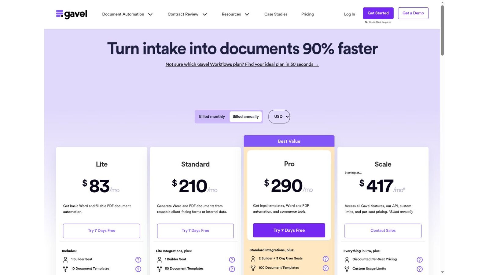
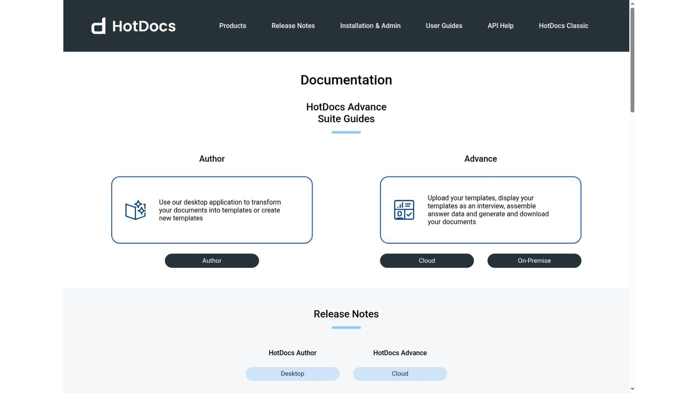
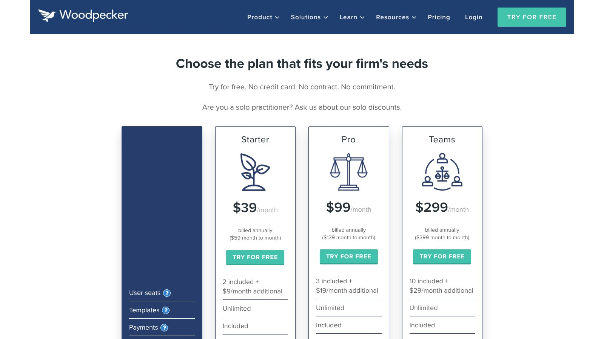
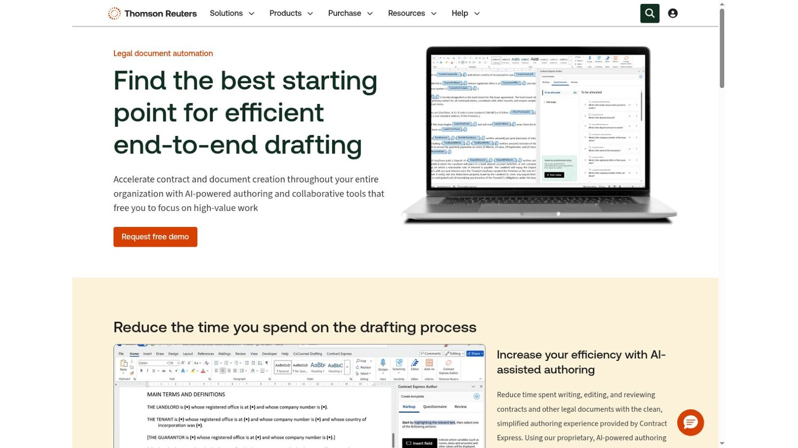
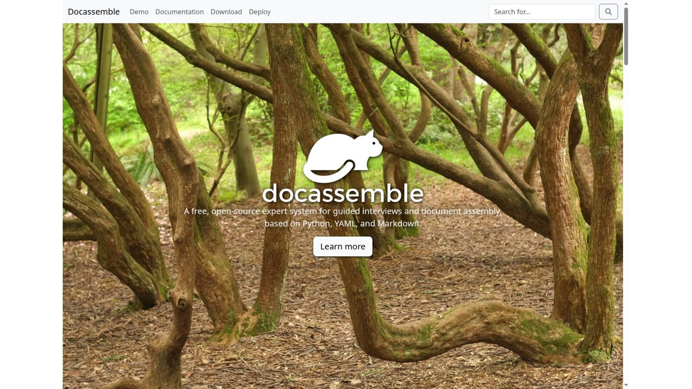
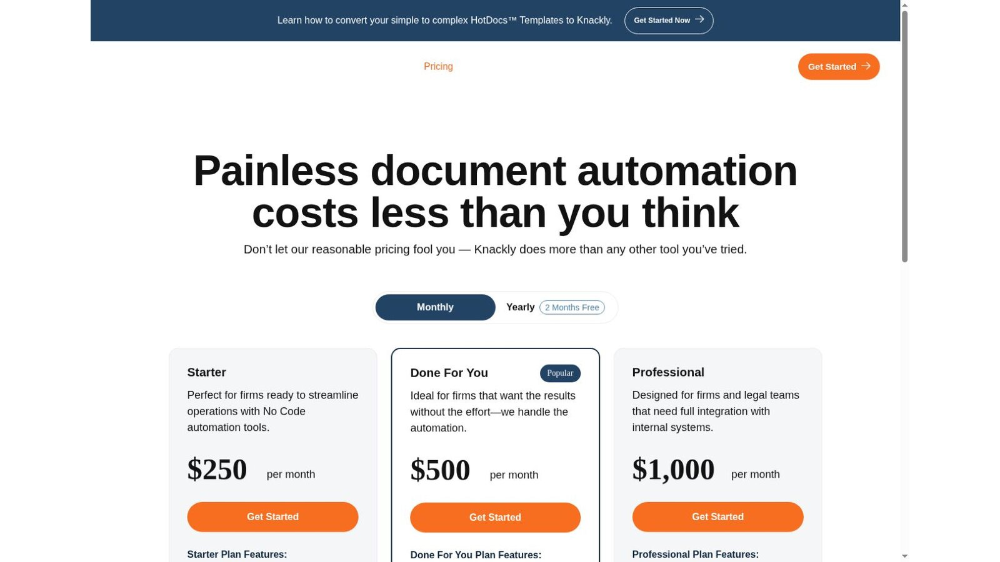
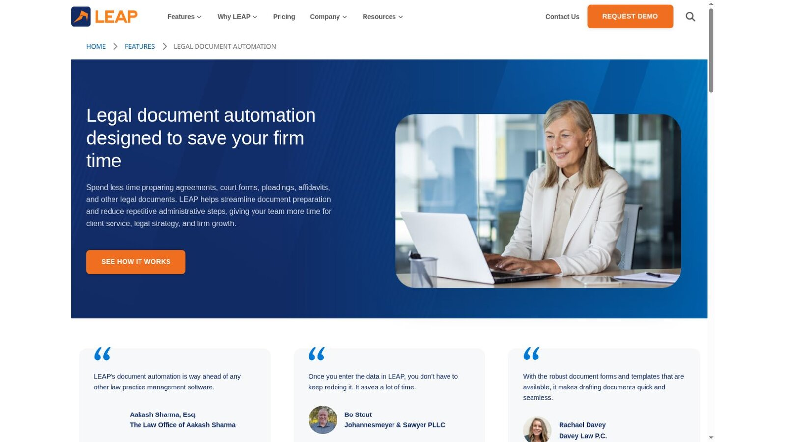
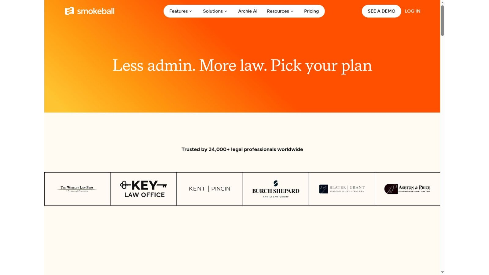

# 8 Best Legal Document Automation Software Tools

The best legal document automation software depends on the document and on who fills in the interview. Gavel and Woodpecker offer approachable workflows with published prices. HotDocs, Contract Express, and Knackly handle complex assembly. docassemble is an open-source platform for technical teams. LEAP and Smokeball build automation into wider practice management.

Document automation isn't the same as generative drafting. Assembly starts from approved templates and rules, collects structured answers, and produces defined documents. Generative AI can help draft or revise wording, but it needs its own checking process.

No vendor paid to be included. We checked product facts and prices against official vendor pages and screenshots of those pages on November 5, 2026. We didn't build or benchmark production templates. This article is general information, not legal or technical advice.

## Key Takeaways

- **Choose the Model First:** Decide between interviews, Word add-ins, forms, or a full platform before comparing features.
- **Maintenance Is the Real Cost:** Keeping templates current takes more work than the first demo suggests.
- **Check Forms by Number:** Confirm court-form coverage by jurisdiction and form number, not by marketing claims.
- **Test Client Interviews:** Client-facing forms need validation, save-and-return, and accessibility checks.
- **Review Every Output:** Each generated document still needs a defined legal review and version control.

## Quick Comparison

The table sorts the eight tools by automation model and the published US price we found on November 5, 2026. Builder seats, extra users, hosting, setup, and template conversion can add to the cost.

| Platform | Automation Model | Best Fit | Published Starting Price |
|---|---|---|---|
| Gavel Workflows | No-code interviews with Word and PDF output | Client-facing legal workflows | $83 per month, billed yearly |
| HotDocs Advance | Complex template and interview assembly | Large template libraries | Quote required |
| Woodpecker | Microsoft Word add-in with questionnaires | Firms automating existing Word files | $39 per month, billed yearly |
| Contract Express | Enterprise Word-based automation | Large firms and legal departments | Quote required |
| docassemble | Open-source guided interviews | Technical teams and access-to-justice projects | Free software; hosting extra |
| Knackly | Complex Word and PDF automation | Firms needing advanced logic | $250 per month |
| LEAP | Practice management with legal forms | Small firms wanting one platform | Quote required |
| Smokeball | Practice management with automation | Firms working in Word and Outlook | Quote required |

## How We Evaluated the Tools

Lists of legal document automation software tend to mix four categories: questionnaire assembly, Word add-ins, court-form filling, and generative drafting. We focused on products that publicly document reusable templates, structured interviews, conditional logic, document sets, or legal forms.

We checked official pages for output formats, authoring, data reuse, client interviews, integrations, deployment, and price. A simple mail-merge field doesn't count as full automation, and no tool's output is legally correct without review.

## 1. Gavel Workflows: Best Client-Facing No-Code Automation

The [Gavel pricing page](https://www.gavel.io/pricing) lists Lite at $83 a month with one builder seat and 10 templates. Standard costs $210 with 50 templates, Pro costs $290 with two builders and three organization users, and Scale starts at $417. These prices are billed yearly, and the page offers a seven-day trial.

Extra users beyond a tier's allowance cost $50 or $35 a month, depending on seat type. Pro adds legal templates and commerce tools for paid client workflows.

**Best fit:** Firms building guided intake-to-document workflows for staff or clients.

**Test:** Complete one interview with missing details, conflicting answers, a return visit, and two document branches.

## 2. HotDocs Advance: Best for Complex Template Libraries

HotDocs documentation describes two parts. HotDocs Author is a desktop app that turns documents into templates. HotDocs Advance lets you upload templates, show them as an interview, save answer data, and generate documents, with cloud and on-premise options.

Licensing comes through sales. Setup may include template conversion, integration, training, and admin work.

**Best fit:** Organizations running complex, long-lived template libraries and interview logic.

**Test:** Convert one hard production template with repeated clauses, calculations, nested conditions, tables, and attachments.

## 3. Woodpecker: Best Word Add-In for Smaller Teams

The [Woodpecker pricing page](https://woodpecker.squarespace.com/pricing) lists Starter at $39 a month, Pro at $99, and Teams at $299 on yearly billing. Month-to-month terms cost $59 and $139 for the first two plans. Starter includes two users, with more at $9 a month each.

Woodpecker works inside Microsoft Word, so firms keep familiar files and convert less. Still, test how it handles styles and complex formatting.

**Best fit:** Smaller firms that want to automate existing Word documents without a platform change.

**Test:** Generate a document with headers, footers, tables, numbering, cross-references, optional clauses, and signature blocks.

## 4. Contract Express: Best Enterprise Word-Based Automation

Thomson Reuters Contract Express uses guided questionnaires to create single documents and document suites. Its page says it integrates with Microsoft Word, Microsoft Excel, and iSheets, and that finished documents can go to Word for markup and validation.

Pricing is by quote. Your setup scope should name who handles template conversion, integrations, environments, admin, training, and support.

**Best fit:** Large firms and legal departments with complex precedents and enterprise integrations.

**Test:** Ask who will convert, check, document, and maintain the first template set after launch.

## 5. Docassemble: Best Open-Source Guided Interview Platform

docassemble describes itself as a free, open-source expert system for guided interviews and document assembly, built on Python, YAML, and Markdown. Interviews can give users documents in PDF, RTF, or DOCX format.

There's no license fee. The [docassemble deployment guide](https://docassemble.org/deploy.html) says hosting a server on the internet costs money, between $10 and $40 a month or more depending on performance needs. Your team owns the technical work.

**Best fit:** Technical legal teams, courts, nonprofits, and access-to-justice projects that want code-level control.

**Test:** Weigh hosting, security updates, backups, accessibility, and developer continuity before you treat free as the total cost.

## 6. Knackly: Best for Complex Logic With Published Tiers

Knackly's pricing page lists Starter at $250 a month, Done For You at $500, and Professional at $1,000. Extra users cost $40 a month on the first two plans and $50 on Professional. The page says yearly plans, billed upfront, get two months free.

Knackly aims at complex legal documents and deeper integrations on its top plan. Budget for authoring skill and template conversion, or for the Done For You plan if you want help building.

**Best fit:** Firms and legal teams that need advanced logic and reusable data across document sets.

**Test:** Build one template your firm thinks is too complex for mail merge, then count the upkeep steps.

## 7. LEAP: Best Built-In Form Library and Practice Management

LEAP's document automation page says it helps firms prepare agreements, court forms, pleadings, affidavits, and other legal documents. It fills matter data into forms, letters, and emails in Microsoft 365. Pricing is by request.

That can cut integration work for a small firm. It also means you can't judge the automation apart from the wider platform decision.

**Best fit:** Small firms that want forms, matters, billing, and accounting from one vendor.

**Test:** Confirm the exact state, court, and practice-area library, and name who updates your local templates.

## 8. Smokeball: Best Automation Around Word and Outlook

Smokeball's pricing page lists automated forms and templates, Word and Outlook integration, and advanced document automation on higher plans. Pricing is by quote.

The automation lives inside a wider practice system. Compare the full package, not the document feature alone.

**Best fit:** Firms already weighing Smokeball for matters, email, time, billing, and documents.

**Test:** Fill a document set from matter data, revise the template, compare versions, and confirm who can publish changes.

## What the First Year Costs at Published Rates

Here is our arithmetic for one year, using only prices printed on each page. It covers licenses only, with no conversion work or extra users.

| Option | Calculation | First-Year License |
|---|---|---|
| docassemble on a basic server | 12 × $10 to $40 hosting | $120 to $480 |
| Woodpecker Starter, yearly | 12 × $39 | $468 |
| Gavel Lite, yearly | 12 × $83 | $996 |
| Knackly Starter, yearly | 10 × $250, with two months free | $2,500 |

This is our calculation, not a vendor quote. docassemble's low figure leaves out developer time, which is usually the largest cost. The gap between Woodpecker and Knackly mostly reflects how much logic each one handles.

## Start With One Document Family

Most failed rollouts try to automate everything at once. Pick one high-volume document family, such as engagement letters or a standard pleading set, and automate it end to end first. That first project shows how long templates really take, who needs to approve changes, and whether staff will trust the output.

Write down the source wording, the decision rules, and who signs off before anyone opens the builder. Legal document automation software turns clear rules into documents quickly, but it can't settle disagreements about which clause is correct. Track the time saved on the first family, then use that number to decide whether the next family is worth the build.

## Choose by Automation Model

Match the legal document automation software model to your team.

- **Client-Facing Workflows:** Choose Gavel for no-code interviews.
- **Word-First Rollout:** Choose Woodpecker for a smaller, Word-based start.
- **Complex Assembly:** Choose HotDocs, Contract Express, or Knackly for large template programs.
- **Open Source:** Choose docassemble when you have technical owners.
- **Full Platform:** Choose LEAP or Smokeball when automation belongs inside new practice management.

Generated files need a home, so weigh the [law firm document management software](/legal-tech/best-law-firm-document-management-software/) we reviewed alongside this list. Firms automating agreements should also compare [legal contract management software](/legal-tech/best-legal-contract-management-software/), and intake-heavy firms can feed answers from [legal CRM software](/legal-tech/best-legal-crm-software/). Our [legal technology statistics](/legal-tech/legal-technology-statistics/) add wider adoption context.

## Questions to Ask Before Buying

Put these questions to every legal document automation software vendor and get written answers.

1. Which document types and jurisdictions are in the first release?
2. Who builds, tests, approves, publishes, and maintains templates?
3. Which answers can be reused across matters and document sets?
4. How are conditional clauses, calculations, repeats, and attachments handled?
5. Can clients save, return, correct, and securely submit an interview?
6. What happens when the source form, law, or firm wording changes?
7. Which builder seats, users, templates, and services cost extra?
8. Can the firm export templates, logic, data, and finished documents?

## Frequently Asked Questions

### What Is Legal Document Automation Software?

Legal document automation software uses templates, structured data, rules, and interviews to produce legal documents or document sets with less repetitive editing.

### Is Document Automation the Same as Generative AI?

No. Traditional automation assembles approved text under set rules. Generative AI writes new text by prediction. Some products now combine both.

### Can Automation Prevent Every Drafting Error?

No. It standardizes repeated work, but templates, logic, source data, jurisdiction, and final output still need review.

### Which Tool Works Best in Microsoft Word?

Woodpecker is a focused Word add-in. HotDocs, Contract Express, Knackly, Gavel, LEAP, and Smokeball also work with Word in different ways.

### Is Open-Source Document Automation Free?

docassemble has no license fee. Hosting, development, security, upkeep, backups, and support still cost money.

## Resources

- [HotDocs documentation](https://help.hotdocs.com/)
- [Contract Express](https://www.contractexpress.com/)
- [docassemble](https://docassemble.org/)
- [Knackly pricing](https://knackly.io/pricing/)
- [LEAP document automation](https://www.leaplegalsoftware.com/us/features/legal-document-automation/)
- [Smokeball pricing](https://www.smokeball.com/pricing)
