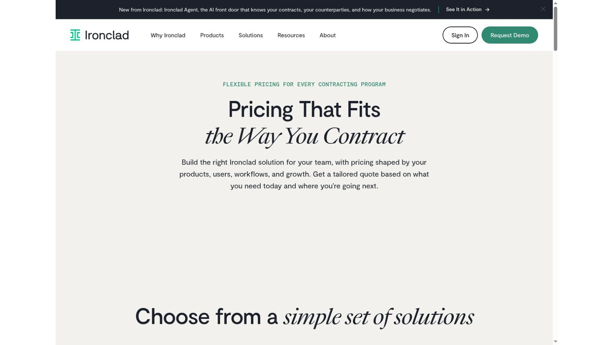
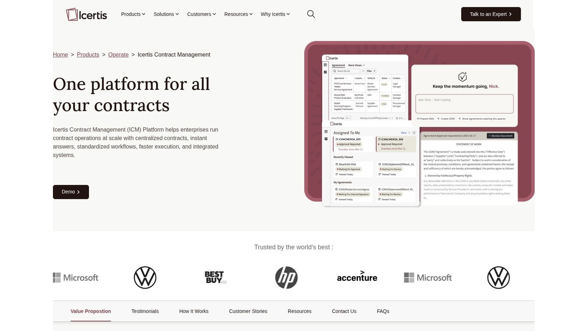
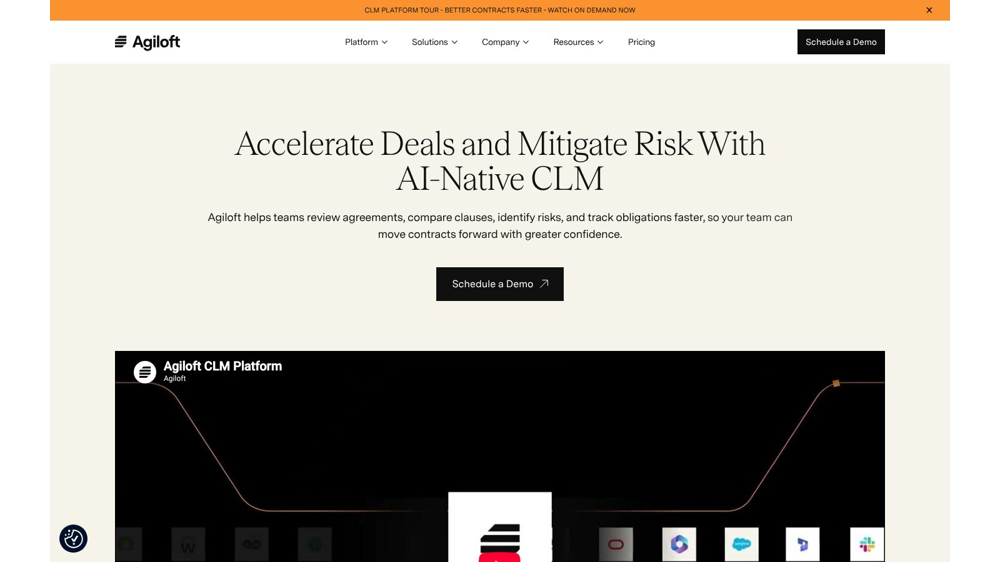
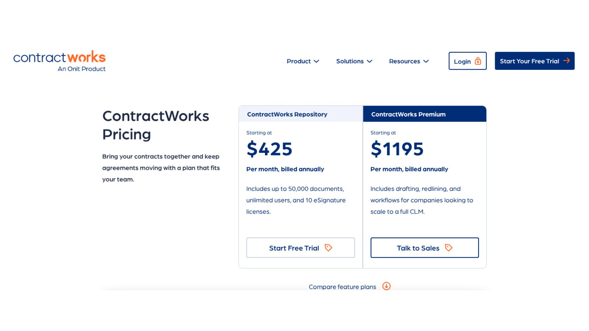
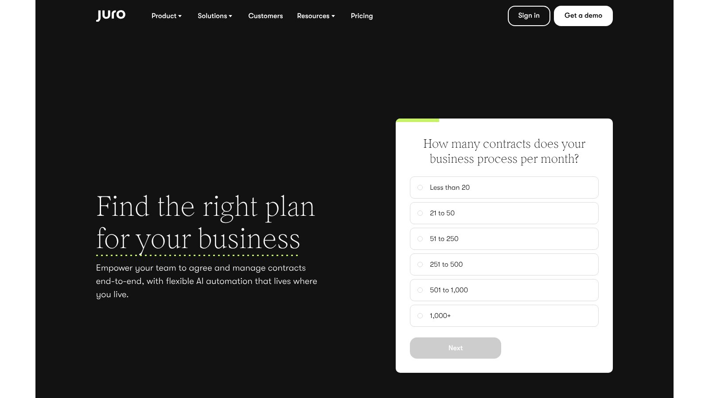
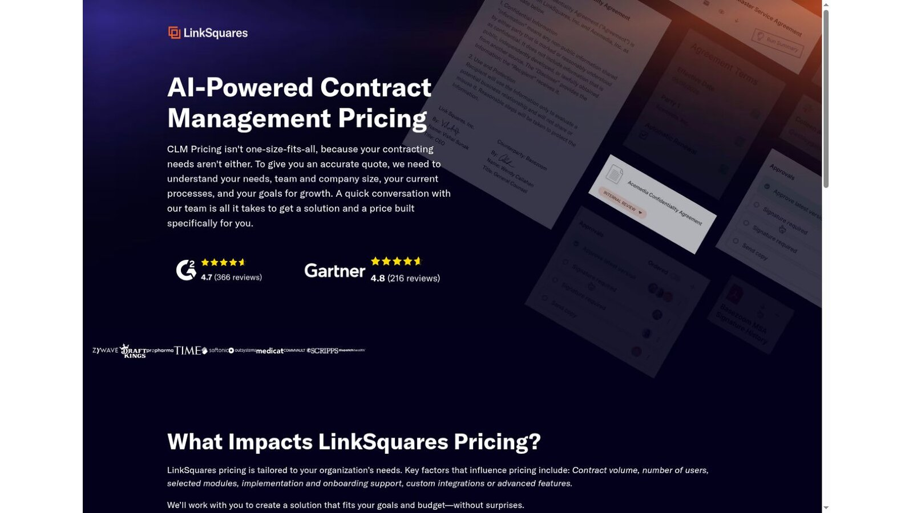
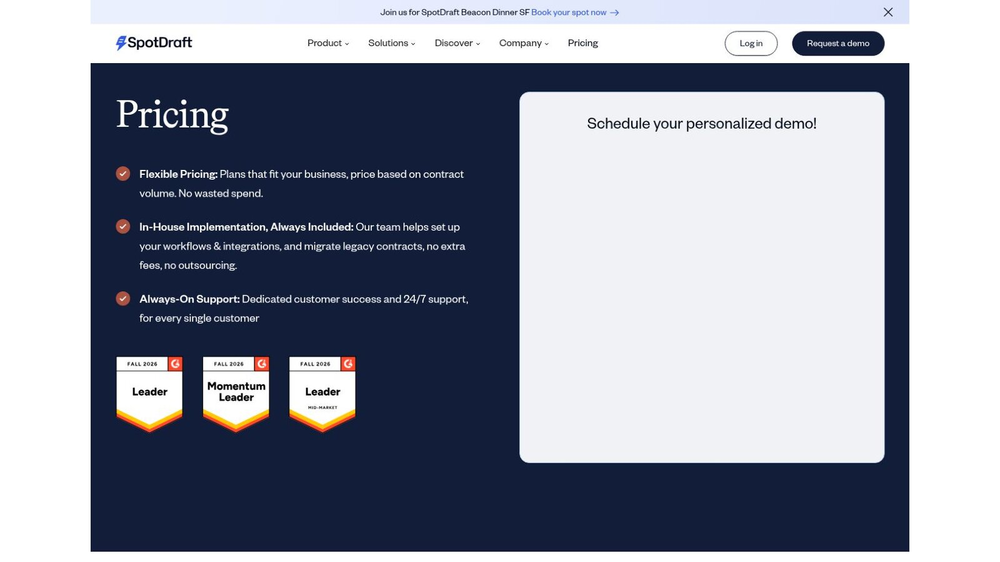
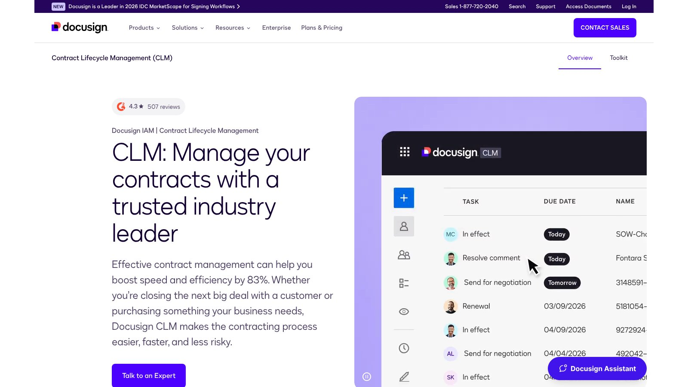

# 8 Best Legal Contract Management Software Platforms

The best legal contract management software depends on where your contracts get stuck. ContractWorks suits teams that mainly need a searchable repository with published prices. Juro and SpotDraft help business teams self-serve within legal guardrails. Ironclad, Icertis, Agiloft, LinkSquares, and Docusign CLM serve organizations that need broader workflow, integrations, and analytics.

Contract management and full contract lifecycle management (CLM) aren't the same thing. A repository tracks signed agreements. CLM also covers the request, drafting, negotiation, approval, signature, obligations, and renewal.

No vendor paid to be included. We checked product facts and prices against official vendor pages and screenshots of those pages on November 5, 2026. We didn't test paid accounts or AI accuracy. This article is general information, not legal advice.

## Key Takeaways

- **Repository or Full CLM:** Decide whether you need storage and alerts or the whole contract lifecycle.
- **Quotes Are Normal:** Most CLM vendors price by quote, so missing prices are a buying fact, not a red flag.
- **Volume Drives Cost:** Contract volume, users, modules, and integrations shape most quotes.
- **AI Needs Proof:** Test contract AI on your own agreements and require citations for every answer.
- **Plan the Exit:** Confirm what you can export, in what format, before you sign.

## Quick Comparison

The table compares the eight platforms by fit, pricing model, and main strength as shown on November 5, 2026. Only ContractWorks publishes a starting price.

| Platform | Best Fit | Pricing Model | Main Strength | Published Price |
|---|---|---|---|---|
| Ironclad | Cross-team enterprise contracting | Tailored quote by products, users, and workflows | Configurable workflows | Quote required |
| Icertis | Complex global contract operations | Enterprise quote | Templates, clauses, and ERP links | Quote required |
| Agiloft | Highly configurable CLM | Enterprise quote | Over 1,000 system integrations | Quote required |
| ContractWorks | Repository-first legal teams | Annual plans with unlimited users | Search, alerts, and e-signature | From $425 per month, billed yearly |
| Juro | Business self-service with legal controls | Contract volume and integration complexity | Unlimited users, workflows, and templates | Quote required |
| LinkSquares | In-house legal analytics | Volume, users, modules, and onboarding | AI across the lifecycle | Quote required |
| SpotDraft | Scaling contract operations | Contract volume | Setup and migration included | Quote required |
| Docusign CLM | Organizations already on Docusign | Custom quote | Link to e-signature | Quote required |

## How We Evaluated the Platforms

Search results often compare a contract repository, an e-signature tool, and enterprise CLM as if they were the same. We mapped the full lifecycle and noted which vendors publicly describe requests, drafting, review, approval, signature, storage, search, obligations, renewals, analytics, and integrations.

We used official sources for every product and price claim. We didn't repeat unofficial average prices for quote-based tools.

## Repository, Self-Service, or Enterprise CLM?

Legal contract management software falls into three broad groups. Knowing your group cuts the shortlist fast.

### Repository First

A repository stores signed contracts, makes them searchable, and sends renewal alerts. It's the fastest win when contracts are scattered across inboxes and drives.

### Business Self-Service

Self-service tools let sales, HR, and procurement create routine contracts from approved templates. Legal sets the rules and handles exceptions.

### Enterprise CLM

Enterprise CLM connects contracts to ERP, CRM, and finance systems and tracks obligations after signature. It needs a real program with data, governance, and change management.

## 1. Ironclad: Best for Configurable Cross-Team Contracting

Ironclad's pricing page says it builds a tailored quote based on your products, users, workflows, and growth. Buyers choose from its contract lifecycle management, AI assistant, and e-signature products, and can add API access, extra instances, or a bigger success plan.

That modular setup lets large organizations shape the platform, so scope discipline matters. Your quote should name products, usage, setup partner, integrations, training, and renewal terms.

**Best fit:** Legal teams coordinating sales, procurement, finance, HR, and operations through configurable workflows.

**Test:** Run one nonstandard agreement through a rejected approval, a fallback clause, signature, an obligation, and renewal.

## 2. Icertis: Best for Complex Global Contract Operations

Icertis describes its Contract Management platform as one place for all your contracts. The product page lists approved templates and clause libraries, and it says users can manage contracts inside SAP, Microsoft, Salesforce, and Workday. Pricing is by quote.

Expect a program that involves data, integrations, governance, and change management, not a simple storage subscription.

**Best fit:** Global organizations with complex contract types, systems, entities, and obligations.

**Test:** Trace one contract term into the downstream system that runs it, then confirm which platform owns each field.

## 3. Agiloft: Best for No-Code Configuration

The [Agiloft CLM page](https://www.agiloft.com/platform/contract-management-software) says its platform connects with over 1,000 existing systems and lets teams tailor workflows. It also describes Astra, a built-in AI suite for reviewing agreements and comparing clauses. CLM pricing requires a quote.

Ask the vendor to separate Astra's AI features from the core CLM scope in the proposal.

**Best fit:** Teams that need deep configuration without building a custom app.

**Test:** Ask your admins to change a workflow, field, permission, and report during the trial, and note whether vendor services were needed.

## 4. ContractWorks: Best Repository-First Option With Public Pricing

The [ContractWorks pricing page](https://www.contractworks.com/contract-management-software-pricing) lists Repository from $425 a month and Premium from $1,195 a month, both billed yearly. Repository includes up to 50,000 documents, unlimited users, and 10 e-signature licenses.

Premium adds drafting, redlining, and workflows for teams moving toward full CLM. The page offers a 14-day Repository trial.

**Best fit:** Lean legal teams that want a repository, search, alerts, and a manageable rollout.

**Test:** Import a sample set, check OCR and metadata, assign renewal owners, and export the same set with its history.

## 5. Juro: Best for Business Self-Service With Legal Guardrails

The [Juro pricing page](https://juro.com/pricing) says all plans include unlimited users, unlimited workflows, and unlimited templates. Prices depend on your contract volume and the complexity of any integrations.

That model supports self-service by sales, HR, procurement, and finance while legal controls templates and workflows. Define what happens when a request falls outside the approved path.

**Best fit:** Legal teams that want to cut routine contract work through controlled business-user workflows.

**Test:** Submit an exception, change commercial terms after approval, and confirm which steps reopen on their own.

## 6. LinkSquares: Best for In-House Legal Analytics

LinkSquares says its pricing depends on contract volume, number of users, selected modules, onboarding support, and custom integrations or advanced features. It positions its platform as AI-powered contract management across the lifecycle.

Test AI extraction and answers against a contract set you've already checked by hand. Record citations, misses, and reviewer corrections.

**Best fit:** In-house legal teams that need workflow plus structured insight from signed agreements.

**Test:** Ask the same obligation question across amendments, exhibits, and the main agreement, then confirm which document controls the answer.

## 7. SpotDraft: Best for Volume-Based Scaling

SpotDraft's pricing page says plans are priced on contract volume and that in-house setup is always included, covering workflows, integrations, and legacy contract migration. Its product terms describe a storage-based model that gives unlimited user access.

Get the exact volumes, assumptions, and exclusions in writing before you sign.

**Best fit:** Legal teams that want broad business access without paying for every viewer.

**Test:** Model new contracts, stored legacy agreements, supporting files, and yearly growth against the proposed volume.

## 8. Docusign CLM: Best for the Docusign Ecosystem

Docusign CLM adds contract workflow, task tracking, and a repository around the company's e-signature products. Pricing is by custom quote through sales.

Separate e-signature envelopes from CLM licenses, document generation, analytics, integrations, and setup. A familiar signature tool doesn't make the whole lifecycle automatic.

**Best fit:** Organizations already committed to Docusign that want a connected agreement workflow.

**Test:** Price the full request-to-renewal process, including products outside the base CLM proposal.

## What a Repository Costs Over One Year

ContractWorks is the only vendor here with a public price, so here is the arithmetic on its two plans. It covers the subscription only.

| Plan | Published Rate | Calculation | Yearly Total |
|---|---|---|---|
| ContractWorks Repository | From $425 per month, billed yearly | 12 × $425 | $5,100 |
| ContractWorks Premium | From $1,195 per month, billed yearly | 12 × $1,195 | $14,340 |
| Difference | Drafting, redlining, workflows | $14,340 − $5,100 | $9,240 |

This is our calculation, not a vendor quote. The $9,240 gap is a useful benchmark when you weigh quotes from full CLM vendors. If a full platform costs far more than that, ask which extra features justify it.

## Clean Your Contract Data Before Migration

Most rollouts slip because of messy source files, not software. Before any legal contract management software goes live, gather signed copies, remove duplicates, and link each amendment to its parent agreement. Name an owner for every renewal date and notice period, and decide which fields the business needs on day one.

A short, clean pilot set of a few hundred contracts tells you more than a big import. It shows how well OCR reads your scans and how much metadata people must fix by hand.

## Choose by Contract Problem

Match legal contract management software to the problem you need to fix.

- **Scattered Signed Contracts:** Choose ContractWorks for a repository, search, alerts, and e-signature.
- **Routine Business Requests:** Choose Juro or SpotDraft when self-service and volume drive the project.
- **Enterprise Workflow:** Choose Ironclad, Icertis, Agiloft, LinkSquares, or Docusign CLM for wide integrations and analytics.

Many teams also want templates that fill themselves, so compare our [legal document automation software](/legal-tech/best-legal-document-automation-software/) picks before you commit. For a wider view of how legal teams buy tools, see our [legal technology statistics](/legal-tech/legal-technology-statistics/).

## Questions to Include in the RFP

Ask every legal contract management software vendor these questions and require written answers.

1. Which contract types, entities, regions, and teams are in scope?
2. What starts a request, and what happens when it falls outside a template?
3. Which product holds clauses, approvals, signatures, obligations, and renewals?
4. How are amendments, exhibits, orders, and parent agreements linked?
5. Which prices depend on users, documents, storage, AI, signatures, or integrations?
6. What migration checks and acceptance evidence will the vendor provide?
7. How are AI extractions cited, reviewed, corrected, and audited?
8. What can you export at the end of the contract, in what format, and at what cost?

## Frequently Asked Questions

### What Is Legal Contract Management Software?

Legal contract management software stores, organizes, searches, tracks, and reports on agreements. Broader CLM software also supports requests, drafting, negotiation, approval, signature, obligations, and renewal.

### How Does Contract Management Differ From CLM?

Contract management often focuses on signed agreements and post-signature work. CLM covers the agreement from request and drafting through renewal or termination.

### How Much Does CLM Software Cost?

Most vendors quote based on users, contract volume, modules, integrations, setup, and support. ContractWorks publishes plans from $425 a month, billed yearly.

### Is E-Signature the Same as CLM?

No. E-signature executes an agreement. CLM also manages the work before and after signature.

### How Should Legal Teams Test Contract AI?

Use a checked sample with amendments, unusual clauses, missing fields, scans, and conflicting dates. Require citations and record every correction.

## Resources

- [Ironclad pricing](https://ironcladapp.com/pricing)
- [Icertis Contract Management](https://www.icertis.com/products/operate/contract-lifecycle-management)
- [LinkSquares pricing](https://linksquares.com/pricing/)
- [SpotDraft pricing](https://www.spotdraft.com/pricing)
- [SpotDraft product terms](https://legal.spotdraft.com/legal/clm-product-services-offerings-e6e5c133?v=2.0)
- [Docusign CLM](https://www.docusign.com/products/clm)
