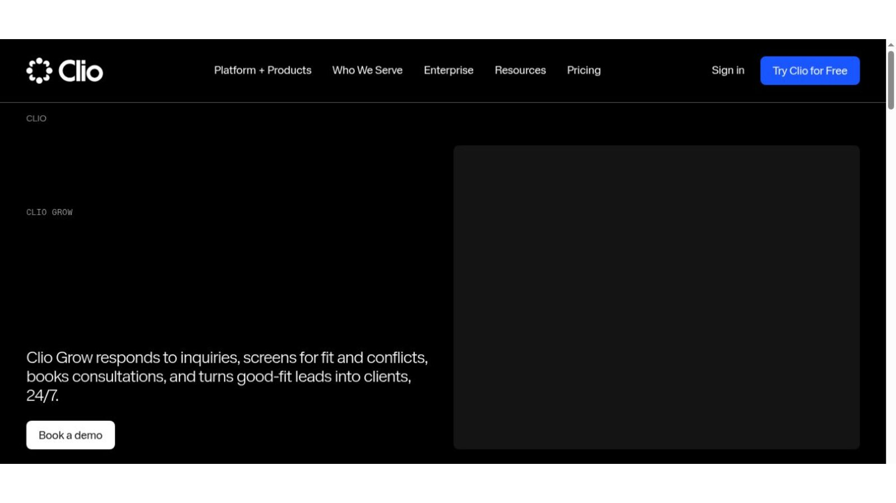
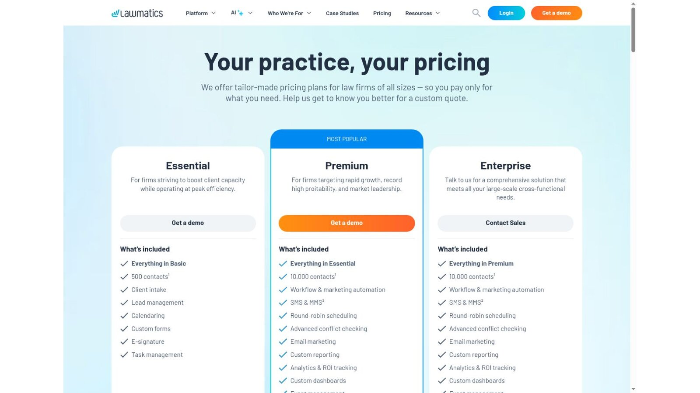
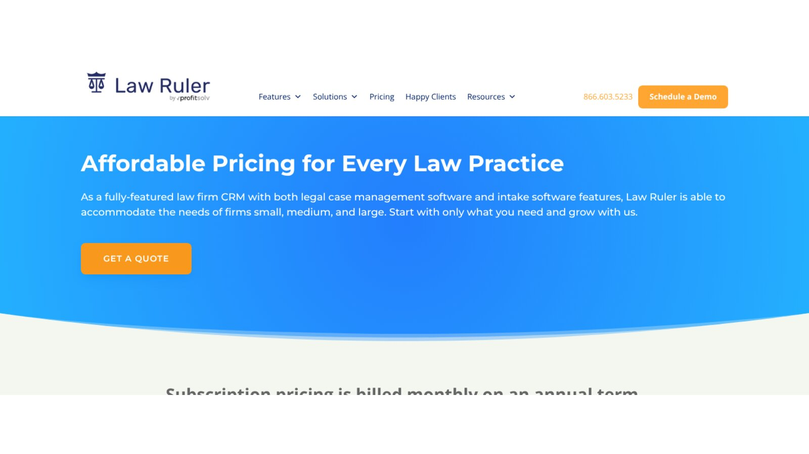
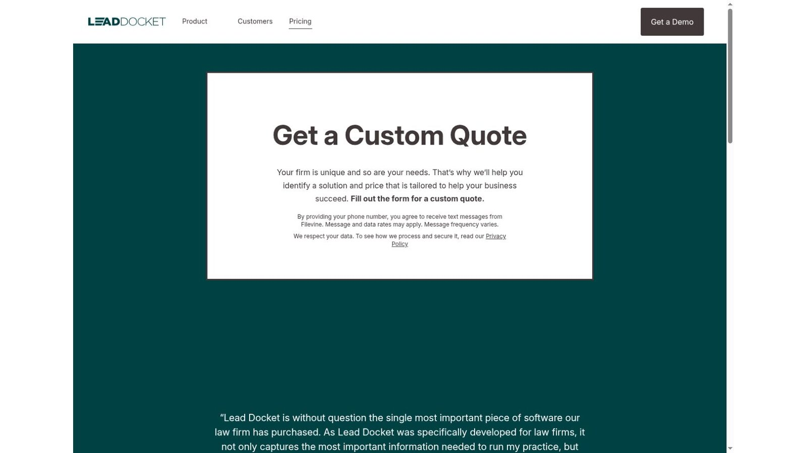
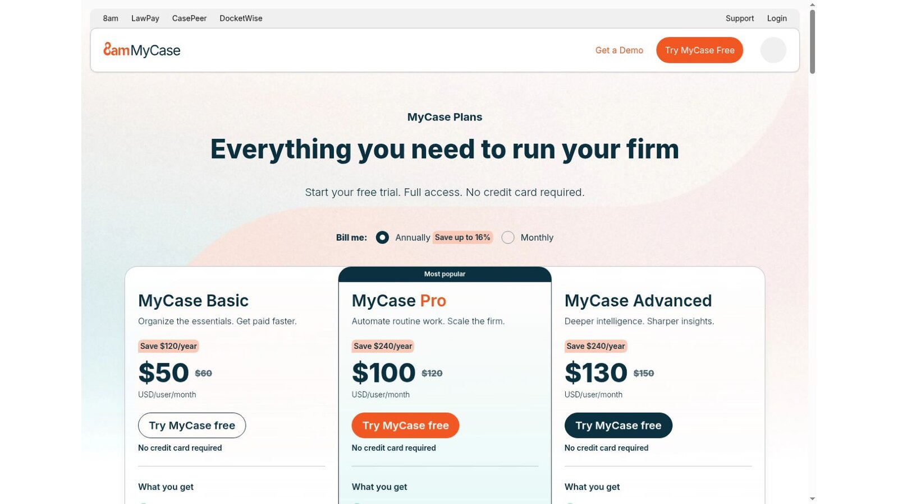
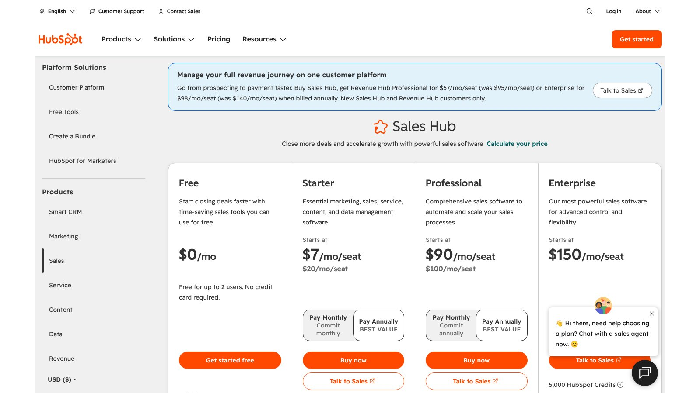
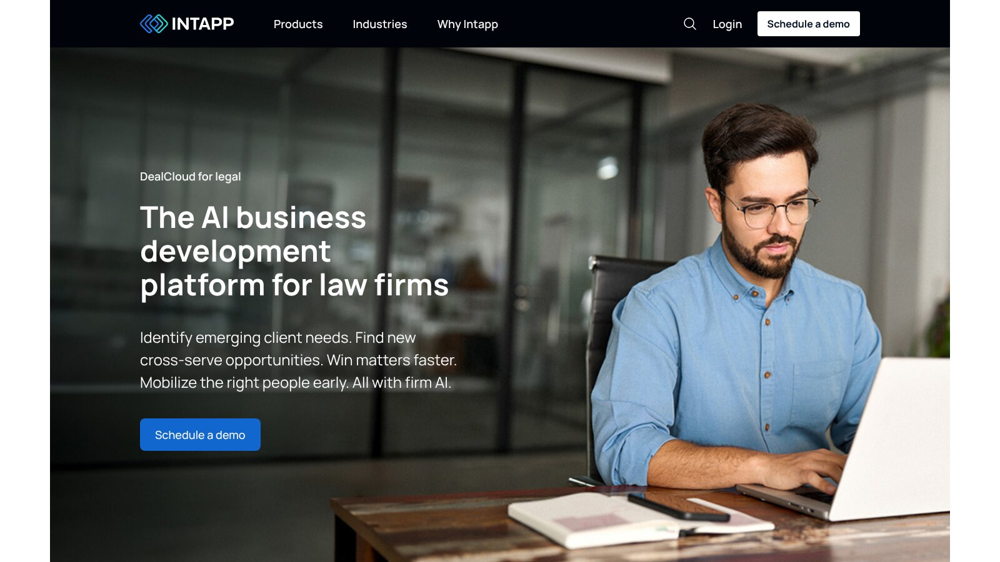

# 7 Best Legal CRM Software Platforms for Law Firms

The best legal CRM software depends on which question your firm needs answered. If it's "what happens after someone contacts us," look at intake tools: Clio Grow, Lawmatics, Law Ruler, Lead Docket, and MyCase. If it's "who knows this client and where can we grow," look at relationship tools such as Intapp DealCloud. HubSpot sits in between as a general CRM you configure yourself.

Those two jobs use different records, different users, and different measures of success. Mixing them in one shortlist is the most common buying mistake. A personal injury firm chasing fast replies and a corporate firm mapping partner contacts need very different software, even though both vendors call their product a CRM.

No vendor paid to be included. We checked product facts and prices against official vendor pages and screenshots of those pages on November 5, 2026. We didn't test paid accounts. This article is general information, not legal or marketing advice.

## Key Takeaways

- **Intake Versus Relationships:** Intake CRMs convert new leads, while relationship CRMs map existing contacts across the firm.
- **Conflicts Come Early:** Conflict screening should happen before a consultation, not after engagement.
- **Watch Usage Fees:** Texts, calls, contacts, and AI features can add charges beyond seat prices.
- **Plan the Handoff:** Know exactly which data moves into practice management when a lead hires you.
- **Own Your Data:** Confirm you can export contacts, activity, source data, and history.

## Quick Comparison

The table groups the seven platforms by CRM type and the published US price we found on November 5, 2026.

| Platform | CRM Type | Best For | Published Starting Price |
|---|---|---|---|
| Clio Grow | Legal intake CRM | Firms using Clio | Quote required |
| Lawmatics | Intake and marketing automation | Configurable nurture campaigns | Custom quote |
| Law Ruler | Legal CRM and messaging automation | High-volume intake | Quote required |
| Lead Docket | Legal intake platform | Structured intake teams | Custom quote |
| MyCase | Practice management with legal CRM | One lead-to-matter system | $100 per user per month for Pro, billed yearly |
| HubSpot | General-purpose CRM | Firms with marketing staff | Free for up to 2 users |
| Intapp DealCloud | Business development platform | Larger firms and complex relationships | Quote required |

## How We Evaluated the Platforms

Many comparison pages put lead intake and enterprise relationship tools in one table. We split them because they solve different problems.

For intake products, we checked forms, lead sources, pipelines, scheduling, messaging, automation, and the handoff to practice management. For relationship products, we checked contact data, relationship mapping, opportunity tracking, and setup needs. Prices came from official pages only.

## Intake CRM or Relationship CRM?

Legal CRM software splits into two families. Pick your family before you compare features.

### Intake CRM

An intake CRM captures inquiries from web forms, calls, chat, and texts, then moves each lead through screening, consultation, and signing. Speed of follow-up is its main measure.

### Relationship CRM

A relationship CRM pulls contact and activity data from across the firm to show who knows whom and where new work may come from. It suits larger firms with many partners and long client histories.

## 1. Clio Grow: Best for Firms Using Clio

Clio's Grow page says the product responds to inquiries, screens for fit and conflicts, books consultations, and turns good-fit leads into clients around the clock. Clio blocks automated readers, so we checked this page from a screenshot of the live page.

Pricing goes through Clio's sales team. Ask which Clio plans include Grow and which need it as an add-on.

**Best fit:** Firms already on Clio that want leads to flow into matters without retyping.

**Test:** Send one inquiry from your website, book the consult, run a conflict check, and convert the lead into a matter.

## 2. Lawmatics: Best for Configurable Intake and Nurture

The [Lawmatics pricing page](https://www.lawmatics.com/pricing) offers tailor-made plans by quote. Essential includes 500 contacts with client intake, lead management, calendaring, custom forms, e-signature, and task management. Premium raises the limit to 10,000 contacts and adds workflow and marketing automation, SMS, advanced conflict checking, and custom reporting.

Enterprise adds features for larger cross-functional teams. Check the contact limits against your yearly inquiry volume.

**Best fit:** Firms that want detailed nurture campaigns and automated follow-up.

**Test:** Build a three-step follow-up for a lead who doesn't book, then confirm it stops once they sign.

## 3. Law Ruler: Best for High-Volume Messaging Workflows

The [Law Ruler pricing page](https://www.lawruler.com/pricing/) describes a law firm CRM with intake and case management features. It says subscriptions are billed monthly on an annual term, and that firms save 15% by prepaying yearly. Two-way SMS, MMS, and text messaging appear across its plans.

Pricing is by quote. Ask which calls, texts, phone numbers, and storage carry usage fees.

**Best fit:** Firms with heavy inquiry volume that rely on texts and calls.

**Test:** Send 20 test leads through different channels and check speed, duplicates, and who gets each alert.

## 4. Lead Docket: Best for Structured Intake Teams

Lead Docket, part of Filevine, focuses on intake. Its features page lists custom intake forms, automated task flows, lead tracking, and links to call tracking numbers, website forms, web chat, answering services, and case management software.

Its pricing page asks firms to request a custom quote tailored to their needs.

**Best fit:** Firms with dedicated intake staff and many lead sources.

**Test:** Route leads by case type and source, then confirm reports show cost and conversion by channel.

## 5. MyCase: Best Built-In CRM for MyCase Firms

MyCase Pro costs $100 per user per month on yearly billing. Its pricing page lists client intake forms and legal CRM, two-way texting, chat, and call logs, and client intake and lead management. A converted lead stays in the same practice platform.

The Basic plan covers core case work, but the pricing page lists the CRM and intake features with Pro.

**Best fit:** Firms that want one system from first contact to closed matter.

**Test:** Turn a web form submission into a client, then check that contacts, notes, and documents carry over.

## 6. HubSpot: Best Configurable General-Purpose Option

The [HubSpot Sales Hub pricing page](https://www.hubspot.com/pricing/sales) offers a free plan for up to two users. When we checked, it showed Starter at $7 per seat per month, down from $20, and Professional at $90, down from $100, as limited offers. Enterprise started at $150 per seat.

HubSpot isn't built for law firms. You'll need to design conflict steps, matter handoff, confidentiality rules, and links to legal systems yourself.

**Best fit:** Firms with marketing staff who can build and maintain legal workflows.

**Test:** Map one lead from first form to signed client and list every custom field and automation you had to build.

## 7. Intapp DealCloud: Best for Complex Client Development

Intapp describes DealCloud for legal as an AI business development platform for law firms. Its page highlights relationship intelligence and mapping, pursuit tracking, and win-loss patterns, pricing trends, and competitor activity across practice areas.

Pricing is by quote. A serious evaluation covers data design, Microsoft 365 links, permissions, migration, adoption, and ongoing admin.

**Best fit:** Larger firms that need relationship mapping and pursuit tracking across partners.

**Test:** Pick one key client and check whether the system shows every partner relationship, past matter, and open pursuit.

## What Five Users Pay Each Month at Published Rates

Only MyCase and HubSpot publish seat prices, so here is our arithmetic for five users. It covers seats only, with no usage fees or setup.

| Option | Calculation | Monthly Total |
|---|---|---|
| HubSpot Free | Up to 2 users only | Not enough seats |
| HubSpot Starter at the offer price | 5 × $7 | $35 |
| HubSpot Starter at the regular price | 5 × $20 | $100 |
| MyCase Pro, which includes practice management | 5 × $100 | $500 |

This is our calculation, not a vendor quote. HubSpot looks cheaper, but MyCase Pro also runs matters, billing, and documents. Compare the total stack, not the CRM line alone.

## Measure Your Intake Before You Buy

Most firms can't say how many inquiries they get or how many they lose. Spend two weeks counting before any demo. Track each inquiry's source, the time until someone replied, whether a consult was booked, and whether the person hired you.

### Numbers to Capture

Record the inquiry count by channel, the median reply time, the booking rate, and the signing rate. Note which inquiries were turned away for conflicts or poor fit, so you don't count them as losses.

### How to Use Them

Those numbers become your baseline. Ask each vendor to show how its reports would display them, and set a target, such as a faster reply time, that the new system must hit within 90 days. Without a baseline, you can't tell whether the software paid for itself.

## Choose the CRM Category First

Match legal CRM software to the question your firm needs answered.

- **New Lead Follow-Up:** Choose Clio Grow, Lawmatics, Law Ruler, Lead Docket, or MyCase.
- **Firmwide Relationships:** Choose Intapp DealCloud.
- **Custom Marketing Stack:** Choose HubSpot when you have staff to configure it.

Intake answers often feed engagement letters, so pair your CRM with the [legal document automation software](/legal-tech/best-legal-document-automation-software/) we compared. For adoption trends across firms, see our [legal technology statistics](/legal-tech/legal-technology-statistics/).

## Questions to Ask Before Buying

Put these questions to every legal CRM software vendor and ask for written answers.

1. Is the system built for intake, relationship mapping, or both?
2. Which sources create leads on their own, and how are duplicates merged?
3. Where are consent, contact preferences, and source data stored?
4. Where does conflict screening fit before consultation or engagement?
5. What data moves into practice management after a client hires the firm?
6. Which calls, texts, contacts, AI actions, and integrations add usage fees?
7. How do permissions affect search and relationship data?
8. Can the firm export records, activity, attachments, source data, and history?

## Frequently Asked Questions

### What Is Legal CRM Software?

Legal CRM software organizes prospective and current client relationships. It may handle intake, follow-up, referrals, marketing tracking, opportunities, or relationship mapping.

### Is Legal CRM the Same as Practice Management?

No. A CRM manages leads and relationships. Practice management runs matters after engagement. Some products connect or combine both stages.

### What Is Relationship Intelligence?

It analyzes firmwide contact and activity data to show who knows a person, how relationships change, and where new work may come from.

### Can a Law Firm Use HubSpot?

Yes, but you must set up legal intake, conflict checks, confidentiality, matter handoff, retention, and access controls. HubSpot doesn't supply those legal workflows out of the box.

### Which CRM Suits a Small Law Firm?

Clio Grow or MyCase may fit firms already on those platforms. Lawmatics and Law Ruler offer deeper intake automation. The right legal CRM software depends on volume, channels, and reporting needs.

## Resources

- [Clio Grow](https://www.clio.com/grow/)
- [Lead Docket pricing](https://www.leaddocket.com/pricing/)
- [Lead Docket features](https://www.leaddocket.com/features/)
- [MyCase pricing](https://www.mycase.com/pricing/)
- [HubSpot product catalog](https://legal.hubspot.com/hubspot-product-and-services-catalog/products)
- [Intapp DealCloud for legal](https://www.intapp.com/legal/dealcloud/)
