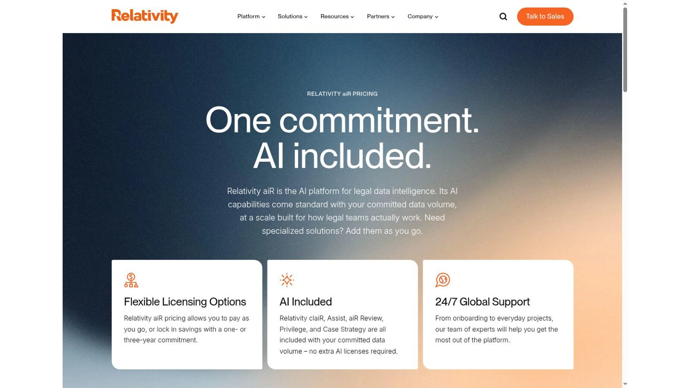
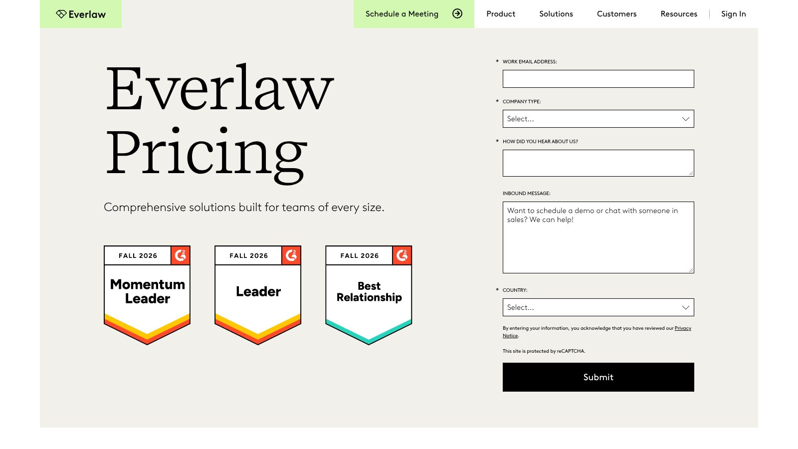
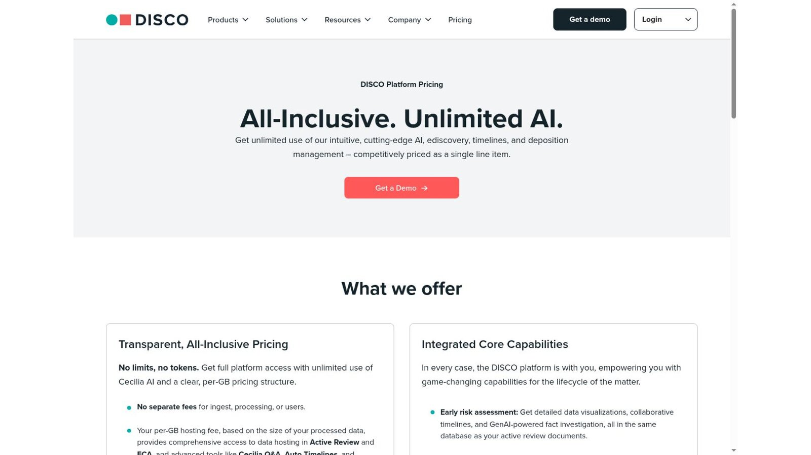
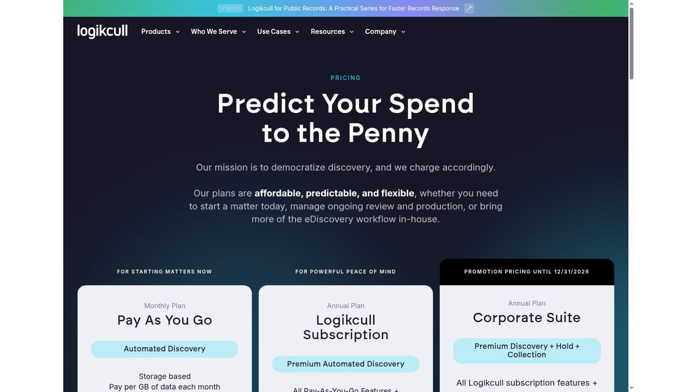
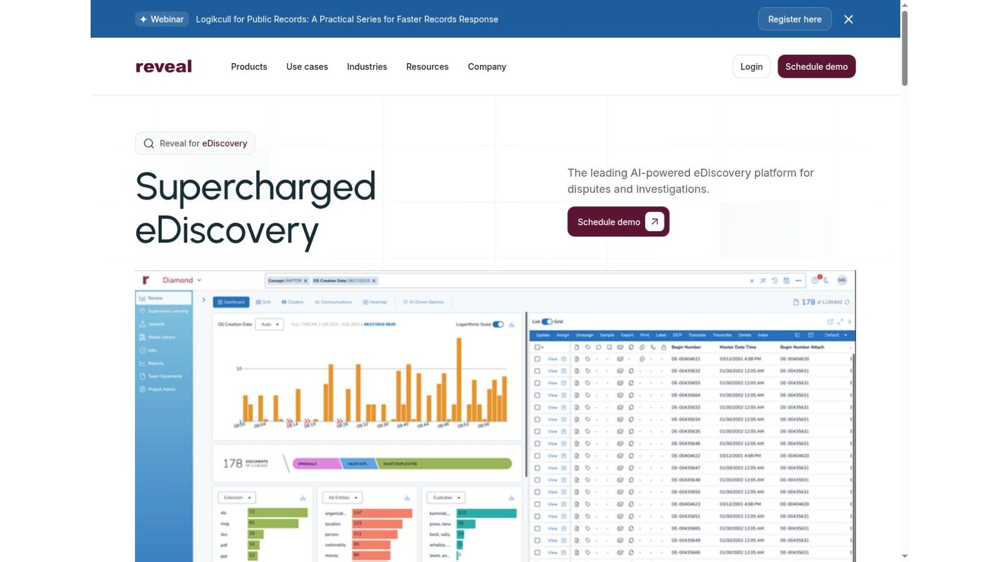
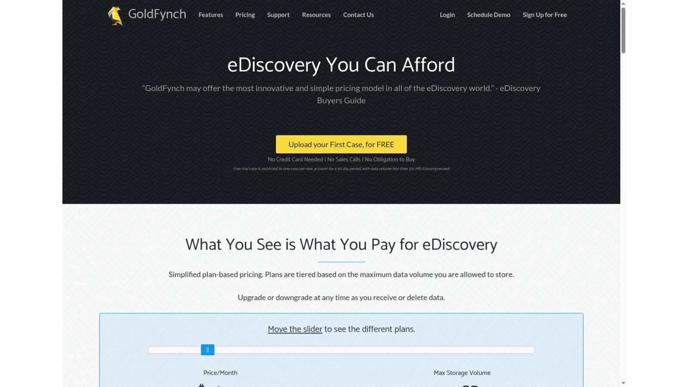
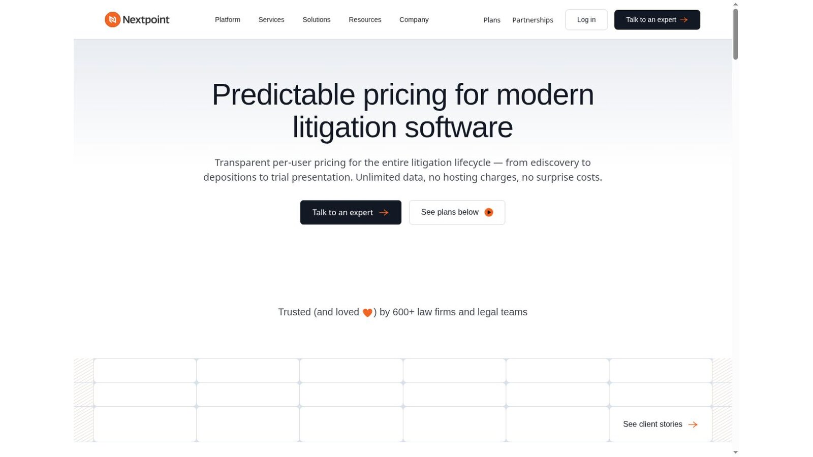
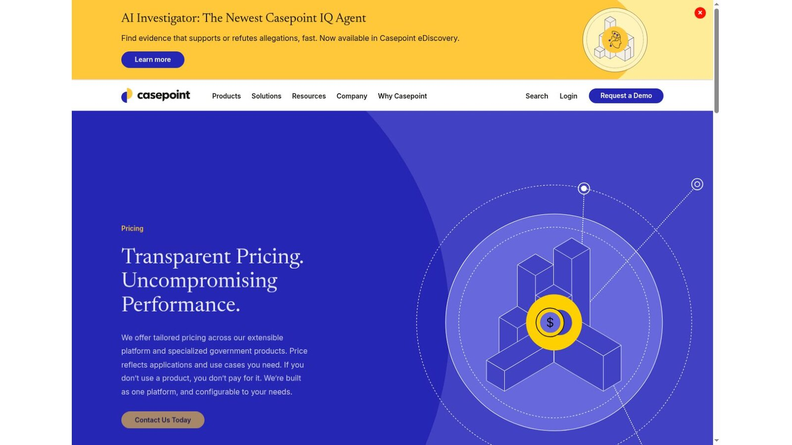
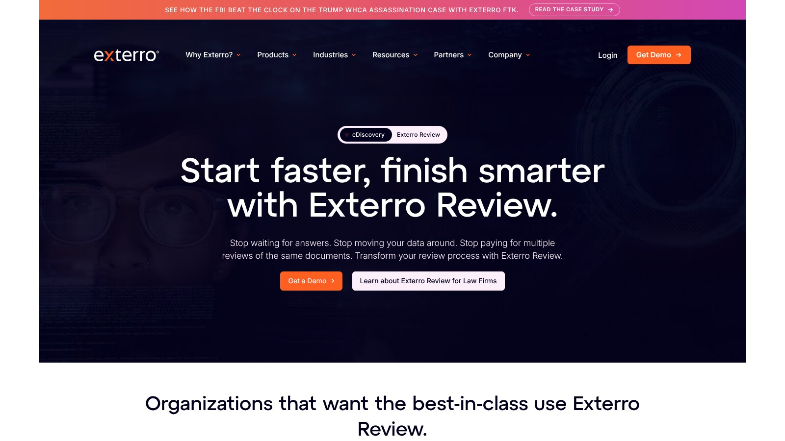
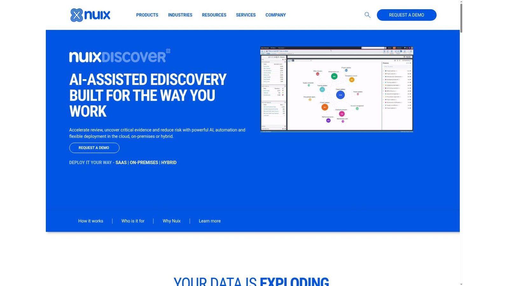

# 10 Best eDiscovery Software Platforms for Legal Teams

The best ediscovery software depends on your data size, your sources, and who will run each matter. RelativityOne, Everlaw, DISCO, Reveal, Casepoint, Exterro, and Nuix Discover serve complex and enterprise work. Logikcull, GoldFynch, and Nextpoint suit smaller teams that want self-service and simpler pricing.

Pricing models matter as much as features. Vendors charge by hosted gigabyte, by user, by case, or by commitment, and the same matter can cost very different amounts under each model.

No vendor paid to be included. We checked product facts and prices against official vendor pages and screenshots of those pages on November 5, 2026. We didn't test paid accounts or AI accuracy. This article is general information, not legal advice.

## Key Takeaways

- **Match the Platform to the Matter:** A small-case review tool and an enterprise governance suite solve different problems.
- **Know the Pricing Unit:** Per-GB, per-user, and per-case models reward different data and team sizes.
- **AI Needs Validation:** Test AI review on your own matter data, with sampling and documented checks.
- **Ask About Hidden Costs:** Processing, exports, services, and long-term hosting can sit outside the base price.
- **Plan the Ending:** Confirm how fast you can export a full matter and get certified deletion.

## Quick Comparison

The table compares the ten platforms by best fit, pricing model, and public price signal as shown on November 5, 2026.

| Platform | Best Fit | Pricing Model | Public Price Signal |
|---|---|---|---|
| RelativityOne | Complex enterprise matters | Pay as you go or 1- or 3-year commitments | Quote required |
| Everlaw | Collaborative cloud litigation | Subscription with unlimited user licenses | Quote required |
| DISCO | Cloud review with simple pricing | Per-GB hosting, no ingest or user fees | Quote required |
| Logikcull | Self-service matters | Pay per GB monthly or annual subscription | Quote required |
| Reveal | AI-supported review | Enterprise platform | Quote required |
| GoldFynch | Small cases | Tiered by stored data volume | Free first case under 512 MB; 10 GB for $76 a month |
| Nextpoint | Firms wanting per-user pricing | Per user with unlimited data | Quote required |
| Casepoint | Enterprise and government work | Tailored by applications | Quote required |
| Exterro | Legal holds through review | Integrated modules | Quote required |
| Nuix Discover | Flexible deployment | SaaS, on-premises, or hybrid | Quote required |

## How We Evaluated the Platforms

Search lists often put a small-case tool next to an enterprise suite without explaining the gap. We mapped each product against preservation, collection, processing, early case assessment, review, privilege, production, deployment, and pricing model.

We relied on official sources only. We didn't rank unverified accuracy claims or repeat old third-party prices.

## Three Common Pricing Models

Ediscovery software pricing usually follows one of three units. Knowing yours helps you compare quotes fairly.

### Per Gigabyte

You pay for the data you host each month. It suits matters with unpredictable team sizes but rewards culling data early.

### Per User

You pay for each reviewer seat, often with unlimited data. It suits steady teams with large or growing data sets.

### Per Case or Tier

You pay a set price for a data tier on each case. It makes small matters easy to budget.

## 1. RelativityOne: Best for Complex Enterprise Matters

Relativity's [aiR pricing page](https://www.relativity.com/pricing/) says you can pay as you go or lock in savings with a one- or three-year commitment. It says aiR Review, Privilege, and Case Strategy are included with your committed data volume, with no extra AI licenses required.

Pricing is by quote. Still model hosting, partner services, setup, and human validation.

**Best fit:** Large firms, corporations, and service providers running complex matters.

**Test:** Price one matter both ways, pay as you go and committed, at your expected data volume.

## 2. Everlaw: Best for Collaborative Cloud Litigation

Everlaw's pricing page lists unlimited user licenses, standard data migration, support, and training, and says AI is included. Some batch AI features use credits, while single-document coding suggestions don't. Pricing is by quote.

The platform covers upload, processing, search, review, and production, with tools for building the case story beside review.

**Best fit:** Litigation teams that want case preparation next to document review.

**Test:** Ask which AI tasks use credits and estimate credit use for one matter.

## 3. DISCO: Best for Simple Per-GB Pricing

The [DISCO pricing page](https://csdisco.com/offerings/platform/pricing) promises full platform access with unlimited use of its Cecilia AI and a per-GB pricing structure. It says there are no separate fees for ingest, processing, or users. The hosting fee is based on the size of your processed data.

Actual rates need a quote. Total cost still depends on data volume, hosting time, and any service work.

**Best fit:** Teams that want one easy-to-forecast pricing unit.

**Test:** Ask how quickly hosting fees drop when you remove data after early case assessment.

## 4. Logikcull: Best for Self-Service Matters

Logikcull's pricing page offers a pay-as-you-go plan that charges per GB of data each month and an annual subscription. It lists unlimited users, unlimited projects, and unlimited downloads.

A simple interface can reduce the need for a dedicated admin, though large or unusual data sets still need expertise.

**Best fit:** Small teams handling investigations and smaller matters themselves.

**Test:** Upload a mixed set with email, chat exports, and scans, then review the processing exception report.

## 5. Reveal: Best for AI-Supported Review

Reveal describes its platform as AI-powered eDiscovery for disputes and investigations, with built-in analytics for exploring data. Pricing is by quote.

AI can help prioritize a review set, but you need proof from your own matter. Build validation, sampling, and privilege checks into the review protocol.

**Best fit:** Teams that plan to rely on analytics and AI to shrink review sets.

**Test:** Run AI prioritization on a sample you've already coded by hand and compare the results.

## 6. GoldFynch: Best Transparent Option for Small Cases

GoldFynch's pricing page offers one free trial case per new account for 90 days, under 512 MB. Paid plans are tiered by stored data, and a 10 GB plan costs $76 a month with unlimited free users, processing, and productions. Above 300 GB, cases grow in 50 GB steps at $275 each.

That model makes small matters easy to budget. Estimate growth and long hosting periods before you commit.

**Best fit:** Small firms with small, well-defined matters.

**Test:** Price your largest likely case at its peak size and for its full hosting period.

## 7. Nextpoint: Best Per-User Model for Litigation Teams

Nextpoint's pricing page promises transparent per-user pricing, unlimited data, and no hosting charges. Its Essential plan includes unlimited cases and free data hosting. Exact prices are by quote.

Per-user pricing avoids surprise hosting bills, but team size still drives the total. Plan for temporary reviewers.

**Best fit:** Steady litigation teams with large or growing data.

**Test:** Ask how short-term contract reviewers are licensed and billed.

## 8. Casepoint: Best for Enterprise and Government Work

Casepoint's pricing page says it tailors pricing to your applications and use case. It lists security certifications including FedRAMP High, DOD IL5, and DOD IL6 authorizations.

Those credentials matter for government work, but match contract controls to your own data and rules.

**Best fit:** Government agencies and contractors with strict security needs.

**Test:** Ask for the authorization documents that cover your exact deployment.

## 9. Exterro: Best for Legal Holds Through Review

Exterro's eDiscovery page covers legal hold and preservation, with automated notifications for issuing and tracking holds, plus collection and Exterro Review. Pricing is by quote.

The suite suits organizations linking legal holds to data governance and review. It may be more platform than a small firm needs.

**Best fit:** Corporate legal teams that want holds, collection, and review in one place.

**Test:** Issue a test hold, collect from one custodian, and trace the data into review.

## 10. Nuix Discover: Best for Flexible Deployment

Nuix Discover supports SaaS, on-premises, and hybrid deployment. Its page describes an early case assessment case type where you ingest data at a lower per-GB rate before moving relevant data into full review. Pricing is by quote.

That two-stage setup can cut review volume when it's run carefully.

**Best fit:** Organizations that need on-premises or hybrid options for large matters.

**Test:** Run one data set through early case assessment and measure how much moves to full review.

## What a Small Case Costs on GoldFynch

GoldFynch is the only vendor here with public plan prices, so here is the arithmetic for one small case. It covers hosting only.

| Scenario | Published Rate | Calculation | Total |
|---|---|---|---|
| Trial case under 512 MB | Free for 90 days | One case per new account | $0 |
| 10 GB case for 6 months | $76 per month | 6 × $76 | $456 |
| 10 GB case for 12 months | $76 per month | 12 × $76 | $912 |

This is our calculation, not a vendor quote. Hosting time doubles the cost here, so closing matters promptly matters as much as the monthly rate.

## Choose by Matter Profile

Match ediscovery software to the matters you run most often.

- **Complex Enterprise Matters:** Start with RelativityOne, Everlaw, DISCO, Reveal, Casepoint, Exterro, and Nuix Discover.
- **Self-Service Work:** Compare Logikcull, GoldFynch, and Nextpoint.
- **Strict Security:** Shortlist vendors with the authorizations your contracts require.

Discovery runs on court deadlines, so pair your platform with the [legal calendaring software](/legal-tech/best-legal-calendaring-software/) we compared. For wider adoption context, see our [legal technology statistics](/legal-tech/legal-technology-statistics/).

## Questions to Include in an RFP

Ask every ediscovery software vendor these questions and get written answers.

1. Which file types, chat systems, cloud sources, and mobile sources are supported?
2. What is charged for collection, processing, hosting, AI, users, exports, and services?
3. How are processing exceptions and password-protected files reported?
4. How does the system keep families, threads, metadata, and native files?
5. What validation is available for analytics and generative AI?
6. Which security, data location, and audit terms are in the contract?
7. How quickly can the provider return or migrate a full matter?
8. How is certified deletion documented after the retention period?

## Frequently Asked Questions

### What Is eDiscovery Software?

Ediscovery software helps legal teams preserve, collect, process, search, review, redact, and produce electronically stored information for litigation, investigations, and regulatory work.

### How Is eDiscovery Software Priced?

Common models charge by hosted data, processed data, user, case, subscription, or a mix. Services, AI, migration, exports, and long-term storage may cost extra.

### What Is Early Case Assessment?

Early case assessment uses search, metadata, analytics, and sampling to understand a data set before full review. It helps with scoping, strategy, and cost estimates.

### Can AI Perform Legal Document Review?

AI can prioritize, classify, summarize, or find patterns. Counsel still needs documented validation, privilege controls, sampling, and human judgment.

### What Should a Small Firm Choose?

Start with data volume, sources, review team, and production needs. GoldFynch, Logikcull, and Nextpoint are worth comparing, but fit depends on the matter.

## Resources

- [Everlaw pricing](https://www.everlaw.com/pricing/)
- [Logikcull pricing](https://www.logikcull.com/pricing)
- [Reveal eDiscovery](https://www.revealdata.com/use-case/ediscovery)
- [GoldFynch pricing](https://goldfynch.com/pricing.html)
- [Nextpoint pricing](https://www.nextpoint.com/ediscovery-pricing)
- [Casepoint pricing](https://www.casepoint.com/pricing/)
- [Exterro eDiscovery](https://www.exterro.com/e-discovery-software)
- [Nuix Discover](https://www.nuix.com/solutions/nuix-discover)
