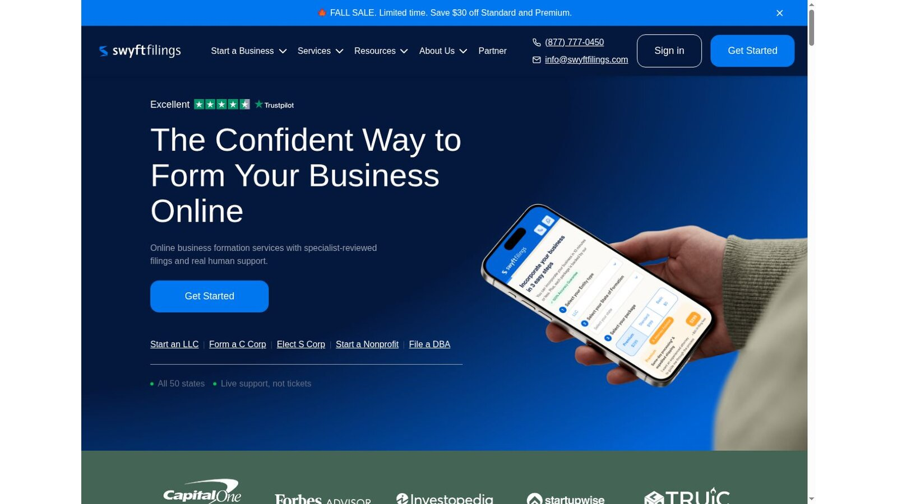
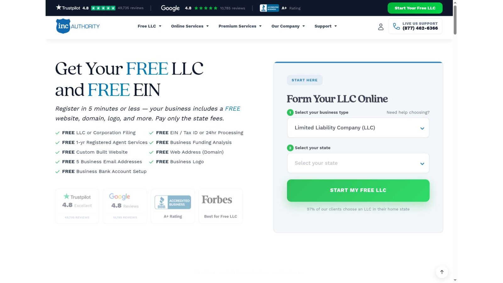
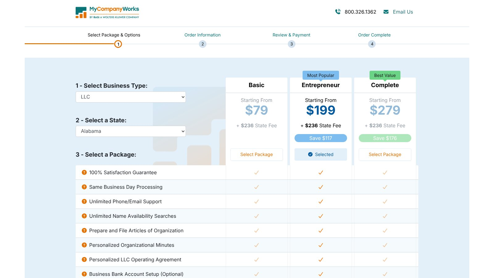

# Best LLC Formation Services: Providers Compared by Real Cost

The best LLC formation services for most owners are Northwest Registered Agent for long-term value, Bizee for the lowest first-year cost, and ZenBusiness Pro for a bundled paid package. The right pick depends on whether you need a registered agent, how long you plan to keep the company, and which extras you would buy anyway.

A $0 package can still cost hundreds of dollars once you add the state fee, a registered agent, and add-ons. This guide separates the first payment from the renewals that follow.

No provider paid to be included. We checked every price and claim against official provider and government pages on November 8, 2026. Where a page blocks automated readers, we checked a screenshot of the live page supplied by the site owner. We didn't buy accounts. This is general information, not legal or tax advice.

## Key Takeaways

- **State Fees Always Apply:** A $0 provider package removes the provider's charge, not the state filing fee.
- **Renewals Decide the Winner:** Registered agent renewals run from $119 to $249 a year among these providers, so the second year matters most.
- **EINs Are Free:** The IRS issues an EIN at no cost, so a paid EIN add-on only buys convenience.
- **BOI Reporting Changed:** FinCEN now exempts U.S. companies from beneficial ownership reporting, so skip any domestic BOI add-on.
- **Watch Preselected Trials:** Some checkouts add a free trial that renews monthly unless you remove it.

## Quick Comparison

The table compares the seven providers on entry price and registered agent cost. Prices were checked on November 8, 2026, and state fees are always extra.

| Service | Entry Formation Price | Registered Agent Position | Best For |
|---|---:|---|---|
| Northwest Registered Agent | $39 plus state fees | Included with formation; $125 a year standalone | Long-term value |
| Bizee | $0 plus state fees | First year free; $149 a year after | Lowest first-year cost |
| ZenBusiness | $0 plus state fees | $99 first year with formation, then $199 a year | Guided dashboard and bundles |
| LegalZoom | $0 plus state fees | $249 a year | Broad legal catalog |
| Swyft Filings | $0 plus state fees | Price shown during checkout | Clear processing tiers |
| Inc Authority | $0 plus state fees | First year free; renewal not clearly stated | First-year freebies |
| MyCompanyWorks | From $79 plus state fees | $119 a year | Lowest agent renewal |

We didn't rank providers by commission. Rankings reflect published pricing, recurring costs, scope, and how clearly each provider discloses renewals.

## Our Picks

Each pick fits a different owner. Read the cost check under each provider before you choose.

- **Best Overall:** Northwest Registered Agent.
- **Best First-Year Bundle:** Bizee.
- **Best Paid Package:** ZenBusiness Pro.
- **Best Legal Catalog:** LegalZoom.
- **Best Published Speed Tiers:** Swyft Filings.
- **Best First-Year Inclusions:** Inc Authority.
- **Best Agent Renewal Price:** MyCompanyWorks.

No provider controls state approval. Processing claims describe the provider's own handling time, and the state's review comes after.

## How We Compared LLC Formation Services

We used current provider and government pages only. We didn't claim hands-on use where none happened.

We scored each of the LLC formation services on entry price, first-year provider cost, registered agent renewal, EIN and operating agreement pricing, published handling time, recurring subscriptions, and how clearly it discloses pricing and cancellation. We gave more weight to recurring costs than to temporary discounts, and we never counted government filing fees as provider revenue.

Demand for these services is high. The Census Bureau reported 534,947 seasonally adjusted business applications in September 2026, according to its [Business Formation Statistics](https://www.census.gov/econ/bfs/current/index.html). That counts applications, not completed LLCs, but it explains why so many providers compete on low entry prices.

## 1. Northwest Registered Agent: Best Overall

Northwest's LLC page lists formation at $39 plus state fees. The page also lists same day processing, registered agent service, compliance reminders, and the option to use Northwest's address instead of yours where the service allows.

Its standalone registered agent service costs $125 a year, according to its registered agent page. That is below ZenBusiness and LegalZoom, and it avoids a $0 headline followed by a higher renewal.

**Best fit:** Owners who need a professional registered agent and plan to keep the LLC for years.

**Watch for:** Less value if you already have a qualifying agent.

## 2. Bizee: Best First-Year Bundle

Bizee lists Basic at $0, Standard at $199, and Premium at $299, each plus the state fee. Every package includes one free year of registered agent service.

Bizee's registered agent page lists the standalone service at $149 a year. So the second year brings a $149 bill if you keep Bizee as your agent.

**Best fit:** Owners who want the lowest first-year provider cost with an agent included.

**Watch for:** The $149 renewal starting in year two.

## 3. ZenBusiness: Best Paid Package

ZenBusiness Starter costs $0 plus state fees and lists standard processing of 7 to 10 business days. Pro costs $199 and renews at $199 a year. It adds 1-day processing, an EIN, an operating agreement template, and its Worry-Free Compliance service.

On Starter, the EIN and the operating agreement are $99 add-ons each, so buying both nearly matches Pro. The pricing page also says Starter preselects a 30-day free trial of a website builder that renews at $15 a month unless you remove it.

**Best fit:** Owners who want a guided dashboard and bundled setup documents.

**Watch for:** Pro plus a $199 registered agent creates $398 in yearly renewals.

## 4. LegalZoom: Best Legal Catalog

LegalZoom Basic costs $0 plus state fees and files your articles of organization. Pro costs $249 and adds an operating agreement, an EIN, and 30 days of attorney consultations through its Business Attorney Plan.

LegalZoom says that plan auto-renews at $49 a month after 30 days unless you cancel. Its registered agent service costs $249 a year, the highest standard rate in this group.

**Best fit:** Owners who expect to buy other legal services from one company.

**Watch for:** A Pro and agent basket reaches $498 before state fees.

## 5. Swyft Filings: Best Published Speed Tiers

Swyft Filings lists Basic at $0 with processing in 7 to 10 business days. During its current fall sale, Standard shows $169 instead of $199 with processing in 3 business days, and Premium shows $269 instead of $299.

The public page doesn't show a registered agent price we could confirm. Check the annual price and renewal at checkout and save a copy of that screen.

**Best fit:** Owners comparing provider handling times.

**Watch for:** Sale prices that may end, and an agent price shown only at checkout.

## 6. Inc Authority: Best First-Year Inclusions

Inc Authority advertises a free LLC filing, a free EIN, and one free year of registered agent service, with the buyer paying only state fees. The page also promotes a free website, domain, and logo.

The page notes annual renewal fees but didn't state the agent renewal clearly in the text we checked. Without that number, a multi-year total isn't possible, so ask for it in writing before you order.

**Best fit:** Buyers focused on first-year inclusions.

**Watch for:** An unclear renewal price for the registered agent.

## 7. MyCompanyWorks: Best Agent Renewal Price

MyCompanyWorks lists Basic from $79, Entrepreneur from $199, and Complete from $279, each plus state fees. Its order page lists same business day processing and registered agent service at $119 a year.

That $119 rate is the lowest published agent price in this group. Optional EIN and forms products add cost, so compare tiers carefully.

**Best fit:** Buyers who value fast provider handling and a lower agent renewal.

**Watch for:** A higher entry price than the $0 providers.

## What a Two-Year Provider Bill Looks Like

Here is our arithmetic for one LLC that needs a professional registered agent for two years. It covers provider charges only, with no state fee or optional products.

| Provider | Year 1 | Year 2 | Two-Year Total |
|---|---:|---:|---:|
| Bizee Basic | $0 | $149 agent | $149 |
| Northwest | $39 | $125 agent | $164 |
| MyCompanyWorks Basic plus agent | $79 + $119 | $119 agent | $317 |
| ZenBusiness Starter plus agent | $0 + $99 | $199 agent | $298 |
| LegalZoom Basic plus agent | $0 + $249 | $249 agent | $498 |

This is our calculation, not a quote. It assumes Northwest's formation price covers the first agent year, as its LLC page lists agent service in the package. By year three, Northwest's $125 renewal overtakes Bizee's $149.

## Government Fees Still Set the Baseline

Every LLC owes its state's required formation fee. A free LLC offer only removes the provider's preparation charge.

The state fee varies widely. Florida charges $125, Wyoming charges $100, and Texas charges $300. Our state guides break down each one: the [Florida LLC formation services](/legal-business/florida-llc-formation-services/) comparison covers the $400 late annual report fee, the [Wyoming LLC formation services](/legal-business/wyoming-llc-formation-services/) guide covers the annual license tax, and the [Texas LLC formation services](/legal-business/texas-llc-formation-services/) guide covers Texas Express and franchise tax.

## Don't Pay for an EIN Before Checking the Free Route

The IRS says its online tool lets you get an EIN directly from the IRS in minutes for free. A provider fee buys convenience, not a special filing right.

International owners may need the IRS phone, fax, or mail process. Read the [IRS EIN page](https://www.irs.gov/businesses/small-businesses-self-employed/get-an-employer-identification-number) before choosing an add-on.

## Check Current BOI Guidance

FinCEN updated its guidance on August 11, 2026. Its [BOI page](https://www.fincen.gov/boi) says U.S. companies are exempt from beneficial ownership information reporting. Older formation guides that tell domestic LLCs to file are now out of date.

Certain foreign companies registered in the United States may still have duties. Check FinCEN's page before buying any BOI filing service.

## Registered Agents Deserve Their Own Comparison

Many owners buy a registered agent with formation and never compare it again. Since the agent fee repeats every year, it's often the largest provider cost you will pay.

Our [registered agent services](/legal-business/best-registered-agent-services/) comparison prices one-year and three-year totals across eight providers. Wyoming owners should also compare [Wyoming registered agent services](/legal-business/wyoming-registered-agent-services/), since the state sets specific recordkeeping duties.

## Brand Comparisons and Reviews

If you have narrowed the field to two big names, our head-to-head pieces go deeper. See [ZenBusiness vs LegalZoom](/legal-business/zenbusiness-vs-legalzoom/) for formation baskets and renewals, or read the full [LegalZoom review](/legal-business/legalzoom-review/) and the [ZenBusiness review](/legal-business/zenbusiness-review/) for product-by-product verdicts.

Some owners forming a business are also planning their estate. Our [Trust & Will vs LegalZoom](/legal-business/trust-and-will-vs-legalzoom/) comparison covers wills, trusts, and attorney support.

## When Direct Filing Is the Better Choice

A formation service may be unnecessary for a simple, single-owner company. State websites provide forms and instructions.

Direct filing can work when you understand the entity choice, have a qualifying registered agent, can follow state instructions, and can get an EIN yourself. Ownership agreements, tax elections, regulated work, and investors add complexity that may call for a lawyer or tax professional.

## Frequently Asked Questions

### What Are the Best LLC Formation Services?

Northwest offers strong long-term value when you need a registered agent. Bizee has the lowest first-year provider cost. ZenBusiness Pro bundles common setup documents. The best of the LLC formation services for you depends on your agent needs and how long you will keep the company.

### Are $0 LLC Services Really Free?

They waive the provider's basic preparation fee. The state filing fee still applies, and add-ons and renewals can cost more.

### Do I Need a Registered Agent Service?

You need a qualifying registered agent. You may serve as your own if your state allows it and you meet its address rules.

### Should I Pay for an EIN?

Not necessarily. The IRS issues EINs for free online. A paid service may save time, but the federal application itself has no fee.

### Do LLC Formation Services Give Legal Advice?

Most LLC formation services prepare and file forms. Attorney plans or consultations have separate scopes, terms, and renewals.

## Resources

- [Northwest LLC service](https://www.northwestregisteredagent.com/llc)
- [Northwest registered agent pricing](https://www.northwestregisteredagent.com/registered-agent)
- [Bizee pricing](https://bizee.com/pricing)
- [Bizee registered agent pricing](https://bizee.com/business-management/registered-agent)
- [ZenBusiness formation plans](https://www.zenbusiness.com/pricing-formation-plans/)
- [ZenBusiness registered agent](https://www.zenbusiness.com/registered-agent/)
- [LegalZoom LLC plans](https://www.legalzoom.com/business/business-formation/llc-overview.html)
- [LegalZoom registered agent](https://www.legalzoom.com/business/business-operations/registered-agent-overview.html/)
- [Swyft Filings](https://www.swyftfilings.com/)
- [Inc Authority](https://www.incauthority.com/)
- [MyCompanyWorks order page](https://secure.mycompanyworks.com/oms/order-b.php?entityId=2&stateId=2)
