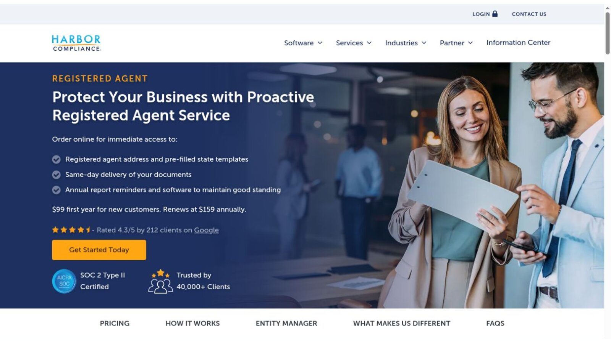
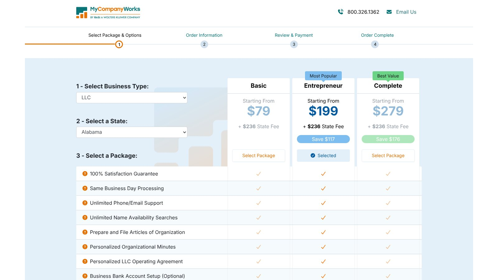
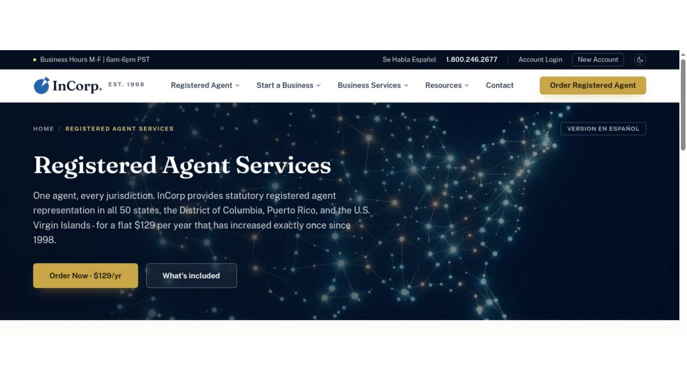
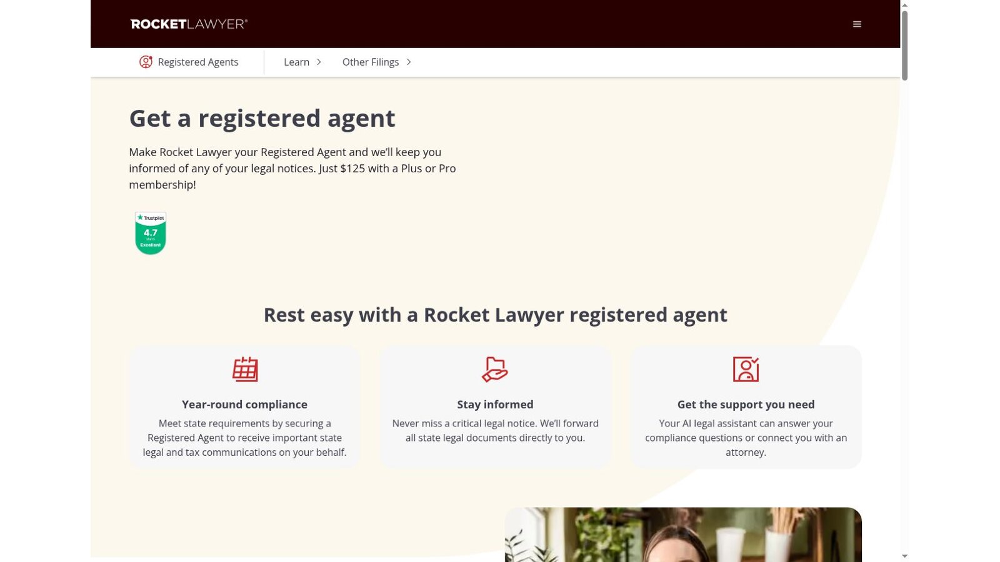
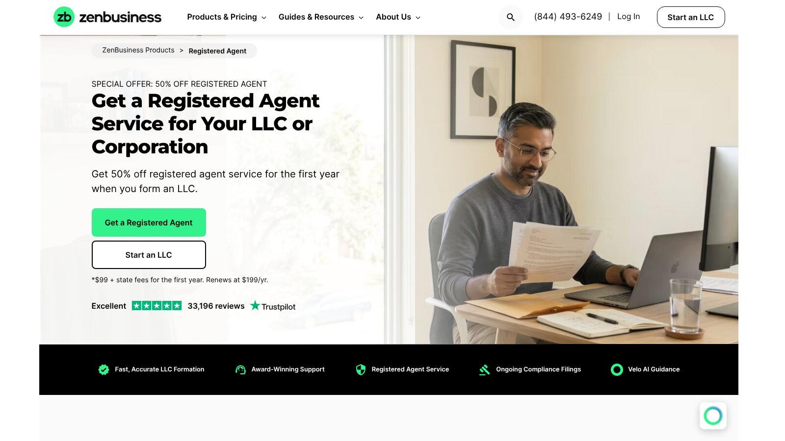

# Best Registered Agent Services: National Providers Compared

The best registered agent services depend on how long you'll keep the company. Harbor Compliance has the lowest introductory price at $99. MyCompanyWorks has the lowest flat yearly rate at $119. Northwest offers a simple $125 flat price, and InCorp is cheapest if you prepay three years or more.

An introductory rate can lose its edge after renewal. This comparison prices the first year and the following years, then checks document delivery, coverage, and switching help.

No provider paid to be included. We checked every price against official provider and government pages on November 8, 2026. Where a page blocks automated readers, we checked a screenshot of the live page supplied by the site owner. This is general information, not legal advice.

## Key Takeaways

- **Renewal Beats Intro Price:** The cheapest first year isn't always the cheapest three years.
- **Membership Costs Count:** A low agent fee that requires a paid membership can cost more overall.
- **Prepaying Saves Money:** InCorp's five-year rate drops to $87 a year, but you pay the full term up front.
- **An Agent Is Not a Mailbox:** A registered agent receives legal notices, not all of your business mail.
- **Avoid Coverage Gaps:** File the state change form before you cancel your old agent.

## Quick Comparison

The table shows each provider's public first-year price and renewal terms as of November 8, 2026. Prices generally apply per entity, per state.

| Provider | First-Year Public Price | Renewal or Condition | Best For |
|---|---:|---|---|
| Harbor Compliance | $99 | $159 a year | Low introductory price |
| MyCompanyWorks | $119 | $119 a year | Low flat yearly price |
| Northwest Registered Agent | $125 | $125 a year | Simple flat pricing |
| InCorp | $129 | Lower with multi-year prepayment | Prepaid savings |
| Rocket Lawyer | $125 | Requires Plus or Pro membership | Existing members |
| Bizee | Free with formation | $149 a year | Formation customers |
| ZenBusiness | $99 with formation | $199 a year | ZenBusiness users |
| LegalZoom | $249 | $249 a year | LegalZoom users |

Government fees for changing agents may apply separately. Prices can change after publication.

## What a Registered Agent Does

A registered agent receives service of process and official notices for a business at a physical address in the state. It doesn't automatically give you a general business mailbox, and it doesn't replace a lawyer or accountant.

States spell out the address rules. The [Texas registered agent FAQs](https://www.sos.state.tx.us/corp/registeredagentfaqs.shtml) require a street address where process can be personally served on the agent during normal business hours. The [Wyoming registered agent FAQs](https://sos.wyo.gov/faqs.aspx?root=RAO) say post office boxes, drop boxes, virtual addresses, mail forwarding locations, and UPS or FedEx stores don't qualify.

## How We Compared Providers

We used official product pages and state sources, and no ranking relied on commission. We weighed first-year price, renewal price, multi-year total, national coverage, document scanning and alerts, service of process handling, compliance reminders, switching help, membership requirements, and pricing transparency.

We didn't treat privacy marketing as full anonymity. State records may still show owners, managers, organizers, or addresses.

## 1. Harbor Compliance: Best Introductory Price

The [Harbor Compliance registered agent page](https://www.harborcompliance.com/registered-agent-service) lists $99 for the first year for new customers, renewing at $159 a year. It lists same-day document delivery, phone notice when service of process arrives, annual report reminders, and pre-filled state templates.

At those rates, three years cost $417: $99 plus two renewals at $159. That makes Harbor cheapest in year one but not over three years.

**Best fit:** Owners who want a low first year and multi-entity tools.

**Watch for:** The jump to $159 at renewal.

## 2. MyCompanyWorks: Best Flat Yearly Price

MyCompanyWorks lists registered agent service at $119 a year on its order page, with the same price shown for later years. That's the lowest standard yearly rate among these registered agent services.

Confirm how documents are delivered and how switching works before ordering, since the order page focuses on formation.

**Best fit:** Owners who want a low flat rate without a membership.

**Watch for:** Fewer published details on delivery and switching.

## 3. Northwest Registered Agent: Best Simple National Option

Northwest lists registered agent service at $125 per year. Its page lists free mail scanning, with instant scans of state and legal mail in your online account.

Three years cost $375 at the published flat rate. That's easy to budget compared with changing promotions.

**Best fit:** Owners who value predictable renewal pricing.

**Watch for:** Slightly higher than MyCompanyWorks each year.

## 4. InCorp: Best Prepaid Discount

InCorp lists a flat $129 a year in every state and territory. Prepaid rates fall to $117 a year for two years, $105 for three, $96 for four, and $87 for five.

The three-year option totals $315 and the five-year option totals $435. InCorp also lists same-day scanning and delivery of legal documents.

**Best fit:** Established businesses comfortable paying several years up front.

**Watch for:** Less flexibility if you close or move the company early.

## 5. Rocket Lawyer: Best for Existing Members

Rocket Lawyer's registered agent page offers the service for $125 with a Plus or Pro membership. Rocket Lawyer blocks automated readers, so we checked this page from a screenshot, and we couldn't confirm the current membership prices.

For an existing member, only the $125 agent fee is new. For anyone else, the required membership raises the real cost well above the agent fee.

**Best fit:** People already paying for a Rocket Lawyer membership.

**Watch for:** The membership cost if you join only for the agent.

## 6. Bizee: Best Formation Bundle

Bizee includes one free year of registered agent service with each formation package. Its registered agent page lists the standalone service at $149 a year after that.

That creates a low first-year total for a new company. The advantage shrinks once the renewal starts.

**Best fit:** New businesses forming with Bizee.

**Watch for:** Existing businesses pay the full $149 from year one.

## 7. ZenBusiness: Best Integrated Dashboard

ZenBusiness offers 50% off the first year when you form an LLC, making it $99, then $199 a year. It lists document receipt, secure digital delivery, and email alerts.

The promotional first year plus two renewals totals $497. Without the promotion, three years cost $597.

**Best fit:** Owners already using the ZenBusiness dashboard.

**Watch for:** One of the higher renewal rates here.

## 8. LegalZoom: Best Broad Legal Account

LegalZoom lists registered agent service at $249 a year. It sends alerts when official mail arrives and reminders before annual report deadlines.

Its page also says it completes all paperwork needed to switch agents and covers the state fees. Three years cost $747, the highest standard total in this group.

**Best fit:** Owners who want one account for several legal products.

**Watch for:** The highest yearly price among these providers.

## First Year Versus Three-Year Cost

Registered agent fees repeat every year, so a three-year view gives a truer picture. Here is our arithmetic using each provider's published rates.

| Provider | Three-Year Total | Condition |
|---|---:|---|
| InCorp | $315 | Three years prepaid |
| MyCompanyWorks | $357 | Current $119 flat rate |
| Northwest | $375 | Current $125 flat rate |
| Harbor Compliance | $417 | $99 first year, then $159 a year |
| ZenBusiness | $497 | $99 formation offer, then $199 a year |
| LegalZoom | $747 | Current $249 rate |

This is our calculation, not a quote. Rocket Lawyer is left out because its required membership changes the total, and Bizee's free year depends on forming with Bizee.

## Questions to Ask Before You Buy

Published prices only tell part of the story. Before you pick between registered agent services, put these questions to each provider and keep the answers with your company records.

1. How fast does a scanned document appear in your account after it arrives?
2. How will you alert me when service of process arrives, and is phone or text escalation included?
3. Are scanning and physical forwarding limited or charged separately?
4. What is the renewal price, and when will I be billed?
5. How do I cancel, and how long can I download old documents afterward?
6. Will you prepare the state change form if I switch to you?

Speed matters most with lawsuits. A missed or late notice can lead to a default judgment, so a provider that calls you when legal papers arrive is worth more than one that only sends an email. Compare registered agent services on how they handle urgent mail, not just on price.

## Can You Serve as Your Own Registered Agent?

Many states let an owner serve as the agent if they meet the state's rules. That removes the provider fee.

Serving yourself can work when you have:

- **A Qualifying Address:** A physical street address in the state.
- **Steady Availability:** Someone present during business hours.
- **Comfort Going Public:** Your address appears in public records.
- **A Plan for Urgent Papers:** A way to act fast on a lawsuit or notice.
- **A Stable Location:** No frequent travel or moves.

Professional registered agent services help remote owners, companies in several states, and people who want their home address out of the agent field.

## Switching Providers Without a Gap

Buying a new service doesn't always update the state record. A separate change filing may be needed.

Before you switch, confirm these points:

1. Who prepares the change form.
2. Who pays the government fee.
3. When the new agent starts.
4. When the old service ends.
5. How you'll keep access to old documents.

Avoid a gap in coverage. In Texas, the Secretary of State warns that failing to maintain a registered agent may lead to involuntary termination of a domestic entity.

## Pairing an Agent With Formation

Many owners buy an agent at the same time they form the LLC. Our comparison of [LLC formation services](/legal-business/best-llc-formation-services/) shows how bundled agent years change first-year totals. Florida owners should also check our [Florida LLC formation services](/legal-business/florida-llc-formation-services/) guide, which covers the state's agent rules and its $400 late fee.

## Frequently Asked Questions

### What Are the Cheapest Registered Agent Services?

Harbor has the lowest introductory price at $99. MyCompanyWorks has the lowest standard yearly rate at $119. InCorp is cheapest if you prepay three years.

### Is a Registered Agent the Same as a Virtual Mailbox?

No. Registered agent services receive official notices and service of process. General mail forwarding usually needs a separate product.

### Can I Use a Post Office Box?

Generally no. Wyoming says post office boxes and virtual addresses don't qualify, and Texas requires a street address where process can be served in person.

### Does a Registered Agent File Annual Reports?

Not automatically. Some services send reminders, but filing may need a separate service and a government fee.

### Can I Change Registered Agents Later?

Yes. File your state's change document, pay any required fee, and line up the dates to avoid a gap.

## Resources

- [MyCompanyWorks order page](https://secure.mycompanyworks.com/oms/order-b.php?entityId=2&stateId=2)
- [Northwest registered agent](https://www.northwestregisteredagent.com/registered-agent)
- [InCorp registered agent](https://www.incorp.com/registered-agent-services)
- [Rocket Lawyer registered agent](https://www.rocketlawyer.com/registered-agent)
- [Bizee registered agent](https://bizee.com/business-management/registered-agent)
- [ZenBusiness registered agent](https://www.zenbusiness.com/registered-agent/)
- [LegalZoom registered agent](https://www.legalzoom.com/business/business-operations/registered-agent-overview.html/)
