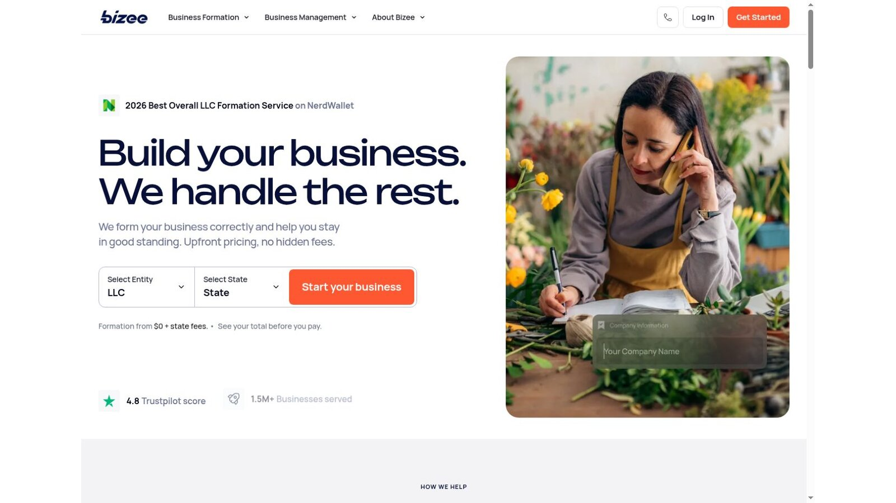
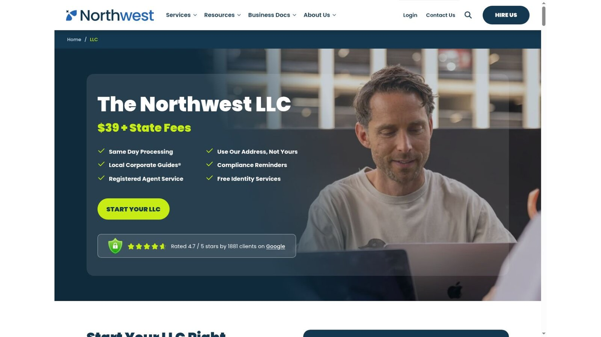
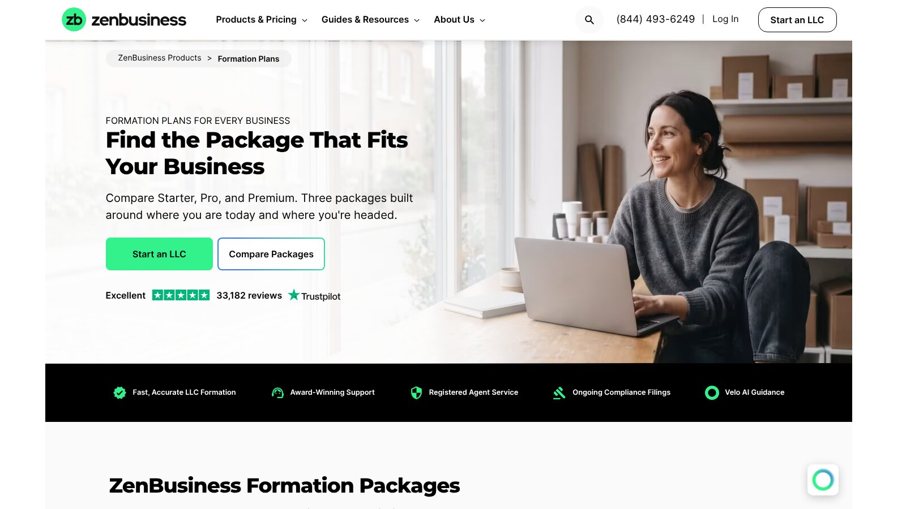
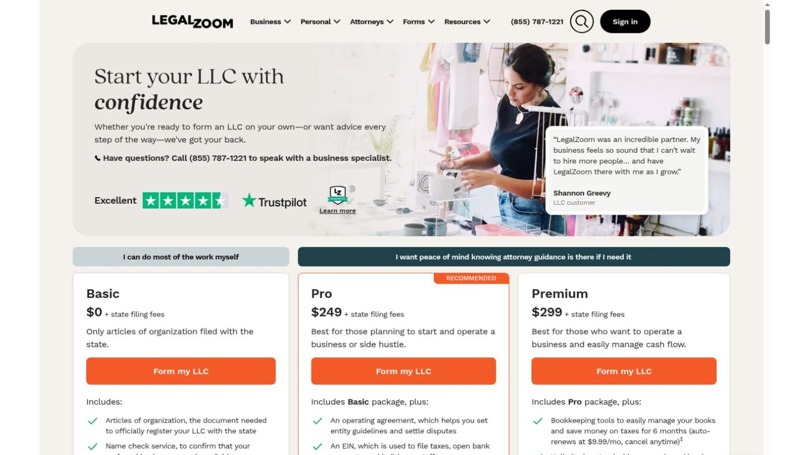
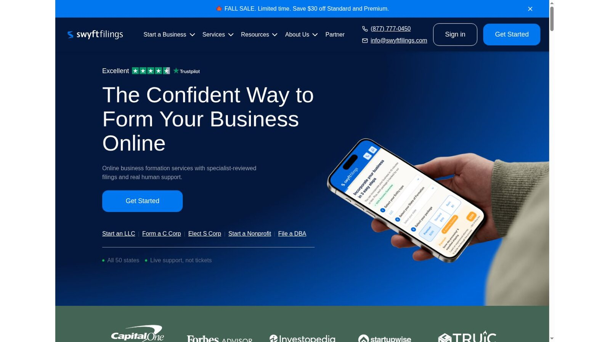

# Best Florida LLC Formation Services: Fees and Providers Compared

Among Florida LLC formation services, Bizee has the lowest first-year provider cost, Northwest has the cheaper long-term agent renewal, and ZenBusiness Pro is the strongest paid bundle. None of them can remove Florida's $125 filing charge.

The bigger Florida cost often comes later. The annual report costs $138.75, and filing after May 1 adds a $400 late fee, more than three times the cost of forming the company.

No provider paid to be included. We checked every price and fee against official provider pages and the Florida Division of Corporations on November 8, 2026. This is general information, not legal or tax advice.

## Key Takeaways

- **The State Fee Is $125:** That's $100 for the articles plus $25 for the registered agent designation.
- **May 1 Is the Real Deadline:** Filing the annual report after May 1 adds a $400 late fee.
- **The Agent Needs a Florida Street Address:** A post office box or out-of-state address isn't accepted.
- **Bizee Wins Year One, Northwest Wins Later:** Their agent renewals differ by $24 a year.
- **The LLC Can't Be Its Own Agent:** A member or manager may serve instead.

## Florida LLC Cost Snapshot

Florida's official charges should always appear separately from provider fees. These come straight from the [Sunbiz LLC filing instructions](https://efile.sunbiz.org/llc_filing_help.html) and its annual report help page.

| Cost | Amount |
|---|---:|
| Articles of organization | $100 |
| Registered agent designation | $25 |
| Minimum formation total | $125 |
| Annual report filed January 1 to May 1 | $138.75 |
| Late fee after May 1 | $400 |
| Certified copy (optional) | $30 |
| Certificate of status (optional) | $5 |

These are government fees. A provider's preparation charge sits on top of them.

## Quick Provider Comparison

The table adds Florida's $125 formation fee to each provider's entry price. Prices were checked on November 8, 2026, and optional products are excluded.

| Provider | Formation Service | First-Year Total | Registered Agent Position |
|---|---:|---:|---|
| Bizee | $0 | $125 | First year free, then $149 a year |
| Northwest | $39 | $164 | Included with formation, $125 a year standalone |
| ZenBusiness Starter | $0 | $125 | $99 first year with formation, then $199 |
| LegalZoom Basic | $0 | $125 | $249 a year |
| Swyft Filings Basic | $0 | $125 | Price shown at checkout |

The totals leave out EIN, operating agreement, expedited, and subscription products.

## Our Florida Picks

Each provider wins a different category among Florida LLC formation services.

- **Best First-Year Price With an Agent:** Bizee.
- **Best Long-Term Agent Renewal:** Northwest.
- **Best Paid Document Bundle:** ZenBusiness Pro.
- **Best Wider Legal Catalog:** LegalZoom.
- **Best Published Speed Tiers:** Swyft Filings.

Florida owners who qualify as their own agent can file directly for $125, which avoids any provider charge.

## Florida's Registered Agent Rules

Sunbiz says the registered office must be a Florida street address, and a post office box or an address outside Florida isn't acceptable. The LLC can't serve as its own registered agent, but a manager, member, or managing member may be listed instead.

Under [Florida Statutes section 605.0113](https://www.leg.state.fl.us/statutes/index.cfm?App_mode=Display_Statute&URL=0600-0699/0605/Sections/0605.0113.html), an individual agent must reside in Florida, or the agent can be an entity authorized to do business there. The statute also requires the agent to forward process, notices, and demands to the company.

## 1. Bizee: Best First-Year Price

Bizee lists Basic at $0 plus state fees, and every package includes one free year of registered agent service. For a new Florida LLC, the starting total is just the $125 state fee.

Bizee's registered agent page lists the service at $149 a year after that. Mark the renewal date when you order, and decide before then whether you'll keep Bizee or switch to a cheaper agent for year two.

**Best fit:** First-time owners who need an agent and want the lowest starting cost.

## 2. Northwest: Best Long-Term Agent Renewal

Northwest charges $39 plus state fees and lists registered agent service in its LLC package. Its standalone agent service costs $125 a year.

The first-year Florida total starts at $164, which is $39 more than Bizee. But the renewal is $24 cheaper each year, so Northwest pulls ahead the longer you keep the company.

**Best fit:** Owners planning to keep a commercial agent for three years or more.

## 3. ZenBusiness: Best Paid Bundle

ZenBusiness Starter costs $0 plus state fees with standard processing of 7 to 10 business days. Pro costs $199, renews at $199 a year, and adds 1-day processing, an EIN, and an operating agreement template.

Registered agent service costs $99 for the first year with formation, then $199 a year. Starter also preselects a website-builder trial that renews at $15 a month unless you remove it.

**Best fit:** Owners who want documents and compliance tools in one dashboard.

## 4. LegalZoom: Best Wider Legal Catalog

LegalZoom Basic costs $0 plus state fees. Pro costs $249 and includes an EIN, an operating agreement, and 30 days of attorney consultations that auto-renew at $49 a month unless canceled.

Registered agent service costs $249 a year. A Florida owner who only needs formation can spend less elsewhere, especially once the agent renewal and any continued attorney plan are added up over two or three years.

**Best fit:** Owners who expect to use other legal products.

## 5. Swyft Filings: Best Published Speed Tiers

Swyft Filings Basic costs $0 plus state fees with processing in 7 to 10 business days. Its current fall sale lists Standard at $169, normally $199, with processing in 3 business days.

The registered agent price appears inside the order flow, so confirm it before you pay.

**Best fit:** Owners comparing provider handling speeds.

## What to Look for in Florida LLC Formation Services

Florida's own process is simple and cheap, so a provider has to earn its fee with something the state doesn't give you. Judge Florida LLC formation services on four points.

### Renewal Transparency

The agent renewal is the cost you'll pay every year. A provider should show it before checkout, not after. Bizee, Northwest, ZenBusiness, and LegalZoom all publish theirs, while Swyft shows its agent price only inside the order flow.

### Annual Report Support

The $400 late fee makes deadline help genuinely useful in Florida. Ask whether a reminder is all you get, or whether the provider will file the report for you and at what price. A reminder alone still leaves the filing and the $138.75 fee to you.

### Address Handling

Florida filings list several addresses, including the principal office, the mailing address, and the registered office. Ask which of those fields a provider's address can replace. A commercial agent can keep your home address out of the agent field, but it can't keep every name and address off the public record.

### Honest Speed Claims

Some Florida LLC formation services sell faster processing. Since Sunbiz currently reviews online filings in two to three days, a provider's speed upgrade mostly shortens its own queue. Ask exactly what the faster tier changes before you pay for it.

## Florida Processing Time

The [Sunbiz online filing notice](https://efile.sunbiz.org/disclaimer.html) says that, due to its current heavy workload, processing an online document may take two to three days once payment is confirmed. That timing can change.

Provider handling comes before the state's review. Paying a provider for speed may not shorten the state's part, so check Sunbiz before you pay extra.

## The Annual Report Is the Bigger Deadline Risk

Florida requires every LLC to file an annual report to stay active, and an LLC that fails to file will be administratively dissolved. Sunbiz says the first report is due January 1 of the calendar year after the company forms.

Reports filed between January 1 and May 1 cost $138.75. After May 1, a $400 late fee applies. Don't assume a compliance reminder includes the filing itself or the state fee, so confirm what each service covers.

## Choosing an Effective Date

Sunbiz lets you name a specific effective date in the articles. The date can't be more than five business days before, or 90 days after, the filing date.

The company doesn't exist until its effective date, so a later date isn't right for every owner. If you form near year-end, ask a professional how the date affects your first report and taxes, and don't let a provider pick a date without telling you.

## A Two-Year Florida Cost Example

Here is our arithmetic for a company that needs a commercial registered agent for two years and files its first annual report on time. It leaves out optional products.

| Item | Bizee Basic | Northwest |
|---|---:|---:|
| Year 1 provider and state fee | $125 | $164 |
| Year 2 agent renewal | $149 | $125 |
| First annual report | $138.75 | $138.75 |
| Two-year total | $412.75 | $427.75 |

This is our calculation, not a quote. Bizee is $15 cheaper over two years, but Northwest becomes cheaper in year three because its renewal is lower. A single late annual report would add $400 to either total.

## EIN and BOI Checks

The IRS issues EINs directly at no cost through its online tool. Compare that free route before buying an EIN add-on.

FinCEN's guidance, updated August 11, 2026, says U.S. companies are exempt from beneficial ownership information reporting. Certain foreign companies registered in the United States may still have duties.

## Direct Filing Versus a Service

Direct filing can suit a simple Florida LLC. The Sunbiz instructions explain the names, addresses, agent acceptance, and filing details you'll need.

A service may help when you:

- **Lack a Florida Agent:** You need a qualifying Florida street address.
- **Want Prep Support:** You'd rather not complete state forms yourself.
- **Need Reminders:** You want help tracking the May 1 deadline.
- **Value One Account:** You want records stored in one place.

Legal and tax advice stay separate. Multi-owner agreements and regulated work deserve professional review. If two or more people will own the company, settle voting, profit splits, and what happens when someone leaves before you file, because a generic operating agreement template rarely covers those choices well.

## How Florida Compares

Florida's $125 formation fee sits between Wyoming's $100 and Texas's $300. Our national guide to [LLC formation services](/legal-business/best-llc-formation-services/) compares all seven providers, and owners weighing a lower-fee state can read our [Wyoming LLC formation services](/legal-business/wyoming-llc-formation-services/) guide, which explains when forming outside your home state adds cost.

## Frequently Asked Questions

### How Much Does a Florida LLC Cost?

Florida charges $125 to form an LLC. Optional copies, certificates, provider products, and agent services add more.

### When Is the Florida Annual Report Due?

The filing window runs from January 1 through May 1. Filing after May 1 adds a $400 late fee.

### Can I Be My Own Florida Registered Agent?

Yes, if you live in Florida and have a Florida street address. The LLC itself can't serve, but a member or manager may.

### Is an EIN Included in the Florida Fee?

No. The state formation fee doesn't include an EIN, and eligible owners can get one from the IRS for free.

### Do Florida LLC Formation Services Guarantee Approval?

No. Florida LLC formation services prepare and submit documents, but the Florida Division of Corporations reviews and approves the filing.

## Resources

- [Florida LLC annual report help](https://efile.sunbiz.org/llc_ar_help.html)
- [IRS: Get an EIN](https://www.irs.gov/businesses/small-businesses-self-employed/get-an-employer-identification-number)
- [FinCEN BOI reporting](https://www.fincen.gov/boi)
- [Bizee registered agent](https://bizee.com/business-management/registered-agent)
- [Northwest LLC service](https://www.northwestregisteredagent.com/llc)
- [ZenBusiness formation plans](https://www.zenbusiness.com/pricing-formation-plans/)
- [LegalZoom LLC plans](https://www.legalzoom.com/business/business-formation/llc-overview.html)
- [Swyft Filings](https://www.swyftfilings.com/)
