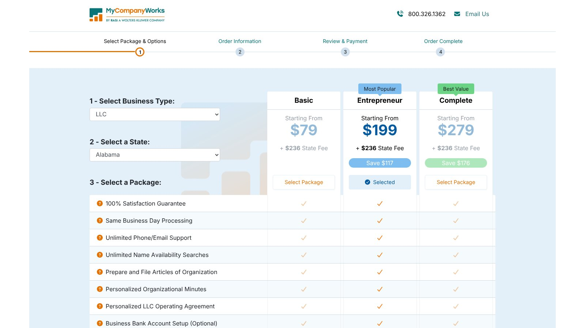

# Best Wyoming LLC Formation Services: Costs and Providers Compared

Among Wyoming LLC formation services, Northwest offers the best value for owners who need a commercial registered agent, Bizee has the lowest first-year charge, and MyCompanyWorks has the cheapest agent renewal. For a resident with a qualifying address, filing online with the state can be faster and cheaper than any provider.

Wyoming charges $100 to form most LLCs. Nonresidents need a Wyoming registered agent every year, and that ongoing cost matters more than any formation discount.

No provider paid to be included. We checked every price and rule against official provider pages and the Wyoming Secretary of State on November 8, 2026. This is general information, not legal or tax advice.

## Key Takeaways

- **The State Fee Is $100:** Most Wyoming formations cost $100, plus a card processing fee online.
- **The Annual Tax Starts at $60:** It's $60 or two-tenths of a mill on Wyoming assets, whichever is greater.
- **Online Filing Is Immediate:** Wyoming says a company is active as soon as online filing finishes.
- **Nonresidents Need a Local Agent:** The agent needs a physical Wyoming address, not a virtual one.
- **Wyoming Isn't Fully Anonymous:** Filings are public records, and agents keep key-person details.

## Wyoming LLC Cost Snapshot

State costs and provider charges are different. These figures come from the [Wyoming business FAQs](https://sos.wyo.gov/faqs.aspx?root=BUS) and its company-creation guide.

| Cost | Amount |
|---|---:|
| Domestic LLC formation | $100 |
| Annual license tax | $60 minimum or $0.0002 of Wyoming assets |
| Registered agent change filing | $5 |
| Online card payment | Processor convenience fee |

The state's example: a company with $1,210,000 in Wyoming assets owes $242. A company with $300,000 or less pays the $60 minimum.

## Quick Provider Comparison

The table adds Wyoming's $100 formation fee to each provider's entry price. Prices were checked on November 8, 2026, and optional products are excluded.

| Provider | Formation Charge | Starting Total | Registered Agent Position |
|---|---:|---:|---|
| Bizee | $0 | $100 | First year free, then $149 a year |
| Northwest | $39 | $139 | Included with formation, $125 a year standalone |
| ZenBusiness Starter | $0 | $100 | $99 first year with formation, then $199 |
| LegalZoom Basic | $0 | $100 | $249 a year |
| MyCompanyWorks Basic | $79 | $179 | $119 a year |

Nonresidents should confirm the order includes a Wyoming agent before paying.

## Our Wyoming Picks

The best of the Wyoming LLC formation services depends on residency and support needs.

- **Best Formation and Agent Value:** Northwest.
- **Best First-Year Price:** Bizee.
- **Best Agent Renewal Rate:** MyCompanyWorks.
- **Best Paid Bundle:** ZenBusiness Pro.
- **Best Broad Legal Catalog:** LegalZoom.

A Wyoming resident with a qualifying address may file directly and skip provider fees entirely.

## Wyoming's Registered Agent Requirements

The [Wyoming registered agent FAQs](https://sos.wyo.gov/faqs.aspx?root=RAO) say all businesses, domestic or foreign, must continuously maintain a registered agent with a physical Wyoming address. Post office boxes, drop boxes, virtual addresses, mail forwarding locations, and UPS or FedEx stores don't qualify.

The state's agent guide adds that an individual agent must be at least 18, live in Wyoming, and have a physical Wyoming address. Agents must also keep records of key individuals and a communications contact, which makes the job more than a mailbox rental.

## 1. Northwest: Best Formation and Agent Value

Northwest charges $39 plus the state fee and lists registered agent service in its LLC package. Its standalone agent service costs $125 a year.

The first Wyoming total starts at $139 before the online processor fee. This bundle suits nonresidents who need a Wyoming agent and want clear recurring pricing.

**Best fit:** Nonresident owners who will keep a Wyoming agent for years.

## 2. Bizee: Best First-Year Price

Bizee Basic charges $0 plus state fees and includes one free year of registered agent service. The starting Wyoming total is just the $100 state fee.

Bizee's registered agent page lists the service at $149 a year afterward. Northwest becomes cheaper over longer periods.

**Best fit:** Owners who want the lowest initial bill.

## 3. MyCompanyWorks: Best Agent Renewal Rate

MyCompanyWorks Basic starts at $79 plus state fees, so the formation total starts at $179. Its registered agent service costs $119 a year.

That makes the first year more expensive than the $0 providers. But the $119 renewal is the lowest published rate in this group, which helps owners who keep the LLC for several years.

**Best fit:** Long-term holders who want the lowest yearly agent cost.

## 4. ZenBusiness: Best Paid Bundle

ZenBusiness Starter costs $0 plus state fees. Pro costs $199, renews at $199 a year, and includes an EIN, an operating agreement template, and 1-day processing.

Registered agent service costs $99 for the first year with formation, then $199 a year. That costs more over time if you only need an agent.

**Best fit:** Owners who want a guided dashboard.

## 5. LegalZoom: Best Broad Legal Catalog

LegalZoom Basic costs $0 plus state fees. Pro costs $249 and includes an EIN, an operating agreement, and 30 days of attorney consultations that renew at $49 a month unless canceled.

Registered agent service costs $249 a year, the highest agent price in this group.

**Best fit:** Owners planning to use LegalZoom's other legal products.

## Online Filing Can Beat a Service on Speed

Wyoming's [company-creation guide](https://sos.wyo.gov/Business/docs/HowToCreateAWyomingCompany.pdf) says a company filed online is active as soon as the online filing process is completed. A provider adds its own handling before it submits to the state.

If speed is your only concern, compare direct online filing first. Wyoming LLC formation services help most when you also need a registered agent or document support.

## The Annual License Tax and Report

Wyoming's annual report is due on the first day of your formation anniversary month. For example, a company formed on January 15 has a report due every January 1.

The tax is $60 or two-tenths of one mill on Wyoming assets, whichever is greater. Wyoming sends courtesy email reminders 60, 30, and 10 days before the due date, but the owner stays responsible. If the report isn't filed within 60 days of the due date, the company is administratively dissolved.

## Official Reminders and Misleading Mail

The Secretary of State has warned about private solicitations that look like official notices. In one example it published, a mailing asked for $135 when the official minimum annual report fee was $60.

Check the sender and the filing address before paying, and never pay a notice just because it looks official. The state's official site for filing annual reports is sos.wyo.gov, and a commercial service should label its own charge clearly.

## Privacy Claims Need Careful Wording

Wyoming is often marketed as an anonymous LLC state. That overpromises.

The company-creation guide says all documents filed with the office are public records, and signatures become public upon filing. Agents also keep key-person and communications-contact details that law enforcement or a state agency can use to reach the company. A commercial agent can keep your home address out of the agent field, but it doesn't make ownership invisible.

## What to Ask Wyoming LLC Formation Services

Most Wyoming LLC formation services sell to people who don't live in Wyoming. That makes the agent relationship the core of the purchase, so ask these questions before you order.

### How Will Legal Papers Reach Me?

A Wyoming lawsuit or state notice goes to your agent, not to you. Ask how fast documents are scanned, whether you'll get a phone call when service of process arrives, and whether physical originals are forwarded and at what cost.

### Who Files the Annual Report?

Some providers only send reminders. Others will file the report and pay the license tax for you, adding a service charge. Ask whether the price you see includes the state tax, the processor fee, and the provider's own fee.

### What Does the Privacy Service Cover?

Ask exactly which fields on the public filing will show the provider's details instead of yours. An agent can stand in for you in the agent field and sometimes as organizer, but the company still has to give the agent key-person records.

### What Happens If I Leave?

Ask whether the provider will help with the $5 agent change filing, and how long you can download old documents after you cancel. Wyoming LLC formation services that answer these clearly tend to be easier to work with later.

## A Decision Framework for Nonresidents

Forming outside your home state can add registration and compliance costs. A Wyoming LLC may still need to register as a foreign LLC where it operates.

Before choosing Wyoming, answer these questions:

1. Where will the business operate?
2. Where will employees work?
3. Where are offices and property?
4. Will another state require foreign registration?
5. What annual fees apply in both states?
6. Will your bank and insurer support the setup?

The cheapest formation state can become expensive once foreign registration and two registered agents apply. Legal and tax advice can prevent duplicated fees or missed filings.

## A Three-Year Wyoming Cost Example

Here is our arithmetic for a nonresident who needs a commercial agent for three years and pays the $60 minimum tax each year after formation. It leaves out processor fees.

| Item | Bizee | Northwest | MyCompanyWorks |
|---|---:|---:|---:|
| Formation and state fee | $100 | $139 | $179 |
| Agent, year 1 | Included | Included | $119 |
| Agent, years 2 and 3 | $298 | $250 | $238 |
| Annual tax, two reports | $120 | $120 | $120 |
| Three-year total | $518 | $509 | $656 |

This is our calculation, not a quote. Northwest edges out Bizee by year three, while MyCompanyWorks costs more because its formation fee and first agent year aren't bundled.

## EIN and BOI Checks

The IRS issues EINs at no cost through its online tool. A provider can apply for you, but that only buys convenience.

FinCEN's guidance, updated August 11, 2026, says U.S. companies are exempt from beneficial ownership information reporting. Certain foreign companies registered in the United States may still have duties.

## How Wyoming Compares

Wyoming's $100 fee is lower than Florida's $125 and far below Texas's $300. Our national comparison of [LLC formation services](/legal-business/best-llc-formation-services/) covers all seven providers, and our [Texas LLC formation services](/legal-business/texas-llc-formation-services/) guide shows how a higher fee and franchise-tax reporting change the math in a large home state.

## Frequently Asked Questions

### How Much Does a Wyoming LLC Cost?

The state formation fee is $100, and online payment adds a processor fee. Provider, agent, and optional service charges are separate.

### How Much Is Wyoming's Annual LLC Fee?

The minimum is $60. Companies with more than $300,000 in Wyoming assets can owe more under the state formula.

### Can a Nonresident Use Wyoming LLC Formation Services?

Yes. Wyoming LLC formation services can file for nonresidents, but the LLC needs a qualifying Wyoming registered agent, and other states may require registration where the business operates.

### Is a Wyoming LLC Anonymous?

Don't assume full anonymity. Filed documents are public records, and agents keep required contact records.

### How Fast Is Wyoming Online Formation?

Wyoming says a company is active as soon as the online filing process is completed.

## Resources

- [Wyoming registered agent guide](https://sos.wyo.gov/Business/Docs/HowToFindOrBecomeARegisteredAgent.pdf)
- [Wyoming scam notice](https://sos.wyo.gov/Business/Docs/Notice_Beware_of_Scams_Targeting_Wyoming_Businesses.pdf)
- [IRS: Get an EIN](https://www.irs.gov/businesses/small-businesses-self-employed/get-an-employer-identification-number)
- [FinCEN BOI reporting](https://www.fincen.gov/boi)
- [Northwest LLC service](https://www.northwestregisteredagent.com/llc)
- [Bizee registered agent](https://bizee.com/business-management/registered-agent)
- [MyCompanyWorks order page](https://secure.mycompanyworks.com/oms/order-b.php?entityId=2&stateId=2)
- [ZenBusiness formation plans](https://www.zenbusiness.com/pricing-formation-plans/)
- [LegalZoom LLC plans](https://www.legalzoom.com/business/business-formation/llc-overview.html)
