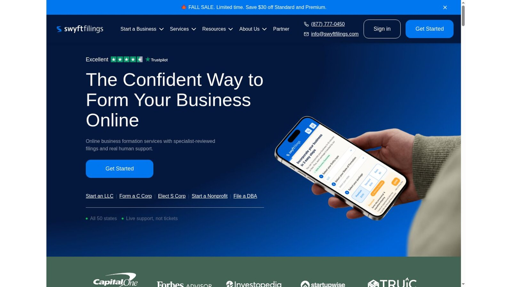

# Best Texas LLC Formation Services: Fees and Providers Compared

Among Texas LLC formation services, Bizee has the lowest first-year charge for an owner who needs an agent, Northwest has the cheaper long-term agent renewal, and ZenBusiness Pro bundles common setup documents. If you already have a qualifying agent, filing directly with the state beats all of them on price.

Texas charges $300 to file a certificate of formation, and that fee applies even when a provider advertises $0. Texas also has yearly franchise tax reporting that a formation service doesn't remove.

No provider paid to be included. We checked every price and rule against official provider pages, the Texas Secretary of State, and the Texas Comptroller on November 8, 2026. This is general information, not legal or tax advice.

## Key Takeaways

- **The State Fee Is $300:** Card payments add $0.25 plus 2.25%, or $7 on a $300 filing.
- **Texas Sells Its Own Speed:** Texas Express offers $50, $500, and $750 expedite levels.
- **The Agent Needs a Texas Street Address:** It must be a place where legal papers can be served in person.
- **The LLC Can't Be Its Own Agent:** An owner, officer, or employee can serve instead.
- **Franchise Reporting Still Applies:** The 2026 no-tax-due threshold is $2.65 million, but small LLCs still file a report.

## Texas LLC Cost Snapshot

These official fees set the cost floor. They come from the [Texas Form 205 instructions](https://www.sos.state.tx.us/corp/instructions/205.shtml) and the state's Texas Express announcement.

| Cost | Amount |
|---|---:|
| Certificate of formation | $300 |
| Online credit card charge | $0.25 plus 2.25% |
| Standard expedite | $50 plus filing fee |
| Next-day Texas Express | $500 plus filing fee |
| Same-day Texas Express | $750 plus filing fee |

Expedite levels have submission deadlines and channels, which we cover below.

## Quick Provider Comparison

The table adds Texas's $300 fee to each provider's entry price. Prices were checked on November 8, 2026, and card fees and optional products are excluded.

| Provider | Formation Service | Starting Total | Registered Agent Position |
|---|---:|---:|---|
| Bizee | $0 | $300 | First year free, then $149 a year |
| Northwest | $39 | $339 | Included with formation, $125 a year standalone |
| ZenBusiness Starter | $0 | $300 | $99 first year with formation, then $199 |
| LegalZoom Basic | $0 | $300 | $249 a year |
| Swyft Filings Basic | $0 | $300 | Price shown at checkout |

If you pay by card, add the state's convenience charge.

## Our Texas Picks

These Texas LLC formation services each fit a different priority.

- **Best First-Year Agent Bundle:** Bizee.
- **Best Long-Term Agent Price:** Northwest.
- **Best Paid Setup Bundle:** ZenBusiness Pro.
- **Best Wider Legal Catalog:** LegalZoom.
- **Best Published Speed Tiers:** Swyft Filings.

Direct filing can beat every provider on price when you already have a qualifying agent.

## Texas Registered Agent Requirements

The [Texas registered agent FAQs](https://www.sos.state.tx.us/corp/registeredagentfaqs.shtml) require every entity to keep a registered agent and a registered office in Texas. An officer, owner, or employee may serve as the agent, but an entity may not serve as its own registered agent.

The Form 205 instructions add that the registered office must be a street address where legal papers can be personally served on the agent during normal business hours. The Secretary of State warns that failing to maintain an agent and office may lead to involuntary termination.

## 1. Bizee: Best First-Year Agent Bundle

Bizee Basic charges $0 plus state fees and includes one free year of registered agent service. The starting Texas total is the $300 state fee before card charges.

Bizee's registered agent page lists the service at $149 a year after that.

**Best fit:** New owners who need a Texas agent and want a low first-year cost.

## 2. Northwest: Best Long-Term Agent Price

Northwest charges $39 plus state fees and lists registered agent service in its LLC package. Its standalone agent service costs $125 a year.

The starting Texas total is $339 before card fees. Its renewal is $24 cheaper than Bizee's each year.

**Best fit:** Owners who plan to keep a commercial agent for several years.

## 3. ZenBusiness: Best Paid Setup Bundle

ZenBusiness Starter costs $0 plus state fees. Pro costs $199, renews at $199 a year, and adds an EIN, an operating agreement template, 1-day processing, and compliance tools.

Registered agent service costs $99 the first year with formation, then $199 a year. Pro plus the agent can create $398 in yearly renewals.

**Best fit:** Owners who want one dashboard for documents and reminders.

## 4. LegalZoom: Best Wider Legal Catalog

LegalZoom Basic costs $0 plus state fees. The $249 Pro tier adds an EIN, an operating agreement, and 30 days of attorney consultations that renew at $49 a month unless canceled.

Registered agent service costs $249 a year. A simple Texas filing costs less elsewhere.

**Best fit:** Owners who expect to need more legal services.

## 5. Swyft Filings: Best Published Speed Tiers

Swyft Filings Basic costs $0 plus state fees with processing in 7 to 10 business days. Its fall sale lists Standard at $169, normally $199, with processing in 3 business days.

Texas now sells official expedite options, so compare those before paying a provider for speed. The agent price appears during checkout.

**Best fit:** Owners comparing provider handling times.

## Texas Express Changes the Speed Decision

The Secretary of State announced Texas Express on July 14, 2026. Standard expedite costs $50 per document, and the state says those filings are typically processed within two to three business days.

Next-day service costs $500 per document, and filings received by 12:00 p.m. are processed by the close of the next business day. Same-day service costs $750, and filings received by 12:00 p.m. are processed by the close of business that day. A provider's own rush service may only speed its internal handling, so ask whether its quote includes Texas Express.

## When Paying for Speed Makes Sense

Speed is worth paying for when a real deadline is waiting, such as a lease signing, a bank account, or a contract that names the LLC. It helps less when the owners haven't agreed on who owns what. A rushed filing with the wrong details can mean a second filing and a second fee.

### Use the State's Option First

Since Texas now sells same-day and next-day processing directly, the cheapest fast route is often to file yourself and pay the expedite fee. Texas LLC formation services can still submit for you, but ask whether their rush price includes the state's Texas Express fee or only moves you up their own queue.

### Get Dates in Writing

Ask a provider for two dates: when it will submit your filing, and when it expects the state to respond. Texas LLC formation services that can't give both are selling a promise they don't control. Keep the answer with your company records in case the timing matters later.

### Prepare Before You Pay

Have the company name, the registered agent's consent, the organizer details, and the management structure settled before you pick a speed. Faster processing only helps once the information is right.

## Texas Franchise Tax After Formation

Texas LLCs fall under the franchise tax. The [Texas Comptroller](https://comptroller.texas.gov/taxes/franchise/) lists a no-tax-due threshold of $2,650,000 for the current report year.

Businesses at or below the threshold generally owe no franchise tax, but the Comptroller says they still file a Public Information Report or Ownership Information Report. Missing that report can bring penalties, even when no tax is due.

## Card Payments Change the State Total

Texas adds $0.25 plus 2.25% to credit card payments. On a $300 formation fee, that comes to $7, for a total of $307 before provider charges.

Providers may collect the state fee in their own checkout. Ask whether the displayed total already includes the card charge. It won't decide which provider you pick, but it belongs in an accurate budget.

## A First Compliance-Year Checklist

Formation is only the first step. Schedule these tasks for your first year:

1. Keep the registered agent record current.
2. Get an EIN if you need one.
3. Open accounts with your filed formation documents.
4. Track franchise tax and information report duties.
5. Keep company records and an operating agreement.
6. Check licenses and local permits.

Texas LLC formation services may help with some of these steps, but they don't take on every duty.

## A Two-Year Texas Cost Example

Here is our arithmetic for an owner who needs a commercial agent for two years. It excludes card charges, franchise tax, and optional products.

| Item | Bizee Basic | Northwest |
|---|---:|---:|
| Year 1 provider and state fee | $300 | $339 |
| Year 2 agent renewal | $149 | $125 |
| Two-year total | $449 | $464 |

This is our calculation, not a quote. Bizee is $15 cheaper over two years, but Northwest becomes cheaper in year three because its renewal is lower.

## EIN and BOI Checks

The IRS issues EINs at no cost through its online tool. Eligible owners can apply after the LLC forms.

FinCEN's guidance, updated August 11, 2026, says U.S. companies are exempt from beneficial ownership information reporting. Certain foreign companies may still have duties.

## Direct Filing Versus a Provider

The Form 205 instructions explain the required filing, and direct submission can work for a simple ownership structure. The LLC name must include an accepted designation and be distinguishable from existing names in state records.

A service may help owners who:

- **Need a Commercial Agent:** No one in the company has a qualifying Texas address.
- **Want Guided Prep:** They'd rather not complete the form alone.
- **Prefer One Dashboard:** They want records and reminders in one place.
- **Need Several Documents:** They want an agreement and EIN filed together.

Texas instructs filers to keep personal identifying information out of submitted documents, since filed records can become public. An attorney or tax adviser can help with ownership, tax elections, regulated work, or investor terms.

## Choosing Texas or Another State

Texas's $300 fee is the highest of the three states we compared. Our national guide to [LLC formation services](/legal-business/best-llc-formation-services/) shows how state fees change first-year totals. Owners tempted by a cheaper state should read our [Wyoming registered agent services](/legal-business/wyoming-registered-agent-services/) guide first, since a Wyoming LLC doing business in Texas usually needs agents in both states.

## Frequently Asked Questions

### How Much Does It Cost to Form a Texas LLC?

Texas charges $300. Card payments add a convenience charge, and provider services and optional products cost extra.

### Does Texas Require a Registered Agent?

Yes. The agent needs a Texas street address where papers can be served in person, and the LLC can't serve as its own agent.

### Does Every Texas LLC Pay Franchise Tax?

No. The current no-tax-due threshold is $2.65 million, but a report is still due even below it.

### Can Texas Process an LLC on the Same Day?

Yes. Texas Express same-day service costs $750 plus the filing fee for filings received by 12:00 p.m.

### Do Texas LLC Formation Services Include an EIN?

Some paid packages do, but the state fee doesn't. Texas LLC formation services charge for EIN help that the IRS provides free.

## Resources

- [Texas Express announcement](https://www.sos.state.tx.us/about/newsreleases/2026/071426.shtml)
- [IRS: Get an EIN](https://www.irs.gov/businesses/small-businesses-self-employed/get-an-employer-identification-number)
- [FinCEN BOI reporting](https://www.fincen.gov/boi)
- [Bizee registered agent](https://bizee.com/business-management/registered-agent)
- [Northwest LLC service](https://www.northwestregisteredagent.com/llc)
- [ZenBusiness formation plans](https://www.zenbusiness.com/pricing-formation-plans/)
- [LegalZoom LLC plans](https://www.legalzoom.com/business/business-formation/llc-overview.html)
- [Swyft Filings](https://www.swyftfilings.com/)
