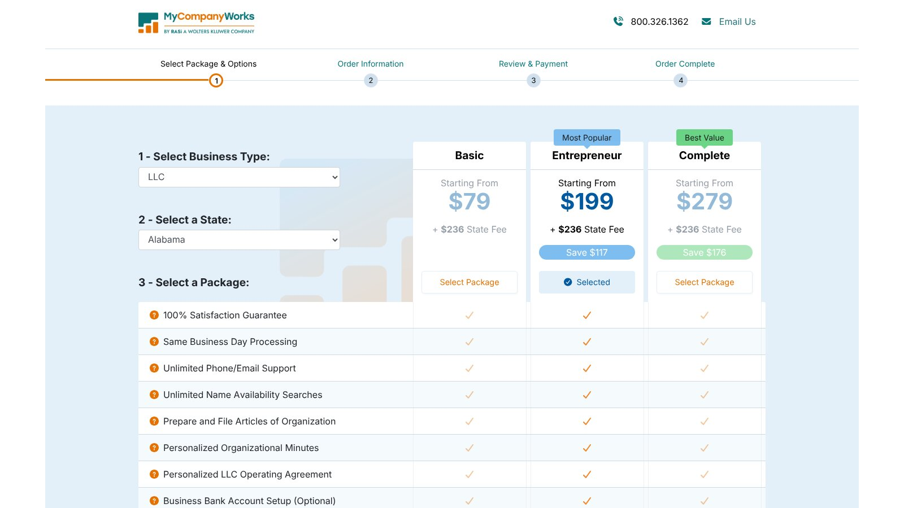
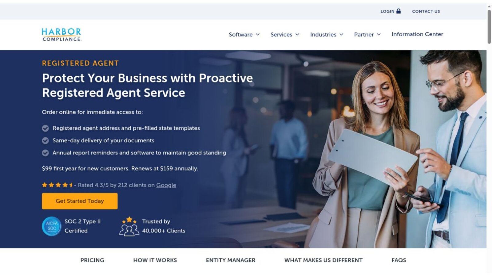
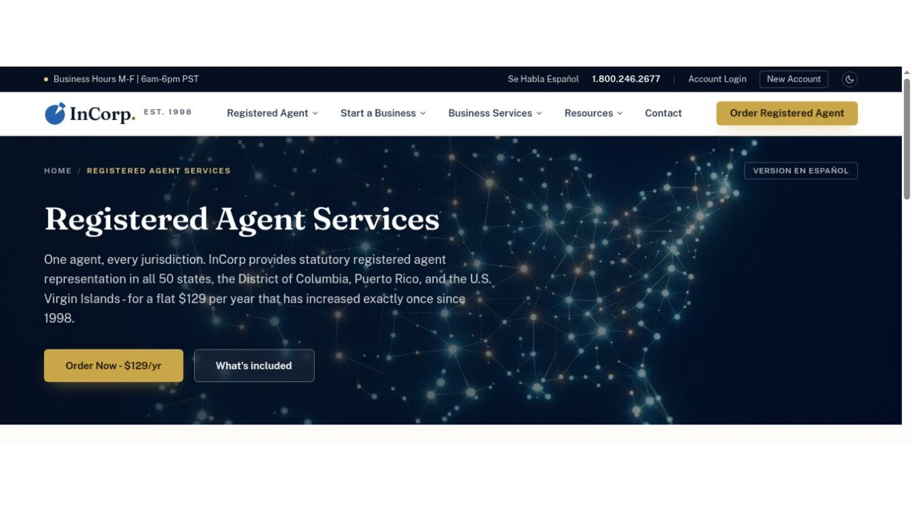
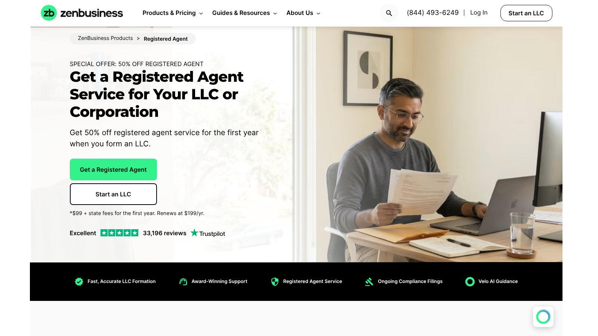

# Best Wyoming Registered Agent Services: Providers and Annual Costs

Among Wyoming registered agent services, MyCompanyWorks has the lowest flat yearly rate at $119, Northwest offers the clearest formation bundle, and InCorp is cheapest if you prepay three years. Harbor Compliance has the lowest first year at $99, but it renews at $159.

Wyoming requires every business to keep a registered agent with a physical Wyoming address and specific records. So document handling, renewal terms, and state qualifications deserve as much attention as price.

No provider paid to be included. We checked every price and rule against official provider pages and the Wyoming Secretary of State on November 8, 2026. This is general information, not legal advice.

## Key Takeaways

- **Every Entity Needs One:** Domestic and foreign businesses must keep a Wyoming registered agent at all times.
- **No Virtual Addresses:** Post office boxes, mail forwarders, and shipping stores don't qualify.
- **Agents Keep Records:** Wyoming agents must hold key-individual and communications-contact details.
- **Changing Agents Costs $5:** The state charges $5 to appoint a new agent.
- **Renewals Change the Ranking:** Harbor wins year one, but MyCompanyWorks and InCorp win over three years.

## Quick Wyoming Comparison

The table shows public prices for each provider as of November 8, 2026. Prices apply per entity and can change.

| Provider | Public First-Year Price | Renewal or Condition | Best For |
|---|---:|---|---|
| Harbor Compliance | $99 | $159 a year | Lowest first year |
| MyCompanyWorks | $119 | $119 a year | Lowest flat rate |
| Northwest | $125 | $125 a year | Formation bundle |
| InCorp | $129 | Lower with prepayment | Long-term prepayment |
| Bizee | Free with formation | $149 a year | New formation customers |
| ZenBusiness | $99 with formation | $199 a year | ZenBusiness users |
| LegalZoom | $249 | $249 a year | LegalZoom users |

Wyoming charges $5 to file a change of registered agent. Some providers may prepare or cover that filing.

## Our Wyoming Picks

These recommendations use public rates and service scope.

- **Best Flat Yearly Price:** MyCompanyWorks.
- **Best Formation Bundle:** Northwest.
- **Best First-Year Price:** Harbor Compliance.
- **Best Prepaid Option:** InCorp.
- **Best First-Year Formation Inclusion:** Bizee.

Wyoming residents may serve as their own agent if they meet every state requirement.

## What Wyoming Requires From an Agent

The [Wyoming registered agent FAQs](https://sos.wyo.gov/faqs.aspx?root=RAO) say all businesses, domestic or foreign, must continuously maintain a registered agent with a physical Wyoming address where someone can accept service of process. Post office boxes, drop boxes, virtual addresses, mail forwarding locations, and UPS or FedEx stores don't qualify.

The state's [registered agent guide](https://sos.wyo.gov/Business/Docs/HowToFindOrBecomeARegisteredAgent.pdf) says an individual agent must be at least 18, live in Wyoming, and have a physical Wyoming address. Agents must also keep records of key individuals and a communications contact who can be reached by law enforcement or a state agency.

That makes Wyoming registered agent services more than an address rental. A provider takes on legal-document and recordkeeping duties for your company.

## 1. MyCompanyWorks: Best Flat Yearly Price

MyCompanyWorks lists registered agent service at $119 a year, the lowest flat public rate in this group. Its order page also lists same business day processing.

Confirm Wyoming delivery procedures and how you'll be alerted to service of process before ordering.

**Best fit:** Owners who want a simple low yearly price.

## 2. Northwest: Best Formation Bundle

Northwest lists standalone agent service at $125 a year, and its $39 LLC package lists registered agent service. For a new Wyoming LLC, the bundle starts at $139 after adding the $100 state fee.

Northwest also lists free scanning of state and legal mail into your online account.

**Best fit:** New nonresident owners who need formation and a Wyoming address.

## 3. Harbor Compliance: Best First-Year Price

The [Harbor Compliance page](https://www.harborcompliance.com/registered-agent-service) lists $99 for the first year for new customers, renewing at $159 a year. It lists same-day document delivery and a phone call when service of process arrives.

The intro rate beats the flat-rate options in year one. MyCompanyWorks and Northwest cost less once Harbor renews.

**Best fit:** Owners who value phone alerts and a low first year.

## 4. InCorp: Best Prepaid Option

InCorp lists $129 for one year. Prepaid rates fall to $117, $105, $96, or $87 a year as the term grows.

The three-year prepaid total is $315, and five years cost $435. Review refund and transfer terms before you prepay, in case you close or move the company early.

**Best fit:** Established businesses comfortable committing for years.

## 5. Bizee: Best First-Year Formation Inclusion

Bizee includes one free year of agent service with its formation packages. Wyoming's $100 state fee still applies.

Its registered agent page lists the service at $149 a year after the free year.

**Best fit:** Owners forming a new company now.

## 6. ZenBusiness: Best for Dashboard Users

ZenBusiness offers 50% off the first year with formation, making it $99, then $199 a year. It lists document receipt, secure digital delivery, and email alerts.

Lower-cost options exist if you only need an agent.

**Best fit:** Existing ZenBusiness customers.

## 7. LegalZoom: Best for LegalZoom Users

LegalZoom charges $249 a year. It sends mail alerts and annual report reminders, and its page says it completes the paperwork to switch agents and covers the state fees.

Confirm the switch offer's conditions before relying on it. It's the highest published price in this group.

**Best fit:** Owners who want one account for several legal services.

## Three-Year Cost Comparison

Renewal prices change the ranking. Here is our arithmetic using each provider's published rates.

| Provider | Three-Year Total | Condition |
|---|---:|---|
| InCorp | $315 | Three years prepaid |
| MyCompanyWorks | $357 | Current flat rate |
| Northwest | $375 | Current flat rate |
| Harbor Compliance | $417 | $99 first year, then $159 |
| ZenBusiness | $497 | $99 formation offer, then $199 |
| LegalZoom | $747 | Current $249 rate |

This is our calculation, not a quote. Bizee is left out because its free year requires forming with Bizee; its next two years would total $298.

## How Wyoming Agents Handle Urgent Papers

The most important job a registered agent does is pass along a lawsuit before a deadline runs. Wyoming registered agent services differ most in how they handle that moment.

### Scanning Speed

Most providers scan legal mail and upload it to an online account. Ask how many hours pass between delivery and upload, and whether that holds on weekends or holidays. A same-day promise is worth more than an unstated one.

### Alert Escalation

An email can sit unread for days. Harbor Compliance says it calls you when service of process arrives, and other providers rely mainly on email. If you travel or check email rarely, choose a provider that escalates by phone or text.

### Original Documents

Some cases require the original papers, not a scan. Ask whether originals are forwarded, how quickly, and at what cost, since scanning and forwarding often follow different rules.

### Records the State Requires

Wyoming registered agent services must keep your key-individual and communications-contact details. Ask how a provider stores that information and how you update it when people in your company change, since stale records can delay notices.

## Can You Be Your Own Wyoming Registered Agent?

Yes, if you meet the state's rules. You must be at least 18, live in Wyoming, and have a physical Wyoming address.

Serving yourself suits a resident who stays available during business hours. It saves the yearly fee, but it also means you personally receive every lawsuit, subpoena, and state notice, and you must be at that address whenever a process server arrives. It's a poor fit for frequent travelers or home-based owners who don't want their address in public records. You'd also need to keep the required key-person records yourself.

## Using Wyoming's Public Roster

The Secretary of State publishes a roster of commercial registered agents. Its guide says the list is neither an advertisement nor a public endorsement of any agent on it, and choosing an agent stays the business's responsibility.

Use the roster to find options, then check each provider yourself. Before ordering, confirm:

- **Legal Name:** The exact name on Wyoming's records.
- **Physical Address:** A real Wyoming street address.
- **Alert Method:** How you'll hear about service of process.
- **Scanning Limits:** Any caps or per-page fees.
- **Full Pricing:** Both first-year and renewal rates.
- **Exit Terms:** Document access after you cancel.

Save the provider's answers with your company records. If an urgent document goes missing later, a written record of what the provider promised can help you sort out what went wrong.

## Changing Agents in Wyoming

Wyoming charges $5 to file an Appointment of New Registered Agent and Office. The new agent must meet state requirements.

Follow this order to avoid a gap:

1. Hire and confirm the new agent.
2. Get any required consent.
3. File the state change form.
4. Confirm the state record updated.
5. Cancel the old service after confirmation.
6. Download old documents before access ends.

## Privacy Has Limits

A commercial agent can keep your home address out of the agent field, but it doesn't create full anonymity. Wyoming filings are public records, and agents keep required contacts and key-person details.

Banks, tax agencies, licenses, and court cases can also identify the people behind a company. Choose among Wyoming registered agent services for reliable notice handling, not for anonymity promises.

## Warning Signs in an Agent Offer

A cheap service can get expensive after a missed document or an unclear renewal. Watch for these warning signs:

- **No Renewal Price:** The yearly rate isn't published.
- **Vague Alerts:** No clear method for urgent legal papers.
- **A Virtual Address:** Offered as the registered office.
- **Hidden Scanning Fees:** Extra charges per page or document.
- **No Exit Plan:** No cancellation steps or document access after leaving.

Ask how soon a scanned document appears after delivery, and whether a phone or text alert backs up email for service of process.

## Formation and Brand Comparisons

If you're forming a new Wyoming LLC, the comparison of [LLC formation services](/legal-business/best-llc-formation-services/) shows how agent bundles change first-year totals. Weighing two big brands? Our [ZenBusiness vs LegalZoom](/legal-business/zenbusiness-vs-legalzoom/) comparison prices their agent renewals side by side.

## Frequently Asked Questions

### How Much Do Wyoming Registered Agent Services Cost?

Wyoming registered agent services in this guide range from a $99 introductory price to $249 a year. Renewal rates give the better comparison.

### Does Wyoming Require a Registered Agent?

Yes. Every domestic and foreign entity must continuously keep one with a physical Wyoming address.

### Can I Use a Virtual Address?

No. Wyoming says virtual addresses, mail forwarders, shipping stores, and post office boxes don't qualify.

### How Much Does It Cost to Change Agents?

Wyoming lists a $5 filing fee. Provider fees may also apply.

### Does a Wyoming Agent Make an LLC Anonymous?

No. It can replace your address in one field, but public filings and required records still exist.

## Resources

- [MyCompanyWorks order page](https://secure.mycompanyworks.com/oms/order-b.php?entityId=2&stateId=2)
- [Northwest registered agent](https://www.northwestregisteredagent.com/registered-agent)
- [InCorp registered agent](https://www.incorp.com/registered-agent-services)
- [Bizee registered agent](https://bizee.com/business-management/registered-agent)
- [ZenBusiness registered agent](https://www.zenbusiness.com/registered-agent/)
- [LegalZoom registered agent](https://www.legalzoom.com/business/business-operations/registered-agent-overview.html/)
