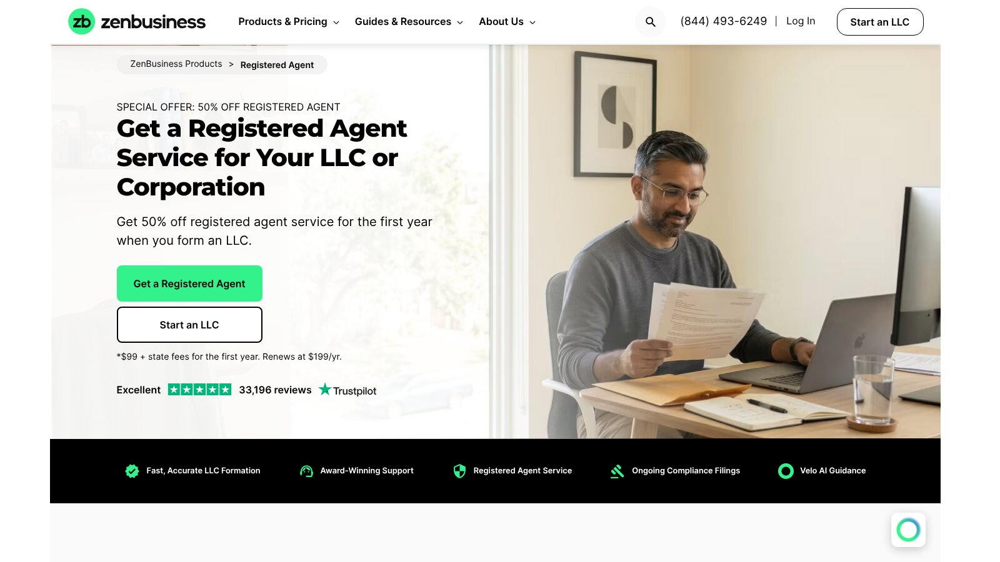

# ZenBusiness vs LegalZoom: Pricing, Add-ons, and Best Fit

In ZenBusiness vs LegalZoom, ZenBusiness costs less for a comparable paid package, while LegalZoom adds attorney access and a wider legal catalog. Both offer a $0 formation tier before state fees.

The better choice depends on what you need after filing. ZenBusiness suits owners who want formation and compliance tools in one account. LegalZoom suits owners who expect to use attorney consultations or its wider document library.

No provider paid to be included. We checked every price against both companies' official pages on November 8, 2026. This is general information, not legal or tax advice.

## Key Takeaways

- **Both Start at $0:** Each charges the state fee on top of its free tier.
- **ZenBusiness Pro Is $50 Cheaper:** It costs $199 against LegalZoom Pro's $249.
- **Agent Fees Differ by $50:** ZenBusiness charges $199 a year after a $99 first year, and LegalZoom charges $249.
- **Trials Renew Monthly:** LegalZoom's attorney plan renews at $49 a month, and ZenBusiness's website builder at $15.
- **Skip Paid EINs:** The IRS issues EINs free, so neither plan is needed just for that.

## ZenBusiness vs LegalZoom at a Glance

The table uses public prices checked on November 8, 2026. Promotions can change.

| Comparison Point | ZenBusiness | LegalZoom |
|---|---|---|
| Entry package | Starter, $0 plus state fees | Basic, $0 plus state fees |
| Mid-level package | Pro, $199, renews yearly | Pro, $249 |
| Top package | Premium, $299, renews yearly | Premium, $299 |
| Registered agent | $99 first year with formation, then $199 | $249 a year |
| EIN and operating agreement | Included in Pro and Premium | Included in Pro and Premium |
| Standard processing | 7 to 10 business days on Starter | Depends on order and state |
| Attorney access | Not in formation packages | 30 days in Pro, then $49 a month |
| Main strength | Lower comparable price | Wider legal catalog |

Both companies' formation and registered agent pages are listed in Resources.

## Our Verdict

Choose ZenBusiness if price and a guided workflow lead your decision. Its Pro plan costs $50 less than LegalZoom Pro before state fees.

Choose LegalZoom if you expect to use attorney consultations or more legal documents, and track the renewal on every included trial. Choose neither paid plan just for an EIN, since the [IRS issues EINs](https://www.irs.gov/businesses/small-businesses-self-employed/get-an-employer-identification-number) for free online.

## The Advertised Price Is Only the First Number

A $0 package doesn't mean a free LLC. The state still charges its filing fee, and optional services can create recurring charges.

Run this four-part check before choosing:

1. Add the state filing fee.
2. Add the formation package.
3. Add the first registered agent term if needed.
4. List every renewal that starts after a trial.

That gives a clearer first-year estimate and shows the likely second-year bill.

## A Comparable Formation Basket

Suppose you want formation, an operating agreement, an EIN, and a professional registered agent. Here is the arithmetic for each.

| Item | ZenBusiness | LegalZoom |
|---|---:|---:|
| Pro package | $199 | $249 |
| Registered agent, year 1 | $99 | $249 |
| Year 1 provider total | $298 | $498 |
| Year 2 renewals | $199 Pro + $199 agent | $249 agent |
| Year 2 total | $398 | $249 |

This is our calculation, not a quote, and the packages aren't identical. LegalZoom Pro includes 30 days of attorney consultations that renew at $49 a month unless canceled, which would add $588 over a full year. ZenBusiness Pro renews at $199 a year, so in year two ZenBusiness costs more unless you drop Pro.

## ZenBusiness Plans and Recurring Charges

ZenBusiness publishes three packages, all excluding state fees. Its [formation pricing page](https://www.zenbusiness.com/pricing-formation-plans/) lists the details below.

### Starter

Starter costs $0 and includes a name search, filing of your articles of organization, document access, and a dashboard. Standard processing takes 7 to 10 business days, with rush processing available for $79.

Starter includes one free year of Worry-Free Compliance, which renews at $199 a year. It also preselects a 30-day free trial of a website builder that renews at $15 a month, and the page says you can remove it before you buy.

### Pro

Pro costs $199 and renews at $199 a year. It adds 1-day processing, Worry-Free Compliance, an operating agreement template, and an EIN.

That 1-day processing describes ZenBusiness's own handling, not state approval. Buying the EIN and agreement as $99 Starter add-ons would cost $198, almost the same as Pro, so Pro is the better buy if you want both documents.

### Premium

Premium costs $299 and renews at $299 a year. It adds a domain name with privacy, a business email address, a business documents library, and a business advisor consultation.

## LegalZoom Plans and Recurring Charges

LegalZoom also publishes three LLC packages with state fees separate. Its [LLC pricing page](https://www.legalzoom.com/business/business-formation/llc-overview.html) lists the details below.

### Basic

Basic costs $0 and files only your articles of organization, with a name check service. It doesn't include an operating agreement or EIN.

### Pro

Pro costs $249 and adds an operating agreement, an EIN, and 30 days of unlimited 30-minute attorney consultations. LegalZoom says the attorney plan auto-renews at $49 a month after 30 days, and you can cancel online or by phone.

### Premium

Premium costs $299 and adds bookkeeping tools for 6 months, plus invoices and proposals. LegalZoom says bookkeeping then auto-renews at $9.99 a month unless canceled.

## Registered Agent Differences

Both companies sell nationwide registered agent service. An agent receives official notices and service of process, which is narrower than many buyers expect.

ZenBusiness offers 50% off the first year with formation, making it $99, then $199 a year. LegalZoom charges $249 a year, and its page says it completes switching paperwork and covers state fees for the change. Compare renewal price, delivery speed, reminders, and cancellation timing before ordering.

## A Three-Year Cost Outlook

The first year rarely tells the whole story. Here is our arithmetic for the same basket over three years, under two common choices: keeping every paid service, or dropping the extras after year one.

| Scenario | ZenBusiness | LegalZoom |
|---|---:|---:|
| Keep Pro and agent, no attorney plan | $298 + $398 + $398 = $1,094 | $498 + $249 + $249 = $996 |
| Drop Pro after year 1, keep agent | $298 + $199 + $199 = $696 | $498 + $249 + $249 = $996 |
| Keep LegalZoom attorney plan all 3 years | Not applicable | $996 + $1,715 = $2,711 |

This is our calculation, not a quote. The attorney line assumes 35 monthly payments of $49 after the free 30 days. The table shows why the ZenBusiness vs LegalZoom winner depends less on the sticker price and more on which renewals you keep.

## Cancellation and Renewal Checklist

Both companies publish their renewals, but they're easy to miss in checkout. Before you pay, write down each of these:

1. The end date of every free trial.
2. The amount each service renews at.
3. Whether it bills monthly or yearly.
4. How to cancel, online or by phone.
5. What happens to your documents after you cancel.

Set calendar reminders a week before each renewal so you have time to decide whether to keep or cancel each service. A screenshot of your final cart can also settle billing questions later.

## Formation Speed Has Two Clocks

The provider prepares and submits your order, then the state reviews it. ZenBusiness publishes provider processing for each plan, with 7 to 10 business days on Starter and 1 day on Pro.

LegalZoom's package page focuses on what's included rather than speed. Either way, the state's queue can still control the final date, so check your state's current processing time before paying for speed.

## Annual Report and Compliance Help

Formation is a one-time job, but most states expect an annual or biennial report every year after. This is where the two companies take different approaches.

ZenBusiness builds compliance into its packages through Worry-Free Compliance. Starter includes it free for the first year, then it renews at $199 a year, and Pro includes it as long as Pro is active. LegalZoom ties reminders to its registered agent service, which sends email reminders about annual report deadlines through its Compliance Calendar.

Neither approach files the report for free in every case, and reminders don't move the legal duty off you. Ask each company whether its service only reminds you or also prepares and files the report, and whether the state fee is included. In a state like Florida, where a late report adds $400, that difference matters.

## Current BOI Rule

Some older guides still list federal BOI filing as a requirement for domestic LLCs. That advice is out of date.

FinCEN's BOI guidance, updated August 11, 2026, says U.S. companies are exempt from beneficial ownership information reporting. Certain foreign companies registered in the United States may still have duties.

## Which Service Fits Each Owner?

The ZenBusiness vs LegalZoom choice gets clearer when matched to a specific need.

### ZenBusiness Fits These Owners

Owners who want the lower comparable price, one formation and compliance dashboard, and who can track yearly package renewals. It's less suited to owners who need broad legal documents.

### LegalZoom Fits These Owners

Owners who expect to use attorney consultations, want a larger legal catalog, or need more than formation. They should be ready to manage trial-to-paid renewals.

### Direct State Filing Fits These Owners

Owners comfortable reading state instructions who only need the filing, can get an EIN from the IRS, and already have a qualifying registered agent.

## Questions to Ask Before Checkout

A few direct questions settle most of the ZenBusiness vs LegalZoom decision before you pay:

- **Do I Need the EIN Service?** The IRS issues EINs free, so the paid version only saves time.
- **Will I Use an Attorney?** If not, LegalZoom Pro's main extra may go unused.
- **Do I Want Ongoing Compliance Tools?** That's the main reason to keep ZenBusiness Pro after year one.
- **Do I Already Have an Agent?** If so, skip both companies' agent service.
- **Is My Agreement Simple?** A template suits one owner, but multi-owner LLCs may need a lawyer.

## What Most Comparisons Miss

Many ZenBusiness vs LegalZoom comparisons stop at the package price. That understates the ongoing cost.

A better comparison records every renewal next to its cancellation deadline and separates state fees from provider charges. Neither company can tell you whether an LLC is the right entity for you, which can affect taxes, liability, ownership, and fundraising.

## More Comparisons

For the full field of seven providers, see our comparison of [LLC formation services](/legal-business/best-llc-formation-services/). LegalZoom also sells wills and trusts, which our [Trust & Will vs LegalZoom](/legal-business/trust-and-will-vs-legalzoom/) comparison covers in detail.

## Frequently Asked Questions

### Is ZenBusiness Cheaper Than LegalZoom?

For year one, yes. ZenBusiness Pro costs $199 against LegalZoom Pro's $249, and its first agent year costs $99 against $249. State fees are extra.

### Which Wins in ZenBusiness vs LegalZoom for Year Two?

It depends on renewals. ZenBusiness Pro and its agent renew at $398 a year combined, while LegalZoom's agent renews at $249 unless you keep the $49 monthly attorney plan.

### Can I Form an LLC for $0?

Both charge $0 for their basic preparation service, but you still pay the state filing fee.

### Do I Need to Pay for an EIN?

No. Eligible applicants can get an EIN directly from the IRS for free. A paid service only completes the application for you.

### Does Either Service Provide Legal Advice?

Formation packages mainly prepare and file documents. LegalZoom Pro includes limited attorney access for 30 days, so read its scope and renewal terms.

## Resources

- [ZenBusiness registered agent](https://www.zenbusiness.com/registered-agent/)
- [FinCEN BOI reporting](https://www.fincen.gov/boi)
- [LegalZoom registered agent](https://www.legalzoom.com/business/business-operations/registered-agent-overview.html/)
