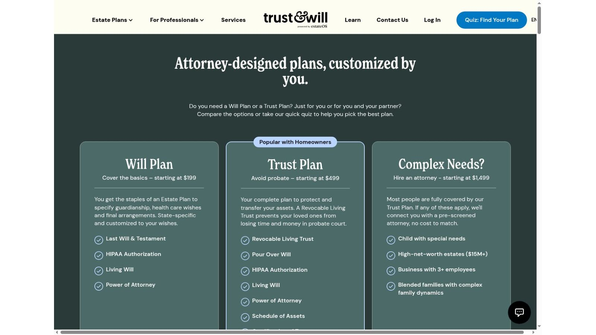
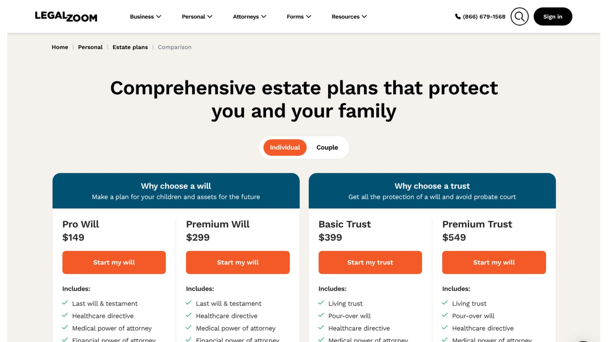

# Trust & Will vs LegalZoom: Wills, Trusts, Pricing, and Attorney Support

In Trust & Will vs LegalZoom, LegalZoom starts cheaper for individual wills and trusts, while Trust & Will offers a focused estate planning workflow with clear couples pricing. Trust & Will lists its Will Plan at $199 and Trust Plan at $499. LegalZoom lists its Pro Will at $149 and Basic Trust at $399.

Price doesn't settle it. Revision periods, attorney access, couples pricing, and ongoing memberships change the real value.

No company paid to be included. We checked every price against both companies' official pages on November 8, 2026, and left out temporary discounts. This is general information, not legal or tax advice.

## Key Takeaways

- **LegalZoom Starts Lower:** Its Pro Will is $149 and Basic Trust is $399, both before discounts.
- **Trust & Will Publishes Couples Pricing:** Its couple plans cost $299 for wills and $599 for trusts.
- **Memberships Renew:** Trust & Will's optional membership is $49 a year, and LegalZoom's attorney plans renew at $25 a month or $199 a year.
- **Trusts Need Funding:** Neither company moves assets into your trust for you.
- **Complex Estates Need a Lawyer:** Special needs, blended families, and large estates call for individual advice.

## Trust & Will vs LegalZoom at a Glance

These public prices were checked on November 8, 2026. Temporary discounts are excluded.

| Comparison Point | Trust & Will | LegalZoom |
|---|---|---|
| Individual will plan | $199 | Pro Will, $149 |
| Couple will plan | $299 | Couple option on its compare page |
| Higher will plan | Not offered | Premium Will, $299 |
| Individual trust plan | $499 | Basic Trust, $399 |
| Couple trust plan | $599 | Couple option on its compare page |
| Higher trust plan | Not offered | Premium Trust, $549 |
| Ongoing membership | Essentials $49 a year, Pro $299 a year | Attorney plan renews at $25 a month or $199 a year |
| Complex estates | Attorney match, plans from $1,499 | Attorney consultations on higher plans |

Sources for these figures are the [Trust & Will pricing help article](https://help.trustandwill.com/hc/en-us/articles/360053615451-Pricing-for-Trusts-and-Wills) and the [LegalZoom estate plan comparison](https://www.legalzoom.com/personal/estate-planning/compare.html).

## Our Verdict

Choose Trust & Will if you want a focused estate planning product and clear couples pricing. Choose LegalZoom if a lower entry price leads your decision, or if you already use its other services.

Choose an estate planning attorney for complex families, tax-sensitive estates, business succession, or special needs planning. Online documents can't weigh every legal consequence, and a lawyer can also make sure the plan is signed and witnessed the way your state requires.

## Start With the Plan Type

A will plan and a trust plan solve different problems. Comparing their prices without separating them leads to a poor decision.

A will says who receives property controlled by your estate, and it can nominate guardians and name a personal representative. A revocable living trust can hold assets you transfer into it during life, and proper funding is central to its goal of avoiding probate. Neither company moves assets into a trust for you, so you must complete the transfers yourself.

## Trust & Will Pricing

Trust & Will publishes individual and couple prices for its two main plans, and its plan page describes them as attorney-designed and state-specific.

### Will Plan

The Will Plan costs $199 for one person and $299 for a couple. Its plan page lists a last will and testament, a HIPAA authorization, a living will, and a power of attorney.

### Trust Plan

The Trust Plan costs $499 for one person and $599 for a couple. It lists a revocable living trust, a pour-over will, a HIPAA authorization, a living will, a power of attorney, and a schedule of assets.

### Membership and Attorney Support

The help center says the Essentials membership costs $49 a year at checkout. It includes digital safe uploads, an AI assistant, and one free document shipment per billing cycle. The plan page describes unlimited updates as optional at $49 a year.

The Pro membership costs $299 a year and adds attorney support, an estate tax report, and premium support. For complex needs, Trust & Will says it will match you with a pre-screened attorney at no cost to match, with attorney plans starting at $1,499.

## LegalZoom Pricing

LegalZoom publishes four estate plans on its comparison page. Its pages sometimes show temporary discounts, which we left out.

### Pro Will

Pro Will costs $149. It includes a last will, a healthcare directive, medical and financial powers of attorney, a HIPAA authorization, pet care provisions, and online storage.

It also includes 30 days of attorney consultations and unlimited revisions, plus one printed set. LegalZoom says the attorney plan then renews at $25 a month unless canceled.

### Premium Will

Premium Will costs $299 and adds a year of attorney consultations. LegalZoom says those benefits continue automatically for $199 a year unless canceled.

### Basic Trust

Basic Trust costs $399. It includes a living trust, a pour-over will, a healthcare directive, powers of attorney, a HIPAA authorization, a certificate of trust, a schedule of assets, and a bill of transfer, with 30 days of revisions and one printed set.

### Premium Trust

Premium Trust costs $549 and adds a year of attorney consultations that continue at $199 a year unless canceled.

## Document Comparison

Both companies cover the core documents you'd expect in a will or living trust package, though the names vary. Before buying, check that your plan includes:

- **A Will:** A last will and testament, or a pour-over will with a trust.
- **Powers of Attorney:** For financial and medical decisions.
- **A Healthcare Directive:** Also called a living will.
- **A HIPAA Authorization:** So named people can see medical records.
- **Trust Paperwork:** A certificate of trust and schedule of assets, if you choose a trust.

A longer document list doesn't guarantee a better plan. The instructions and your completed choices matter more.

## What Two Years Cost at List Prices

Here is our arithmetic for one person who keeps the optional extras for two years. It uses list prices and leaves out discounts.

| Plan | Year 1 | Year 2 | Two-Year Total |
|---|---:|---:|---:|
| Trust & Will Will Plan plus Essentials | $199 + $49 | $49 | $297 |
| LegalZoom Pro Will plus attorney plan | $149 | 12 × $25 | $449 |
| Trust & Will Trust Plan plus Essentials | $499 + $49 | $49 | $597 |
| LegalZoom Premium Trust plus attorney plan | $549 | $199 | $748 |

This is our calculation, not a quote. LegalZoom's Pro Will year one already includes 30 days of attorney access, and we counted 12 paid months in year two. If you cancel the extras, LegalZoom's will and trust both cost less than Trust & Will's.

## Revision Access Can Change the Value

Estate plans need updates after major life changes, such as marriage, divorce, a birth, a death, a move, or a property sale. Trust & Will offers unlimited updates as an optional $49-a-year membership.

LegalZoom's revision periods depend on the plan. Pro Will and Basic Trust include 30 days of unlimited revisions. Ask what happens after the included period and whether a new purchase becomes necessary.

## Attorney Support Isn't the Same on Both

Trust & Will offers attorney support through its $299 Pro membership and matches complex cases with attorneys. LegalZoom bundles consultation access into its plans, and those subscriptions renew after the included period.

Ask five questions before relying on attorney access:

1. Is the lawyer licensed in your state?
2. Will the lawyer review your completed documents?
3. How long is each consultation?
4. Can you discuss the same issue more than once?
5. What does it cost after the included period?

LegalZoom's terms limit each consultation to half an hour, one per new legal matter, and exclude business matters.

## When an Online Plan May Fit

Online estate planning tools may suit someone with straightforward wishes who can follow the instructions and sign the documents correctly. Lower-complexity situations often include property in one state, clear beneficiary choices, no disputed family relationships, no special needs beneficiary, and no expected estate tax issue.

This is a screening guide, not legal advice. A simple questionnaire can still miss a fact that matters.

## When to Speak With an Attorney

Trust & Will's own plan page names complex situations, including a child with special needs, high-net-worth estates over $15 million, a business with three or more employees, and blended families with complex dynamics.

Other reasons to get individual advice include property in several states, a beneficiary on government benefits, a planned disinheritance, creditor concerns, an international spouse or asset, a likely contest, or unclear community property rights. An attorney can also explain signing rules, which vary by state.

## Couples and Families

Couples face a different Trust & Will vs LegalZoom decision than individuals. Trust & Will prices couples openly at $299 for wills and $599 for a trust, which is only $100 more than one person's plan. LegalZoom's comparison page has a separate couple view, so check those prices in its checkout before you compare.

### Matching Plans Between Spouses

Spouses often want mirror documents that leave everything to each other first, then to the same children or heirs. Ask whether each platform lets you build both plans together and update them at the same time.

### Naming Guardians

Parents of minor children should name a guardian in a will. Both companies support guardian choices, but think about backups and how the guardian will manage money, which may call for a trust.

## Privacy and Storage

Both services keep your documents online. Trust & Will's Essentials membership includes digital safe uploads, and LegalZoom's plans list secure online document storage.

Download copies and keep signed originals safe either way. Read each company's privacy policy before you upload family and asset details, and check how to delete your account.

## What Most Comparisons Miss

Many Trust & Will vs LegalZoom comparisons rank the cheapest plan without pricing the renewals. Others count documents without explaining signing or trust funding. A useful Trust & Will vs LegalZoom comparison is narrower: pick the right plan type, confirm support, sign correctly, and review the plan after major changes.

## Trust Funding Deserves Its Own Check

Creating a trust document doesn't place assets in the trust. Titles and beneficiary designations may need separate work.

Ask each provider what its funding guide covers, then list every home, account, business interest, and valuable asset. Some transfers need a deed, a bank form, or professional help, and missing this step can defeat the main goal.

## More Comparisons

LegalZoom sells far more than estate plans, and our full [LegalZoom review](/legal-business/legalzoom-review/) covers its business products too. If you're also forming a company, our comparison of [LLC formation services](/legal-business/best-llc-formation-services/) prices seven providers.

## Frequently Asked Questions

### Which Is Cheaper in Trust & Will vs LegalZoom?

LegalZoom is cheaper for individual plans at list price. Its Pro Will costs $149 and Basic Trust $399, against Trust & Will's $199 and $499.

### Does Trust & Will Include Attorney Advice?

Attorney support comes with its $299-a-year Pro membership, and complex cases can be matched with an attorney.

### Does LegalZoom's Attorney Access Renew Automatically?

Yes. LegalZoom says the Pro Will plan renews at $25 a month after 30 days, and its premium plans continue at $199 a year, unless canceled.

### Can an Online Trust Avoid Probate?

A properly created and funded trust can keep covered assets out of probate. The document alone doesn't transfer assets into the trust.

### Is Trust & Will vs LegalZoom a Choice Between Valid and Invalid Wills?

No. Validity depends on your state's law and correct signing, not the brand. Follow each platform's state-specific instructions, and get legal advice if any requirement is unclear.

## Resources

- [Trust & Will plan comparison](https://trustandwill.com/compare)
- [LegalZoom living trust plans](https://www.legalzoom.com/personal/estate-planning/living-trust-overview.html)
