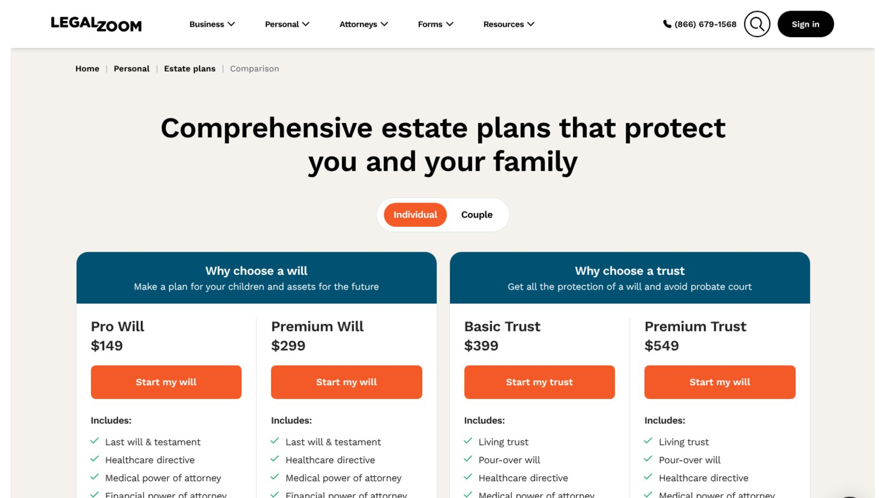

# LegalZoom Review: Actual Costs, Add-ons, and Who Should Use It

This LegalZoom review finds a legitimate document and filing service whose $0 LLC package genuinely cuts preparation costs, but whose paid plans and trials need close reading. The best reason to choose LegalZoom is convenience across several legal tasks. The biggest risk is missing a renewal attached to a trial or membership.

We checked current public pricing and kept government fees separate from LegalZoom's own charges.

No company paid to be included. We checked every price against LegalZoom's official pages on November 8, 2026, and we didn't buy an account. This is general information, not legal or tax advice.

## Key Takeaways

- **Basic LLC Is $0:** It covers filing your articles, but the state fee is extra.
- **Pro Adds a Monthly Trial:** The Business Attorney Plan renews at $49 a month after 30 days.
- **The Agent Costs $249 a Year:** That's well above several competitors.
- **Wills Start at $149:** Trusts start at $399, with attorney plans that renew.
- **EINs Are Free Elsewhere:** The IRS issues EINs at no cost.

## LegalZoom Review Verdict

LegalZoom fits owners who want formation, documents, and optional attorney access from one company. It also suits consumers who want a guided will or trust workflow.

Cost-focused LLC owners may prefer filing directly with the state, and the IRS issues EINs for free. LegalZoom doesn't replace individual legal advice for complex ownership, tax, family, or estate issues.

## LegalZoom Pricing Snapshot

These prices were checked on November 8, 2026. Temporary promotions can change your checkout total.

| Product | Published Price | Renewal or Extra Cost |
|---|---:|---|
| LLC Basic | $0 plus state fees | Optional products |
| LLC Pro | $249 plus state fees | Attorney plan renews at $49 a month after 30 days |
| LLC Premium | $299 plus state fees | Bookkeeping renews at $9.99 a month after 6 months |
| Registered agent | $249 a year | Renews yearly |
| Pro Will | $149 | Attorney plan renews at $25 a month after 30 days |
| Premium Will | $299 | Attorney plan continues at $199 a year |
| Basic Trust | $399 | Revisions for 30 days |
| Premium Trust | $549 | Attorney plan continues at $199 a year |

Sources are LegalZoom's [LLC plans page](https://www.legalzoom.com/business/business-formation/llc-overview.html) and its [estate plan comparison](https://www.legalzoom.com/personal/estate-planning/compare.html).

## What LegalZoom Sells

LegalZoom sells filing, document, subscription, and attorney-support products well beyond LLC formation. Its catalog includes:

- **Business Formation:** LLCs and other entities.
- **Registered Agent Service:** Yearly, nationwide.
- **Business Documents:** Contracts and forms.
- **Attorney Plans:** Consultation memberships.
- **Estate Plans:** Wills and living trusts.
- **Business Tools:** Bookkeeping and invoicing.

Each product has its own terms and renewal rules, so a good experience with one doesn't prove value in another.

## LegalZoom LLC Formation Review

LegalZoom offers Basic, Pro, and Premium LLC packages, all excluding the state fee.

### Basic

Basic costs $0 and files only your articles of organization, with a name check service. It suits owners who just want filing help, but it doesn't include an operating agreement or EIN.

### Pro

Pro costs $249 and adds an operating agreement, an EIN, and 30 days of unlimited 30-minute attorney consultations on new business topics. LegalZoom says your card will then be charged $49, and the plan renews monthly until you cancel online or by phone.

### Premium

Premium costs $299 and adds bookkeeping tools for 6 months, plus unlimited proposals and invoices. LegalZoom says bookkeeping then auto-renews at $9.99 a month unless canceled.

## What an LLC Order Can Cost

The package price leaves out the state fee, and a registered agent adds another yearly charge. Here is our arithmetic for an owner who picks Pro and LegalZoom's agent.

| Item | Year 1 | Year 2 |
|---|---:|---:|
| Pro package | $249 | $0 |
| Registered agent | $249 | $249 |
| Attorney plan, if kept | 11 × $49 = $539 | 12 × $49 = $588 |
| Total with attorney plan | $1,037 | $837 |
| Total without attorney plan | $498 | $249 |

This is our calculation, not a quote, and it excludes the state fee. Keeping the attorney plan more than doubles the bill, so decide before the 30 days end.

Use this checkout audit:

1. Record the package price.
2. Add the state fee.
3. Add optional services.
4. Mark every trial end date.
5. Work out the second-year cost.

## Registered Agent Service Review

LegalZoom's [registered agent page](https://www.legalzoom.com/business/business-operations/registered-agent-overview.html/) lists the service at $249 a year. It sends an alert as soon as official mail arrives and emails reminders about annual report deadlines.

The page also says LegalZoom completes all the paperwork to switch agents and covers the state fees. Its price is higher than many competitors: Northwest lists $125 a year, and Harbor Compliance lists $99 for the first year, then $159. Compare delivery speed, support, and cancellation, not just price.

## EIN Service Value

LegalZoom includes EIN service in Pro and Premium, which saves a step for owners who want one workflow. But the IRS says its online tool lets you get an EIN directly from the IRS in minutes for free.

Don't pay just because a page suggests an EIN needs a service. The fee buys preparation help, not the federal number.

## LegalZoom Estate Planning Review

LegalZoom sells two will plans and two trust plans. Its list prices sit below Trust & Will's individual starting prices.

### Wills

Pro Will costs $149 and includes a will, a healthcare directive, medical and financial powers of attorney, a HIPAA authorization, storage, and one printed set. It includes 30 days of attorney consultations and revisions, then the attorney plan renews at $25 a month unless canceled. Premium Will costs $299 and adds a year of attorney access that continues at $199 a year.

### Trusts

Basic Trust costs $399 and includes a living trust, a pour-over will, directives, powers of attorney, a certificate of trust, a schedule of assets, and a bill of transfer, with 30 days of revisions. Premium Trust costs $549 and adds a year of attorney consultations that continue at $199 a year.

LegalZoom's terms limit each consultation to half an hour, one per new legal matter. Don't treat the plan as full legal representation.

## Where LegalZoom Provides Value

LegalZoom's main advantage is breadth. One account can hold formation records, legal documents, and estate plans, and its current product pages disclose recurring prices clearly in the fine print.

The service also reduces form work and gives nervous filers a guided path. For someone who has never filed with a state agency, a step-by-step questionnaire can prevent simple mistakes, such as a missing name designation or a registered agent who hasn't agreed to serve.

## LegalZoom Limitations

LegalZoom's broad catalog means several buying decisions, and the cheapest plan rarely includes everything shown across the site. Watch for these limits:

- **State Fees Are Separate:** No package covers them.
- **Speed Isn't Approval:** Provider handling doesn't control the state's review.
- **Trials Renew:** Included subscriptions bill unless canceled.
- **EINs Are Free:** The IRS charges nothing.
- **Templates Have Limits:** They can't assess every legal risk.
- **Trusts Need Funding:** Documents still need proper signing and asset transfers.

These are product boundaries, not accusations, and they should shape your decision.

## How LegalZoom Compares on Price

A LegalZoom review needs a price yardstick. Here are published rates from competitors, checked the same day.

| Product | LegalZoom | Closest Competitor Rates |
|---|---:|---|
| Paid formation package with EIN and agreement | $249 (Pro) | ZenBusiness Pro $199 |
| Registered agent, yearly | $249 | ZenBusiness $199, Bizee $149, Northwest $125, MyCompanyWorks $119 |
| Individual will | $149 (Pro Will) | Trust & Will $199 |
| Individual trust | $399 (Basic Trust) | Trust & Will $499 |

The pattern is clear. LegalZoom costs more for business formation and agent service, but less for entry-level estate plans. That makes it easier to recommend for wills than for registered agent service.

## Which LegalZoom Product Is Easiest to Justify?

Not every LegalZoom product offers the same value.

### Easiest to Justify

Basic LLC formation has clear value when you want filing help, since it removes the preparation fee while leaving the state fee visible. The entry-level will and trust plans are also priced below Trust & Will's.

### Hardest to Justify

Registered agent service is hard to justify on price alone, because several competitors publish lower yearly rates. The attorney plan is worth keeping only if you'll call an attorney often enough to beat $49 a month.

## Questions to Ask Before Checkout

Before you pay, answer these questions honestly:

1. Will I call an attorney in the first 30 days, or should I cancel the plan right away?
2. Do I already have a registered agent, or a cheaper one in mind?
3. Do I need the EIN service, or can I apply on the IRS site myself?
4. Will I use bookkeeping after the free 6 months on Premium?
5. Is my situation simple enough for templates?

Write the cancellation dates in your calendar before you leave the checkout page, and save a screenshot of your final cart.

## Is LegalZoom Legitimate?

Yes, LegalZoom is an established company with active consumer and business products. But legitimacy isn't the useful question for this LegalZoom review.

The better question is whether a specific product fits your task. A $0 filing, an attorney subscription, and a living trust solve different problems. Judge each by scope, current price, renewal, and support, and don't treat star ratings as proof of a legal outcome.

## What Most LegalZoom Reviews Miss

Many reviews put one-time and recurring products in a single price column, which makes the true cost hard to judge. Others list features as included without naming the package, even though LegalZoom places several features behind Pro, Premium, or a subscription.

A useful LegalZoom review treats each product separately and prices the second year. That's the approach we took above, and it's the check we suggest you run on any provider before you buy.

## Current Federal Compliance Note

Formation content published before August 2026 may tell domestic LLCs to file BOI reports. FinCEN's guidance, updated August 11, 2026, says U.S. companies are now exempt.

Certain foreign companies registered in the United States may still report.

## Who Should Use LegalZoom?

LegalZoom may suit these users:

- **Guided Filers:** Owners who want help with state forms.
- **Multi-Service Buyers:** People who'll use several legal products.
- **Attorney Seekers:** Consumers who value optional consultations.
- **Renewal Trackers:** Buyers who will cancel trials on time.
- **Simple Estates:** Straightforward will or trust users.

Direct filing may suit owners who only need the state document, and a lawyer may suit people with higher legal complexity.

## Compare Before You Buy

Every LegalZoom review should be read next to a rival's. Our [ZenBusiness review](/legal-business/zenbusiness-review/) applies the same renewal checks to LegalZoom's closest formation competitor, and our comparison of [LLC formation services](/legal-business/best-llc-formation-services/) prices seven providers side by side.

## Frequently Asked Questions

### Is LegalZoom Free for an LLC?

Basic charges $0 for LegalZoom's filing service, but the state fee still applies and optional products cost extra.

### How Much Is LegalZoom's Registered Agent Service?

LegalZoom lists it at $249 a year, renewing yearly. Check the cancellation deadline before ordering.

### Can I Cancel a LegalZoom Subscription?

LegalZoom's pages say its attorney and bookkeeping subscriptions can be canceled online or by phone. Check your account for the exact steps.

### Does LegalZoom Give Legal Advice?

Some plans include short attorney consultations, but the filing service itself isn't representation. Read the consultation scope and terms.

### What Does This LegalZoom Review Recommend for a Living Trust?

It may suit a straightforward plan with careful signing and funding. Complex families, assets, or tax issues call for an attorney, as this LegalZoom review explains above.

## Resources

- [LegalZoom living trust plans](https://www.legalzoom.com/personal/estate-planning/living-trust-overview.html)
- [IRS: Get an EIN](https://www.irs.gov/businesses/small-businesses-self-employed/get-an-employer-identification-number)
- [FinCEN BOI reporting](https://www.fincen.gov/boi)
