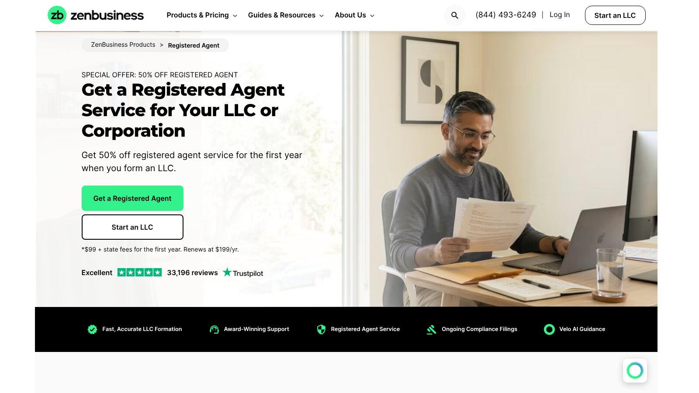

# ZenBusiness Reviews: Plans, Renewal Costs, and Best Fit

Most ZenBusiness reviews stop at the $0 headline. Ours finds a credible formation service whose $0 Starter package is a real option, whose Pro plan is the best value of its three packages, and whose renewals and preselected trials need watching.

ZenBusiness suits owners who want a guided formation dashboard. Buyers still need to track yearly renewals and optional subscriptions.

No company paid to be included. We checked every price against ZenBusiness's official pages on November 8, 2026, and we didn't buy an account. This is general information, not legal or tax advice.

## Key Takeaways

- **Starter Is $0:** It covers filing, but the state fee and add-ons cost extra.
- **Pro Is the Best Value:** At $199 it includes the EIN and agreement that cost $99 each on Starter.
- **Several Things Renew:** Pro renews at $199, and Starter's free compliance year renews at $199 too.
- **Watch the Website Trial:** Starter preselects a builder that renews at $15 a month unless you remove it.
- **The Agent Is $99, Then $199:** The first-year discount applies only with formation.

## ZenBusiness Review Verdict

ZenBusiness is a strong pick for owners who value a guided workflow, and Pro offers the best balance among its packages. Starter suits owners willing to handle an EIN and operating agreement separately, and Premium makes sense only if the extra digital tools have real value to you.

Direct state filing stays cheaper for many simple LLCs. A formation company doesn't decide whether an LLC fits your legal or tax situation.

## ZenBusiness Pricing Snapshot

These prices were checked on November 8, 2026, on the [ZenBusiness formation pricing page](https://www.zenbusiness.com/pricing-formation-plans/). State fees are separate.

| Product | Published Price | Renewal or Extra Cost |
|---|---:|---|
| Starter | $0 plus state fees | Free compliance year renews at $199 |
| Pro | $199 plus state fees | Renews at $199 a year |
| Premium | $299 plus state fees | Renews at $299 a year |
| Registered agent | $99 first year with formation | Renews at $199 a year |
| EIN on Starter | $99 | Included in Pro and Premium |
| Operating agreement on Starter | $99 | Included in Pro and Premium |
| Rush processing on Starter | $79 | One time |
| Website builder trial | Free for 30 days | Renews at $15 a month |
| Money Pro bookkeeping | Add-on on Pro and Premium | $30 a month |

## Starter Review

Starter costs $0 plus state fees. It includes a name search, filing of your articles of organization, document access, a dashboard with unlimited storage, and one free year of Worry-Free Compliance.

Standard processing takes 7 to 10 business days, or you can add rush processing for $79. The EIN and operating agreement are $99 add-ons each.

The pricing page says Starter includes a 30-day free trial of the AI website builder, which is preselected at checkout and renews at $15 a month. You can remove it before you buy, so check your cart.

## Pro Review

Pro costs $199 plus state fees and renews at $199 a year. It adds 1-day processing, Worry-Free Compliance included outright, an operating agreement template, and an EIN.

Pro is the clearest value for a buyer who wants both documents. Buying the two $99 Starter add-ons would cost $198, almost the same as Pro. One-day processing refers to ZenBusiness's handling, not state approval.

### When Pro Costs Less Than Starter Add-Ons

The comparison favors Pro in year one, since it bundles both documents plus faster handling for $1 more than the add-ons. It changes after renewal, because Pro bills $199 every year while the add-ons are one-time charges.

### What You Keep Paying For

After year one, Pro's renewal mainly pays for ongoing compliance features. Decide whether you still need them, or move to Starter-level service.

## Premium Review

Premium costs $299 plus state fees and renews at $299 a year. It adds a domain name with privacy, a business email address, a business documents library, Advanced Compliance Protection, and a business advisor consultation.

Premium is hard to justify if you already have email, a domain, and document tools. It makes more sense for a brand-new owner who wants a professional email address and an online presence set up in the same order as the LLC. Compare the renewal with standalone alternatives.

## Registered Agent Service Review

The [ZenBusiness registered agent page](https://www.zenbusiness.com/registered-agent/) offers the service for $99 for the first year when you form an LLC, then $199 a year. The price includes document receipt, secure digital delivery, and notifications.

The renewal should drive your comparison, since a discounted first year can hide a higher three-year total. Northwest lists $125 a year, InCorp $129, and Harbor Compliance $99 for the first year, then $159.

## A Practical First-Year Basket

Assume you want formation, an EIN, an operating agreement, and a professional registered agent. Here is our arithmetic.

| Item | Year 1 | Year 2 |
|---|---:|---:|
| Pro package | $199 | $199 |
| Registered agent | $99 | $199 |
| Provider total | $298 | $398 |

This is our calculation, not a quote, and it excludes the state fee. If you keep both services, the second year costs $398 before any other subscription.

## How ZenBusiness Compares on Price

Good ZenBusiness reviews measure it against rivals. Here are competitors' published rates, checked the same day.

| Product | ZenBusiness | Other Published Rates |
|---|---:|---|
| Paid package with EIN and agreement | $199 (Pro) | LegalZoom Pro $249 |
| Entry formation package | $0 (Starter) | Bizee $0, LegalZoom $0, Northwest $39 |
| Registered agent, yearly after year one | $199 | LegalZoom $249, Bizee $149, Northwest $125, MyCompanyWorks $119 |

ZenBusiness sits in the middle on formation and toward the high end on registered agent renewals. Its strongest price advantage is Pro against LegalZoom Pro.

## A Three-Year Outlook

Here is our arithmetic for the same basket over three years, under two choices.

| Scenario | Year 1 | Year 2 | Year 3 | Total |
|---|---:|---:|---:|---:|
| Keep Pro and the agent | $298 | $398 | $398 | $1,094 |
| Drop Pro after year one, keep the agent | $298 | $199 | $199 | $696 |

This is our calculation, not a quote. Dropping Pro after formation saves almost $400 over three years, so decide early whether you'll use its ongoing compliance features. You could also switch to a cheaper agent to save more.

## Questions to Ask Before Checkout

A few honest answers settle most ZenBusiness decisions:

1. Do I want both the EIN and the agreement? If yes, Pro beats Starter add-ons.
2. Will I use compliance tools after year one, or will I drop Pro?
3. Do I already have a registered agent, or a cheaper one in mind?
4. Did I remove the preselected website trial?
5. Do I need Premium's domain and email, or do I already have them?

## EIN Service Review

ZenBusiness includes an EIN in Pro and Premium, and Starter buyers can add it for $99. The [IRS says](https://www.irs.gov/businesses/small-businesses-self-employed/get-an-employer-identification-number) its online tool lets you get an EIN directly from the IRS in minutes for free.

ZenBusiness sells convenience and preparation, not access to a number you can't get elsewhere. International applicants may need a different IRS process.

## Processing Times

ZenBusiness publishes 7 to 10 business days for Starter and 1-day processing for Pro. Provider processing and state processing are separate, and a state backlog can stretch the total.

Check your state's current service before buying a faster package. Wyoming says online filings are active as soon as filing completes, and Florida says online documents may take two to three days under its current workload.

## Subscription Checks

ZenBusiness lists the website builder trial across its packages and Money Pro bookkeeping at $30 a month on Pro and Premium. Remove any preselected tools you don't want.

Before paying, write down:

1. The trial end date.
2. The renewal amount.
3. The billing frequency.
4. How to cancel.
5. What happens to your data after you cancel.

A screenshot of your final cart can help settle later billing questions.

## Worry-Free Compliance Explained

Worry-Free Compliance is the ZenBusiness service that appears in every package. Starter includes it free for the first year, then it renews at $199 a year. Pro includes it outright for as long as Pro is active, and Premium adds Advanced Compliance Protection.

For many owners, this is the deciding factor in ZenBusiness reviews. If you're comfortable tracking your own state deadlines, you may not need it after year one. If you'd rather hand that job off, it's the main reason to keep paying ZenBusiness after formation.

Ask whether the service files your annual report and pays the state fee, or only reminds you. In a state like Florida, where a late report adds $400, that difference can matter more than the subscription price.

## Compliance Claims and BOI Rules

ZenBusiness sells compliance tools that help track deadlines, but you keep the legal responsibility.

FinCEN's guidance, updated August 11, 2026, says U.S. companies are exempt from beneficial ownership information reporting. Certain foreign companies registered in the United States may still have duties.

## Where ZenBusiness Provides Value

ZenBusiness puts formation steps in one account, and its three-package structure is easy to compare. Pro bundles two common purchases, which suits owners who want both an EIN service and an agreement. The dashboard also helps people who dislike state forms.

## ZenBusiness Limitations

The $0 headline doesn't include government fees, and Starter add-ons can raise the cost quickly. Other limits to weigh:

- **Paid Packages Renew:** Pro and Premium bill every year.
- **The Agent Costs Extra:** $199 a year after the first.
- **Speed Isn't Approval:** The state still reviews your filing.
- **EINs Are Free:** The IRS charges nothing.
- **Trials Renew Monthly:** Website and bookkeeping tools bill monthly.
- **No Legal Advice:** Filing doesn't replace a lawyer or tax professional.

These limits are common in the industry, but they still belong in your decision.

## Who Should Use ZenBusiness?

ZenBusiness may suit:

- **First-Time Filers:** People who want a guided process.
- **Compliance-Minded Owners:** Those who want formation and reminders together.
- **Dashboard Fans:** Buyers who value one account.
- **Renewal Trackers:** Owners willing to review renewals each year.
- **Document Seekers:** Users who want an agreement and EIN filed for them.

Direct state filing may suit an owner with a simple structure, and an attorney may suit multi-owner, regulated, or investor-backed companies.

## What Most ZenBusiness Reviews Miss

Many ZenBusiness reviews repeat the $0 price without building a realistic basket. Others treat 1-day provider processing as complete formation, or never mention the preselected website trial.

Better ZenBusiness reviews separate state time from provider time and add up recurring charges before naming a winner. The most useful number is the cost over the first two years.

## Compare Before You Buy

Our full comparison of [LLC formation services](/legal-business/best-llc-formation-services/) puts ZenBusiness beside six rivals. Since the agent fee is the cost you'll pay every year, the comparison of [registered agent services](/legal-business/best-registered-agent-services/) compares eight providers over three years.

## Frequently Asked Questions

### Is ZenBusiness Really Free?

Starter charges $0 for ZenBusiness's formation service, but the state fee still applies and add-ons cost extra.

### Does ZenBusiness Renew Automatically?

Pro and Premium renew yearly, Starter's free compliance year renews at $199, and the registered agent and trials renew too. Check your cart and billing settings.

### How Much Is ZenBusiness Registered Agent Service?

It's $99 for the first year when you form an LLC, then $199 a year.

### Can I Get an EIN Without ZenBusiness?

Yes. Eligible applicants can get an EIN directly from the IRS for free.

### What Do ZenBusiness Reviews Say About Legal Advice?

ZenBusiness reviews agree it's a formation and business services company, not a law firm. Its filing service doesn't replace a lawyer or tax professional.

## Resources

- [ZenBusiness product pricing](https://www.zenbusiness.com/pricing-products/)
- [FinCEN BOI reporting](https://www.fincen.gov/boi)
- [Wyoming business FAQs](https://sos.wyo.gov/faqs.aspx?root=BUS)
- [Florida online filing notice](https://efile.sunbiz.org/disclaimer.html)
